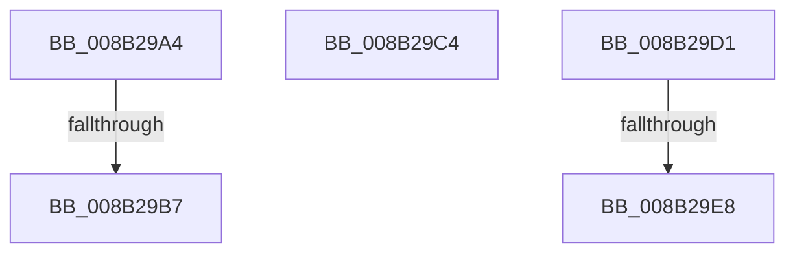

# sub_008B29A4

- RVA: `0x008B29A4`–`0x008B29EF` (길이 `75` bytes)
- VA: `0x00000001408B29A4`
- 실행 섹션: `PAGE`
- PDB 이름 있음: `아니요`; PDB Function 태그: `아니요`
- unwind 정보 RVA: `0x00082698`
- 디코드: `17`개 명령, `75/75` bytes 표시
- 미해석 바이트: `0` (있으면 어셈블리에 `.byte`로 보존)

> 이 문서는 커널 이미지의 기계어와 PDB 기호를 분석해 생성했습니다. 4번과 5번은 함수 원형과 자료형을 바이너리 사용 방식에서 추정한 C 해석이며 원본 소스 복구 결과는 아닙니다.

## 1. Dependencies

- 직접 호출 지점: **0**; 고유 호출 대상: **0**
- 직접 호출자로 확인된 함수: **0**
- RIP 상대 이미지 참조: **1**

### Outgoing calls
- 직접 디코드된 call 명령이 없습니다.

### Direct callers
- 이 함수 시작 RVA로 연결되는 직접 call은 확인되지 않았습니다. 간접 호출은 완전히 역산할 수 없습니다.

### Static image references
- `0x008B29D1` → RVA `0x00E09F70` (`.data`; read)

## 2. Other-region calls and transfers

- 다른 실행 섹션으로 향하는 call: **0**
- call이 아닌 외부 분기/꼬리 이동: **5**
  - `0x008B29B1` → [CmpBounceContextStart + 0x46](CmpBounceContextStart_function_008B27F0.md) (`tail-transfer`)
  - `0x008B29BF` → [sub_008B2872](Unknown_function_008B2872.md) (`tail-transfer`)
  - `0x008B29CC` → [sub_008B2872](Unknown_function_008B2872.md) (`tail-transfer`)
  - `0x008B29E2` → [sub_008B28C6 + 0xD](Unknown_function_008B28C6.md) (`tail-transfer`)
  - `0x008B29EA` → [sub_008B28C6 + 0xF](Unknown_function_008B28C6.md) (`tail-transfer`)

## 3. Assembly (complete function range)

```asm
008B29A4  48 B8 FF FF FE FF FF 7F 00 00   movabs rax, 0x7ffffffeffff
008B29AE  48 3B D0                        cmp rdx, rax
008B29B1  0F 86 7F FE FF FF               jbe 0x1408b2836
008B29B7  33 ED                           xor ebp, ebp
008B29B9  48 89 51 08                     mov qword ptr [rcx + 8], rdx
008B29BD  8B C5                           mov eax, ebp
008B29BF  E9 AE FE FF FF                  jmp 0x1408b2872
008B29C4  33 ED                           xor ebp, ebp
008B29C6  48 89 69 08                     mov qword ptr [rcx + 8], rbp
008B29CA  8B C5                           mov eax, ebp
008B29CC  E9 A1 FE FF FF                  jmp 0x1408b2872
008B29D1  48 8B 05 98 75 55 00            mov rax, qword ptr [rip + 0x557598]
008B29D8  83 E0 04                        and eax, 4
008B29DB  48 3B 05 8E 75 55 00            cmp rax, qword ptr [rip + 0x55758e]
008B29E2  0F 85 EB FE FF FF               jne 0x1408b28d3
008B29E8  B0 01                           mov al, 1
008B29EA  E9 E6 FE FF FF                  jmp 0x1408b28d5
```

## 4. C-style interpretation (structured pseudocode)

```c
__int64 __fastcall sub_008B29A4(__int64 a1, __int64 a2)
{
    __int64 v_rbp;

    v_rbp = 0;
    *(unsigned __int64 *)(a1 + 8) = a2;
}
```

## 5. (Beta) C Style

```c
int64_t sub_008B29A4(void *Arg1, int64_t Arg2)
{
    uint8_t *arg1 = (uint8_t *)Arg1;

    int64_t local_rbp;

    local_rbp = 0;
    *(uint64_t *)(arg1 + 0x8) = Arg2;
}
```

### 관측된 메모리 오프셋

구조체 형식이 확인되지 않은 접근은 인자 기준의 오프셋으로만 기록했습니다.

| 기준 인자 | 오프셋 표현 | 폭 (bit) | 접근 |
|---|---:|---:|---|
| `Arg1` | `+ 0x8` | `64` | `W` |

## 6. Execution-region graph

[열기: 2D/3D 그래프와 함수 탐색 컨트롤 패널](../../../control-panel.html?section=page&rva=0x008B29A4&view=graph)

- 2D 그래프는 위에서 아래로 흐르고, 3D 그래프는 빈 공간을 드래그해 회전합니다. Shift+드래그는 이동, 휠은 확대·축소, 함수 노드 선택은 대상 보고서 이동입니다.

### Static fallback


