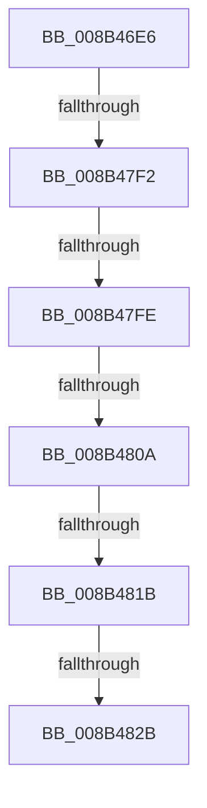

# sub_008B46E6

- RVA: `0x008B46E6`–`0x008B4839` (길이 `339` bytes)
- VA: `0x00000001408B46E6`
- 실행 섹션: `PAGE`
- PDB 이름 있음: `아니요`; PDB Function 태그: `아니요`
- unwind 정보 RVA: `0x000827E4`
- 디코드: `70`개 명령, `339/339` bytes 표시
- 미해석 바이트: `0` (있으면 어셈블리에 `.byte`로 보존)

> 이 문서는 커널 이미지의 기계어와 PDB 기호를 분석해 생성했습니다. 4번과 5번은 함수 원형과 자료형을 바이너리 사용 방식에서 추정한 C 해석이며 원본 소스 복구 결과는 아닙니다.

## 1. Dependencies

- 직접 호출 지점: **5**; 고유 호출 대상: **3**
- 직접 호출자로 확인된 함수: **0**
- RIP 상대 이미지 참조: **1**

### Outgoing calls
- `0x008B4720` → [memset](../../text/6C/memset_function_006C6C40.md) (function, `0x006C6C40`)
- `0x008B4734` → [memset](../../text/6C/memset_function_006C6C40.md) (function, `0x006C6C40`)
- `0x008B474D` → [RtlInitUnicodeString](../../text/42/RtlInitUnicodeString_function_0042A780.md) (function, `0x0042A780`)
- `0x008B477E` → [memset](../../text/6C/memset_function_006C6C40.md) (function, `0x006C6C40`)
- `0x008B481E` → [CmpIsKcbInsideVirtualizedHive](CmpIsKcbInsideVirtualizedHive_function_008B4E70.md) (function, `0x008B4E70`)

### Direct callers
- 이 함수 시작 RVA로 연결되는 직접 call은 확인되지 않았습니다. 간접 호출은 완전히 역산할 수 없습니다.

### Static image references
- `0x008B47FE` → RVA `0x00E0ECA0` (`.data`; read)

## 2. Other-region calls and transfers

- 다른 실행 섹션으로 향하는 call: **4**
  - `0x008B4720` → [memset](../../text/6C/memset_function_006C6C40.md) (`PAGE` → `.text`)
  - `0x008B4734` → [memset](../../text/6C/memset_function_006C6C40.md) (`PAGE` → `.text`)
  - `0x008B474D` → [RtlInitUnicodeString](../../text/42/RtlInitUnicodeString_function_0042A780.md) (`PAGE` → `.text`)
  - `0x008B477E` → [memset](../../text/6C/memset_function_006C6C40.md) (`PAGE` → `.text`)
- call이 아닌 외부 분기/꼬리 이동: **5**
  - `0x008B47EC` → [sub_008B4C99](Unknown_function_008B4C99.md) (`tail-transfer`)
  - `0x008B47F8` → [sub_008B4C99](Unknown_function_008B4C99.md) (`tail-transfer`)
  - `0x008B4804` → [sub_008B4C99](Unknown_function_008B4C99.md) (`tail-transfer`)
  - `0x008B4815` → [sub_008B4A26](Unknown_function_008B4A26.md) (`tail-transfer`)
  - `0x008B4825` → [sub_008B4A26](Unknown_function_008B4A26.md) (`tail-transfer`)

## 3. Assembly (complete function range)

```asm
008B46E6  4D 89 63 10                     mov qword ptr [r11 + 0x10], r12
008B46EA  48 8B F1                        mov rsi, rcx
008B46ED  44 89 44 24 54                  mov dword ptr [rsp + 0x54], r8d
008B46F2  0F 57 C0                        xorps xmm0, xmm0
008B46F5  88 54 24 41                     mov byte ptr [rsp + 0x41], dl
008B46F9  41 B8 A0 00 00 00               mov r8d, 0xa0
008B46FF  48 89 4C 24 78                  mov qword ptr [rsp + 0x78], rcx
008B4704  33 D2                           xor edx, edx
008B4706  4D 89 6B D8                     mov qword ptr [r11 - 0x28], r13
008B470A  48 8D 8D F0 01 00 00            lea rcx, [rbp + 0x1f0]
008B4711  4D 89 7B C8                     mov qword ptr [r11 - 0x38], r15
008B4715  49 8B F9                        mov rdi, r9
008B4718  0F 11 45 88                     movups xmmword ptr [rbp - 0x78], xmm0
008B471C  4C 89 4D 80                     mov qword ptr [rbp - 0x80], r9
008B4720  E8 1B 25 E1 FF                  call 0x1406c6c40
008B4725  33 D2                           xor edx, edx
008B4727  48 8D 8D 90 02 00 00            lea rcx, [rbp + 0x290]
008B472E  41 B8 E0 00 00 00               mov r8d, 0xe0
008B4734  E8 07 25 E1 FF                  call 0x1406c6c40
008B4739  33 C0                           xor eax, eax
008B473B  48 8D 4D 88                     lea rcx, [rbp - 0x78]
008B473F  33 DB                           xor ebx, ebx
008B4741  88 44 24 42                     mov byte ptr [rsp + 0x42], al
008B4745  33 D2                           xor edx, edx
008B4747  89 5D A4                        mov dword ptr [rbp - 0x5c], ebx
008B474A  89 5D BC                        mov dword ptr [rbp - 0x44], ebx
008B474D  E8 2E 60 B7 FF                  call 0x14042a780
008B4752  4C 8B 2E                        mov r13, qword ptr [rsi]
008B4755  48 8D 4D F0                     lea rcx, [rbp - 0x10]
008B4759  0F 57 C0                        xorps xmm0, xmm0
008B475C  48 89 5C 24 48                  mov qword ptr [rsp + 0x48], rbx
008B4761  33 D2                           xor edx, edx
008B4763  41 B8 D0 01 00 00               mov r8d, 0x1d0
008B4769  0F 11 85 C0 01 00 00            movups xmmword ptr [rbp + 0x1c0], xmm0
008B4770  0F 11 85 D0 01 00 00            movups xmmword ptr [rbp + 0x1d0], xmm0
008B4777  0F 11 85 E0 01 00 00            movups xmmword ptr [rbp + 0x1e0], xmm0
008B477E  E8 BD 24 E1 FF                  call 0x1406c6c40
008B4783  0F 57 C0                        xorps xmm0, xmm0
008B4786  C7 45 50 FF FF FF FF            mov dword ptr [rbp + 0x50], 0xffffffff
008B478D  0F 11 85 80 00 00 00            movups xmmword ptr [rbp + 0x80], xmm0
008B4794  48 8D 85 80 00 00 00            lea rax, [rbp + 0x80]
008B479B  48 89 1F                        mov qword ptr [rdi], rbx
008B479E  48 89 85 88 00 00 00            mov qword ptr [rbp + 0x88], rax
008B47A5  45 32 E4                        xor r12b, r12b
008B47A8  0F 11 85 70 01 00 00            movups xmmword ptr [rbp + 0x170], xmm0
008B47AF  48 8D 85 80 00 00 00            lea rax, [rbp + 0x80]
008B47B6  88 5C 24 40                     mov byte ptr [rsp + 0x40], bl
008B47BA  48 89 85 80 00 00 00            mov qword ptr [rbp + 0x80], rax
008B47C1  0F 11 85 80 01 00 00            movups xmmword ptr [rbp + 0x180], xmm0
008B47C8  0F 11 85 90 01 00 00            movups xmmword ptr [rbp + 0x190], xmm0
008B47CF  0F 11 85 A0 01 00 00            movups xmmword ptr [rbp + 0x1a0], xmm0
008B47D6  0F 11 85 B0 01 00 00            movups xmmword ptr [rbp + 0x1b0], xmm0
008B47DD  4D 8B 7D 08                     mov r15, qword ptr [r13 + 8]
008B47E1  F3 0F 7F 44 24 60               movdqu xmmword ptr [rsp + 0x60], xmm0
008B47E7  66 41 39 5F 42                  cmp word ptr [r15 + 0x42], bx
008B47EC  0F 85 A7 04 00 00               jne 0x1408b4c99
008B47F2  41 8B 45 30                     mov eax, dword ptr [r13 + 0x30]
008B47F6  A8 10                           test al, 0x10
008B47F8  0F 85 9B 04 00 00               jne 0x1408b4c99
008B47FE  38 1D 9C A4 55 00               cmp byte ptr [rip + 0x55a49c], bl
008B4804  0F 84 8F 04 00 00               je 0x1408b4c99
008B480A  41 8B 97 B8 00 00 00            mov edx, dword ptr [r15 + 0xb8]
008B4811  0F BA E2 19                     bt edx, 0x19
008B4815  0F 82 0B 02 00 00               jb 0x1408b4a26
008B481B  49 8B CF                        mov rcx, r15
008B481E  E8 4D 06 00 00                  call 0x1408b4e70
008B4823  84 C0                           test al, al
008B4825  0F 84 FB 01 00 00               je 0x1408b4a26
008B482B  C6 44 24 40 01                  mov byte ptr [rsp + 0x40], 1
008B4830  65 48 8B 3C 25 88 01 00 00      mov rdi, qword ptr gs:[0x188]
```

## 4. C-style interpretation (structured pseudocode)

```c
__int64 __fastcall sub_008B46E6(__int64 a1, int a2, int a3, __int64 a4)
{
    __int64 result;
    __int64 v_r12;
    __int64 v_rbx;
    unsigned __int8 v_stack_p40;
    unsigned __int8 v_stack_p41;
    unsigned __int8 v_stack_p42;
    unsigned __int64 v_stack_p48;
    unsigned int v_stack_p54;
    unsigned __int64 v_stack_p60;
    unsigned __int64 v_stack_p78;

    *(unsigned __int64 *)(v_r11 + 16) = v_r12;
    v_stack_p54 = a3;
    v_stack_p41 = (unsigned __int8)(a2);
    v_stack_p78 = a1;
    a2 = 0;
    *(unsigned __int64 *)(v_r11 - 40) = v_r13;
    *(unsigned __int64 *)(v_r11 - 56) = v_r15;
    *(unsigned __int64 *)(v_rbp - 120) = v_xmm0;
    *(unsigned __int64 *)(v_rbp - 128) = a4;
    result = memset(v_rbp + 496, a2, 160, a4);
    a2 = 0;
    result = memset(v_rbp + 656, a2, 224, a4);
    result = 0;
    v_rbx = 0;
    v_stack_p42 = 0;
    a2 = 0;
    *(unsigned int *)(v_rbp - 92) = 0;
    *(unsigned int *)(v_rbp - 68) = 0;
    result = RtlInitUnicodeString(v_rbp - 120, a2, 224, a4);
    v_stack_p48 = 0;
    a2 = 0;
    *(unsigned __int64 *)(v_rbp + 448) = v_xmm0;
    *(unsigned __int64 *)(v_rbp + 464) = v_xmm0;
    *(unsigned __int64 *)(v_rbp + 480) = v_xmm0;
    result = memset(v_rbp - 16, a2, 464, a4);
    *(unsigned int *)(v_rbp + 80) = 0xFFFFFFFFULL;
    *(unsigned __int64 *)(v_rbp + 128) = v_xmm0;
    *(unsigned __int64 *)(a4) = 0;
    *(unsigned __int64 *)(v_rbp + 136) = v_rbp + 128;
    v_r12 = 0;
    *(unsigned __int64 *)(v_rbp + 368) = v_xmm0;
    v_stack_p40 = 0;
    *(unsigned __int64 *)(v_rbp + 128) = v_rbp + 128;
    *(unsigned __int64 *)(v_rbp + 384) = v_xmm0;
    *(unsigned __int64 *)(v_rbp + 400) = v_xmm0;
    *(unsigned __int64 *)(v_rbp + 416) = v_xmm0;
    *(unsigned __int64 *)(v_rbp + 432) = v_xmm0;
    v_stack_p60 = v_xmm0;
    result = CmpIsKcbInsideVirtualizedHive(*(unsigned __int64 *)(*(unsigned __int64 *)(a1) + 8), (unsigned int)(*(unsigned int *)(*(unsigned __int64 *)(*(unsigned __int64 *)(a1) + 8) + 184)), 464, a4);
    v_stack_p40 = 1;
    return result;
}
```

## 5. (Beta) C Style

```c
int64_t sub_008B46E6(void *Arg1, int32_t Arg2, int32_t Arg3, void *Arg4)
{
    uint8_t *arg1 = (uint8_t *)Arg1;
    uint8_t *arg4 = (uint8_t *)Arg4;

    int64_t result;
    int64_t local_r12;
    int64_t local_rbx;
    uint8_t v_stack_p40;
    uint8_t v_stack_p41;
    uint8_t v_stack_p42;
    uint64_t v_stack_p48;
    uint32_t v_stack_p54;
    uint64_t v_stack_p60;
    uint64_t v_stack_p78;

    *(uint64_t *)(local_r11 + 0x10) = local_r12;
    v_stack_p54 = Arg3;
    v_stack_p41 = (uint8_t)(Arg2);
    v_stack_p78 = Arg1;
    Arg2 = 0;
    *(uint64_t *)(local_r11 - 0x28) = local_r13;
    *(uint64_t *)(local_r11 - 0x38) = local_r15;
    *(uint64_t *)(local_rbp - 0x78) = v_xmm0;
    *(void **)(local_rbp - 0x80) = Arg4;
    result = memset(local_rbp + 496, Arg2, 160, Arg4);
    Arg2 = 0;
    result = memset(local_rbp + 656, Arg2, 224, Arg4);
    result = 0;
    local_rbx = 0;
    v_stack_p42 = 0;
    Arg2 = 0;
    *(uint32_t *)(local_rbp - 0x5C) = 0;
    *(uint32_t *)(local_rbp - 0x44) = 0;
    result = RtlInitUnicodeString(local_rbp - 120, Arg2, 224, Arg4);
    v_stack_p48 = 0;
    Arg2 = 0;
    *(uint64_t *)(local_rbp + 0x1C0) = v_xmm0;
    *(uint64_t *)(local_rbp + 0x1D0) = v_xmm0;
    *(uint64_t *)(local_rbp + 0x1E0) = v_xmm0;
    result = memset(local_rbp - 16, Arg2, 464, Arg4);
    *(uint32_t *)(local_rbp + 0x50) = 0xFFFFFFFFULL;
    *(uint64_t *)(local_rbp + 0x80) = v_xmm0;
    *(uint64_t *)(arg4) = 0;
    *(uint64_t *)(local_rbp + 0x88) = local_rbp + 128;
    local_r12 = 0;
    *(uint64_t *)(local_rbp + 0x170) = v_xmm0;
    v_stack_p40 = 0;
    *(uint64_t *)(local_rbp + 0x80) = local_rbp + 128;
    *(uint64_t *)(local_rbp + 0x180) = v_xmm0;
    *(uint64_t *)(local_rbp + 0x190) = v_xmm0;
    *(uint64_t *)(local_rbp + 0x1A0) = v_xmm0;
    *(uint64_t *)(local_rbp + 0x1B0) = v_xmm0;
    v_stack_p60 = v_xmm0;
    result = CmpIsKcbInsideVirtualizedHive(*(uint64_t *)(*(uint64_t *)(arg1) + 0x8), (uint32_t)(*(uint32_t *)(*(uint64_t *)(*(uint64_t *)(arg1) + 0x8) + 0xB8)), 464, Arg4);
    v_stack_p40 = 1;
    return result;
}
```

### 관측된 메모리 오프셋

구조체 형식이 확인되지 않은 접근은 인자 기준의 오프셋으로만 기록했습니다.

| 기준 인자 | 오프셋 표현 | 폭 (bit) | 접근 |
|---|---:|---:|---|
| `Arg1` | `+ 0x0` | `64` | `R` |
| `Arg4` | `+ 0x0` | `64` | `W` |

## 6. Execution-region graph

[열기: 2D/3D 그래프와 함수 탐색 컨트롤 패널](../../../control-panel.html?section=page&rva=0x008B46E6&view=graph)

- 2D 그래프는 위에서 아래로 흐르고, 3D 그래프는 빈 공간을 드래그해 회전합니다. Shift+드래그는 이동, 휠은 확대·축소, 함수 노드 선택은 대상 보고서 이동입니다.

### Static fallback


