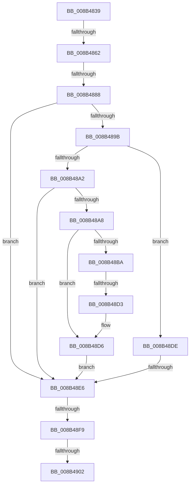

# sub_008B4839

- RVA: `0x008B4839`–`0x008B4915` (길이 `220` bytes)
- VA: `0x00000001408B4839`
- 실행 섹션: `PAGE`
- PDB 이름 있음: `아니요`; PDB Function 태그: `아니요`
- unwind 정보 RVA: `0x00082800`
- 디코드: `51`개 명령, `220/220` bytes 표시
- 미해석 바이트: `0` (있으면 어셈블리에 `.byte`로 보존)

> 이 문서는 커널 이미지의 기계어와 PDB 기호를 분석해 생성했습니다. 4번과 5번은 함수 원형과 자료형을 바이너리 사용 방식에서 추정한 C 해석이며 원본 소스 복구 결과는 아닙니다.

## 1. Dependencies

- 직접 호출 지점: **2**; 고유 호출 대상: **2**
- 직접 호출자로 확인된 함수: **0**
- RIP 상대 이미지 참조: **2**

### Outgoing calls
- `0x008B4872` → [PsReferencePrimaryTokenWithTag](../../text/20/PsReferencePrimaryTokenWithTag_function_0020FF80.md) (function, `0x0020FF80`)
- `0x008B48C4` → [SeQueryInformationToken](SeQueryInformationToken_function_008B5090.md) (function, `0x008B5090`)

### Direct callers
- 이 함수 시작 RVA로 연결되는 직접 call은 확인되지 않았습니다. 간접 호출은 완전히 역산할 수 없습니다.

### Static image references
- `0x008B4877` → RVA `0x00FD8010` (`PAGEDATA`; read)
- `0x008B4888` → RVA `0x00E0ECA0` (`.data`; read)

## 2. Other-region calls and transfers

- 다른 실행 섹션으로 향하는 call: **1**
  - `0x008B4872` → [PsReferencePrimaryTokenWithTag](../../text/20/PsReferencePrimaryTokenWithTag_function_0020FF80.md) (`PAGE` → `.text`)
- call이 아닌 외부 분기/꼬리 이동: **7**
  - `0x008B485C` → [sub_008B4AB4](Unknown_function_008B4AB4.md) (`tail-transfer`)
  - `0x008B4882` → [sub_008B4D32](Unknown_function_008B4D32.md) (`tail-transfer`)
  - `0x008B48CD` → [sub_008B4B26](Unknown_function_008B4B26.md) (`tail-transfer`)
  - `0x008B48E0` → [sub_008B4B26 + 0x4](Unknown_function_008B4B26.md) (`tail-transfer`)
  - `0x008B48F3` → [sub_008B4D32 + 0xFB](Unknown_function_008B4D32.md) (`tail-transfer`)
  - `0x008B48FC` → [sub_008B4D32 + 0xAE](Unknown_function_008B4D32.md) (`tail-transfer`)
  - `0x008B490F` → [sub_008B4E37](Unknown_function_008B4E37.md) (`tail-transfer`)

## 3. Assembly (complete function range)

```asm
008B4839  4C 89 B4 24 88 04 00 00         mov qword ptr [rsp + 0x488], r14
008B4841  4C 8B B7 B8 00 00 00            mov r14, qword ptr [rdi + 0xb8]
008B4848  49 8B 86 D0 01 00 00            mov rax, qword ptr [r14 + 0x1d0]
008B484F  48 89 44 24 70                  mov qword ptr [rsp + 0x70], rax
008B4854  8B 87 A0 05 00 00               mov eax, dword ptr [rdi + 0x5a0]
008B485A  A8 08                           test al, 8
008B485C  0F 85 52 02 00 00               jne 0x1408b4ab4
008B4862  48 8B F3                        mov rsi, rbx
008B4865  BA 53 65 53 75                  mov edx, 0x75536553
008B486A  48 89 74 24 58                  mov qword ptr [rsp + 0x58], rsi
008B486F  49 8B CE                        mov rcx, r14
008B4872  E8 09 B7 95 FF                  call 0x14020ff80
008B4877  39 1D 93 37 72 00               cmp dword ptr [rip + 0x723793], ebx
008B487D  48 89 44 24 68                  mov qword ptr [rsp + 0x68], rax
008B4882  0F 85 AA 04 00 00               jne 0x1408b4d32
008B4888  38 1D 12 A4 55 00               cmp byte ptr [rip + 0x55a412], bl
008B488E  0F 57 C0                        xorps xmm0, xmm0
008B4891  0F 11 45 D0                     movups xmmword ptr [rbp - 0x30], xmm0
008B4895  0F 11 45 E0                     movups xmmword ptr [rbp - 0x20], xmm0
008B4899  74 4B                           je 0x1408b48e6
008B489B  8B 45 00                        mov eax, dword ptr [rbp]
008B489E  A8 01                           test al, 1
008B48A0  75 3C                           jne 0x1408b48de
008B48A2  38 5C 24 41                     cmp byte ptr [rsp + 0x41], bl
008B48A6  74 3E                           je 0x1408b48e6
008B48A8  48 8B 4C 24 68                  mov rcx, qword ptr [rsp + 0x68]
008B48AD  48 85 F6                        test rsi, rsi
008B48B0  89 5C 24 50                     mov dword ptr [rsp + 0x50], ebx
008B48B4  48 0F 45 CE                     cmovne rcx, rsi
008B48B8  75 1C                           jne 0x1408b48d6
008B48BA  4C 8D 44 24 50                  lea r8, [rsp + 0x50]
008B48BF  BA 18 00 00 00                  mov edx, 0x18
008B48C4  E8 C7 07 00 00                  call 0x1408b5090
008B48C9  39 5C 24 50                     cmp dword ptr [rsp + 0x50], ebx
008B48CD  0F 85 53 02 00 00               jne 0x1408b4b26
008B48D3  8B 45 00                        mov eax, dword ptr [rbp]
008B48D6  83 C8 03                        or eax, 3
008B48D9  89 45 00                        mov dword ptr [rbp], eax
008B48DC  EB 08                           jmp 0x1408b48e6
008B48DE  A8 02                           test al, 2
008B48E0  0F 84 44 02 00 00               je 0x1408b4b2a
008B48E6  8B FB                           mov edi, ebx
008B48E8  45 32 FF                        xor r15b, r15b
008B48EB  48 8B 4C 24 48                  mov rcx, qword ptr [rsp + 0x48]
008B48F0  48 85 C9                        test rcx, rcx
008B48F3  0F 85 34 05 00 00               jne 0x1408b4e2d
008B48F9  45 84 FF                        test r15b, r15b
008B48FC  0F 85 DE 04 00 00               jne 0x1408b4de0
008B4902  80 7C 24 42 00                  cmp byte ptr [rsp + 0x42], 0
008B4907  4C 8B B4 24 88 04 00 00         mov r14, qword ptr [rsp + 0x488]
008B490F  0F 85 22 05 00 00               jne 0x1408b4e37
```

## 4. C-style interpretation (structured pseudocode)

```c
__int64 __fastcall sub_008B4839(__int64 a1, __int64 a2, __int64 a3, __int64 a4, __int64 a5, __int64 a6, __int64 a7, __int64 a8, __int64 a9, unsigned int a10, __int64 a11, __int64 a12, __int64 a13, __int64 a14, __int64 a15, __int64 a16, __int64 a17, __int64 a18, __int64 a19, __int64 a20, __int64 a21, __int64 a22, __int64 a23, __int64 a24, __int64 a25, __int64 a26, __int64 a27, __int64 a28, __int64 a29, __int64 a30, __int64 a31, __int64 a32, __int64 a33, __int64 a34, __int64 a35, __int64 a36, __int64 a37, __int64 a38, __int64 a39, __int64 a40, __int64 a41, __int64 a42, __int64 a43, __int64 a44, __int64 a45, __int64 a46, __int64 a47, __int64 a48, __int64 a49, __int64 a50, __int64 a51, __int64 a52, __int64 a53, __int64 a54, __int64 a55, __int64 a56, __int64 a57, __int64 a58, __int64 a59, __int64 a60, __int64 a61, __int64 a62, __int64 a63, __int64 a64, __int64 a65, __int64 a66, __int64 a67, __int64 a68, __int64 a69, __int64 a70, __int64 a71, __int64 a72, __int64 a73, __int64 a74, __int64 a75, __int64 a76, __int64 a77, __int64 a78, __int64 a79, __int64 a80, __int64 a81, __int64 a82, __int64 a83, __int64 a84, __int64 a85, __int64 a86, __int64 a87, __int64 a88, __int64 a89, __int64 a90, __int64 a91, __int64 a92, __int64 a93, __int64 a94, __int64 a95, __int64 a96, __int64 a97, __int64 a98, __int64 a99, __int64 a100, __int64 a101, __int64 a102, __int64 a103, __int64 a104, __int64 a105, __int64 a106, __int64 a107, __int64 a108, __int64 a109, __int64 a110, __int64 a111, __int64 a112, __int64 a113, __int64 a114, __int64 a115, __int64 a116, __int64 a117, __int64 a118, __int64 a119, __int64 a120, __int64 a121, __int64 a122, __int64 a123, __int64 a124, __int64 a125, __int64 a126, __int64 a127, __int64 a128, __int64 a129, __int64 a130, __int64 a131, __int64 a132, __int64 a133, __int64 a134, __int64 a135, __int64 a136, __int64 a137, __int64 a138, __int64 a139, __int64 a140, __int64 a141, __int64 a142, __int64 a143, __int64 a144, __int64 a145)
{
    __int64 result;
    __int64 v_r15;
    unsigned __int8 v_stack_p41;
    unsigned __int8 v_stack_p42;
    unsigned __int64 v_stack_p488;
    unsigned int v_stack_p50;
    unsigned __int64 v_stack_p58;
    unsigned __int64 v_stack_p68;
    unsigned __int64 v_stack_p70;

    v_stack_p488 = v_r14;
    v_stack_p70 = *(unsigned __int64 *)(*(unsigned __int64 *)(v_rdi + 184) + 464);
    v_stack_p58 = v_rbx;
    result = PsReferencePrimaryTokenWithTag(*(unsigned __int64 *)(v_rdi + 184), (unsigned int)(0x75536553ULL), a3, a4);
    v_stack_p68 = result;
    *(unsigned __int64 *)(v_rbp - 48) = v_xmm0;
    *(unsigned __int64 *)(v_rbp - 32) = v_xmm0;
    if ((*(unsigned __int8 *)(v_rip + 5612562)) == ((unsigned __int8)(v_rbx))) goto loc_008B48E6;
    if ((((unsigned __int8)((unsigned int)(*(unsigned int *)(v_rbp)))) & (1)) != 0) goto loc_008B48DE;
    if (v_stack_p41 == ((unsigned __int8)(v_rbx))) goto loc_008B48E6;
    v_stack_p50 = (unsigned int)(v_rbx);
    if (v_rbx != 0) { a13 = v_rbx; }
    if (v_rbx != 0) goto loc_008B48D6;
    result = SeQueryInformationToken(a13, 24, a10, a4);
loc_008B48D6:
    result = (unsigned int)(((unsigned int)(*(unsigned int *)(v_rbp))) | (3));
    *(unsigned int *)(v_rbp) = (unsigned int)(result);
    goto loc_008B48E6;
loc_008B48DE:
loc_008B48E6:
    v_r15 = 0;
}
```

## 5. (Beta) C Style

```c
int64_t sub_008B4839(int64_t Arg1, int64_t Arg2, int64_t Arg3, int64_t Arg4, uint64_t Arg5, uint64_t Arg6, uint64_t Arg7, uint64_t Arg8, int64_t Arg9, uint32_t Arg10, uint64_t Arg11, uint64_t Arg12, int64_t Arg13, uint64_t Arg14, uint64_t Arg15, uint64_t Arg16, uint64_t Arg17, uint64_t Arg18, uint64_t Arg19, uint64_t Arg20, uint64_t Arg21, uint64_t Arg22, uint64_t Arg23, uint64_t Arg24, uint64_t Arg25, uint64_t Arg26, uint64_t Arg27, uint64_t Arg28, uint64_t Arg29, uint64_t Arg30, uint64_t Arg31, uint64_t Arg32, uint64_t Arg33, uint64_t Arg34, uint64_t Arg35, uint64_t Arg36, uint64_t Arg37, uint64_t Arg38, uint64_t Arg39, uint64_t Arg40, uint64_t Arg41, uint64_t Arg42, uint64_t Arg43, uint64_t Arg44, uint64_t Arg45, uint64_t Arg46, uint64_t Arg47, uint64_t Arg48, uint64_t Arg49, uint64_t Arg50, uint64_t Arg51, uint64_t Arg52, uint64_t Arg53, uint64_t Arg54, uint64_t Arg55, uint64_t Arg56, uint64_t Arg57, uint64_t Arg58, uint64_t Arg59, uint64_t Arg60, uint64_t Arg61, uint64_t Arg62, uint64_t Arg63, uint64_t Arg64, uint64_t Arg65, uint64_t Arg66, uint64_t Arg67, uint64_t Arg68, uint64_t Arg69, uint64_t Arg70, uint64_t Arg71, uint64_t Arg72, uint64_t Arg73, uint64_t Arg74, uint64_t Arg75, uint64_t Arg76, uint64_t Arg77, uint64_t Arg78, uint64_t Arg79, uint64_t Arg80, uint64_t Arg81, uint64_t Arg82, uint64_t Arg83, uint64_t Arg84, uint64_t Arg85, uint64_t Arg86, uint64_t Arg87, uint64_t Arg88, uint64_t Arg89, uint64_t Arg90, uint64_t Arg91, uint64_t Arg92, uint64_t Arg93, uint64_t Arg94, uint64_t Arg95, uint64_t Arg96, uint64_t Arg97, uint64_t Arg98, uint64_t Arg99, uint64_t Arg100, uint64_t Arg101, uint64_t Arg102, uint64_t Arg103, uint64_t Arg104, uint64_t Arg105, uint64_t Arg106, uint64_t Arg107, uint64_t Arg108, uint64_t Arg109, uint64_t Arg110, uint64_t Arg111, uint64_t Arg112, uint64_t Arg113, uint64_t Arg114, uint64_t Arg115, uint64_t Arg116, uint64_t Arg117, uint64_t Arg118, uint64_t Arg119, uint64_t Arg120, uint64_t Arg121, uint64_t Arg122, uint64_t Arg123, uint64_t Arg124, uint64_t Arg125, uint64_t Arg126, uint64_t Arg127, uint64_t Arg128, uint64_t Arg129, uint64_t Arg130, uint64_t Arg131, uint64_t Arg132, uint64_t Arg133, uint64_t Arg134, uint64_t Arg135, uint64_t Arg136, uint64_t Arg137, uint64_t Arg138, uint64_t Arg139, uint64_t Arg140, uint64_t Arg141, uint64_t Arg142, uint64_t Arg143, uint64_t Arg144, int64_t Arg145)
{
    int64_t result;
    int64_t local_r15;
    uint8_t v_stack_p41;
    uint8_t v_stack_p42;
    uint64_t v_stack_p488;
    uint32_t v_stack_p50;
    uint64_t v_stack_p58;
    uint64_t v_stack_p68;
    uint64_t v_stack_p70;

    v_stack_p488 = local_r14;
    v_stack_p70 = *(uint64_t *)(*(uint64_t *)(local_rdi + 0xB8) + 0x1D0);
    v_stack_p58 = local_rbx;
    result = PsReferencePrimaryTokenWithTag(*(uint64_t *)(local_rdi + 0xB8), (uint32_t)(0x75536553ULL), Arg3, Arg4);
    v_stack_p68 = result;
    *(uint64_t *)(local_rbp - 0x30) = v_xmm0;
    *(uint64_t *)(local_rbp - 0x20) = v_xmm0;
    if ((*(uint8_t *)(v_rip + 0x55A412)) == ((uint8_t)(local_rbx))) goto loc_008B48E6;
    if ((((uint8_t)((uint32_t)(*(uint32_t *)(local_rbp)))) & (1)) != 0) goto loc_008B48DE;
    if (v_stack_p41 == ((uint8_t)(local_rbx))) goto loc_008B48E6;
    v_stack_p50 = (uint32_t)(local_rbx);
    if (local_rbx != 0) { Arg13 = local_rbx; }
    if (local_rbx != 0) goto loc_008B48D6;
    result = SeQueryInformationToken(Arg13, 24, Arg10, Arg4);
loc_008B48D6:
    result = (uint32_t)(((uint32_t)(*(uint32_t *)(local_rbp))) | (3));
    *(uint32_t *)(local_rbp) = (uint32_t)(result);
    goto loc_008B48E6;
loc_008B48DE:
loc_008B48E6:
    local_r15 = 0;
}
```

## 6. Execution-region graph

[열기: 2D/3D 그래프와 함수 탐색 컨트롤 패널](../../../control-panel.html?section=page&rva=0x008B4839&view=graph)

- 2D 그래프는 위에서 아래로 흐르고, 3D 그래프는 빈 공간을 드래그해 회전합니다. Shift+드래그는 이동, 휠은 확대·축소, 함수 노드 선택은 대상 보고서 이동입니다.

### Static fallback


