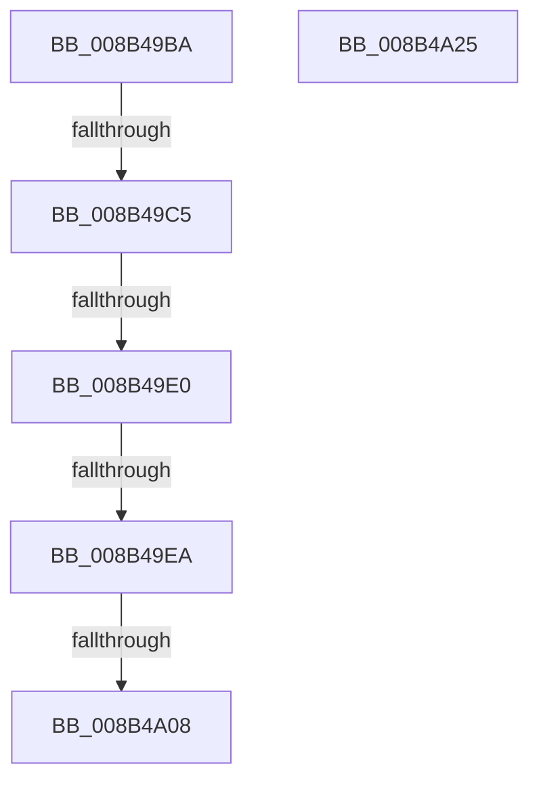

# sub_008B49BA

- RVA: `0x008B49BA`–`0x008B4A26` (길이 `108` bytes)
- VA: `0x00000001408B49BA`
- 실행 섹션: `PAGE`
- PDB 이름 있음: `아니요`; PDB Function 태그: `아니요`
- unwind 정보 RVA: `0x00082824`
- 디코드: `26`개 명령, `108/108` bytes 표시
- 미해석 바이트: `0` (있으면 어셈블리에 `.byte`로 보존)

> 이 문서는 커널 이미지의 기계어와 PDB 기호를 분석해 생성했습니다. 4번과 5번은 함수 원형과 자료형을 바이너리 사용 방식에서 추정한 C 해석이며 원본 소스 복구 결과는 아닙니다.

## 1. Dependencies

- 직접 호출 지점: **1**; 고유 호출 대상: **1**
- 직접 호출자로 확인된 함수: **0**
- RIP 상대 이미지 참조: **0**

### Outgoing calls
- `0x008B4A14` → [_security_check_cookie](../../text/6A/_security_check_cookie_function_006AC640.md) (function, `0x006AC640`)

### Direct callers
- 이 함수 시작 RVA로 연결되는 직접 call은 확인되지 않았습니다. 간접 호출은 완전히 역산할 수 없습니다.

### Static image references
- 디코드된 RIP-relative 메모리 참조가 없습니다.

## 2. Other-region calls and transfers

- 다른 실행 섹션으로 향하는 call: **1**
  - `0x008B4A14` → [_security_check_cookie](../../text/6A/_security_check_cookie_function_006AC640.md) (`PAGE` → `.text`)
- call이 아닌 외부 분기/꼬리 이동: **4**
  - `0x008B49BF` → [sub_008B4CB2](Unknown_function_008B4CB2.md) (`tail-transfer`)
  - `0x008B49DA` → [sub_008B4B1F](Unknown_function_008B4B1F.md) (`tail-transfer`)
  - `0x008B49E4` → [sub_008B4B1F](Unknown_function_008B4B1F.md) (`tail-transfer`)
  - `0x008B4A06` → [sub_008B4A38](Unknown_function_008B4A38.md) (`tail-transfer`)

## 3. Assembly (complete function range)

```asm
008B49BA  48 83 7D 48 00                  cmp qword ptr [rbp + 0x48], 0
008B49BF  0F 85 ED 02 00 00               jne 0x1408b4cb2
008B49C5  48 8B 9D 80 00 00 00            mov rbx, qword ptr [rbp + 0x80]
008B49CC  48 8D 8D 80 00 00 00            lea rcx, [rbp + 0x80]
008B49D3  48 8B 03                        mov rax, qword ptr [rbx]
008B49D6  48 39 4B 08                     cmp qword ptr [rbx + 8], rcx
008B49DA  0F 85 3F 01 00 00               jne 0x1408b4b1f
008B49E0  48 39 58 08                     cmp qword ptr [rax + 8], rbx
008B49E4  0F 85 35 01 00 00               jne 0x1408b4b1f
008B49EA  48 89 85 80 00 00 00            mov qword ptr [rbp + 0x80], rax
008B49F1  48 8D 8D 80 00 00 00            lea rcx, [rbp + 0x80]
008B49F8  48 89 48 08                     mov qword ptr [rax + 8], rcx
008B49FC  48 8D 85 80 00 00 00            lea rax, [rbp + 0x80]
008B4A03  48 3B D8                        cmp rbx, rax
008B4A06  75 30                           jne 0x1408b4a38
008B4A08  8B C7                           mov eax, edi
008B4A0A  48 8B 8D 70 03 00 00            mov rcx, qword ptr [rbp + 0x370]
008B4A11  48 33 CC                        xor rcx, rsp
008B4A14  E8 27 7C DF FF                  call 0x1406ac640
008B4A19  48 81 C4 98 04 00 00            add rsp, 0x498
008B4A20  5F                              pop rdi
008B4A21  5E                              pop rsi
008B4A22  5B                              pop rbx
008B4A23  5D                              pop rbp
008B4A24  C3                              ret
008B4A25  CC                              int3
```

## 4. C-style interpretation (structured pseudocode)

```c
__int64 __fastcall sub_008B49BA(void)
{
    __int64 result;
    __int64 v_rsp;

    *(unsigned __int64 *)(v_rbp + 128) = *(unsigned __int64 *)(*(unsigned __int64 *)(v_rbp + 128));
    *(unsigned __int64 *)(*(unsigned __int64 *)(*(unsigned __int64 *)(v_rbp + 128)) + 8) = v_rbp + 128;
    a1 = (*(unsigned __int64 *)(v_rbp + 880)) ^ (v_rsp);
    result = _security_check_cookie(a1, a2, a3, a4);
    v_rsp = (v_rsp) + (0x498ULL);
    return result;
}
```

## 5. (Beta) C Style

```c
void sub_008B49BA(void)
{
    int64_t result;
    int64_t local_rsp;

    *(uint64_t *)(local_rbp + 0x80) = *(uint64_t *)(*(uint64_t *)(local_rbp + 0x80));
    *(uint64_t *)(*(uint64_t *)(*(uint64_t *)(local_rbp + 0x80)) + 0x8) = local_rbp + 128;
    a1 = (*(uint64_t *)(local_rbp + 0x370)) ^ (local_rsp);
    result = _security_check_cookie(a1, a2, a3, a4);
    local_rsp = (local_rsp) + (0x498ULL);
    return result;
}
```

## 6. Execution-region graph

[열기: 2D/3D 그래프와 함수 탐색 컨트롤 패널](../../../control-panel.html?section=page&rva=0x008B49BA&view=graph)

- 2D 그래프는 위에서 아래로 흐르고, 3D 그래프는 빈 공간을 드래그해 회전합니다. Shift+드래그는 이동, 휠은 확대·축소, 함수 노드 선택은 대상 보고서 이동입니다.

### Static fallback


