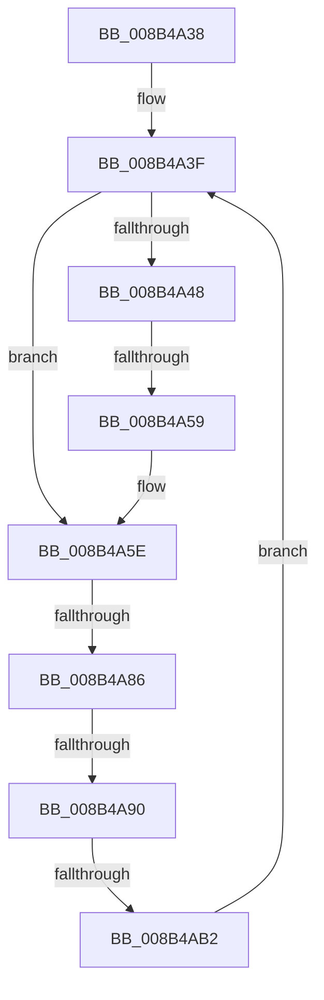

# sub_008B4A38

- RVA: `0x008B4A38`–`0x008B4AB4` (길이 `124` bytes)
- VA: `0x00000001408B4A38`
- 실행 섹션: `PAGE`
- PDB 이름 있음: `아니요`; PDB Function 태그: `아니요`
- unwind 정보 RVA: `0x00082854`
- 디코드: `26`개 명령, `124/124` bytes 표시
- 미해석 바이트: `0` (있으면 어셈블리에 `.byte`로 보존)

> 이 문서는 커널 이미지의 기계어와 PDB 기호를 분석해 생성했습니다. 4번과 5번은 함수 원형과 자료형을 바이너리 사용 방식에서 추정한 C 해석이며 원본 소스 복구 결과는 아닙니다.

## 1. Dependencies

- 직접 호출 지점: **2**; 고유 호출 대상: **2**
- 직접 호출자로 확인된 함수: **0**
- RIP 상대 이미지 참조: **1**

### Outgoing calls
- `0x008B4A59` → [VrpOriginalKeyNameParameterCleanup](../../text/47/VrpOriginalKeyNameParameterCleanup_function_00479060.md) (function, `0x00479060`)
- `0x008B4A66` → [CmpFreePoolWithTag](../../text/44/CmpFreePoolWithTag_function_004489E0.md) (function, `0x004489E0`)

### Direct callers
- 이 함수 시작 RVA로 연결되는 직접 call은 확인되지 않았습니다. 간접 호출은 완전히 역산할 수 없습니다.

### Static image references
- `0x008B4A38` → RVA `0x00479060` (`VrpOriginalKeyNameParameterCleanup`; read)

## 2. Other-region calls and transfers

- 다른 실행 섹션으로 향하는 call: **2**
  - `0x008B4A59` → [VrpOriginalKeyNameParameterCleanup](../../text/47/VrpOriginalKeyNameParameterCleanup_function_00479060.md) (`PAGE` → `.text`)
  - `0x008B4A66` → [CmpFreePoolWithTag](../../text/44/CmpFreePoolWithTag_function_004489E0.md) (`PAGE` → `.text`)
- call이 아닌 외부 분기/꼬리 이동: **4**
  - `0x008B4A53` → [sub_008B4E48 + 0xC](Unknown_function_008B4E48.md) (`tail-transfer`)
  - `0x008B4A80` → [sub_008B4B1F](Unknown_function_008B4B1F.md) (`tail-transfer`)
  - `0x008B4A8A` → [sub_008B4B1F](Unknown_function_008B4B1F.md) (`tail-transfer`)
  - `0x008B4AAC` → [sub_008B49BA + 0x4E](Unknown_function_008B49BA.md) (`tail-transfer`)

## 3. Assembly (complete function range)

```asm
008B4A38  48 8D 35 21 46 BC FF            lea rsi, [rip - 0x43b9df]
008B4A3F  48 8B 43 20                     mov rax, qword ptr [rbx + 0x20]
008B4A43  48 85 C0                        test rax, rax
008B4A46  74 16                           je 0x1408b4a5e
008B4A48  48 8D 53 30                     lea rdx, [rbx + 0x30]
008B4A4C  48 8D 4B 10                     lea rcx, [rbx + 0x10]
008B4A50  48 3B C6                        cmp rax, rsi
008B4A53  0F 85 FB 03 00 00               jne 0x1408b4e54
008B4A59  E8 02 46 BC FF                  call 0x140479060
008B4A5E  BA 43 4D 45 50                  mov edx, 0x50454d43
008B4A63  48 8B CB                        mov rcx, rbx
008B4A66  E8 75 3F B9 FF                  call 0x1404489e0
008B4A6B  48 8B 9D 80 00 00 00            mov rbx, qword ptr [rbp + 0x80]
008B4A72  48 8D 8D 80 00 00 00            lea rcx, [rbp + 0x80]
008B4A79  48 8B 03                        mov rax, qword ptr [rbx]
008B4A7C  48 39 4B 08                     cmp qword ptr [rbx + 8], rcx
008B4A80  0F 85 99 00 00 00               jne 0x1408b4b1f
008B4A86  48 39 58 08                     cmp qword ptr [rax + 8], rbx
008B4A8A  0F 85 8F 00 00 00               jne 0x1408b4b1f
008B4A90  48 89 85 80 00 00 00            mov qword ptr [rbp + 0x80], rax
008B4A97  48 8D 8D 80 00 00 00            lea rcx, [rbp + 0x80]
008B4A9E  48 89 48 08                     mov qword ptr [rax + 8], rcx
008B4AA2  48 8D 85 80 00 00 00            lea rax, [rbp + 0x80]
008B4AA9  48 3B D8                        cmp rbx, rax
008B4AAC  0F 84 56 FF FF FF               je 0x1408b4a08
008B4AB2  EB 8B                           jmp 0x1408b4a3f
```

## 4. C-style interpretation (structured pseudocode)

```c
__int64 __fastcall sub_008B4A38(void)
{
    __int64 result;

loc_008B4A3F:
    if (*(unsigned __int64 *)(v_rbx + 32) == 0) goto loc_008B4A5E;
    result = VrpOriginalKeyNameParameterCleanup(v_rbx + 16, v_rbx + 48, a3, a4);
loc_008B4A5E:
    result = CmpFreePoolWithTag(v_rbx, (unsigned int)(0x50454D43ULL), a3, a4);
    *(unsigned __int64 *)(v_rbp + 128) = *(unsigned __int64 *)(*(unsigned __int64 *)(v_rbp + 128));
    *(unsigned __int64 *)(*(unsigned __int64 *)(*(unsigned __int64 *)(v_rbp + 128)) + 8) = v_rbp + 128;
    goto loc_008B4A3F;
}
```

## 5. (Beta) C Style

```c
void sub_008B4A38(void)
{
    int64_t result;

loc_008B4A3F:
    if (*(uint64_t *)(local_rbx + 0x20) == 0) goto loc_008B4A5E;
    result = VrpOriginalKeyNameParameterCleanup(local_rbx + 16, local_rbx + 48, a3, a4);
loc_008B4A5E:
    result = CmpFreePoolWithTag(local_rbx, (uint32_t)(0x50454D43ULL), a3, a4);
    *(uint64_t *)(local_rbp + 0x80) = *(uint64_t *)(*(uint64_t *)(local_rbp + 0x80));
    *(uint64_t *)(*(uint64_t *)(*(uint64_t *)(local_rbp + 0x80)) + 0x8) = local_rbp + 128;
    goto loc_008B4A3F;
}
```

## 6. Execution-region graph

[열기: 2D/3D 그래프와 함수 탐색 컨트롤 패널](../../../control-panel.html?section=page&rva=0x008B4A38&view=graph)

- 2D 그래프는 위에서 아래로 흐르고, 3D 그래프는 빈 공간을 드래그해 회전합니다. Shift+드래그는 이동, 휠은 확대·축소, 함수 노드 선택은 대상 보고서 이동입니다.

### Static fallback


