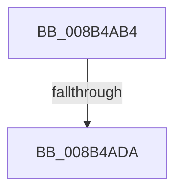

# sub_008B4AB4

- RVA: `0x008B4AB4`–`0x008B4B10` (길이 `92` bytes)
- VA: `0x00000001408B4AB4`
- 실행 섹션: `PAGE`
- PDB 이름 있음: `아니요`; PDB Function 태그: `아니요`
- unwind 정보 RVA: `0x00082864`
- 디코드: `20`개 명령, `92/92` bytes 표시
- 미해석 바이트: `0` (있으면 어셈블리에 `.byte`로 보존)

> 이 문서는 커널 이미지의 기계어와 PDB 기호를 분석해 생성했습니다. 4번과 5번은 함수 원형과 자료형을 바이너리 사용 방식에서 추정한 C 해석이며 원본 소스 복구 결과는 아닙니다.

## 1. Dependencies

- 직접 호출 지점: **3**; 고유 호출 대상: **3**
- 직접 호출자로 확인된 함수: **0**
- RIP 상대 이미지 참조: **0**

### Outgoing calls
- `0x008B4AC7` → [PspLockThreadSecurityShared](../../text/3C/PspLockThreadSecurityShared_function_003C4720.md) (function, `0x003C4720`)
- `0x008B4AED` → [ObfReferenceObjectWithTag](../../text/21/ObfReferenceObjectWithTag_function_00210710.md) (function, `0x00210710`)
- `0x008B4B06` → [PspUnlockThreadSecurityShared](../../text/3C/PspUnlockThreadSecurityShared_function_003C2E40.md) (function, `0x003C2E40`)

### Direct callers
- 이 함수 시작 RVA로 연결되는 직접 call은 확인되지 않았습니다. 간접 호출은 완전히 역산할 수 없습니다.

### Static image references
- 디코드된 RIP-relative 메모리 참조가 없습니다.

## 2. Other-region calls and transfers

- 다른 실행 섹션으로 향하는 call: **3**
  - `0x008B4AC7` → [PspLockThreadSecurityShared](../../text/3C/PspLockThreadSecurityShared_function_003C4720.md) (`PAGE` → `.text`)
  - `0x008B4AED` → [ObfReferenceObjectWithTag](../../text/21/ObfReferenceObjectWithTag_function_00210710.md) (`PAGE` → `.text`)
  - `0x008B4B06` → [PspUnlockThreadSecurityShared](../../text/3C/PspUnlockThreadSecurityShared_function_003C2E40.md) (`PAGE` → `.text`)
- call이 아닌 외부 분기/꼬리 이동: **2**
  - `0x008B4AD4` → [sub_008B4B26 + 0x16B](Unknown_function_008B4B26.md) (`tail-transfer`)
  - `0x008B4B0B` → [sub_008B4839 + 0x2C](Unknown_function_008B4839.md) (`tail-transfer`)

## 3. Assembly (complete function range)

```asm
008B4AB4  65 48 8B 04 25 88 01 00 00      mov rax, qword ptr gs:[0x188]
008B4ABD  48 8B CF                        mov rcx, rdi
008B4AC0  48 8B D0                        mov rdx, rax
008B4AC3  48 89 45 98                     mov qword ptr [rbp - 0x68], rax
008B4AC7  E8 54 FC B0 FF                  call 0x1403c4720
008B4ACC  8B 87 A0 05 00 00               mov eax, dword ptr [rdi + 0x5a0]
008B4AD2  A8 08                           test al, 8
008B4AD4  0F 84 B7 01 00 00               je 0x1408b4c91
008B4ADA  48 8B B7 38 05 00 00            mov rsi, qword ptr [rdi + 0x538]
008B4AE1  BA 53 65 53 75                  mov edx, 0x75536553
008B4AE6  48 83 E6 F8                     and rsi, 0xfffffffffffffff8
008B4AEA  48 8B CE                        mov rcx, rsi
008B4AED  E8 1E BC 95 FF                  call 0x140210710
008B4AF2  8B 87 38 05 00 00               mov eax, dword ptr [rdi + 0x538]
008B4AF8  83 E0 03                        and eax, 3
008B4AFB  89 44 24 60                     mov dword ptr [rsp + 0x60], eax
008B4AFF  48 8B 55 98                     mov rdx, qword ptr [rbp - 0x68]
008B4B03  48 8B CF                        mov rcx, rdi
008B4B06  E8 35 E3 B0 FF                  call 0x1403c2e40
008B4B0B  E9 55 FD FF FF                  jmp 0x1408b4865
```

## 4. C-style interpretation (structured pseudocode)

```c
__int64 __fastcall sub_008B4AB4(void)
{
    __int64 result;
    __int64 v_rsi;
    unsigned int v_stack_p60;

    *(unsigned __int64 *)(v_rbp - 104) = *(unsigned __int64 *)(gs_base + (0 + 392));
    result = PspLockThreadSecurityShared(v_rdi, *(unsigned __int64 *)(gs_base + (0 + 392)), a3, a4);
    v_rsi = (*(unsigned __int64 *)(v_rdi + 1336)) & (-8);
    result = ObfReferenceObjectWithTag(v_rsi, (unsigned int)(0x75536553ULL), a3, a4);
    result = (unsigned int)(((unsigned int)(*(unsigned int *)(v_rdi + 1336))) & (3));
    v_stack_p60 = (unsigned int)(result);
    result = PspUnlockThreadSecurityShared(v_rdi, *(unsigned __int64 *)(v_rbp - 104), a3, a4);
}
```

## 5. (Beta) C Style

```c
void sub_008B4AB4(void)
{
    int64_t result;
    int64_t local_rsi;
    uint32_t v_stack_p60;

    *(uint64_t *)(local_rbp - 0x68) = *(uint64_t *)(gs_base + (0 + 0x188));
    result = PspLockThreadSecurityShared(local_rdi, *(uint64_t *)(gs_base + (0 + 0x188)), a3, a4);
    local_rsi = (*(uint64_t *)(local_rdi + 0x538)) & (-8);
    result = ObfReferenceObjectWithTag(local_rsi, (uint32_t)(0x75536553ULL), a3, a4);
    result = (uint32_t)(((uint32_t)(*(uint32_t *)(local_rdi + 0x538))) & (3));
    v_stack_p60 = (uint32_t)(result);
    result = PspUnlockThreadSecurityShared(local_rdi, *(uint64_t *)(local_rbp - 0x68), a3, a4);
}
```

## 6. Execution-region graph

[열기: 2D/3D 그래프와 함수 탐색 컨트롤 패널](../../../control-panel.html?section=page&rva=0x008B4AB4&view=graph)

- 2D 그래프는 위에서 아래로 흐르고, 3D 그래프는 빈 공간을 드래그해 회전합니다. Shift+드래그는 이동, 휠은 확대·축소, 함수 노드 선택은 대상 보고서 이동입니다.

### Static fallback


