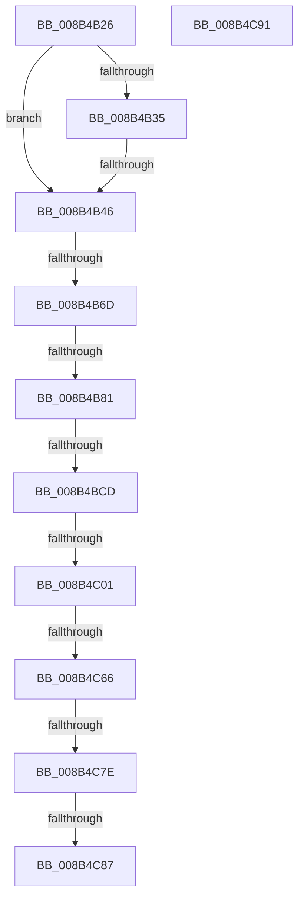

# sub_008B4B26

- RVA: `0x008B4B26`–`0x008B4C99` (길이 `371` bytes)
- VA: `0x00000001408B4B26`
- 실행 섹션: `PAGE`
- PDB 이름 있음: `아니요`; PDB Function 태그: `아니요`
- unwind 정보 RVA: `0x000828B0`
- 디코드: `83`개 명령, `371/371` bytes 표시
- 미해석 바이트: `0` (있으면 어셈블리에 `.byte`로 보존)

> 이 문서는 커널 이미지의 기계어와 PDB 기호를 분석해 생성했습니다. 4번과 5번은 함수 원형과 자료형을 바이너리 사용 방식에서 추정한 C 해석이며 원본 소스 복구 결과는 아닙니다.

## 1. Dependencies

- 직접 호출 지점: **11**; 고유 호출 대상: **9**
- 직접 호출자로 확인된 함수: **0**
- RIP 상대 이미지 참조: **1**

### Outgoing calls
- `0x008B4B4D` → [CmpAttachToRegistryProcess](../../pagecmrc/BC/CmpAttachToRegistryProcess_function_00BC98E0.md) (function, `0x00BC98E0`)
- `0x008B4B57` → [CmpLockRegistry](../../pagecmrc/BC/CmpLockRegistry_function_00BC9B34.md) (function, `0x00BC9B34`)
- `0x008B4B5F` → [CmpLockKcbShared](../../pagecmrc/BC/CmpLockKcbShared_function_00BC9A1C.md) (function, `0x00BC9A1C`)
- `0x008B4B74` → [CmVirtualKCBToRealPath](../A7/CmVirtualKCBToRealPath_function_00A76BE8.md) (function, `0x00A76BE8`)
- `0x008B4B84` → [CmpUnlockKcb](../../pagecmrc/BC/CmpUnlockKcb_function_00BC92C0.md) (function, `0x00BC92C0`)
- `0x008B4B89` → [CmpUnlockRegistry](../../pagecmrc/BC/CmpUnlockRegistry_function_00BC9A84.md) (function, `0x00BC9A84`)
- `0x008B4BD2` → [ObfReferenceObject](../../text/20/ObfReferenceObject_function_0020FA20.md) (function, `0x0020FA20`)
- `0x008B4BF2` → [SepCreateAccessStateFromSubjectContext](../../text/3E/SepCreateAccessStateFromSubjectContext_function_003EBF40.md) (function, `0x003EBF40`)
- `0x008B4C5B` → [CmObReferenceObjectByName](../../pagecmrc/BC/CmObReferenceObjectByName_function_00BC9E94.md) (function, `0x00BC9E94`)
- `0x008B4C66` → [CmpLockRegistry](../../pagecmrc/BC/CmpLockRegistry_function_00BC9B34.md) (function, `0x00BC9B34`)
- `0x008B4C87` → [CmpUnlockRegistry](../../pagecmrc/BC/CmpUnlockRegistry_function_00BC9A84.md) (function, `0x00BC9A84`)

### Direct callers
- 이 함수 시작 RVA로 연결되는 직접 call은 확인되지 않았습니다. 간접 호출은 완전히 역산할 수 없습니다.

### Static image references
- `0x008B4BA0` → RVA `0x00FC6AC0` (`ALMOSTRO`; read)

## 2. Other-region calls and transfers

- 다른 실행 섹션으로 향하는 call: **10**
  - `0x008B4B4D` → [CmpAttachToRegistryProcess](../../pagecmrc/BC/CmpAttachToRegistryProcess_function_00BC98E0.md) (`PAGE` → `PAGECMRC`)
  - `0x008B4B57` → [CmpLockRegistry](../../pagecmrc/BC/CmpLockRegistry_function_00BC9B34.md) (`PAGE` → `PAGECMRC`)
  - `0x008B4B5F` → [CmpLockKcbShared](../../pagecmrc/BC/CmpLockKcbShared_function_00BC9A1C.md) (`PAGE` → `PAGECMRC`)
  - `0x008B4B84` → [CmpUnlockKcb](../../pagecmrc/BC/CmpUnlockKcb_function_00BC92C0.md) (`PAGE` → `PAGECMRC`)
  - `0x008B4B89` → [CmpUnlockRegistry](../../pagecmrc/BC/CmpUnlockRegistry_function_00BC9A84.md) (`PAGE` → `PAGECMRC`)
  - `0x008B4BD2` → [ObfReferenceObject](../../text/20/ObfReferenceObject_function_0020FA20.md) (`PAGE` → `.text`)
  - `0x008B4BF2` → [SepCreateAccessStateFromSubjectContext](../../text/3E/SepCreateAccessStateFromSubjectContext_function_003EBF40.md) (`PAGE` → `.text`)
  - `0x008B4C5B` → [CmObReferenceObjectByName](../../pagecmrc/BC/CmObReferenceObjectByName_function_00BC9E94.md) (`PAGE` → `PAGECMRC`)
  - `0x008B4C66` → [CmpLockRegistry](../../pagecmrc/BC/CmpLockRegistry_function_00BC9B34.md) (`PAGE` → `PAGECMRC`)
  - `0x008B4C87` → [CmpUnlockRegistry](../../pagecmrc/BC/CmpUnlockRegistry_function_00BC9A84.md) (`PAGE` → `PAGECMRC`)
- call이 아닌 외부 분기/꼬리 이동: **10**
  - `0x008B4B40` → [sub_008B4839 + 0xAD](Unknown_function_008B4839.md) (`tail-transfer`)
  - `0x008B4B67` → [sub_008B4D32 + 0x51](Unknown_function_008B4D32.md) (`tail-transfer`)
  - `0x008B4B7B` → [sub_008B4D32 + 0x7F](Unknown_function_008B4D32.md) (`tail-transfer`)
  - `0x008B4BC7` → [sub_008B4D32 + 0xD0](Unknown_function_008B4D32.md) (`tail-transfer`)
  - `0x008B4BFB` → [sub_008B4D32 + 0xDD](Unknown_function_008B4D32.md) (`tail-transfer`)
  - `0x008B4C64` → [sub_008B4CCA](Unknown_function_008B4CCA.md) (`tail-transfer`)
  - `0x008B4C78` → [sub_008B4D32 + 0x91](Unknown_function_008B4D32.md) (`tail-transfer`)
  - `0x008B4C81` → [sub_008B4D32 + 0xF4](Unknown_function_008B4D32.md) (`tail-transfer`)
  - `0x008B4C8C` → [sub_008B4839 + 0xB2](Unknown_function_008B4839.md) (`tail-transfer`)
  - `0x008B4C94` → [sub_008B4AB4 + 0x4B](Unknown_function_008B4AB4.md) (`tail-transfer`)

## 3. Assembly (complete function range)

```asm
008B4B26  83 4D 00 05                     or dword ptr [rbp], 5
008B4B2A  44 0F B6 74 24 40               movzx r14d, byte ptr [rsp + 0x40]
008B4B30  45 84 F6                        test r14b, r14b
008B4B33  74 11                           je 0x1408b4b46
008B4B35  41 F7 87 B8 00 00 00 00 00 80 00  test dword ptr [r15 + 0xb8], 0x800000
008B4B40  0F 84 A0 FD FF FF               je 0x1408b48e6
008B4B46  48 8D 8D C0 01 00 00            lea rcx, [rbp + 0x1c0]
008B4B4D  E8 8E 4D 31 00                  call 0x140bc98e0
008B4B52  C6 44 24 42 01                  mov byte ptr [rsp + 0x42], 1
008B4B57  E8 D8 4F 31 00                  call 0x140bc9b34
008B4B5C  49 8B CF                        mov rcx, r15
008B4B5F  E8 B8 4E 31 00                  call 0x140bc9a1c
008B4B64  45 84 F6                        test r14b, r14b
008B4B67  0F 85 16 02 00 00               jne 0x1408b4d83
008B4B6D  48 8D 55 88                     lea rdx, [rbp - 0x78]
008B4B71  49 8B CF                        mov rcx, r15
008B4B74  E8 6F 20 1C 00                  call 0x140a76be8
008B4B79  85 C0                           test eax, eax
008B4B7B  0F 88 30 02 00 00               js 0x1408b4db1
008B4B81  49 8B CF                        mov rcx, r15
008B4B84  E8 37 47 31 00                  call 0x140bc92c0
008B4B89  E8 F6 4E 31 00                  call 0x140bc9a84
008B4B8E  48 8B 44 24 78                  mov rax, qword ptr [rsp + 0x78]
008B4B93  BA 08 00 00 00                  mov edx, 8
008B4B98  44 8B 7C 24 54                  mov r15d, dword ptr [rsp + 0x54]
008B4B9D  45 85 FF                        test r15d, r15d
008B4BA0  48 8B 3D 19 1F 71 00            mov rdi, qword ptr [rip + 0x711f19]
008B4BA7  89 55 F0                        mov dword ptr [rbp - 0x10], edx
008B4BAA  48 8B 00                        mov rax, qword ptr [rax]
008B4BAD  48 8B 48 38                     mov rcx, qword ptr [rax + 0x38]
008B4BB1  B8 08 10 00 00                  mov eax, 0x1008
008B4BB6  0F 44 D0                        cmove edx, eax
008B4BB9  48 89 4D 38                     mov qword ptr [rbp + 0x38], rcx
008B4BBD  48 83 C7 4C                     add rdi, 0x4c
008B4BC1  89 55 F0                        mov dword ptr [rbp - 0x10], edx
008B4BC4  48 85 F6                        test rsi, rsi
008B4BC7  0F 85 35 02 00 00               jne 0x1408b4e02
008B4BCD  48 8B 4C 24 68                  mov rcx, qword ptr [rsp + 0x68]
008B4BD2  E8 49 AE 95 FF                  call 0x14020fa20
008B4BD7  45 8B CF                        mov r9d, r15d
008B4BDA  48 89 7C 24 20                  mov qword ptr [rsp + 0x20], rdi
008B4BDF  4C 8D 85 90 02 00 00            lea r8, [rbp + 0x290]
008B4BE6  48 8D 95 F0 01 00 00            lea rdx, [rbp + 0x1f0]
008B4BED  48 8D 4C 24 58                  lea rcx, [rsp + 0x58]
008B4BF2  E8 49 73 B3 FF                  call 0x1403ebf40
008B4BF7  8B F8                           mov edi, eax
008B4BF9  85 C0                           test eax, eax
008B4BFB  0F 88 0E 02 00 00               js 0x1408b4e0f
008B4C01  44 8B 44 24 54                  mov r8d, dword ptr [rsp + 0x54]
008B4C06  48 8D 95 F0 01 00 00            lea rdx, [rbp + 0x1f0]
008B4C0D  B8 40 06 00 00                  mov eax, 0x640
008B4C12  C7 45 A0 30 00 00 00            mov dword ptr [rbp - 0x60], 0x30
008B4C19  B9 40 02 00 00                  mov ecx, 0x240
008B4C1E  48 89 5D A8                     mov qword ptr [rbp - 0x58], rbx
008B4C22  0F 57 C0                        xorps xmm0, xmm0
008B4C25  41 B7 01                        mov r15b, 1
008B4C28  44 38 7C 24 41                  cmp byte ptr [rsp + 0x41], r15b
008B4C2D  F3 0F 7F 45 C0                  movdqu xmmword ptr [rbp - 0x40], xmm0
008B4C32  0F 45 C1                        cmovne eax, ecx
008B4C35  48 8D 4D A0                     lea rcx, [rbp - 0x60]
008B4C39  89 45 B8                        mov dword ptr [rbp - 0x48], eax
008B4C3C  48 8D 45 88                     lea rax, [rbp - 0x78]
008B4C40  48 89 45 B0                     mov qword ptr [rbp - 0x50], rax
008B4C44  48 8D 44 24 48                  lea rax, [rsp + 0x48]
008B4C49  48 89 44 24 30                  mov qword ptr [rsp + 0x30], rax
008B4C4E  48 8D 45 F0                     lea rax, [rbp - 0x10]
008B4C52  48 89 44 24 28                  mov qword ptr [rsp + 0x28], rax
008B4C57  88 5C 24 20                     mov byte ptr [rsp + 0x20], bl
008B4C5B  E8 34 52 31 00                  call 0x140bc9e94
008B4C60  8B F8                           mov edi, eax
008B4C62  85 C0                           test eax, eax
008B4C64  78 64                           js 0x1408b4cca
008B4C66  E8 C9 4E 31 00                  call 0x140bc9b34
008B4C6B  48 8B 44 24 48                  mov rax, qword ptr [rsp + 0x48]
008B4C70  48 8B 48 08                     mov rcx, qword ptr [rax + 8]
008B4C74  66 39 59 42                     cmp word ptr [rcx + 0x42], bx
008B4C78  0F 84 45 01 00 00               je 0x1408b4dc3
008B4C7E  45 84 E4                        test r12b, r12b
008B4C81  0F 85 9F 01 00 00               jne 0x1408b4e26
008B4C87  E8 F8 4D 31 00                  call 0x140bc9a84
008B4C8C  E9 5A FC FF FF                  jmp 0x1408b48eb
008B4C91  48 8B F3                        mov rsi, rbx
008B4C94  E9 66 FE FF FF                  jmp 0x1408b4aff
```

## 4. C-style interpretation (structured pseudocode)

```c
__int64 __fastcall sub_008B4B26(__int64 a1, __int64 a2, __int64 a3, __int64 a4, __int64 a5, __int64 a6, __int64 a7, unsigned __int8 a8, __int64 a9, __int64 a10, __int64 a11, __int64 a12, __int64 a13, __int64 a14, __int64 a15)
{
    __int64 result;
    __int64 v_rdi;
    unsigned __int64 v_stack_p20;
    unsigned __int64 v_stack_p28;
    unsigned __int64 v_stack_p30;
    unsigned __int8 v_stack_p41;
    unsigned __int8 v_stack_p42;
    unsigned int v_stack_p54;

    if (a8 == 0) goto loc_008B4B46;
loc_008B4B46:
    result = CmpAttachToRegistryProcess(v_rbp + 448, a2, a3, a4);
    v_stack_p42 = 1;
    result = CmpLockRegistry(v_rbp + 448, a2, a3, a4);
    result = CmpLockKcbShared(v_r15, a2, a3, a4);
    result = CmVirtualKCBToRealPath(v_r15, v_rbp - 120, a3, a4);
    result = CmpUnlockKcb(v_r15, v_rbp - 120, a3, a4);
    result = CmpUnlockRegistry(v_r15, v_rbp - 120, a3, a4);
    *(unsigned int *)(v_rbp - 16) = 8;
    a2 = 8;
    if ((unsigned int)((unsigned int)(v_stack_p54)) == 0) { a2 = (unsigned int)((unsigned int)(0x1008ULL)); }
    *(unsigned __int64 *)(v_rbp + 56) = *(unsigned __int64 *)(*(unsigned __int64 *)(a15) + 56);
    v_rdi = (*(unsigned __int64 *)(v_rip + 7413529)) + (76);
    *(unsigned int *)(v_rbp - 16) = (unsigned int)(a2);
    result = ObfReferenceObject(a13, a2, a3, a4);
    v_stack_p20 = v_rdi;
    result = SepCreateAccessStateFromSubjectContext(a11, v_rbp + 496, v_rbp + 656, (unsigned int)((unsigned int)((unsigned int)(v_stack_p54))));
    *(unsigned int *)(v_rbp - 96) = 48;
    *(unsigned __int64 *)(v_rbp - 88) = v_rbx;
    *(unsigned __int64 *)(v_rbp - 64) = v_xmm0;
    result = (unsigned int)(0x640ULL);
    if (v_stack_p41 != 1) { result = 576; }
    *(unsigned int *)(v_rbp - 72) = (unsigned int)(result);
    *(unsigned __int64 *)(v_rbp - 80) = v_rbp - 120;
    v_stack_p30 = a9;
    v_stack_p28 = v_rbp - 16;
    v_stack_p20 = (unsigned __int8)(v_rbx);
    result = CmObReferenceObjectByName(v_rbp - 96, v_rbp + 496, (unsigned int)(v_stack_p54), (unsigned int)((unsigned int)((unsigned int)(v_stack_p54))));
    result = CmpLockRegistry(v_rbp - 96, v_rbp + 496, (unsigned int)(v_stack_p54), (unsigned int)((unsigned int)((unsigned int)(v_stack_p54))));
    result = CmpUnlockRegistry(*(unsigned __int64 *)(a9 + 8), v_rbp + 496, (unsigned int)(v_stack_p54), (unsigned int)((unsigned int)((unsigned int)(v_stack_p54))));
}
```

## 5. (Beta) C Style

```c
int64_t sub_008B4B26(int64_t Arg1, int64_t Arg2, int64_t Arg3, int64_t Arg4, uint64_t Arg5, uint64_t Arg6, uint64_t Arg7, uint8_t Arg8, void *Arg9, uint64_t Arg10, int64_t Arg11, uint64_t Arg12, int64_t Arg13, uint64_t Arg14, void *Arg15)
{
    uint8_t *arg9 = (uint8_t *)Arg9;
    uint8_t *arg15 = (uint8_t *)Arg15;

    int64_t result;
    int64_t local_rdi;
    uint64_t v_stack_p20;
    uint64_t v_stack_p28;
    uint64_t v_stack_p30;
    uint8_t v_stack_p41;
    uint8_t v_stack_p42;
    uint32_t v_stack_p54;

    if (Arg8 == 0) goto loc_008B4B46;
loc_008B4B46:
    result = CmpAttachToRegistryProcess(local_rbp + 448, Arg2, Arg3, Arg4);
    v_stack_p42 = 1;
    result = CmpLockRegistry(local_rbp + 448, Arg2, Arg3, Arg4);
    result = CmpLockKcbShared(local_r15, Arg2, Arg3, Arg4);
    result = CmVirtualKCBToRealPath(local_r15, local_rbp - 120, Arg3, Arg4);
    result = CmpUnlockKcb(local_r15, local_rbp - 120, Arg3, Arg4);
    result = CmpUnlockRegistry(local_r15, local_rbp - 120, Arg3, Arg4);
    *(uint32_t *)(local_rbp - 0x10) = 8;
    Arg2 = 8;
    if ((uint32_t)((uint32_t)(v_stack_p54)) == 0) { Arg2 = (uint32_t)((uint32_t)(0x1008ULL)); }
    *(uint64_t *)(local_rbp + 0x38) = *(uint64_t *)(*(uint64_t *)(arg15) + 0x38);
    local_rdi = (*(uint64_t *)(v_rip + 0x711F19)) + (76);
    *(uint32_t *)(local_rbp - 0x10) = (uint32_t)(Arg2);
    result = ObfReferenceObject(Arg13, Arg2, Arg3, Arg4);
    v_stack_p20 = local_rdi;
    result = SepCreateAccessStateFromSubjectContext(Arg11, local_rbp + 496, local_rbp + 656, (uint32_t)((uint32_t)((uint32_t)(v_stack_p54))));
    *(uint32_t *)(local_rbp - 0x60) = 48;
    *(uint64_t *)(local_rbp - 0x58) = local_rbx;
    *(uint64_t *)(local_rbp - 0x40) = v_xmm0;
    result = (uint32_t)(0x640ULL);
    if (v_stack_p41 != 1) { result = 576; }
    *(uint32_t *)(local_rbp - 0x48) = (uint32_t)(result);
    *(uint64_t *)(local_rbp - 0x50) = local_rbp - 120;
    v_stack_p30 = Arg9;
    v_stack_p28 = local_rbp - 16;
    v_stack_p20 = (uint8_t)(local_rbx);
    result = CmObReferenceObjectByName(local_rbp - 96, local_rbp + 496, (uint32_t)(v_stack_p54), (uint32_t)((uint32_t)((uint32_t)(v_stack_p54))));
    result = CmpLockRegistry(local_rbp - 96, local_rbp + 496, (uint32_t)(v_stack_p54), (uint32_t)((uint32_t)((uint32_t)(v_stack_p54))));
    result = CmpUnlockRegistry(*(uint64_t *)(arg9 + 0x8), local_rbp + 496, (uint32_t)(v_stack_p54), (uint32_t)((uint32_t)((uint32_t)(v_stack_p54))));
}
```

### 관측된 메모리 오프셋

구조체 형식이 확인되지 않은 접근은 인자 기준의 오프셋으로만 기록했습니다.

| 기준 인자 | 오프셋 표현 | 폭 (bit) | 접근 |
|---|---:|---:|---|
| `Arg9` | `+ 0x8` | `64` | `R` |
| `Arg15` | `+ 0x0` | `64` | `R` |

## 6. Execution-region graph

[열기: 2D/3D 그래프와 함수 탐색 컨트롤 패널](../../../control-panel.html?section=page&rva=0x008B4B26&view=graph)

- 2D 그래프는 위에서 아래로 흐르고, 3D 그래프는 빈 공간을 드래그해 회전합니다. Shift+드래그는 이동, 휠은 확대·축소, 함수 노드 선택은 대상 보고서 이동입니다.

### Static fallback


