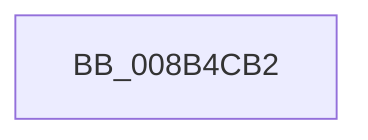

# sub_008B4CB2

- RVA: `0x008B4CB2`–`0x008B4CCA` (길이 `24` bytes)
- VA: `0x00000001408B4CB2`
- 실행 섹션: `PAGE`
- PDB 이름 있음: `아니요`; PDB Function 태그: `아니요`
- unwind 정보 RVA: `0x000828EC`
- 디코드: `5`개 명령, `24/24` bytes 표시
- 미해석 바이트: `0` (있으면 어셈블리에 `.byte`로 보존)

> 이 문서는 커널 이미지의 기계어와 PDB 기호를 분석해 생성했습니다. 4번과 5번은 함수 원형과 자료형을 바이너리 사용 방식에서 추정한 C 해석이며 원본 소스 복구 결과는 아닙니다.

## 1. Dependencies

- 직접 호출 지점: **3**; 고유 호출 대상: **3**
- 직접 호출자로 확인된 함수: **0**
- RIP 상대 이미지 참조: **0**

### Outgoing calls
- `0x008B4CB2` → [CmpLockRegistry](../../pagecmrc/BC/CmpLockRegistry_function_00BC9B34.md) (function, `0x00BC9B34`)
- `0x008B4CBB` → [CmpDereferenceKeyControlBlock](../85/CmpDereferenceKeyControlBlock_function_00851310.md) (function, `0x00851310`)
- `0x008B4CC0` → [CmpUnlockRegistry](../../pagecmrc/BC/CmpUnlockRegistry_function_00BC9A84.md) (function, `0x00BC9A84`)

### Direct callers
- 이 함수 시작 RVA로 연결되는 직접 call은 확인되지 않았습니다. 간접 호출은 완전히 역산할 수 없습니다.

### Static image references
- 디코드된 RIP-relative 메모리 참조가 없습니다.

## 2. Other-region calls and transfers

- 다른 실행 섹션으로 향하는 call: **2**
  - `0x008B4CB2` → [CmpLockRegistry](../../pagecmrc/BC/CmpLockRegistry_function_00BC9B34.md) (`PAGE` → `PAGECMRC`)
  - `0x008B4CC0` → [CmpUnlockRegistry](../../pagecmrc/BC/CmpUnlockRegistry_function_00BC9A84.md) (`PAGE` → `PAGECMRC`)
- call이 아닌 외부 분기/꼬리 이동: **1**
  - `0x008B4CC5` → [sub_008B49BA + 0xB](Unknown_function_008B49BA.md) (`tail-transfer`)

## 3. Assembly (complete function range)

```asm
008B4CB2  E8 7D 4E 31 00                  call 0x140bc9b34
008B4CB7  48 8B 4D 48                     mov rcx, qword ptr [rbp + 0x48]
008B4CBB  E8 50 C6 F9 FF                  call 0x140851310
008B4CC0  E8 BF 4D 31 00                  call 0x140bc9a84
008B4CC5  E9 FB FC FF FF                  jmp 0x1408b49c5
```

## 4. C-style interpretation (structured pseudocode)

```c
__int64 __fastcall sub_008B4CB2(void)
{
    __int64 result;

    result = CmpLockRegistry(a1, a2, a3, a4);
    result = CmpDereferenceKeyControlBlock(*(unsigned __int64 *)(v_rbp + 72), a2, a3, a4);
    result = CmpUnlockRegistry(*(unsigned __int64 *)(v_rbp + 72), a2, a3, a4);
}
```

## 5. (Beta) C Style

```c
void sub_008B4CB2(void)
{
    int64_t result;

    result = CmpLockRegistry(a1, a2, a3, a4);
    result = CmpDereferenceKeyControlBlock(*(uint64_t *)(local_rbp + 0x48), a2, a3, a4);
    result = CmpUnlockRegistry(*(uint64_t *)(local_rbp + 0x48), a2, a3, a4);
}
```

## 6. Execution-region graph

[열기: 2D/3D 그래프와 함수 탐색 컨트롤 패널](../../../control-panel.html?section=page&rva=0x008B4CB2&view=graph)

- 2D 그래프는 위에서 아래로 흐르고, 3D 그래프는 빈 공간을 드래그해 회전합니다. Shift+드래그는 이동, 휠은 확대·축소, 함수 노드 선택은 대상 보고서 이동입니다.

### Static fallback


