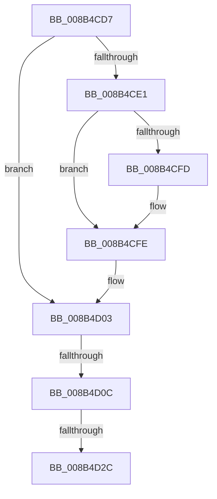

# sub_008B4CD7

- RVA: `0x008B4CD7`–`0x008B4D32` (길이 `91` bytes)
- VA: `0x00000001408B4CD7`
- 실행 섹션: `PAGE`
- PDB 이름 있음: `아니요`; PDB Function 태그: `아니요`
- unwind 정보 RVA: `0x0008291C`
- 디코드: `19`개 명령, `91/91` bytes 표시
- 미해석 바이트: `0` (있으면 어셈블리에 `.byte`로 보존)

> 이 문서는 커널 이미지의 기계어와 PDB 기호를 분석해 생성했습니다. 4번과 5번은 함수 원형과 자료형을 바이너리 사용 방식에서 추정한 C 해석이며 원본 소스 복구 결과는 아닙니다.

## 1. Dependencies

- 직접 호출 지점: **0**; 고유 호출 대상: **0**
- 직접 호출자로 확인된 함수: **0**
- RIP 상대 이미지 참조: **1**

### Outgoing calls
- 직접 디코드된 call 명령이 없습니다.

### Direct callers
- 이 함수 시작 RVA로 연결되는 직접 call은 확인되지 않았습니다. 간접 호출은 완전히 역산할 수 없습니다.

### Static image references
- `0x008B4CEF` → RVA `0x00E67B90` (`.data`; read)

## 2. Other-region calls and transfers

- 다른 실행 섹션으로 향하는 call: **0**
- call이 아닌 외부 분기/꼬리 이동: **3**
  - `0x008B4D06` → [sub_008B4915 + 0xD](Unknown_function_008B4915.md) (`tail-transfer`)
  - `0x008B4D26` → [sub_008B4915 + 0xD](Unknown_function_008B4915.md) (`tail-transfer`)
  - `0x008B4D2D` → [sub_008B4915 + 0xD](Unknown_function_008B4915.md) (`tail-transfer`)

## 3. Assembly (complete function range)

```asm
008B4CD7  48 8B 44 24 68                  mov rax, qword ptr [rsp + 0x68]
008B4CDC  48 85 C0                        test rax, rax
008B4CDF  74 22                           je 0x1408b4d03
008B4CE1  48 8B 80 78 04 00 00            mov rax, qword ptr [rax + 0x478]
008B4CE8  F0 FF 88 1C 01 00 00            lock dec dword ptr [rax + 0x11c]
008B4CEF  48 8B 05 9A 2E 5B 00            mov rax, qword ptr [rip + 0x5b2e9a]
008B4CF6  48 39 44 24 68                  cmp qword ptr [rsp + 0x68], rax
008B4CFB  75 01                           jne 0x1408b4cfe
008B4CFD  CC                              int3
008B4CFE  48 8B 74 24 58                  mov rsi, qword ptr [rsp + 0x58]
008B4D03  48 85 F6                        test rsi, rsi
008B4D06  0F 84 16 FC FF FF               je 0x1408b4922
008B4D0C  48 8B 86 78 04 00 00            mov rax, qword ptr [rsi + 0x478]
008B4D13  F0 FF 88 1C 01 00 00            lock dec dword ptr [rax + 0x11c]
008B4D1A  48 8B 05 6F 2E 5B 00            mov rax, qword ptr [rip + 0x5b2e6f]
008B4D21  48 39 44 24 58                  cmp qword ptr [rsp + 0x58], rax
008B4D26  0F 85 F6 FB FF FF               jne 0x1408b4922
008B4D2C  CC                              int3
008B4D2D  E9 F0 FB FF FF                  jmp 0x1408b4922
```

## 4. C-style interpretation (structured pseudocode)

```c
__int64 __fastcall sub_008B4CD7(__int64 a1, __int64 a2, __int64 a3, __int64 a4, __int64 a5, __int64 a6, __int64 a7, __int64 a8, __int64 a9, __int64 a10, __int64 a11, __int64 a12, __int64 a13)
{
    if (a13 == 0) goto loc_008B4D03;
    if (a13 == (*(unsigned __int64 *)(v_rip + 5975706))) {
    }
loc_008B4D03:
}
```

## 5. (Beta) C Style

```c
int64_t sub_008B4CD7(int64_t Arg1, int64_t Arg2, int64_t Arg3, int64_t Arg4, uint64_t Arg5, uint64_t Arg6, uint64_t Arg7, uint64_t Arg8, uint64_t Arg9, uint64_t Arg10, int64_t Arg11, uint64_t Arg12, int64_t Arg13)
{
    if (Arg13 == 0) goto loc_008B4D03;
    if (Arg13 == (*(uint64_t *)(v_rip + 0x5B2E9A))) {
    }
loc_008B4D03:
}
```

## 6. Execution-region graph

[열기: 2D/3D 그래프와 함수 탐색 컨트롤 패널](../../../control-panel.html?section=page&rva=0x008B4CD7&view=graph)

- 2D 그래프는 위에서 아래로 흐르고, 3D 그래프는 빈 공간을 드래그해 회전합니다. Shift+드래그는 이동, 휠은 확대·축소, 함수 노드 선택은 대상 보고서 이동입니다.

### Static fallback


