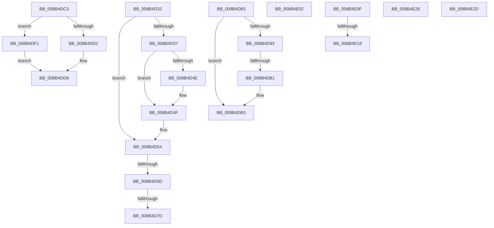

# sub_008B4D32

- RVA: `0x008B4D32`–`0x008B4E37` (길이 `261` bytes)
- VA: `0x00000001408B4D32`
- 실행 섹션: `PAGE`
- PDB 이름 있음: `아니요`; PDB Function 태그: `아니요`
- unwind 정보 RVA: `0x00082938`
- 디코드: `64`개 명령, `261/261` bytes 표시
- 미해석 바이트: `0` (있으면 어셈블리에 `.byte`로 보존)

> 이 문서는 커널 이미지의 기계어와 PDB 기호를 분석해 생성했습니다. 4번과 5번은 함수 원형과 자료형을 바이너리 사용 방식에서 추정한 C 해석이며 원본 소스 복구 결과는 아닙니다.

## 1. Dependencies

- 직접 호출 지점: **8**; 고유 호출 대상: **7**
- 직접 호출자로 확인된 함수: **0**
- RIP 상대 이미지 참조: **1**

### Outgoing calls
- `0x008B4D88` → [CmpPerformKeyBodyDeletionCheck](../../pagecmrc/BC/CmpPerformKeyBodyDeletionCheck_function_00BC97D0.md) (function, `0x00BC97D0`)
- `0x008B4D9F` → [CmpReparseToVirtualPath](../7E/CmpReparseToVirtualPath_function_007EBA48.md) (function, `0x007EBA48`)
- `0x008B4DB6` → [CmpUnlockKcb](../../pagecmrc/BC/CmpUnlockKcb_function_00BC92C0.md) (function, `0x00BC92C0`)
- `0x008B4DC3` → [CmpUnlockRegistry](../../pagecmrc/BC/CmpUnlockRegistry_function_00BC9A84.md) (function, `0x00BC9A84`)
- `0x008B4DE7` → [SeDeleteAccessState](../8C/SeDeleteAccessState_function_008C5F70.md) (function, `0x008C5F70`)
- `0x008B4E05` → [ObfReferenceObject](../../text/20/ObfReferenceObject_function_0020FA20.md) (function, `0x0020FA20`)
- `0x008B4E1B` → [ObfDereferenceObject](../../text/2F/ObfDereferenceObject_function_002F9350.md) (function, `0x002F9350`)
- `0x008B4E2D` → [ObfDereferenceObject](../../text/2F/ObfDereferenceObject_function_002F9350.md) (function, `0x002F9350`)

### Direct callers
- 이 함수 시작 RVA로 연결되는 직접 call은 확인되지 않았습니다. 간접 호출은 완전히 역산할 수 없습니다.

### Static image references
- `0x008B4D45` → RVA `0x00E67B90` (`.data`; read)

## 2. Other-region calls and transfers

- 다른 실행 섹션으로 향하는 call: **6**
  - `0x008B4D88` → [CmpPerformKeyBodyDeletionCheck](../../pagecmrc/BC/CmpPerformKeyBodyDeletionCheck_function_00BC97D0.md) (`PAGE` → `PAGECMRC`)
  - `0x008B4DB6` → [CmpUnlockKcb](../../pagecmrc/BC/CmpUnlockKcb_function_00BC92C0.md) (`PAGE` → `PAGECMRC`)
  - `0x008B4DC3` → [CmpUnlockRegistry](../../pagecmrc/BC/CmpUnlockRegistry_function_00BC9A84.md) (`PAGE` → `PAGECMRC`)
  - `0x008B4E05` → [ObfReferenceObject](../../text/20/ObfReferenceObject_function_0020FA20.md) (`PAGE` → `.text`)
  - `0x008B4E1B` → [ObfDereferenceObject](../../text/2F/ObfDereferenceObject_function_002F9350.md) (`PAGE` → `.text`)
  - `0x008B4E2D` → [ObfDereferenceObject](../../text/2F/ObfDereferenceObject_function_002F9350.md) (`PAGE` → `.text`)
- call이 아닌 외부 분기/꼬리 이동: **11**
  - `0x008B4D57` → [sub_008B4839 + 0x4F](Unknown_function_008B4839.md) (`tail-transfer`)
  - `0x008B4D77` → [sub_008B4839 + 0x4F](Unknown_function_008B4839.md) (`tail-transfer`)
  - `0x008B4D7E` → [sub_008B4839 + 0x4F](Unknown_function_008B4839.md) (`tail-transfer`)
  - `0x008B4DAB` → [sub_008B4B26 + 0x5B](Unknown_function_008B4B26.md) (`tail-transfer`)
  - `0x008B4DBE` → [sub_008B4B26 + 0x161](Unknown_function_008B4B26.md) (`tail-transfer`)
  - `0x008B4DEC` → [sub_008B4839 + 0xC9](Unknown_function_008B4839.md) (`tail-transfer`)
  - `0x008B4E0A` → [sub_008B4B26 + 0xA7](Unknown_function_008B4B26.md) (`tail-transfer`)
  - `0x008B4E12` → [sub_00B1A8D2](../B1/Unknown_function_00B1A8D2.md) (`tail-transfer`)
  - `0x008B4E21` → [sub_00B1A8D2](../B1/Unknown_function_00B1A8D2.md) (`tail-transfer`)
  - `0x008B4E28` → [sub_008B4B26 + 0x161](Unknown_function_008B4B26.md) (`tail-transfer`)
  - `0x008B4E32` → [sub_008B4839 + 0xC0](Unknown_function_008B4839.md) (`tail-transfer`)

## 3. Assembly (complete function range)

```asm
008B4D32  48 85 C0                        test rax, rax
008B4D35  74 1D                           je 0x1408b4d54
008B4D37  48 8B 88 78 04 00 00            mov rcx, qword ptr [rax + 0x478]
008B4D3E  F0 FF 81 1C 01 00 00            lock inc dword ptr [rcx + 0x11c]
008B4D45  48 3B 05 44 2E 5B 00            cmp rax, qword ptr [rip + 0x5b2e44]
008B4D4C  75 01                           jne 0x1408b4d4f
008B4D4E  CC                              int3
008B4D4F  48 8B 74 24 58                  mov rsi, qword ptr [rsp + 0x58]
008B4D54  48 85 F6                        test rsi, rsi
008B4D57  0F 84 2B FB FF FF               je 0x1408b4888
008B4D5D  48 8B 86 78 04 00 00            mov rax, qword ptr [rsi + 0x478]
008B4D64  F0 FF 80 1C 01 00 00            lock inc dword ptr [rax + 0x11c]
008B4D6B  48 8B 74 24 58                  mov rsi, qword ptr [rsp + 0x58]
008B4D70  48 3B 35 19 2E 5B 00            cmp rsi, qword ptr [rip + 0x5b2e19]
008B4D77  0F 85 0B FB FF FF               jne 0x1408b4888
008B4D7D  CC                              int3
008B4D7E  E9 05 FB FF FF                  jmp 0x1408b4888
008B4D83  33 D2                           xor edx, edx
008B4D85  49 8B CD                        mov rcx, r13
008B4D88  E8 43 4A 31 00                  call 0x140bc97d0
008B4D8D  8B F8                           mov edi, eax
008B4D8F  85 C0                           test eax, eax
008B4D91  78 20                           js 0x1408b4db3
008B4D93  4C 8D 4D 88                     lea r9, [rbp - 0x78]
008B4D97  49 8B CF                        mov rcx, r15
008B4D9A  4C 8D 44 24 58                  lea r8, [rsp + 0x58]
008B4D9F  E8 A4 6C F3 FF                  call 0x1407eba48
008B4DA4  48 8B 74 24 58                  mov rsi, qword ptr [rsp + 0x58]
008B4DA9  84 C0                           test al, al
008B4DAB  0F 85 D0 FD FF FF               jne 0x1408b4b81
008B4DB1  8B FB                           mov edi, ebx
008B4DB3  49 8B CF                        mov rcx, r15
008B4DB6  E8 05 45 31 00                  call 0x140bc92c0
008B4DBB  45 32 FF                        xor r15b, r15b
008B4DBE  E9 C4 FE FF FF                  jmp 0x1408b4c87
008B4DC3  E8 BC 4C 31 00                  call 0x140bc9a84
008B4DC8  48 8B 44 24 48                  mov rax, qword ptr [rsp + 0x48]
008B4DCD  45 84 F6                        test r14b, r14b
008B4DD0  74 1F                           je 0x1408b4df1
008B4DD2  48 8B 4D 80                     mov rcx, qword ptr [rbp - 0x80]
008B4DD6  48 89 01                        mov qword ptr [rcx], rax
008B4DD9  48 89 5C 24 48                  mov qword ptr [rsp + 0x48], rbx
008B4DDE  8B FB                           mov edi, ebx
008B4DE0  48 8D 8D F0 01 00 00            lea rcx, [rbp + 0x1f0]
008B4DE7  E8 84 11 01 00                  call 0x1408c5f70
008B4DEC  E9 11 FB FF FF                  jmp 0x1408b4902
008B4DF1  48 8B 4C 24 78                  mov rcx, qword ptr [rsp + 0x78]
008B4DF6  48 89 01                        mov qword ptr [rcx], rax
008B4DF9  48 8B 4D 80                     mov rcx, qword ptr [rbp - 0x80]
008B4DFD  4C 89 29                        mov qword ptr [rcx], r13
008B4E00  EB D7                           jmp 0x1408b4dd9
008B4E02  48 8B CE                        mov rcx, rsi
008B4E05  E8 16 AC 95 FF                  call 0x14020fa20
008B4E0A  E9 BE FD FF FF                  jmp 0x1408b4bcd
008B4E0F  48 85 F6                        test rsi, rsi
008B4E12  0F 84 BA 5A 26 00               je 0x140b1a8d2
008B4E18  48 8B CE                        mov rcx, rsi
008B4E1B  E8 30 45 A4 FF                  call 0x1402f9350
008B4E20  90                              nop
008B4E21  E9 AC 5A 26 00                  jmp 0x140b1a8d2
008B4E26  8B FB                           mov edi, ebx
008B4E28  E9 5A FE FF FF                  jmp 0x1408b4c87
008B4E2D  E8 1E 45 A4 FF                  call 0x1402f9350
008B4E32  E9 C2 FA FF FF                  jmp 0x1408b48f9
```

## 4. C-style interpretation (structured pseudocode)

```c
__int64 __fastcall sub_008B4D32(__int64 a1, int a2, __int64 a3, __int64 a4, __int64 a5, __int64 a6, __int64 a7, __int64 a8, __int64 a9, __int64 a10, __int64 a11)
{
    unsigned __int64 v_stack_p48;
    unsigned __int64 v_stack_p58;
    unsigned __int64 v_stack_p78;

    if (result == 0) goto loc_008B4D54;
    if (result == (*(unsigned __int64 *)(v_rip + 5975620))) {
    }
loc_008B4D54:
}
```

## 5. (Beta) C Style

```c
int64_t sub_008B4D32(int64_t Arg1, int32_t Arg2, int64_t Arg3, int64_t Arg4, uint64_t Arg5, uint64_t Arg6, uint64_t Arg7, uint64_t Arg8, uint64_t Arg9, uint64_t Arg10, int64_t Arg11)
{
    uint64_t v_stack_p48;
    uint64_t v_stack_p58;
    uint64_t v_stack_p78;

    if (result == 0) goto loc_008B4D54;
    if (result == (*(uint64_t *)(v_rip + 0x5B2E44))) {
    }
loc_008B4D54:
}
```

## 6. Execution-region graph

[열기: 2D/3D 그래프와 함수 탐색 컨트롤 패널](../../../control-panel.html?section=page&rva=0x008B4D32&view=graph)

- 2D 그래프는 위에서 아래로 흐르고, 3D 그래프는 빈 공간을 드래그해 회전합니다. Shift+드래그는 이동, 휠은 확대·축소, 함수 노드 선택은 대상 보고서 이동입니다.

### Static fallback


