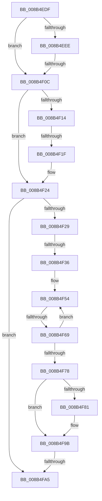

# sub_008B4EDF

- RVA: `0x008B4EDF`–`0x008B4FAE` (길이 `207` bytes)
- VA: `0x00000001408B4EDF`
- 실행 섹션: `PAGE`
- PDB 이름 있음: `아니요`; PDB Function 태그: `아니요`
- unwind 정보 RVA: `0x000829B0`
- 디코드: `46`개 명령, `207/207` bytes 표시
- 미해석 바이트: `0` (있으면 어셈블리에 `.byte`로 보존)

> 이 문서는 커널 이미지의 기계어와 PDB 기호를 분석해 생성했습니다. 4번과 5번은 함수 원형과 자료형을 바이너리 사용 방식에서 추정한 C 해석이며 원본 소스 복구 결과는 아닙니다.

## 1. Dependencies

- 직접 호출 지점: **2**; 고유 호출 대상: **2**
- 직접 호출자로 확인된 함수: **0**
- RIP 상대 이미지 참조: **2**

### Outgoing calls
- `0x008B4EFC` → [SeQueryInformationToken](SeQueryInformationToken_function_008B5090.md) (function, `0x008B5090`)
- `0x008B4F96` → [ObpPushStackInfo](../../text/21/ObpPushStackInfo_function_002109E4.md) (function, `0x002109E4`)

### Direct callers
- 이 함수 시작 RVA로 연결되는 직접 call은 확인되지 않았습니다. 간접 호출은 완전히 역산할 수 없습니다.

### Static image references
- `0x008B4F29` → RVA `0x00FD8010` (`PAGEDATA`; read)
- `0x008B4F78` → RVA `0x00FC5010` (`ALMOSTRO`; read)

## 2. Other-region calls and transfers

- 다른 실행 섹션으로 향하는 call: **1**
  - `0x008B4F96` → [ObpPushStackInfo](../../text/21/ObpPushStackInfo_function_002109E4.md) (`PAGE` → `.text`)
- call이 아닌 외부 분기/꼬리 이동: **5**
  - `0x008B4F06` → [sub_008B4FBA + 0xC](Unknown_function_008B4FBA.md) (`tail-transfer`)
  - `0x008B4F19` → [sub_008B4FF6](Unknown_function_008B4FF6.md) (`tail-transfer`)
  - `0x008B4F30` → [sub_008B500F + 0x12](Unknown_function_008B500F.md) (`tail-transfer`)
  - `0x008B4F63` → [sub_008B500F](Unknown_function_008B500F.md) (`tail-transfer`)
  - `0x008B4FA3` → [sub_008B4FBA](Unknown_function_008B4FBA.md) (`tail-transfer`)

## 3. Assembly (complete function range)

```asm
008B4EDF  48 89 7C 24 50                  mov qword ptr [rsp + 0x50], rdi
008B4EE4  C7 44 24 68 00 00 00 00         mov dword ptr [rsp + 0x68], 0
008B4EEC  75 1E                           jne 0x1408b4f0c
008B4EEE  48 8B 4A 10                     mov rcx, qword ptr [rdx + 0x10]
008B4EF2  4C 8D 44 24 68                  lea r8, [rsp + 0x68]
008B4EF7  BA 18 00 00 00                  mov edx, 0x18
008B4EFC  E8 8F 01 00 00                  call 0x1408b5090
008B4F01  83 7C 24 68 00                  cmp dword ptr [rsp + 0x68], 0
008B4F06  0F 85 BA 00 00 00               jne 0x1408b4fc6
008B4F0C  40 B7 01                        mov dil, 1
008B4F0F  48 85 DB                        test rbx, rbx
008B4F12  74 10                           je 0x1408b4f24
008B4F14  8B 03                           mov eax, dword ptr [rbx]
008B4F16  40 84 FF                        test dil, dil
008B4F19  0F 84 D7 00 00 00               je 0x1408b4ff6
008B4F1F  83 C8 03                        or eax, 3
008B4F22  89 03                           mov dword ptr [rbx], eax
008B4F24  40 84 F6                        test sil, sil
008B4F27  74 7C                           je 0x1408b4fa5
008B4F29  83 3D E0 30 72 00 00            cmp dword ptr [rip + 0x7230e0], 0
008B4F30  0F 85 EB 00 00 00               jne 0x1408b5021
008B4F36  65 48 8B 14 25 88 01 00 00      mov rdx, qword ptr gs:[0x188]
008B4F3F  48 8B 92 B8 00 00 00            mov rdx, qword ptr [rdx + 0xb8]
008B4F46  0F 0D 8A 48 02 00 00            prefetchw byte ptr [rdx + 0x248]
008B4F4D  48 8B 82 48 02 00 00            mov rax, qword ptr [rdx + 0x248]
008B4F54  4C 8B 44 24 30                  mov r8, qword ptr [rsp + 0x30]
008B4F59  48 8B C8                        mov rcx, rax
008B4F5C  49 33 C8                        xor rcx, r8
008B4F5F  48 83 F9 0F                     cmp rcx, 0xf
008B4F63  0F 83 A6 00 00 00               jae 0x1408b500f
008B4F69  48 8D 48 01                     lea rcx, [rax + 1]
008B4F6D  F0 48 0F B1 8A 48 02 00 00      lock cmpxchg qword ptr [rdx + 0x248], rcx
008B4F76  75 DC                           jne 0x1408b4f54
008B4F78  83 3D 91 00 71 00 00            cmp dword ptr [rip + 0x710091], 0
008B4F7F  74 1A                           je 0x1408b4f9b
008B4F81  48 8B 4C 24 30                  mov rcx, qword ptr [rsp + 0x30]
008B4F86  33 D2                           xor edx, edx
008B4F88  48 83 C1 D0                     add rcx, -0x30
008B4F8C  41 B9 53 65 53 75               mov r9d, 0x75536553
008B4F92  44 8D 42 01                     lea r8d, [rdx + 1]
008B4F96  E8 49 BA 95 FF                  call 0x1402109e4
008B4F9B  48 8B 4C 24 20                  mov rcx, qword ptr [rsp + 0x20]
008B4FA0  48 85 C9                        test rcx, rcx
008B4FA3  75 15                           jne 0x1408b4fba
008B4FA5  40 0F B6 C7                     movzx eax, dil
008B4FA9  48 8B 7C 24 50                  mov rdi, qword ptr [rsp + 0x50]
```

## 4. C-style interpretation (structured pseudocode)

```c
__int64 __fastcall sub_008B4EDF(__int64 a1, __int64 a2, __int64 a3, __int64 a4, __int64 a5, __int64 a6, __int64 a7, __int64 a8, __int64 a9, __int64 a10, __int64 a11, __int64 a12, unsigned int a13)
{
    __int64 result;
    unsigned __int64 v_stack_p20;
    unsigned __int64 v_stack_p50;
    unsigned int v_stack_p68;

    v_stack_p50 = v_rdi;
    v_stack_p68 = 0;
    if (condition_is_not_equal) goto loc_008B4F0C;
    result = SeQueryInformationToken(*(unsigned __int64 *)(a2 + 16), 24, a13, a4);
loc_008B4F0C:
    if (v_rbx == 0) goto loc_008B4F24;
    result = (unsigned int)(((unsigned int)(*(unsigned int *)(v_rbx))) | (3));
    *(unsigned int *)(v_rbx) = (unsigned int)(result);
loc_008B4F24:
    if ((unsigned __int8)(v_rsi) == 0) goto loc_008B4FA5;
loc_008B4F54:
    a1 = (*(unsigned __int64 *)(*(unsigned __int64 *)(*(unsigned __int64 *)(gs_base + (0 + 392)) + 184) + 584)) ^ (a6);
    if (a1 != 15) goto loc_008B4F54;
    result = *(unsigned __int64 *)(*(unsigned __int64 *)(*(unsigned __int64 *)(gs_base + (0 + 392)) + 184) + 584);
    if ((*(unsigned int *)(v_rip + 7405713)) != 0) {
        a1 = a6;
        a2 = 0;
        a1 = (a1) + (-48);
        a4 = 0x75536553ULL;
        a3 = a2 + 1;
        result = ObpPushStackInfo(a1, a2, a3, a4);
    }
loc_008B4FA5:
    return 1;
}
```

## 5. (Beta) C Style

```c
int64_t sub_008B4EDF(int64_t Arg1, void *Arg2, int64_t Arg3, int64_t Arg4, uint64_t Arg5, int64_t Arg6, uint64_t Arg7, uint64_t Arg8, uint64_t Arg9, int64_t Arg10, uint64_t Arg11, uint64_t Arg12, uint32_t Arg13)
{
    uint8_t *arg2 = (uint8_t *)Arg2;

    int64_t result;
    uint64_t v_stack_p20;
    uint64_t v_stack_p50;
    uint32_t v_stack_p68;

    v_stack_p50 = local_rdi;
    v_stack_p68 = 0;
    if (condition_is_not_equal) goto loc_008B4F0C;
    result = SeQueryInformationToken(*(uint64_t *)(arg2 + 0x10), 24, Arg13, Arg4);
loc_008B4F0C:
    if (local_rbx == 0) goto loc_008B4F24;
    result = (uint32_t)(((uint32_t)(*(uint32_t *)(local_rbx))) | (3));
    *(uint32_t *)(local_rbx) = (uint32_t)(result);
loc_008B4F24:
    if ((uint8_t)(local_rsi) == 0) goto loc_008B4FA5;
loc_008B4F54:
    Arg1 = (*(uint64_t *)(*(uint64_t *)(*(uint64_t *)(gs_base + (0 + 0x188)) + 0xB8) + 0x248)) ^ (Arg6);
    if (Arg1 != 15) goto loc_008B4F54;
    result = *(uint64_t *)(*(uint64_t *)(*(uint64_t *)(gs_base + (0 + 0x188)) + 0xB8) + 0x248);
    if ((*(uint32_t *)(v_rip + 0x710091)) != 0) {
        Arg1 = Arg6;
        Arg2 = 0;
        Arg1 = (Arg1) + (-48);
        Arg4 = 0x75536553ULL;
        Arg3 = Arg2 + 1;
        result = ObpPushStackInfo(Arg1, Arg2, Arg3, Arg4);
    }
loc_008B4FA5:
    return 1;
}
```

### 관측된 메모리 오프셋

구조체 형식이 확인되지 않은 접근은 인자 기준의 오프셋으로만 기록했습니다.

| 기준 인자 | 오프셋 표현 | 폭 (bit) | 접근 |
|---|---:|---:|---|
| `Arg2` | `+ 0x10` | `64` | `R` |

## 6. Execution-region graph

[열기: 2D/3D 그래프와 함수 탐색 컨트롤 패널](../../../control-panel.html?section=page&rva=0x008B4EDF&view=graph)

- 2D 그래프는 위에서 아래로 흐르고, 3D 그래프는 빈 공간을 드래그해 회전합니다. Shift+드래그는 이동, 휠은 확대·축소, 함수 노드 선택은 대상 보고서 이동입니다.

### Static fallback


