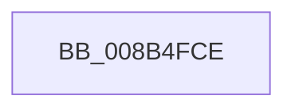

# sub_008B4FCE

- RVA: `0x008B4FCE`–`0x008B4FF6` (길이 `40` bytes)
- VA: `0x00000001408B4FCE`
- 실행 섹션: `PAGE`
- PDB 이름 있음: `아니요`; PDB Function 태그: `아니요`
- unwind 정보 RVA: `0x000829EC`
- 디코드: `8`개 명령, `40/40` bytes 표시
- 미해석 바이트: `0` (있으면 어셈블리에 `.byte`로 보존)

> 이 문서는 커널 이미지의 기계어와 PDB 기호를 분석해 생성했습니다. 4번과 5번은 함수 원형과 자료형을 바이너리 사용 방식에서 추정한 C 해석이며 원본 소스 복구 결과는 아닙니다.

## 1. Dependencies

- 직접 호출 지점: **2**; 고유 호출 대상: **2**
- 직접 호출자로 확인된 함수: **0**
- RIP 상대 이미지 참조: **0**

### Outgoing calls
- `0x008B4FCE` → [PsGetCurrentThreadProcess](../../text/47/PsGetCurrentThreadProcess_function_0047C7E0.md) (function, `0x0047C7E0`)
- `0x008B4FE4` → [SeCaptureSubjectContextEx](../8C/SeCaptureSubjectContextEx_function_008C4C90.md) (function, `0x008C4C90`)

### Direct callers
- 이 함수 시작 RVA로 연결되는 직접 call은 확인되지 않았습니다. 간접 호출은 완전히 역산할 수 없습니다.

### Static image references
- 디코드된 RIP-relative 메모리 참조가 없습니다.

## 2. Other-region calls and transfers

- 다른 실행 섹션으로 향하는 call: **1**
  - `0x008B4FCE` → [PsGetCurrentThreadProcess](../../text/47/PsGetCurrentThreadProcess_function_0047C7E0.md) (`PAGE` → `.text`)
- call이 아닌 외부 분기/꼬리 이동: **1**
  - `0x008B4FF1` → [CmpIsSystemEntity + 0x4B](CmpIsSystemEntity_function_008B4E90.md) (`tail-transfer`)

## 3. Assembly (complete function range)

```asm
008B4FCE  E8 0D 78 BC FF                  call 0x14047c7e0
008B4FD3  65 48 8B 0C 25 88 01 00 00      mov rcx, qword ptr gs:[0x188]
008B4FDC  4C 8D 44 24 20                  lea r8, [rsp + 0x20]
008B4FE1  48 8B D0                        mov rdx, rax
008B4FE4  E8 A7 FC 00 00                  call 0x1408c4c90
008B4FE9  48 8D 54 24 20                  lea rdx, [rsp + 0x20]
008B4FEE  40 B6 01                        mov sil, 1
008B4FF1  E9 E5 FE FF FF                  jmp 0x1408b4edb
```

## 4. C-style interpretation (structured pseudocode)

```c
__int64 __fastcall sub_008B4FCE(void)
{
    __int64 result;
    unsigned __int64 v_stack_p20;

    result = PsGetCurrentThreadProcess(a1, a2, a3, a4);
    result = SeCaptureSubjectContextEx(*(unsigned __int64 *)(gs_base + (0 + 392)), result, v_stack_p20, a4);
}
```

## 5. (Beta) C Style

```c
void sub_008B4FCE(void)
{
    int64_t result;
    uint64_t v_stack_p20;

    result = PsGetCurrentThreadProcess(a1, a2, a3, a4);
    result = SeCaptureSubjectContextEx(*(uint64_t *)(gs_base + (0 + 0x188)), result, v_stack_p20, a4);
}
```

## 6. Execution-region graph

[열기: 2D/3D 그래프와 함수 탐색 컨트롤 패널](../../../control-panel.html?section=page&rva=0x008B4FCE&view=graph)

- 2D 그래프는 위에서 아래로 흐르고, 3D 그래프는 빈 공간을 드래그해 회전합니다. Shift+드래그는 이동, 휠은 확대·축소, 함수 노드 선택은 대상 보고서 이동입니다.

### Static fallback


