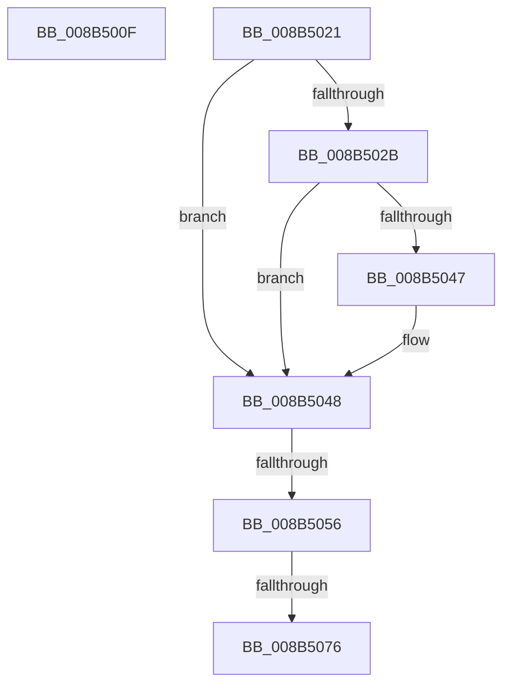

# sub_008B500F

- RVA: `0x008B500F`–`0x008B507C` (길이 `109` bytes)
- VA: `0x00000001408B500F`
- 실행 섹션: `PAGE`
- PDB 이름 있음: `아니요`; PDB Function 태그: `아니요`
- unwind 정보 RVA: `0x00082A24`
- 디코드: `23`개 명령, `109/109` bytes 표시
- 미해석 바이트: `0` (있으면 어셈블리에 `.byte`로 보존)

> 이 문서는 커널 이미지의 기계어와 PDB 기호를 분석해 생성했습니다. 4번과 5번은 함수 원형과 자료형을 바이너리 사용 방식에서 추정한 C 해석이며 원본 소스 복구 결과는 아닙니다.

## 1. Dependencies

- 직접 호출 지점: **1**; 고유 호출 대상: **1**
- 직접 호출자로 확인된 함수: **0**
- RIP 상대 이미지 참조: **1**

### Outgoing calls
- `0x008B5017` → [ObfDereferenceObjectWithTag](../../text/2F/ObfDereferenceObjectWithTag_function_002F78E0.md) (function, `0x002F78E0`)

### Direct callers
- 이 함수 시작 RVA로 연결되는 직접 call은 확인되지 않았습니다. 간접 호출은 완전히 역산할 수 없습니다.

### Static image references
- `0x008B5039` → RVA `0x00E67B90` (`.data`; read)

## 2. Other-region calls and transfers

- 다른 실행 섹션으로 향하는 call: **1**
  - `0x008B5017` → [ObfDereferenceObjectWithTag](../../text/2F/ObfDereferenceObjectWithTag_function_002F78E0.md) (`PAGE` → `.text`)
- call이 아닌 외부 분기/꼬리 이동: **4**
  - `0x008B501C` → [sub_008B4EDF + 0xBC](Unknown_function_008B4EDF.md) (`tail-transfer`)
  - `0x008B5050` → [sub_008B4EDF + 0x57](Unknown_function_008B4EDF.md) (`tail-transfer`)
  - `0x008B5070` → [sub_008B4EDF + 0x57](Unknown_function_008B4EDF.md) (`tail-transfer`)
  - `0x008B5077` → [sub_008B4EDF + 0x57](Unknown_function_008B4EDF.md) (`tail-transfer`)

## 3. Assembly (complete function range)

```asm
008B500F  BA 53 65 53 75                  mov edx, 0x75536553
008B5014  49 8B C8                        mov rcx, r8
008B5017  E8 C4 28 A4 FF                  call 0x1402f78e0
008B501C  E9 7A FF FF FF                  jmp 0x1408b4f9b
008B5021  48 8B 44 24 30                  mov rax, qword ptr [rsp + 0x30]
008B5026  48 85 C0                        test rax, rax
008B5029  74 1D                           je 0x1408b5048
008B502B  48 8B 80 78 04 00 00            mov rax, qword ptr [rax + 0x478]
008B5032  F0 FF 88 1C 01 00 00            lock dec dword ptr [rax + 0x11c]
008B5039  48 8B 05 50 2B 5B 00            mov rax, qword ptr [rip + 0x5b2b50]
008B5040  48 39 44 24 30                  cmp qword ptr [rsp + 0x30], rax
008B5045  75 01                           jne 0x1408b5048
008B5047  CC                              int3
008B5048  48 8B 44 24 20                  mov rax, qword ptr [rsp + 0x20]
008B504D  48 85 C0                        test rax, rax
008B5050  0F 84 E0 FE FF FF               je 0x1408b4f36
008B5056  48 8B 80 78 04 00 00            mov rax, qword ptr [rax + 0x478]
008B505D  F0 FF 88 1C 01 00 00            lock dec dword ptr [rax + 0x11c]
008B5064  48 8B 05 25 2B 5B 00            mov rax, qword ptr [rip + 0x5b2b25]
008B506B  48 39 44 24 20                  cmp qword ptr [rsp + 0x20], rax
008B5070  0F 85 C0 FE FF FF               jne 0x1408b4f36
008B5076  CC                              int3
008B5077  E9 BA FE FF FF                  jmp 0x1408b4f36
```

## 4. C-style interpretation (structured pseudocode)

```c
__int64 __fastcall sub_008B500F(__int64 a1, __int64 a2, __int64 a3)
{
    __int64 result;
    unsigned __int64 v_stack_p20;
    unsigned __int64 v_stack_p30;

    result = ObfDereferenceObjectWithTag(a3, (unsigned int)(0x75536553ULL), a3, a4);
}
```

## 5. (Beta) C Style

```c
int64_t sub_008B500F(int64_t Arg1, int64_t Arg2, int64_t Arg3)
{
    int64_t result;
    uint64_t v_stack_p20;
    uint64_t v_stack_p30;

    result = ObfDereferenceObjectWithTag(Arg3, (uint32_t)(0x75536553ULL), Arg3, a4);
}
```

## 6. Execution-region graph

[열기: 2D/3D 그래프와 함수 탐색 컨트롤 패널](../../../control-panel.html?section=page&rva=0x008B500F&view=graph)

- 2D 그래프는 위에서 아래로 흐르고, 3D 그래프는 빈 공간을 드래그해 회전합니다. Shift+드래그는 이동, 휠은 확대·축소, 함수 노드 선택은 대상 보고서 이동입니다.

### Static fallback


