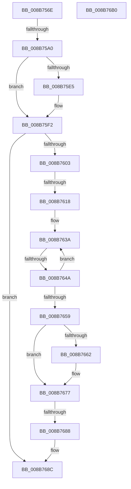

# sub_008B756E

- RVA: `0x008B756E`–`0x008B76B1` (길이 `323` bytes)
- VA: `0x00000001408B756E`
- 실행 섹션: `PAGE`
- PDB 이름 있음: `아니요`; PDB Function 태그: `아니요`
- unwind 정보 RVA: `0x00082B7C`
- 디코드: `75`개 명령, `323/323` bytes 표시
- 미해석 바이트: `0` (있으면 어셈블리에 `.byte`로 보존)

> 이 문서는 커널 이미지의 기계어와 PDB 기호를 분석해 생성했습니다. 4번과 5번은 함수 원형과 자료형을 바이너리 사용 방식에서 추정한 C 해석이며 원본 소스 복구 결과는 아닙니다.

## 1. Dependencies

- 직접 호출 지점: **6**; 고유 호출 대상: **6**
- 직접 호출자로 확인된 함수: **0**
- RIP 상대 이미지 참조: **2**

### Outgoing calls
- `0x008B7591` → [SepCreateAccessStateFromSubjectContext](../../text/3E/SepCreateAccessStateFromSubjectContext_function_003EBF40.md) (function, `0x003EBF40`)
- `0x008B75DA` → [ObpCreateHandle](../86/ObpCreateHandle_function_0086B950.md) (function, `0x0086B950`)
- `0x008B75ED` → [ObfDereferenceObjectWithTag](../../text/2F/ObfDereferenceObjectWithTag_function_002F78E0.md) (function, `0x002F78E0`)
- `0x008B7606` → [SepDeleteAccessState](../../text/3F/SepDeleteAccessState_function_003FFF20.md) (function, `0x003FFF20`)
- `0x008B7672` → [ObpPushStackInfo](../../text/21/ObpPushStackInfo_function_002109E4.md) (function, `0x002109E4`)
- `0x008B7699` → [_security_check_cookie](../../text/6A/_security_check_cookie_function_006AC640.md) (function, `0x006AC640`)

### Direct callers
- 이 함수 시작 RVA로 연결되는 직접 call은 확인되지 않았습니다. 간접 호출은 완전히 역산할 수 없습니다.

### Static image references
- `0x008B760B` → RVA `0x00FD8010` (`PAGEDATA`; read)
- `0x008B7659` → RVA `0x00FC5010` (`ALMOSTRO`; read)

## 2. Other-region calls and transfers

- 다른 실행 섹션으로 향하는 call: **5**
  - `0x008B7591` → [SepCreateAccessStateFromSubjectContext](../../text/3E/SepCreateAccessStateFromSubjectContext_function_003EBF40.md) (`PAGE` → `.text`)
  - `0x008B75ED` → [ObfDereferenceObjectWithTag](../../text/2F/ObfDereferenceObjectWithTag_function_002F78E0.md) (`PAGE` → `.text`)
  - `0x008B7606` → [SepDeleteAccessState](../../text/3F/SepDeleteAccessState_function_003FFF20.md) (`PAGE` → `.text`)
  - `0x008B7672` → [ObpPushStackInfo](../../text/21/ObpPushStackInfo_function_002109E4.md) (`PAGE` → `.text`)
  - `0x008B7699` → [_security_check_cookie](../../text/6A/_security_check_cookie_function_006AC640.md) (`PAGE` → `.text`)
- call이 아닌 외부 분기/꼬리 이동: **4**
  - `0x008B759A` → [sub_008B7711 + 0x36](Unknown_function_008B7711.md) (`tail-transfer`)
  - `0x008B7612` → [sub_008B7711 + 0x5C](Unknown_function_008B7711.md) (`tail-transfer`)
  - `0x008B7644` → [sub_008B7711 + 0x4A](Unknown_function_008B7711.md) (`tail-transfer`)
  - `0x008B7682` → [sub_008B7711](Unknown_function_008B7711.md) (`tail-transfer`)

## 3. Assembly (complete function range)

```asm
008B756E  44 8B 4C 24 60                  mov r9d, dword ptr [rsp + 0x60]
008B7573  48 8D 47 4C                     lea rax, [rdi + 0x4c]
008B7577  4C 8D 84 24 30 01 00 00         lea r8, [rsp + 0x130]
008B757F  48 89 44 24 20                  mov qword ptr [rsp + 0x20], rax
008B7584  48 8D 94 24 90 00 00 00         lea rdx, [rsp + 0x90]
008B758C  48 8D 4C 24 68                  lea rcx, [rsp + 0x68]
008B7591  E8 AA 49 B3 FF                  call 0x1403ebf40
008B7596  8B D8                           mov ebx, eax
008B7598  85 C0                           test eax, eax
008B759A  0F 88 A7 01 00 00               js 0x1408b7747
008B75A0  48 8D 9C 24 90 00 00 00         lea rbx, [rsp + 0x90]
008B75A8  45 33 ED                        xor r13d, r13d
008B75AB  4C 89 74 24 50                  mov qword ptr [rsp + 0x50], r14
008B75B0  45 33 C0                        xor r8d, r8d
008B75B3  4C 89 6C 24 48                  mov qword ptr [rsp + 0x48], r13
008B75B8  4C 8B CB                        mov r9, rbx
008B75BB  44 89 6C 24 40                  mov dword ptr [rsp + 0x40], r13d
008B75C0  48 8B D6                        mov rdx, rsi
008B75C3  4C 89 6C 24 38                  mov qword ptr [rsp + 0x38], r13
008B75C8  44 88 7C 24 30                  mov byte ptr [rsp + 0x30], r15b
008B75CD  41 8D 48 01                     lea ecx, [r8 + 1]
008B75D1  89 6C 24 28                     mov dword ptr [rsp + 0x28], ebp
008B75D5  44 89 6C 24 20                  mov dword ptr [rsp + 0x20], r13d
008B75DA  E8 71 43 FB FF                  call 0x14086b950
008B75DF  8B F8                           mov edi, eax
008B75E1  85 C0                           test eax, eax
008B75E3  79 0D                           jns 0x1408b75f2
008B75E5  BA 4F 62 48 6E                  mov edx, 0x6e48624f
008B75EA  48 8B CE                        mov rcx, rsi
008B75ED  E8 EE 02 A4 FF                  call 0x1402f78e0
008B75F2  48 8D 84 24 90 00 00 00         lea rax, [rsp + 0x90]
008B75FA  48 3B D8                        cmp rbx, rax
008B75FD  0F 85 89 00 00 00               jne 0x1408b768c
008B7603  48 8B CB                        mov rcx, rbx
008B7606  E8 15 89 B4 FF                  call 0x1403fff20
008B760B  83 3D FE 09 72 00 00            cmp dword ptr [rip + 0x7209fe], 0
008B7612  0F 85 55 01 00 00               jne 0x1408b776d
008B7618  65 48 8B 04 25 88 01 00 00      mov rax, qword ptr gs:[0x188]
008B7621  4C 8B 43 30                     mov r8, qword ptr [rbx + 0x30]
008B7625  48 8B 90 B8 00 00 00            mov rdx, qword ptr [rax + 0xb8]
008B762C  0F 0D 8A 48 02 00 00            prefetchw byte ptr [rdx + 0x248]
008B7633  48 8B 82 48 02 00 00            mov rax, qword ptr [rdx + 0x248]
008B763A  48 8B C8                        mov rcx, rax
008B763D  49 33 C8                        xor rcx, r8
008B7640  48 83 F9 0F                     cmp rcx, 0xf
008B7644  0F 83 11 01 00 00               jae 0x1408b775b
008B764A  48 8D 48 01                     lea rcx, [rax + 1]
008B764E  F0 48 0F B1 8A 48 02 00 00      lock cmpxchg qword ptr [rdx + 0x248], rcx
008B7657  75 E1                           jne 0x1408b763a
008B7659  83 3D B0 D9 70 00 00            cmp dword ptr [rip + 0x70d9b0], 0
008B7660  74 15                           je 0x1408b7677
008B7662  33 D2                           xor edx, edx
008B7664  49 8D 48 D0                     lea rcx, [r8 - 0x30]
008B7668  41 B9 53 65 53 75               mov r9d, 0x75536553
008B766E  44 8D 42 01                     lea r8d, [rdx + 1]
008B7672  E8 6D 93 95 FF                  call 0x1402109e4
008B7677  48 8B 4B 20                     mov rcx, qword ptr [rbx + 0x20]
008B767B  4C 89 6B 30                     mov qword ptr [rbx + 0x30], r13
008B767F  48 85 C9                        test rcx, rcx
008B7682  0F 85 89 00 00 00               jne 0x1408b7711
008B7688  4C 89 6B 20                     mov qword ptr [rbx + 0x20], r13
008B768C  8B C7                           mov eax, edi
008B768E  48 8B 8C 24 10 02 00 00         mov rcx, qword ptr [rsp + 0x210]
008B7696  48 33 CC                        xor rcx, rsp
008B7699  E8 A2 4F DF FF                  call 0x1406ac640
008B769E  48 81 C4 20 02 00 00            add rsp, 0x220
008B76A5  41 5F                           pop r15
008B76A7  41 5E                           pop r14
008B76A9  41 5D                           pop r13
008B76AB  5F                              pop rdi
008B76AC  5E                              pop rsi
008B76AD  5D                              pop rbp
008B76AE  5B                              pop rbx
008B76AF  C3                              ret
008B76B0  CC                              int3
```

## 4. C-style interpretation (structured pseudocode)

```c
__int64 __fastcall sub_008B756E(__int64 a1, __int64 a2, __int64 a3, __int64 a4, __int64 a5, __int64 a6, __int64 a7, __int64 a8, __int64 a9, __int64 a10, __int64 a11, unsigned int a12, __int64 a13, __int64 a14, __int64 a15, __int64 a16, __int64 a17, __int64 a18, __int64 a19, __int64 a20, __int64 a21, __int64 a22, __int64 a23, __int64 a24, __int64 a25, __int64 a26, __int64 a27, __int64 a28, __int64 a29, __int64 a30, __int64 a31, __int64 a32, __int64 a33, __int64 a34, __int64 a35, __int64 a36, __int64 a37, __int64 a38, __int64 a39, __int64 a40, __int64 a41, __int64 a42, __int64 a43, __int64 a44, __int64 a45, __int64 a46, __int64 a47, __int64 a48, __int64 a49, __int64 a50, __int64 a51, __int64 a52, __int64 a53, __int64 a54, __int64 a55, __int64 a56, __int64 a57, __int64 a58, __int64 a59, __int64 a60, __int64 a61, __int64 a62, __int64 a63, __int64 a64, __int64 a65, __int64 a66)
{
    __int64 result;
    __int64 v_r13;
    __int64 v_rsp;
    unsigned __int64 v_stack_p20;
    unsigned int v_stack_p28;
    unsigned __int8 v_stack_p30;
    unsigned __int64 v_stack_p38;
    unsigned int v_stack_p40;
    unsigned __int64 v_stack_p48;
    unsigned __int64 v_stack_p50;

    v_stack_p20 = v_rdi + 76;
    result = SepCreateAccessStateFromSubjectContext(a13, a18, a38, (unsigned int)(a12));
    v_r13 = 0;
    v_stack_p50 = v_r14;
    a3 = 0;
    v_stack_p48 = 0;
    v_stack_p40 = 0;
    v_stack_p38 = 0;
    v_stack_p30 = (unsigned __int8)(v_r15);
    v_stack_p28 = (unsigned int)(v_rbp);
    v_stack_p20 = 0;
    result = ObpCreateHandle(a3 + 1, v_rsi, a3, a18);
    if (sign_flag) {
        a2 = 0x6E48624FULL;
        a1 = v_rsi;
        result = ObfDereferenceObjectWithTag(a1, a2, a3, a18);
    }
    if (a18 != a18) goto loc_008B768C;
    result = SepDeleteAccessState(a18, a2, a3, a18);
loc_008B763A:
    a1 = (*(unsigned __int64 *)(*(unsigned __int64 *)(*(unsigned __int64 *)(gs_base + (0 + 392)) + 184) + 584)) ^ (*(unsigned __int64 *)(a18 + 48));
    if (a1 != 15) goto loc_008B763A;
    result = *(unsigned __int64 *)(*(unsigned __int64 *)(*(unsigned __int64 *)(gs_base + (0 + 392)) + 184) + 584);
    if ((*(unsigned int *)(v_rip + 7395760)) != 0) {
        a2 = 0;
        a1 = *(unsigned __int64 *)(a18 + 48) - 48;
        a4 = 0x75536553ULL;
        a3 = a2 + 1;
        result = ObpPushStackInfo(a1, a2, a3, a4);
    }
    *(unsigned __int64 *)(a18 + 48) = 0;
    *(unsigned __int64 *)(a18 + 32) = 0;
loc_008B768C:
    a1 = (a66) ^ (v_rsp);
    result = _security_check_cookie(a1, a2, a3, a4);
    v_rsp = (v_rsp) + (544);
    return result;
}
```

## 5. (Beta) C Style

```c
int64_t sub_008B756E(int64_t Arg1, int64_t Arg2, int64_t Arg3, int64_t Arg4, uint64_t Arg5, uint64_t Arg6, uint64_t Arg7, uint64_t Arg8, uint64_t Arg9, uint64_t Arg10, uint64_t Arg11, uint32_t Arg12, int64_t Arg13, uint64_t Arg14, uint64_t Arg15, uint64_t Arg16, uint64_t Arg17, int64_t Arg18, uint64_t Arg19, uint64_t Arg20, uint64_t Arg21, uint64_t Arg22, uint64_t Arg23, uint64_t Arg24, uint64_t Arg25, uint64_t Arg26, uint64_t Arg27, uint64_t Arg28, uint64_t Arg29, uint64_t Arg30, uint64_t Arg31, uint64_t Arg32, uint64_t Arg33, uint64_t Arg34, uint64_t Arg35, uint64_t Arg36, uint64_t Arg37, int64_t Arg38, uint64_t Arg39, uint64_t Arg40, uint64_t Arg41, uint64_t Arg42, uint64_t Arg43, uint64_t Arg44, uint64_t Arg45, uint64_t Arg46, uint64_t Arg47, uint64_t Arg48, uint64_t Arg49, uint64_t Arg50, uint64_t Arg51, uint64_t Arg52, uint64_t Arg53, uint64_t Arg54, uint64_t Arg55, uint64_t Arg56, uint64_t Arg57, uint64_t Arg58, uint64_t Arg59, uint64_t Arg60, uint64_t Arg61, uint64_t Arg62, uint64_t Arg63, uint64_t Arg64, uint64_t Arg65, int64_t Arg66)
{
    int64_t result;
    int64_t local_r13;
    int64_t local_rsp;
    uint64_t v_stack_p20;
    uint32_t v_stack_p28;
    uint8_t v_stack_p30;
    uint64_t v_stack_p38;
    uint32_t v_stack_p40;
    uint64_t v_stack_p48;
    uint64_t v_stack_p50;

    v_stack_p20 = local_rdi + 76;
    result = SepCreateAccessStateFromSubjectContext(Arg13, Arg18, Arg38, (uint32_t)(Arg12));
    local_r13 = 0;
    v_stack_p50 = local_r14;
    Arg3 = 0;
    v_stack_p48 = 0;
    v_stack_p40 = 0;
    v_stack_p38 = 0;
    v_stack_p30 = (uint8_t)(local_r15);
    v_stack_p28 = (uint32_t)(local_rbp);
    v_stack_p20 = 0;
    result = ObpCreateHandle(Arg3 + 1, local_rsi, Arg3, Arg18);
    if (sign_flag) {
        Arg2 = 0x6E48624FULL;
        Arg1 = local_rsi;
        result = ObfDereferenceObjectWithTag(Arg1, Arg2, Arg3, Arg18);
    }
    if (Arg18 != Arg18) goto loc_008B768C;
    result = SepDeleteAccessState(Arg18, Arg2, Arg3, Arg18);
loc_008B763A:
    Arg1 = (*(uint64_t *)(*(uint64_t *)(*(uint64_t *)(gs_base + (0 + 0x188)) + 0xB8) + 0x248)) ^ (*(uint64_t *)(Arg18 + 0x30));
    if (Arg1 != 15) goto loc_008B763A;
    result = *(uint64_t *)(*(uint64_t *)(*(uint64_t *)(gs_base + (0 + 0x188)) + 0xB8) + 0x248);
    if ((*(uint32_t *)(v_rip + 0x70D9B0)) != 0) {
        Arg2 = 0;
        Arg1 = *(uint64_t *)(Arg18 + 0x30) - 48;
        Arg4 = 0x75536553ULL;
        Arg3 = Arg2 + 1;
        result = ObpPushStackInfo(Arg1, Arg2, Arg3, Arg4);
    }
    *(uint64_t *)(Arg18 + 0x30) = 0;
    *(uint64_t *)(Arg18 + 0x20) = 0;
loc_008B768C:
    Arg1 = (Arg66) ^ (local_rsp);
    result = _security_check_cookie(Arg1, Arg2, Arg3, Arg4);
    local_rsp = (local_rsp) + (544);
    return result;
}
```

## 6. Execution-region graph

[열기: 2D/3D 그래프와 함수 탐색 컨트롤 패널](../../../control-panel.html?section=page&rva=0x008B756E&view=graph)

- 2D 그래프는 위에서 아래로 흐르고, 3D 그래프는 빈 공간을 드래그해 회전합니다. Shift+드래그는 이동, 휠은 확대·축소, 함수 노드 선택은 대상 보고서 이동입니다.

### Static fallback


