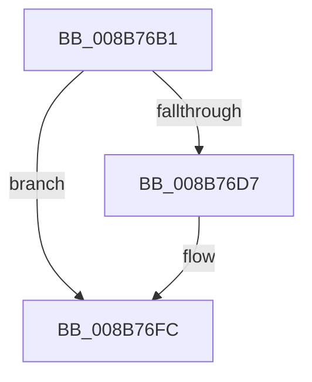

# sub_008B76B1

- RVA: `0x008B76B1`–`0x008B7711` (길이 `96` bytes)
- VA: `0x00000001408B76B1`
- 실행 섹션: `PAGE`
- PDB 이름 있음: `아니요`; PDB Function 태그: `아니요`
- unwind 정보 RVA: `0x00082B90`
- 디코드: `20`개 명령, `96/96` bytes 표시
- 미해석 바이트: `0` (있으면 어셈블리에 `.byte`로 보존)

> 이 문서는 커널 이미지의 기계어와 PDB 기호를 분석해 생성했습니다. 4번과 5번은 함수 원형과 자료형을 바이너리 사용 방식에서 추정한 C 해석이며 원본 소스 복구 결과는 아닙니다.

## 1. Dependencies

- 직접 호출 지점: **3**; 고유 호출 대상: **3**
- 직접 호출자로 확인된 함수: **0**
- RIP 상대 이미지 참조: **0**

### Outgoing calls
- `0x008B76C8` → [PspLockThreadSecurityShared](../../text/3C/PspLockThreadSecurityShared_function_003C4720.md) (function, `0x003C4720`)
- `0x008B76EA` → [ObfReferenceObjectWithTag](../../text/21/ObfReferenceObjectWithTag_function_00210710.md) (function, `0x00210710`)
- `0x008B7707` → [PspUnlockThreadSecurityShared](../../text/3C/PspUnlockThreadSecurityShared_function_003C2E40.md) (function, `0x003C2E40`)

### Direct callers
- 이 함수 시작 RVA로 연결되는 직접 call은 확인되지 않았습니다. 간접 호출은 완전히 역산할 수 없습니다.

### Static image references
- 디코드된 RIP-relative 메모리 참조가 없습니다.

## 2. Other-region calls and transfers

- 다른 실행 섹션으로 향하는 call: **3**
  - `0x008B76C8` → [PspLockThreadSecurityShared](../../text/3C/PspLockThreadSecurityShared_function_003C4720.md) (`PAGE` → `.text`)
  - `0x008B76EA` → [ObfReferenceObjectWithTag](../../text/21/ObfReferenceObjectWithTag_function_00210710.md) (`PAGE` → `.text`)
  - `0x008B7707` → [PspUnlockThreadSecurityShared](../../text/3C/PspUnlockThreadSecurityShared_function_003C2E40.md) (`PAGE` → `.text`)
- call이 아닌 외부 분기/꼬리 이동: **1**
  - `0x008B770C` → [sub_008B750F + 0x33](Unknown_function_008B750F.md) (`tail-transfer`)

## 3. Assembly (complete function range)

```asm
008B76B1  65 48 8B 04 25 88 01 00 00      mov rax, qword ptr gs:[0x188]
008B76BA  48 8B CB                        mov rcx, rbx
008B76BD  48 8B D0                        mov rdx, rax
008B76C0  48 89 84 24 88 00 00 00         mov qword ptr [rsp + 0x88], rax
008B76C8  E8 53 D0 B0 FF                  call 0x1403c4720
008B76CD  8B 83 A0 05 00 00               mov eax, dword ptr [rbx + 0x5a0]
008B76D3  A8 08                           test al, 8
008B76D5  74 25                           je 0x1408b76fc
008B76D7  4C 8B AB 38 05 00 00            mov r13, qword ptr [rbx + 0x538]
008B76DE  BA 53 65 53 75                  mov edx, 0x75536553
008B76E3  49 83 E5 F8                     and r13, 0xfffffffffffffff8
008B76E7  49 8B CD                        mov rcx, r13
008B76EA  E8 21 90 95 FF                  call 0x140210710
008B76EF  8B 83 38 05 00 00               mov eax, dword ptr [rbx + 0x538]
008B76F5  83 E0 03                        and eax, 3
008B76F8  89 44 24 70                     mov dword ptr [rsp + 0x70], eax
008B76FC  48 8B 94 24 88 00 00 00         mov rdx, qword ptr [rsp + 0x88]
008B7704  48 8B CB                        mov rcx, rbx
008B7707  E8 34 B7 B0 FF                  call 0x1403c2e40
008B770C  E9 31 FE FF FF                  jmp 0x1408b7542
```

## 4. C-style interpretation (structured pseudocode)

```c
__int64 __fastcall sub_008B76B1(__int64 a1, __int64 a2, __int64 a3, __int64 a4, __int64 a5, __int64 a6, __int64 a7, __int64 a8, __int64 a9, __int64 a10, __int64 a11, __int64 a12, __int64 a13, __int64 a14, __int64 a15, __int64 a16, __int64 a17)
{
    __int64 result;
    __int64 v_r13;
    unsigned int v_stack_p70;
    unsigned __int64 v_stack_p88;

    v_stack_p88 = *(unsigned __int64 *)(gs_base + (0 + 392));
    result = PspLockThreadSecurityShared(v_rbx, *(unsigned __int64 *)(gs_base + (0 + 392)), a3, a4);
    result = (unsigned int)(*(unsigned int *)(v_rbx + 1440));
    if ((((unsigned __int8)((unsigned int)(*(unsigned int *)(v_rbx + 1440)))) & (8)) != 0) {
        v_r13 = *(unsigned __int64 *)(v_rbx + 1336);
        a2 = 0x75536553ULL;
        v_r13 = (v_r13) & (-8);
        a1 = v_r13;
        result = ObfReferenceObjectWithTag(a1, a2, a3, a4);
        result = *(unsigned int *)(v_rbx + 1336);
        result = (unsigned int)((result) & (3));
        v_stack_p70 = (unsigned int)(result);
    }
    result = PspUnlockThreadSecurityShared(v_rbx, a17, a3, a4);
}
```

## 5. (Beta) C Style

```c
int64_t sub_008B76B1(int64_t Arg1, int64_t Arg2, int64_t Arg3, int64_t Arg4, uint64_t Arg5, uint64_t Arg6, uint64_t Arg7, uint64_t Arg8, uint64_t Arg9, uint64_t Arg10, uint64_t Arg11, uint64_t Arg12, uint64_t Arg13, uint64_t Arg14, uint64_t Arg15, uint64_t Arg16, int64_t Arg17)
{
    int64_t result;
    int64_t local_r13;
    uint32_t v_stack_p70;
    uint64_t v_stack_p88;

    v_stack_p88 = *(uint64_t *)(gs_base + (0 + 0x188));
    result = PspLockThreadSecurityShared(local_rbx, *(uint64_t *)(gs_base + (0 + 0x188)), Arg3, Arg4);
    result = (uint32_t)(*(uint32_t *)(local_rbx + 0x5A0));
    if ((((uint8_t)((uint32_t)(*(uint32_t *)(local_rbx + 0x5A0)))) & (8)) != 0) {
        local_r13 = *(uint64_t *)(local_rbx + 0x538);
        Arg2 = 0x75536553ULL;
        local_r13 = (local_r13) & (-8);
        Arg1 = local_r13;
        result = ObfReferenceObjectWithTag(Arg1, Arg2, Arg3, Arg4);
        result = *(uint32_t *)(local_rbx + 0x538);
        result = (uint32_t)((result) & (3));
        v_stack_p70 = (uint32_t)(result);
    }
    result = PspUnlockThreadSecurityShared(local_rbx, Arg17, Arg3, Arg4);
}
```

## 6. Execution-region graph

[열기: 2D/3D 그래프와 함수 탐색 컨트롤 패널](../../../control-panel.html?section=page&rva=0x008B76B1&view=graph)

- 2D 그래프는 위에서 아래로 흐르고, 3D 그래프는 빈 공간을 드래그해 회전합니다. Shift+드래그는 이동, 휠은 확대·축소, 함수 노드 선택은 대상 보고서 이동입니다.

### Static fallback


