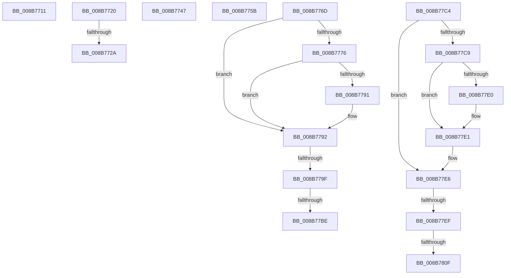

# sub_008B7711

- RVA: `0x008B7711`–`0x008B7815` (길이 `260` bytes)
- VA: `0x00000001408B7711`
- 실행 섹션: `PAGE`
- PDB 이름 있음: `아니요`; PDB Function 태그: `아니요`
- unwind 정보 RVA: `0x00082BA4`
- 디코드: `56`개 명령, `260/260` bytes 표시
- 미해석 바이트: `0` (있으면 어셈블리에 `.byte`로 보존)

> 이 문서는 커널 이미지의 기계어와 PDB 기호를 분석해 생성했습니다. 4번과 5번은 함수 원형과 자료형을 바이너리 사용 방식에서 추정한 C 해석이며 원본 소스 복구 결과는 아닙니다.

## 1. Dependencies

- 직접 호출 지점: **4**; 고유 호출 대상: **1**
- 직접 호출자로 확인된 함수: **0**
- RIP 상대 이미지 참조: **2**

### Outgoing calls
- `0x008B7716` → [ObfDereferenceObjectWithTag](../../text/2F/ObfDereferenceObjectWithTag_function_002F78E0.md) (function, `0x002F78E0`)
- `0x008B7738` → [ObfDereferenceObjectWithTag](../../text/2F/ObfDereferenceObjectWithTag_function_002F78E0.md) (function, `0x002F78E0`)
- `0x008B774F` → [ObfDereferenceObjectWithTag](../../text/2F/ObfDereferenceObjectWithTag_function_002F78E0.md) (function, `0x002F78E0`)
- `0x008B7763` → [ObfDereferenceObjectWithTag](../../text/2F/ObfDereferenceObjectWithTag_function_002F78E0.md) (function, `0x002F78E0`)

### Direct callers
- 이 함수 시작 RVA로 연결되는 직접 call은 확인되지 않았습니다. 간접 호출은 완전히 역산할 수 없습니다.

### Static image references
- `0x008B772A` → RVA `0x00F0F670` (`.data`; read/write)
- `0x008B7784` → RVA `0x00E67B90` (`.data`; read)

## 2. Other-region calls and transfers

- 다른 실행 섹션으로 향하는 call: **4**
  - `0x008B7716` → [ObfDereferenceObjectWithTag](../../text/2F/ObfDereferenceObjectWithTag_function_002F78E0.md) (`PAGE` → `.text`)
  - `0x008B7738` → [ObfDereferenceObjectWithTag](../../text/2F/ObfDereferenceObjectWithTag_function_002F78E0.md) (`PAGE` → `.text`)
  - `0x008B774F` → [ObfDereferenceObjectWithTag](../../text/2F/ObfDereferenceObjectWithTag_function_002F78E0.md) (`PAGE` → `.text`)
  - `0x008B7763` → [ObfDereferenceObjectWithTag](../../text/2F/ObfDereferenceObjectWithTag_function_002F78E0.md) (`PAGE` → `.text`)
- call이 아닌 외부 분기/꼬리 이동: **11**
  - `0x008B771B` → [sub_008B756E + 0x11A](Unknown_function_008B756E.md) (`tail-transfer`)
  - `0x008B7724` → [ObOpenObjectByPointer + 0xDA](ObOpenObjectByPointer_function_008B7420.md) (`tail-transfer`)
  - `0x008B7742` → [sub_008B756E + 0x120](Unknown_function_008B756E.md) (`tail-transfer`)
  - `0x008B7756` → [sub_008B756E + 0x120](Unknown_function_008B756E.md) (`tail-transfer`)
  - `0x008B7768` → [sub_008B756E + 0x109](Unknown_function_008B756E.md) (`tail-transfer`)
  - `0x008B7799` → [sub_008B756E + 0xAA](Unknown_function_008B756E.md) (`tail-transfer`)
  - `0x008B77B8` → [sub_008B756E + 0xAA](Unknown_function_008B756E.md) (`tail-transfer`)
  - `0x008B77BF` → [sub_008B756E + 0xAA](Unknown_function_008B756E.md) (`tail-transfer`)
  - `0x008B77E9` → [sub_008B756E](Unknown_function_008B756E.md) (`tail-transfer`)
  - `0x008B7809` → [sub_008B756E](Unknown_function_008B756E.md) (`tail-transfer`)
  - `0x008B7810` → [sub_008B756E](Unknown_function_008B756E.md) (`tail-transfer`)

## 3. Assembly (complete function range)

```asm
008B7711  BA 53 65 53 75                  mov edx, 0x75536553
008B7716  E8 C5 01 A4 FF                  call 0x1402f78e0
008B771B  E9 68 FF FF FF                  jmp 0x1408b7688
008B7720  4C 39 6E F0                     cmp qword ptr [rsi - 0x10], r13
008B7724  0F 84 D0 FD FF FF               je 0x1408b74fa
008B772A  FF 05 40 7F 65 00               inc dword ptr [rip + 0x657f40]
008B7730  BA 4F 62 48 6E                  mov edx, 0x6e48624f
008B7735  48 8B CE                        mov rcx, rsi
008B7738  E8 A3 01 A4 FF                  call 0x1402f78e0
008B773D  B8 0D 00 00 C0                  mov eax, 0xc000000d
008B7742  E9 47 FF FF FF                  jmp 0x1408b768e
008B7747  BA 4F 62 48 6E                  mov edx, 0x6e48624f
008B774C  48 8B CE                        mov rcx, rsi
008B774F  E8 8C 01 A4 FF                  call 0x1402f78e0
008B7754  8B C3                           mov eax, ebx
008B7756  E9 33 FF FF FF                  jmp 0x1408b768e
008B775B  BA 53 65 53 75                  mov edx, 0x75536553
008B7760  49 8B C8                        mov rcx, r8
008B7763  E8 78 01 A4 FF                  call 0x1402f78e0
008B7768  E9 0A FF FF FF                  jmp 0x1408b7677
008B776D  48 8B 43 30                     mov rax, qword ptr [rbx + 0x30]
008B7771  48 85 C0                        test rax, rax
008B7774  74 1C                           je 0x1408b7792
008B7776  48 8B 80 78 04 00 00            mov rax, qword ptr [rax + 0x478]
008B777D  F0 FF 88 1C 01 00 00            lock dec dword ptr [rax + 0x11c]
008B7784  48 8B 05 05 04 5B 00            mov rax, qword ptr [rip + 0x5b0405]
008B778B  48 39 43 30                     cmp qword ptr [rbx + 0x30], rax
008B778F  75 01                           jne 0x1408b7792
008B7791  CC                              int3
008B7792  48 8B 43 20                     mov rax, qword ptr [rbx + 0x20]
008B7796  48 85 C0                        test rax, rax
008B7799  0F 84 79 FE FF FF               je 0x1408b7618
008B779F  48 8B 80 78 04 00 00            mov rax, qword ptr [rax + 0x478]
008B77A6  F0 FF 88 1C 01 00 00            lock dec dword ptr [rax + 0x11c]
008B77AD  48 8B 05 DC 03 5B 00            mov rax, qword ptr [rip + 0x5b03dc]
008B77B4  48 39 43 20                     cmp qword ptr [rbx + 0x20], rax
008B77B8  0F 85 5A FE FF FF               jne 0x1408b7618
008B77BE  CC                              int3
008B77BF  E9 54 FE FF FF                  jmp 0x1408b7618
008B77C4  48 85 C0                        test rax, rax
008B77C7  74 1D                           je 0x1408b77e6
008B77C9  48 8B 88 78 04 00 00            mov rcx, qword ptr [rax + 0x478]
008B77D0  F0 FF 81 1C 01 00 00            lock inc dword ptr [rcx + 0x11c]
008B77D7  48 3B 05 B2 03 5B 00            cmp rax, qword ptr [rip + 0x5b03b2]
008B77DE  75 01                           jne 0x1408b77e1
008B77E0  CC                              int3
008B77E1  4C 8B 6C 24 68                  mov r13, qword ptr [rsp + 0x68]
008B77E6  4D 85 ED                        test r13, r13
008B77E9  0F 84 7F FD FF FF               je 0x1408b756e
008B77EF  49 8B 85 78 04 00 00            mov rax, qword ptr [r13 + 0x478]
008B77F6  F0 FF 80 1C 01 00 00            lock inc dword ptr [rax + 0x11c]
008B77FD  48 8B 05 8C 03 5B 00            mov rax, qword ptr [rip + 0x5b038c]
008B7804  48 39 44 24 68                  cmp qword ptr [rsp + 0x68], rax
008B7809  0F 85 5F FD FF FF               jne 0x1408b756e
008B780F  CC                              int3
008B7810  E9 59 FD FF FF                  jmp 0x1408b756e
```

## 4. C-style interpretation (structured pseudocode)

```c
__int64 __fastcall sub_008B7711(__int64 a1, __int64 a2, __int64 a3)
{
    __int64 result;
    unsigned __int64 v_stack_p68;

    result = ObfDereferenceObjectWithTag(a1, (unsigned int)(0x75536553ULL), a3, a4);
}
```

## 5. (Beta) C Style

```c
int64_t sub_008B7711(int64_t Arg1, int64_t Arg2, int64_t Arg3)
{
    int64_t result;
    uint64_t v_stack_p68;

    result = ObfDereferenceObjectWithTag(Arg1, (uint32_t)(0x75536553ULL), Arg3, a4);
}
```

## 6. Execution-region graph

[열기: 2D/3D 그래프와 함수 탐색 컨트롤 패널](../../../control-panel.html?section=page&rva=0x008B7711&view=graph)

- 2D 그래프는 위에서 아래로 흐르고, 3D 그래프는 빈 공간을 드래그해 회전합니다. Shift+드래그는 이동, 휠은 확대·축소, 함수 노드 선택은 대상 보고서 이동입니다.

### Static fallback


