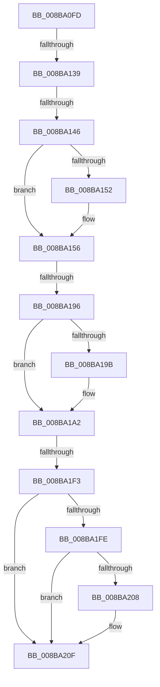

# sub_008BA0FD

- RVA: `0x008BA0FD`–`0x008BA229` (길이 `300` bytes)
- VA: `0x00000001408BA0FD`
- 실행 섹션: `PAGE`
- PDB 이름 있음: `아니요`; PDB Function 태그: `아니요`
- unwind 정보 RVA: `0x00082CD8`
- 디코드: `63`개 명령, `300/300` bytes 표시
- 미해석 바이트: `0` (있으면 어셈블리에 `.byte`로 보존)

> 이 문서는 커널 이미지의 기계어와 PDB 기호를 분석해 생성했습니다. 4번과 5번은 함수 원형과 자료형을 바이너리 사용 방식에서 추정한 C 해석이며 원본 소스 복구 결과는 아닙니다.

## 1. Dependencies

- 직접 호출 지점: **4**; 고유 호출 대상: **3**
- 직접 호출자로 확인된 함수: **0**
- RIP 상대 이미지 참조: **2**

### Outgoing calls
- `0x008BA182` → [SeAssignSecurityEx2](../../text/4E/SeAssignSecurityEx2_function_004E9AA0.md) (function, `0x004E9AA0`)
- `0x008BA19D` → [ExFreePoolWithTag](../../poolcode/B8/ExFreePoolWithTag_function_00B82870.md) (function, `0x00B82870`)
- `0x008BA1F3` → [SeDefaultObjectMethod](SeDefaultObjectMethod_function_008BA2B0.md) (function, `0x008BA2B0`)
- `0x008BA20A` → [ExFreePoolWithTag](../../poolcode/B8/ExFreePoolWithTag_function_00B82870.md) (function, `0x00B82870`)

### Direct callers
- 이 함수 시작 RVA로 연결되는 직접 call은 확인되지 않았습니다. 간접 호출은 완전히 역산할 수 없습니다.

### Static image references
- `0x008BA139` → RVA `0x00F0F650` (`.data`; read)
- `0x008BA1AB` → RVA `0x008BA2B0` (`SeDefaultObjectMethod`; read)

## 2. Other-region calls and transfers

- 다른 실행 섹션으로 향하는 call: **3**
  - `0x008BA182` → [SeAssignSecurityEx2](../../text/4E/SeAssignSecurityEx2_function_004E9AA0.md) (`PAGE` → `.text`)
  - `0x008BA19D` → [ExFreePoolWithTag](../../poolcode/B8/ExFreePoolWithTag_function_00B82870.md) (`PAGE` → `POOLCODE`)
  - `0x008BA20A` → [ExFreePoolWithTag](../../poolcode/B8/ExFreePoolWithTag_function_00B82870.md) (`PAGE` → `POOLCODE`)
- call이 아닌 외부 분기/꼬리 이동: **4**
  - `0x008BA133` → [sub_008BA23A + 0x10](Unknown_function_008BA23A.md) (`tail-transfer`)
  - `0x008BA140` → [sub_008BA23A + 0x53](Unknown_function_008BA23A.md) (`tail-transfer`)
  - `0x008BA190` → [sub_008BA23A](Unknown_function_008BA23A.md) (`tail-transfer`)
  - `0x008BA1ED` → [sub_008BA23A + 0x5A](Unknown_function_008BA23A.md) (`tail-transfer`)

## 3. Assembly (complete function range)

```asm
008BA0FD  48 89 AC 24 B8 00 00 00         mov qword ptr [rsp + 0xb8], rbp
008BA105  48 8D 6B 4C                     lea rbp, [rbx + 0x4c]
008BA109  48 89 BC 24 C0 00 00 00         mov qword ptr [rsp + 0xc0], rdi
008BA111  8B BC 24 B0 00 00 00            mov edi, dword ptr [rsp + 0xb0]
008BA118  0B BC 24 D0 00 00 00            or edi, dword ptr [rsp + 0xd0]
008BA11F  4C 89 B4 24 C8 00 00 00         mov qword ptr [rsp + 0xc8], r14
008BA127  4C 8D 76 20                     lea r14, [rsi + 0x20]
008BA12B  44 38 AC 24 D8 00 00 00         cmp byte ptr [rsp + 0xd8], r13b
008BA133  0F 85 11 01 00 00               jne 0x1408ba24a
008BA139  48 3B 1D 10 55 65 00            cmp rbx, qword ptr [rip + 0x655510]
008BA140  0F 84 47 01 00 00               je 0x1408ba28d
008BA146  33 C0                           xor eax, eax
008BA148  48 8B 54 24 60                  mov rdx, qword ptr [rsp + 0x60]
008BA14D  48 85 D2                        test rdx, rdx
008BA150  75 04                           jne 0x1408ba156
008BA152  48 8B 56 40                     mov rdx, qword ptr [rsi + 0x40]
008BA156  4C 89 64 24 50                  mov qword ptr [rsp + 0x50], r12
008BA15B  48 8D 4C 24 70                  lea rcx, [rsp + 0x70]
008BA160  48 89 6C 24 40                  mov qword ptr [rsp + 0x40], rbp
008BA165  4C 8D 44 24 68                  lea r8, [rsp + 0x68]
008BA16A  4C 89 74 24 38                  mov qword ptr [rsp + 0x38], r14
008BA16F  45 33 C9                        xor r9d, r9d
008BA172  48 89 4C 24 30                  mov qword ptr [rsp + 0x30], rcx
008BA177  49 8B CF                        mov rcx, r15
008BA17A  89 7C 24 28                     mov dword ptr [rsp + 0x28], edi
008BA17E  88 44 24 20                     mov byte ptr [rsp + 0x20], al
008BA182  E8 19 F9 C2 FF                  call 0x1404e9aa0
008BA187  48 8B 4C 24 60                  mov rcx, qword ptr [rsp + 0x60]
008BA18C  8B F8                           mov edi, eax
008BA18E  85 C0                           test eax, eax
008BA190  0F 88 A4 00 00 00               js 0x1408ba23a
008BA196  48 85 C9                        test rcx, rcx
008BA199  74 07                           je 0x1408ba1a2
008BA19B  33 D2                           xor edx, edx
008BA19D  E8 CE 86 2C 00                  call 0x140b82870
008BA1A2  65 48 8B 04 25 88 01 00 00      mov rax, qword ptr gs:[0x188]
008BA1AB  48 8D 15 FE 00 00 00            lea rdx, [rip + 0xfe]
008BA1B2  4C 8B 4C 24 68                  mov r9, qword ptr [rsp + 0x68]
008BA1B7  45 33 C0                        xor r8d, r8d
008BA1BA  0F B6 88 32 02 00 00            movzx ecx, byte ptr [rax + 0x232]
008BA1C1  48 8B 83 98 00 00 00            mov rax, qword ptr [rbx + 0x98]
008BA1C8  88 4C 24 40                     mov byte ptr [rsp + 0x40], cl
008BA1CC  48 3B C2                        cmp rax, rdx
008BA1CF  48 89 6C 24 38                  mov qword ptr [rsp + 0x38], rbp
008BA1D4  41 8D 50 03                     lea edx, [r8 + 3]
008BA1D8  C7 44 24 30 01 00 00 00         mov dword ptr [rsp + 0x30], 1
008BA1E0  49 8B CC                        mov rcx, r12
008BA1E3  4C 89 6C 24 28                  mov qword ptr [rsp + 0x28], r13
008BA1E8  4C 89 6C 24 20                  mov qword ptr [rsp + 0x20], r13
008BA1ED  0F 85 A1 00 00 00               jne 0x1408ba294
008BA1F3  E8 B8 00 00 00                  call 0x1408ba2b0
008BA1F8  8B D8                           mov ebx, eax
008BA1FA  85 C0                           test eax, eax
008BA1FC  79 11                           jns 0x1408ba20f
008BA1FE  48 8B 4C 24 68                  mov rcx, qword ptr [rsp + 0x68]
008BA203  48 85 C9                        test rcx, rcx
008BA206  74 07                           je 0x1408ba20f
008BA208  33 D2                           xor edx, edx
008BA20A  E8 61 86 2C 00                  call 0x140b82870
008BA20F  8B C3                           mov eax, ebx
008BA211  48 8B BC 24 C0 00 00 00         mov rdi, qword ptr [rsp + 0xc0]
008BA219  48 8B AC 24 B8 00 00 00         mov rbp, qword ptr [rsp + 0xb8]
008BA221  4C 8B B4 24 C8 00 00 00         mov r14, qword ptr [rsp + 0xc8]
```

## 4. C-style interpretation (structured pseudocode)

```c
__int64 __fastcall sub_008BA0FD(__int64 a1, __int64 a2, __int64 a3, int a4, __int64 a5, __int64 a6, __int64 a7, __int64 a8, __int64 a9, __int64 a10, __int64 a11, __int64 a12, __int64 a13, __int64 a14, __int64 a15, __int64 a16, __int64 a17, __int64 a18, __int64 a19, __int64 a20, __int64 a21, unsigned int a22, __int64 a23, __int64 a24, __int64 a25, unsigned int a26, unsigned __int8 a27)
{
    __int64 result;
    __int64 v_rdi;
    unsigned __int8 v_stack_p20;
    unsigned int v_stack_p28;
    unsigned __int64 v_stack_p30;
    unsigned __int64 v_stack_p38;
    unsigned __int64 v_stack_p40;
    unsigned __int64 v_stack_p50;
    unsigned __int64 v_stack_pB8;
    unsigned __int64 v_stack_pC0;
    unsigned __int64 v_stack_pC8;

    v_stack_pB8 = v_rbp;
    v_stack_pC0 = v_rdi;
    v_rdi = (unsigned int)(((unsigned int)(a22)) | (a26));
    v_stack_pC8 = v_r14;
    result = 0;
    if (a12 == 0) {
        a2 = *(unsigned __int64 *)(v_rsi + 64);
    }
    v_stack_p50 = v_r12;
    v_stack_p40 = v_rbx + 76;
    v_stack_p38 = v_rsi + 32;
    a4 = 0;
    v_stack_p30 = a14;
    v_stack_p28 = (unsigned int)(v_rdi);
    v_stack_p20 = 0;
    result = SeAssignSecurityEx2(v_r15, a2, a13, a4);
    if (a12 != 0) {
        a2 = 0;
        result = ExFreePoolWithTag(a12, a2, a13, a4);
    }
    a3 = 0;
    v_stack_p40 = (unsigned __int8)(*(unsigned __int8 *)(*(unsigned __int64 *)(gs_base + (0 + 392)) + 562));
    v_stack_p38 = v_rbx + 76;
    v_stack_p30 = 1;
    v_stack_p28 = v_r13;
    v_stack_p20 = v_r13;
    result = SeDefaultObjectMethod(v_r12, a3 + 3, a3, a13);
    if (!sign_flag) goto loc_008BA20F;
    if (a13 != 0) {
        a2 = 0;
        result = ExFreePoolWithTag(a13, a2, a3, a13);
    }
    return (unsigned int)((unsigned int)((unsigned int)((unsigned int)(result))));
}
```

## 5. (Beta) C Style

```c
int64_t sub_008BA0FD(int64_t Arg1, int64_t Arg2, int64_t Arg3, int32_t Arg4, uint64_t Arg5, uint64_t Arg6, uint64_t Arg7, uint64_t Arg8, uint64_t Arg9, uint64_t Arg10, uint64_t Arg11, int64_t Arg12, int64_t Arg13, int64_t Arg14, uint64_t Arg15, uint64_t Arg16, uint64_t Arg17, uint64_t Arg18, uint64_t Arg19, uint64_t Arg20, uint64_t Arg21, uint32_t Arg22, int64_t Arg23, int64_t Arg24, int64_t Arg25, uint32_t Arg26, uint8_t Arg27)
{
    int64_t result;
    int64_t local_rdi;
    uint8_t v_stack_p20;
    uint32_t v_stack_p28;
    uint64_t v_stack_p30;
    uint64_t v_stack_p38;
    uint64_t v_stack_p40;
    uint64_t v_stack_p50;
    uint64_t v_stack_pB8;
    uint64_t v_stack_pC0;
    uint64_t v_stack_pC8;

    v_stack_pB8 = local_rbp;
    v_stack_pC0 = local_rdi;
    local_rdi = (uint32_t)(((uint32_t)(Arg22)) | (Arg26));
    v_stack_pC8 = local_r14;
    result = 0;
    if (Arg12 == 0) {
        Arg2 = *(uint64_t *)(local_rsi + 0x40);
    }
    v_stack_p50 = local_r12;
    v_stack_p40 = local_rbx + 76;
    v_stack_p38 = local_rsi + 32;
    Arg4 = 0;
    v_stack_p30 = Arg14;
    v_stack_p28 = (uint32_t)(local_rdi);
    v_stack_p20 = 0;
    result = SeAssignSecurityEx2(local_r15, Arg2, Arg13, Arg4);
    if (Arg12 != 0) {
        Arg2 = 0;
        result = ExFreePoolWithTag(Arg12, Arg2, Arg13, Arg4);
    }
    Arg3 = 0;
    v_stack_p40 = (uint8_t)(*(uint8_t *)(*(uint64_t *)(gs_base + (0 + 0x188)) + 0x232));
    v_stack_p38 = local_rbx + 76;
    v_stack_p30 = 1;
    v_stack_p28 = local_r13;
    v_stack_p20 = local_r13;
    result = SeDefaultObjectMethod(local_r12, Arg3 + 3, Arg3, Arg13);
    if (!sign_flag) goto loc_008BA20F;
    if (Arg13 != 0) {
        Arg2 = 0;
        result = ExFreePoolWithTag(Arg13, Arg2, Arg3, Arg13);
    }
    return (uint32_t)((uint32_t)((uint32_t)((uint32_t)(result))));
}
```

## 6. Execution-region graph

[열기: 2D/3D 그래프와 함수 탐색 컨트롤 패널](../../../control-panel.html?section=page&rva=0x008BA0FD&view=graph)

- 2D 그래프는 위에서 아래로 흐르고, 3D 그래프는 빈 공간을 드래그해 회전합니다. Shift+드래그는 이동, 휠은 확대·축소, 함수 노드 선택은 대상 보고서 이동입니다.

### Static fallback


