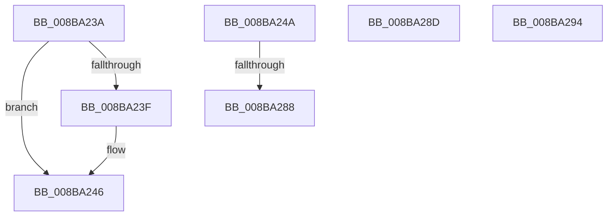

# sub_008BA23A

- RVA: `0x008BA23A`–`0x008BA29E` (길이 `100` bytes)
- VA: `0x00000001408BA23A`
- 실행 섹션: `PAGE`
- PDB 이름 있음: `아니요`; PDB Function 태그: `아니요`
- unwind 정보 RVA: `0x00082D08`
- 디코드: `26`개 명령, `100/100` bytes 표시
- 미해석 바이트: `0` (있으면 어셈블리에 `.byte`로 보존)

> 이 문서는 커널 이미지의 기계어와 PDB 기호를 분석해 생성했습니다. 4번과 5번은 함수 원형과 자료형을 바이너리 사용 방식에서 추정한 C 해석이며 원본 소스 복구 결과는 아닙니다.

## 1. Dependencies

- 직접 호출 지점: **3**; 고유 호출 대상: **3**
- 직접 호출자로 확인된 함수: **0**
- RIP 상대 이미지 참조: **1**

### Outgoing calls
- `0x008BA241` → [ExFreePoolWithTag](../../poolcode/B8/ExFreePoolWithTag_function_00B82870.md) (function, `0x00B82870`)
- `0x008BA27F` → [SeAssignSecurityEx2](../../text/4E/SeAssignSecurityEx2_function_004E9AA0.md) (function, `0x004E9AA0`)
- `0x008BA294` → [guard_dispatch_icall](../../text/6B/guard_dispatch_icall_function_006BAAD0.md) (function, `0x006BAAD0`)

### Direct callers
- 이 함수 시작 RVA로 연결되는 직접 call은 확인되지 않았습니다. 간접 호출은 완전히 역산할 수 없습니다.

### Static image references
- `0x008BA24A` → RVA `0x00F0F650` (`.data`; read)

## 2. Other-region calls and transfers

- 다른 실행 섹션으로 향하는 call: **3**
  - `0x008BA241` → [ExFreePoolWithTag](../../poolcode/B8/ExFreePoolWithTag_function_00B82870.md) (`PAGE` → `POOLCODE`)
  - `0x008BA27F` → [SeAssignSecurityEx2](../../text/4E/SeAssignSecurityEx2_function_004E9AA0.md) (`PAGE` → `.text`)
  - `0x008BA294` → [guard_dispatch_icall](../../text/6B/guard_dispatch_icall_function_006BAAD0.md) (`PAGE` → `.text`)
- call이 아닌 외부 분기/꼬리 이동: **5**
  - `0x008BA248` → [sub_008BA0FD + 0x114](Unknown_function_008BA0FD.md) (`tail-transfer`)
  - `0x008BA286` → [sub_008BA0FD + 0x114](Unknown_function_008BA0FD.md) (`tail-transfer`)
  - `0x008BA288` → [sub_008BA0FD + 0x3C](Unknown_function_008BA0FD.md) (`tail-transfer`)
  - `0x008BA28F` → [sub_008BA0FD + 0x4B](Unknown_function_008BA0FD.md) (`tail-transfer`)
  - `0x008BA299` → [sub_008BA0FD + 0xFB](Unknown_function_008BA0FD.md) (`tail-transfer`)

## 3. Assembly (complete function range)

```asm
008BA23A  48 85 C9                        test rcx, rcx
008BA23D  74 07                           je 0x1408ba246
008BA23F  33 D2                           xor edx, edx
008BA241  E8 2A 86 2C 00                  call 0x140b82870
008BA246  8B C7                           mov eax, edi
008BA248  EB C7                           jmp 0x1408ba211
008BA24A  48 3B 1D FF 53 65 00            cmp rbx, qword ptr [rip + 0x6553ff]
008BA251  4C 8D 44 24 60                  lea r8, [rsp + 0x60]
008BA256  48 8B 56 40                     mov rdx, qword ptr [rsi + 0x40]
008BA25A  4C 89 6C 24 50                  mov qword ptr [rsp + 0x50], r13
008BA25F  0F 94 C0                        sete al
008BA262  48 89 6C 24 40                  mov qword ptr [rsp + 0x40], rbp
008BA267  45 33 C9                        xor r9d, r9d
008BA26A  4C 89 74 24 38                  mov qword ptr [rsp + 0x38], r14
008BA26F  33 C9                           xor ecx, ecx
008BA271  4C 89 6C 24 30                  mov qword ptr [rsp + 0x30], r13
008BA276  44 89 6C 24 28                  mov dword ptr [rsp + 0x28], r13d
008BA27B  88 44 24 20                     mov byte ptr [rsp + 0x20], al
008BA27F  E8 1C F8 C2 FF                  call 0x1404e9aa0
008BA284  85 C0                           test eax, eax
008BA286  78 89                           js 0x1408ba211
008BA288  E9 AC FE FF FF                  jmp 0x1408ba139
008BA28D  B0 01                           mov al, 1
008BA28F  E9 B4 FE FF FF                  jmp 0x1408ba148
008BA294  E8 37 08 E0 FF                  call 0x1406baad0
008BA299  E9 5A FF FF FF                  jmp 0x1408ba1f8
```

## 4. C-style interpretation (structured pseudocode)

```c
__int64 __fastcall sub_008BA23A(__int64 a1, int a2, __int64 a3, int a4)
{
    __int64 result;
    unsigned __int8 v_stack_p20;
    unsigned int v_stack_p28;
    unsigned __int64 v_stack_p30;
    unsigned __int64 v_stack_p38;
    unsigned __int64 v_stack_p40;
    unsigned __int64 v_stack_p50;
    unsigned __int64 v_stack_p60;

    if (a1 != 0) {
        a2 = 0;
        result = ExFreePoolWithTag(a1, a2, a3, a4);
    }
}
```

## 5. (Beta) C Style

```c
int64_t sub_008BA23A(int64_t Arg1, int32_t Arg2, int64_t Arg3, int32_t Arg4)
{
    int64_t result;
    uint8_t v_stack_p20;
    uint32_t v_stack_p28;
    uint64_t v_stack_p30;
    uint64_t v_stack_p38;
    uint64_t v_stack_p40;
    uint64_t v_stack_p50;
    uint64_t v_stack_p60;

    if (Arg1 != 0) {
        Arg2 = 0;
        result = ExFreePoolWithTag(Arg1, Arg2, Arg3, Arg4);
    }
}
```

## 6. Execution-region graph

[열기: 2D/3D 그래프와 함수 탐색 컨트롤 패널](../../../control-panel.html?section=page&rva=0x008BA23A&view=graph)

- 2D 그래프는 위에서 아래로 흐르고, 3D 그래프는 빈 공간을 드래그해 회전합니다. Shift+드래그는 이동, 휠은 확대·축소, 함수 노드 선택은 대상 보고서 이동입니다.

### Static fallback


