# sub_008BA32C

- RVA: `0x008BA32C`–`0x008BA676` (길이 `842` bytes)
- VA: `0x00000001408BA32C`
- 실행 섹션: `PAGE`
- PDB 이름 있음: `아니요`; PDB Function 태그: `아니요`
- unwind 정보 RVA: `0x00082D3C`
- 디코드: `219`개 명령, `842/842` bytes 표시
- 미해석 바이트: `0` (있으면 어셈블리에 `.byte`로 보존)

> 이 문서는 커널 이미지의 기계어와 PDB 기호를 분석해 생성했습니다. 4번과 5번은 함수 원형과 자료형을 바이너리 사용 방식에서 추정한 C 해석이며 원본 소스 복구 결과는 아닙니다.

## 1. Dependencies

- 직접 호출 지점: **14**; 고유 호출 대상: **9**
- 직접 호출자로 확인된 함수: **0**
- RIP 상대 이미지 참조: **1**

### Outgoing calls
- `0x008BA47F` → [KeAbPreAcquire](../../text/21/KeAbPreAcquire_function_00210230.md) (function, `0x00210230`)
- `0x008BA4A1` → [ExfAcquirePushLockSharedEx](../../text/21/ExfAcquirePushLockSharedEx_function_0021044C.md) (function, `0x0021044C`)
- `0x008BA4F8` → [ExfReleasePushLockShared](../../text/26/ExfReleasePushLockShared_function_00263440.md) (function, `0x00263440`)
- `0x008BA500` → [KeAbPostRelease](../../text/2E/KeAbPostRelease_function_002E1600.md) (function, `0x002E1600`)
- `0x008BA50A` → [KeLeaveCriticalRegionThread](../../text/25/KeLeaveCriticalRegionThread_function_0025EFF0.md) (function, `0x0025EFF0`)
- `0x008BA527` → [ExAllocatePool2](../../poolcode/B8/ExAllocatePool2_function_00B820F0.md) (function, `0x00B820F0`)
- `0x008BA54F` → [memcpy](../../text/6C/memcpy_function_006C6840.md) (function, `0x006C6840`)
- `0x008BA56D` → [KeAbPreAcquire](../../text/21/KeAbPreAcquire_function_00210230.md) (function, `0x00210230`)
- `0x008BA593` → [ExfAcquirePushLockSharedEx](../../text/21/ExfAcquirePushLockSharedEx_function_0021044C.md) (function, `0x0021044C`)
- `0x008BA5E7` → [memcmp](../../text/6C/memcmp_function_006C6B10.md) (function, `0x006C6B10`)
- `0x008BA617` → [KeAbPostRelease](../../text/2E/KeAbPostRelease_function_002E1600.md) (function, `0x002E1600`)
- `0x008BA621` → [KeLeaveCriticalRegionThread](../../text/25/KeLeaveCriticalRegionThread_function_0025EFF0.md) (function, `0x0025EFF0`)
- `0x008BA638` → [ExFreePoolWithTag](../../poolcode/B8/ExFreePoolWithTag_function_00B82870.md) (function, `0x00B82870`)
- `0x008BA645` → [ExFreePoolWithTag](../../poolcode/B8/ExFreePoolWithTag_function_00B82870.md) (function, `0x00B82870`)

### Direct callers
- 이 함수 시작 RVA로 연결되는 직접 call은 확인되지 않았습니다. 간접 호출은 완전히 역산할 수 없습니다.

### Static image references
- `0x008BA449` → RVA `0x00FD0EC0` (`CACHEALI`; read)

## 2. Other-region calls and transfers

- 다른 실행 섹션으로 향하는 call: **14**
  - `0x008BA47F` → [KeAbPreAcquire](../../text/21/KeAbPreAcquire_function_00210230.md) (`PAGE` → `.text`)
  - `0x008BA4A1` → [ExfAcquirePushLockSharedEx](../../text/21/ExfAcquirePushLockSharedEx_function_0021044C.md) (`PAGE` → `.text`)
  - `0x008BA4F8` → [ExfReleasePushLockShared](../../text/26/ExfReleasePushLockShared_function_00263440.md) (`PAGE` → `.text`)
  - `0x008BA500` → [KeAbPostRelease](../../text/2E/KeAbPostRelease_function_002E1600.md) (`PAGE` → `.text`)
  - `0x008BA50A` → [KeLeaveCriticalRegionThread](../../text/25/KeLeaveCriticalRegionThread_function_0025EFF0.md) (`PAGE` → `.text`)
  - `0x008BA527` → [ExAllocatePool2](../../poolcode/B8/ExAllocatePool2_function_00B820F0.md) (`PAGE` → `POOLCODE`)
  - `0x008BA54F` → [memcpy](../../text/6C/memcpy_function_006C6840.md) (`PAGE` → `.text`)
  - `0x008BA56D` → [KeAbPreAcquire](../../text/21/KeAbPreAcquire_function_00210230.md) (`PAGE` → `.text`)
  - `0x008BA593` → [ExfAcquirePushLockSharedEx](../../text/21/ExfAcquirePushLockSharedEx_function_0021044C.md) (`PAGE` → `.text`)
  - `0x008BA5E7` → [memcmp](../../text/6C/memcmp_function_006C6B10.md) (`PAGE` → `.text`)
  - `0x008BA617` → [KeAbPostRelease](../../text/2E/KeAbPostRelease_function_002E1600.md) (`PAGE` → `.text`)
  - `0x008BA621` → [KeLeaveCriticalRegionThread](../../text/25/KeLeaveCriticalRegionThread_function_0025EFF0.md) (`PAGE` → `.text`)
  - `0x008BA638` → [ExFreePoolWithTag](../../poolcode/B8/ExFreePoolWithTag_function_00B82870.md) (`PAGE` → `POOLCODE`)
  - `0x008BA645` → [ExFreePoolWithTag](../../poolcode/B8/ExFreePoolWithTag_function_00B82870.md) (`PAGE` → `POOLCODE`)
- call이 아닌 외부 분기/꼬리 이동: **14**
  - `0x008BA33E` → [sub_008BA74A + 0xD](Unknown_function_008BA74A.md) (`tail-transfer`)
  - `0x008BA347` → [sub_008BAA6F + 0x1A](Unknown_function_008BAA6F.md) (`tail-transfer`)
  - `0x008BA350` → [sub_008BAC72 + 0x3E](Unknown_function_008BAC72.md) (`tail-transfer`)
  - `0x008BA359` → [sub_008BAC72 + 0x5B](Unknown_function_008BAC72.md) (`tail-transfer`)
  - `0x008BA399` → [sub_008BA74A](Unknown_function_008BA74A.md) (`tail-transfer`)
  - `0x008BA3C9` → [sub_008BAA6F + 0x1CF](Unknown_function_008BAA6F.md) (`tail-transfer`)
  - `0x008BA3F1` → [sub_008BAC72 + 0x67](Unknown_function_008BAC72.md) (`tail-transfer`)
  - `0x008BA4E0` → [sub_008BA74A + 0x2A6](Unknown_function_008BA74A.md) (`tail-transfer`)
  - `0x008BA514` → [sub_008BAC72 + 0x70](Unknown_function_008BAC72.md) (`tail-transfer`)
  - `0x008BA534` → [sub_008BAC72 + 0x70](Unknown_function_008BAC72.md) (`tail-transfer`)
  - `0x008BA5F9` → [sub_008BAA6F + 0x1B6](Unknown_function_008BAA6F.md) (`tail-transfer`)
  - `0x008BA60E` → [sub_008BAA6F + 0x1C2](Unknown_function_008BAA6F.md) (`tail-transfer`)
  - `0x008BA64D` → [sub_008BAC72 + 0x23](Unknown_function_008BAC72.md) (`tail-transfer`)
  - `0x008BA671` → [SeDefaultObjectMethod + 0x64](SeDefaultObjectMethod_function_008BA2B0.md) (`tail-transfer`)

## 3. Assembly (complete function range)

```asm
008BA32C  4C 89 A4 24 B0 00 00 00         mov qword ptr [rsp + 0xb0], r12
008BA334  4C 89 AC 24 B8 00 00 00         mov qword ptr [rsp + 0xb8], r13
008BA33C  85 D2                           test edx, edx
008BA33E  0F 84 13 04 00 00               je 0x1408ba757
008BA344  83 EA 01                        sub edx, 1
008BA347  0F 84 3C 07 00 00               je 0x1408baa89
008BA34D  83 FA 02                        cmp edx, 2
008BA350  0F 85 5A 09 00 00               jne 0x1408bacb0
008BA356  48 85 ED                        test rbp, rbp
008BA359  0F 84 6E 09 00 00               je 0x1408baccd
008BA35F  41 0F B7 49 02                  movzx ecx, word ptr [r9 + 2]
008BA364  49 8D 51 08                     lea rdx, [r9 + 8]
008BA368  66 85 C9                        test cx, cx
008BA36B  0F 89 5C 02 00 00               jns 0x1408ba5cd
008BA371  41 8B 41 04                     mov eax, dword ptr [r9 + 4]
008BA375  BE 14 00 00 00                  mov esi, 0x14
008BA37A  85 C0                           test eax, eax
008BA37C  74 21                           je 0x1408ba39f
008BA37E  48 03 C5                        add rax, rbp
008BA381  48 85 C0                        test rax, rax
008BA384  74 10                           je 0x1408ba396
008BA386  0F B6 40 01                     movzx eax, byte ptr [rax + 1]
008BA38A  8D 04 85 0B 00 00 00            lea eax, [rax*4 + 0xb]
008BA391  83 E0 FC                        and eax, 0xfffffffc
008BA394  03 F0                           add esi, eax
008BA396  66 85 C9                        test cx, cx
008BA399  0F 89 AB 03 00 00               jns 0x1408ba74a
008BA39F  8B 02                           mov eax, dword ptr [rdx]
008BA3A1  49 8D 51 10                     lea rdx, [r9 + 0x10]
008BA3A5  85 C0                           test eax, eax
008BA3A7  74 18                           je 0x1408ba3c1
008BA3A9  48 03 C5                        add rax, rbp
008BA3AC  48 85 C0                        test rax, rax
008BA3AF  74 10                           je 0x1408ba3c1
008BA3B1  0F B6 40 01                     movzx eax, byte ptr [rax + 1]
008BA3B5  8D 04 85 0B 00 00 00            lea eax, [rax*4 + 0xb]
008BA3BC  83 E0 FC                        and eax, 0xfffffffc
008BA3BF  03 F0                           add esi, eax
008BA3C1  F6 C1 04                        test cl, 4
008BA3C4  74 23                           je 0x1408ba3e9
008BA3C6  66 85 C9                        test cx, cx
008BA3C9  0F 89 6F 08 00 00               jns 0x1408bac3e
008BA3CF  8B 02                           mov eax, dword ptr [rdx]
008BA3D1  85 C0                           test eax, eax
008BA3D3  74 14                           je 0x1408ba3e9
008BA3D5  48 03 C5                        add rax, rbp
008BA3D8  48 85 C0                        test rax, rax
008BA3DB  74 0C                           je 0x1408ba3e9
008BA3DD  0F B7 40 02                     movzx eax, word ptr [rax + 2]
008BA3E1  83 C0 03                        add eax, 3
008BA3E4  83 E0 FC                        and eax, 0xfffffffc
008BA3E7  03 F0                           add esi, eax
008BA3E9  F6 C1 10                        test cl, 0x10
008BA3EC  74 25                           je 0x1408ba413
008BA3EE  66 85 C9                        test cx, cx
008BA3F1  0F 89 E2 08 00 00               jns 0x1408bacd9
008BA3F7  41 8B 41 0C                     mov eax, dword ptr [r9 + 0xc]
008BA3FB  85 C0                           test eax, eax
008BA3FD  74 14                           je 0x1408ba413
008BA3FF  48 03 C5                        add rax, rbp
008BA402  48 85 C0                        test rax, rax
008BA405  74 0C                           je 0x1408ba413
008BA407  0F B7 40 02                     movzx eax, word ptr [rax + 2]
008BA40B  83 C0 03                        add eax, 3
008BA40E  83 E0 FC                        and eax, 0xfffffffc
008BA411  03 F0                           add esi, eax
008BA413  45 33 F6                        xor r14d, r14d
008BA416  8B CE                           mov ecx, esi
008BA418  48 83 E1 F8                     and rcx, 0xfffffffffffffff8
008BA41C  41 8B DE                        mov ebx, r14d
008BA41F  48 03 CD                        add rcx, rbp
008BA422  48 8B C5                        mov rax, rbp
008BA425  48 3B E9                        cmp rbp, rcx
008BA428  73 16                           jae 0x1408ba440
008BA42A  66 0F 1F 44 00 00               nop word ptr [rax + rax]
008BA430  48 33 18                        xor rbx, qword ptr [rax]
008BA433  48 83 C0 10                     add rax, 0x10
008BA437  48 C1 C3 03                     rol rbx, 3
008BA43B  48 3B C1                        cmp rax, rcx
008BA43E  72 F0                           jb 0x1408ba430
008BA440  65 48 8B 0C 25 88 01 00 00      mov rcx, qword ptr gs:[0x188]
008BA449  48 8D 05 70 6A 71 00            lea rax, [rip + 0x716a70]
008BA450  48 89 4C 24 48                  mov qword ptr [rsp + 0x48], rcx
008BA455  45 33 C0                        xor r8d, r8d
008BA458  44 0F B6 E3                     movzx r12d, bl
008BA45C  33 D2                           xor edx, edx
008BA45E  49 C1 E4 04                     shl r12, 4
008BA462  66 FF 89 E4 01 00 00            dec word ptr [rcx + 0x1e4]
008BA469  4C 03 E0                        add r12, rax
008BA46C  49 8B CC                        mov rcx, r12
008BA46F  4C 89 74 24 50                  mov qword ptr [rsp + 0x50], r14
008BA474  4C 89 64 24 60                  mov qword ptr [rsp + 0x60], r12
008BA479  90                              nop
008BA47A  4D 8D 6C 24 08                  lea r13, [r12 + 8]
008BA47F  E8 AC 5D 95 FF                  call 0x140210230
008BA484  48 8B F8                        mov rdi, rax
008BA487  BA 11 00 00 00                  mov edx, 0x11
008BA48C  33 C0                           xor eax, eax
008BA48E  F0 49 0F B1 14 24               lock cmpxchg qword ptr [r12], rdx
008BA494  74 15                           je 0x1408ba4ab
008BA496  4D 8B CC                        mov r9, r12
008BA499  4C 8B C7                        mov r8, rdi
008BA49C  33 D2                           xor edx, edx
008BA49E  49 8B CC                        mov rcx, r12
008BA4A1  E8 A6 5F 95 FF                  call 0x14021044c
008BA4A6  BA 11 00 00 00                  mov edx, 0x11
008BA4AB  48 85 FF                        test rdi, rdi
008BA4AE  74 04                           je 0x1408ba4b4
008BA4B0  C6 47 0A 01                     mov byte ptr [rdi + 0xa], 1
008BA4B4  41 BC 10 00 00 00               mov r12d, 0x10
008BA4BA  49 8B 7D 00                     mov rdi, qword ptr [r13]
008BA4BE  48 85 FF                        test rdi, rdi
008BA4C1  74 15                           je 0x1408ba4d8
008BA4C3  48 39 5F 10                     cmp qword ptr [rdi + 0x10], rbx
008BA4C7  0F 84 E7 00 00 00               je 0x1408ba5b4
008BA4CD  0F 86 E6 00 00 00               jbe 0x1408ba5b9
008BA4D3  BA 11 00 00 00                  mov edx, 0x11
008BA4D8  48 8B 4C 24 50                  mov rcx, qword ptr [rsp + 0x50]
008BA4DD  48 85 C9                        test rcx, rcx
008BA4E0  0F 85 0A 05 00 00               jne 0x1408ba9f0
008BA4E6  48 8B 7C 24 60                  mov rdi, qword ptr [rsp + 0x60]
008BA4EB  48 8B C2                        mov rax, rdx
008BA4EE  F0 4C 0F B1 37                  lock cmpxchg qword ptr [rdi], r14
008BA4F3  74 08                           je 0x1408ba4fd
008BA4F5  48 8B CF                        mov rcx, rdi
008BA4F8  E8 43 8F 9A FF                  call 0x140263440
008BA4FD  48 8B CF                        mov rcx, rdi
008BA500  E8 FB 70 A2 FF                  call 0x1402e1600
008BA505  48 8B 4C 24 48                  mov rcx, qword ptr [rsp + 0x48]
008BA50A  E8 E1 4A 9A FF                  call 0x14025eff0
008BA50F  8D 46 28                        lea eax, [rsi + 0x28]
008BA512  3B C6                           cmp eax, esi
008BA514  0F 82 C8 07 00 00               jb 0x1408bace2
008BA51A  8B D0                           mov edx, eax
008BA51C  B9 08 01 00 00                  mov ecx, 0x108
008BA521  41 B8 4F 62 53 63               mov r8d, 0x6353624f
008BA527  E8 C4 7B 2C 00                  call 0x140b820f0
008BA52C  48 89 44 24 50                  mov qword ptr [rsp + 0x50], rax
008BA531  48 85 C0                        test rax, rax
008BA534  0F 84 A8 07 00 00               je 0x1408bace2
008BA53A  48 8D 48 20                     lea rcx, [rax + 0x20]
008BA53E  44 8B C6                        mov r8d, esi
008BA541  48 8B D5                        mov rdx, rbp
008BA544  4C 89 60 08                     mov qword ptr [rax + 8], r12
008BA548  48 89 58 10                     mov qword ptr [rax + 0x10], rbx
008BA54C  89 70 18                        mov dword ptr [rax + 0x18], esi
008BA54F  E8 EC C2 E0 FF                  call 0x1406c6840
008BA554  48 8B 44 24 48                  mov rax, qword ptr [rsp + 0x48]
008BA559  4C 8D 6F 08                     lea r13, [rdi + 8]
008BA55D  45 33 C0                        xor r8d, r8d
008BA560  33 D2                           xor edx, edx
008BA562  48 8B CF                        mov rcx, rdi
008BA565  66 FF 88 E4 01 00 00            dec word ptr [rax + 0x1e4]
008BA56C  90                              nop
008BA56D  E8 BE 5C 95 FF                  call 0x140210230
008BA572  48 8B C8                        mov rcx, rax
008BA575  48 89 44 24 70                  mov qword ptr [rsp + 0x70], rax
008BA57A  33 C0                           xor eax, eax
008BA57C  BA 11 00 00 00                  mov edx, 0x11
008BA581  F0 48 0F B1 17                  lock cmpxchg qword ptr [rdi], rdx
008BA586  74 15                           je 0x1408ba59d
008BA588  4C 8B C1                        mov r8, rcx
008BA58B  4C 8B CF                        mov r9, rdi
008BA58E  48 8B CF                        mov rcx, rdi
008BA591  33 D2                           xor edx, edx
008BA593  E8 B4 5E 95 FF                  call 0x14021044c
008BA598  48 8B 4C 24 70                  mov rcx, qword ptr [rsp + 0x70]
008BA59D  BA 11 00 00 00                  mov edx, 0x11
008BA5A2  48 85 C9                        test rcx, rcx
008BA5A5  0F 84 0F FF FF FF               je 0x1408ba4ba
008BA5AB  C6 41 0A 01                     mov byte ptr [rcx + 0xa], 1
008BA5AF  E9 06 FF FF FF                  jmp 0x1408ba4ba
008BA5B4  39 77 18                        cmp dword ptr [rdi + 0x18], esi
008BA5B7  74 21                           je 0x1408ba5da
008BA5B9  4C 8B EF                        mov r13, rdi
008BA5BC  48 8B 3F                        mov rdi, qword ptr [rdi]
008BA5BF  48 85 FF                        test rdi, rdi
008BA5C2  0F 84 0B FF FF FF               je 0x1408ba4d3
008BA5C8  E9 F6 FE FF FF                  jmp 0x1408ba4c3
008BA5CD  48 8B 02                        mov rax, qword ptr [rdx]
008BA5D0  BE 28 00 00 00                  mov esi, 0x28
008BA5D5  E9 A7 FD FF FF                  jmp 0x1408ba381
008BA5DA  4C 8D 6F 20                     lea r13, [rdi + 0x20]
008BA5DE  44 8B C6                        mov r8d, esi
008BA5E1  49 8B D5                        mov rdx, r13
008BA5E4  48 8B CD                        mov rcx, rbp
008BA5E7  E8 24 C5 E0 FF                  call 0x1406c6b10
008BA5EC  85 C0                           test eax, eax
008BA5EE  75 C9                           jne 0x1408ba5b9
008BA5F0  F0 4C 0F C1 67 08               lock xadd qword ptr [rdi + 8], r12
008BA5F6  4D 85 E4                        test r12, r12
008BA5F9  0F 8E 26 06 00 00               jle 0x1408bac25
008BA5FF  48 8B 5C 24 60                  mov rbx, qword ptr [rsp + 0x60]
008BA604  B8 11 00 00 00                  mov eax, 0x11
008BA609  F0 4C 0F B1 33                  lock cmpxchg qword ptr [rbx], r14
008BA60E  0F 85 1D 06 00 00               jne 0x1408bac31
008BA614  48 8B CB                        mov rcx, rbx
008BA617  E8 E4 6F A2 FF                  call 0x1402e1600
008BA61C  48 8B 4C 24 48                  mov rcx, qword ptr [rsp + 0x48]
008BA621  E8 CA 49 9A FF                  call 0x14025eff0
008BA626  48 8B 44 24 50                  mov rax, qword ptr [rsp + 0x50]
008BA62B  48 85 C0                        test rax, rax
008BA62E  74 0D                           je 0x1408ba63d
008BA630  BA 4F 62 53 63                  mov edx, 0x6353624f
008BA635  48 8B C8                        mov rcx, rax
008BA638  E8 33 82 2C 00                  call 0x140b82870
008BA63D  33 D2                           xor edx, edx
008BA63F  48 8B CD                        mov rcx, rbp
008BA642  41 8B DE                        mov ebx, r14d
008BA645  E8 26 82 2C 00                  call 0x140b82870
008BA64A  4D 85 ED                        test r13, r13
008BA64D  0F 84 42 06 00 00               je 0x1408bac95
008BA653  49 8D 45 0F                     lea rax, [r13 + 0xf]
008BA657  49 89 47 F8                     mov qword ptr [r15 - 8], rax
008BA65B  44 8B F3                        mov r14d, ebx
008BA65E  41 8B C6                        mov eax, r14d
008BA661  4C 8B A4 24 B0 00 00 00         mov r12, qword ptr [rsp + 0xb0]
008BA669  4C 8B AC 24 B8 00 00 00         mov r13, qword ptr [rsp + 0xb8]
008BA671  E9 9E FC FF FF                  jmp 0x1408ba314
```

## 4. C-style interpretation (structured pseudocode)

```c
__int64 __fastcall sub_008BA32C(__int64 a1, int a2, int a3, __int64 a4, __int64 a5, __int64 a6, __int64 a7, __int64 a8, __int64 a9, __int64 a10, __int64 a11, __int64 a12, __int64 a13, __int64 a14, __int64 a15, __int64 a16, __int64 a17, __int64 a18, __int64 a19, __int64 a20, __int64 a21, __int64 a22, __int64 a23)
{
    __int64 result;
    __int64 v_r12;
    __int64 v_r14;
    __int64 v_rbx;
    __int64 v_rsi;
    unsigned __int64 v_stack_p48;
    unsigned __int64 v_stack_p50;
    unsigned __int64 v_stack_p60;
    unsigned __int64 v_stack_p70;
    unsigned __int64 v_stack_pB0;
    unsigned __int64 v_stack_pB8;

    v_stack_pB0 = v_r12;
    v_stack_pB8 = v_r13;
    a2 = (unsigned int)((a2) - (1));
    if (!sign_flag) goto loc_008BA5CD;
    if ((unsigned int)((unsigned int)(*(unsigned int *)(a4 + 4))) == 0) goto loc_008BA39F;
    result = ((unsigned int)(*(unsigned int *)(a4 + 4))) + (v_rbp);
loc_008BA381:
    v_rsi = 20;
    if (result != 0) {
        result = *(unsigned __int8 *)(result + 1);
        result = result * 4 + 11;
        result = (unsigned int)((result) & (0xFFFFFFFCULL));
        v_rsi = (unsigned int)((20) + ((unsigned int)(result)));
    }
loc_008BA39F:
    if ((unsigned int)((unsigned int)(*(unsigned int *)(a4 + 8))) == 0) goto loc_008BA3C1;
    result = ((unsigned int)(*(unsigned int *)(a4 + 8))) + (v_rbp);
    if (result != 0) {
        result = *(unsigned __int8 *)(result + 1);
        result = result * 4 + 11;
        result = (unsigned int)((result) & (0xFFFFFFFCULL));
        v_rsi = (unsigned int)((v_rsi) + ((unsigned int)(result)));
    }
    if ((((unsigned __int8)(*(unsigned __int16 *)(a4 + 2))) & (4)) == 0) goto loc_008BA3E9;
    if ((unsigned int)((unsigned int)(*(unsigned int *)(a4 + 16))) == 0) goto loc_008BA3E9;
    result = ((unsigned int)(*(unsigned int *)(a4 + 16))) + (v_rbp);
    if (result != 0) {
        result = *(unsigned __int16 *)(result + 2);
        result = (unsigned int)((result) + (3));
        result = (unsigned int)((result) & (0xFFFFFFFCULL));
        v_rsi = (unsigned int)((v_rsi) + ((unsigned int)(result)));
    }
    if ((((unsigned __int8)(*(unsigned __int16 *)(a4 + 2))) & (16)) == 0) goto loc_008BA413;
    if ((unsigned int)((unsigned int)(*(unsigned int *)(a4 + 12))) == 0) goto loc_008BA413;
    result = ((unsigned int)(*(unsigned int *)(a4 + 12))) + (v_rbp);
    if (result != 0) {
        result = *(unsigned __int16 *)(result + 2);
        result = (unsigned int)((result) + (3));
        result = (unsigned int)((result) & (0xFFFFFFFCULL));
        v_rsi = (unsigned int)((v_rsi) + ((unsigned int)(result)));
    }
    v_r14 = 0;
    a1 = ((unsigned int)((unsigned int)(v_rsi))) & (-8);
    a1 = (a1) + (v_rbp);
    if (v_rbp >= a1) goto loc_008BA440;
loc_008BA430:
    v_rbx = (0) ^ (*(unsigned __int64 *)(v_rbp));
    result = (v_rbp) + (16);
    if (result < a1) goto loc_008BA430;
loc_008BA440:
    v_stack_p48 = *(unsigned __int64 *)(gs_base + (0 + 392));
    a3 = 0;
    a2 = 0;
    v_r12 = ((unsigned __int8)(v_rbx)) << (4);
    v_r12 = (v_r12) + (v_rip + 7432816);
    v_stack_p50 = 0;
    v_stack_p60 = v_r12;
    result = KeAbPreAcquire(v_r12, a2, a3, a4);
    result = 0;
    if (!(condition_is_equal)) {
        a4 = v_r12;
        a3 = 0;
        a2 = 0;
        a1 = v_r12;
        result = ExfAcquirePushLockSharedEx(a1, a2, a3, a4);
        a2 = 17;
    }
    if (result != 0) {
        *(unsigned __int8 *)(result + 10) = 1;
    }
loc_008BA4BA:
    if (*(unsigned __int64 *)(v_r12 + 8) == 0) goto loc_008BA4D8;
loc_008BA4C3:
    if ((*(unsigned __int64 *)(*(unsigned __int64 *)(v_r12 + 8) + 16)) == v_rbx) goto loc_008BA5B4;
    if ((*(unsigned __int64 *)(*(unsigned __int64 *)(v_r12 + 8) + 16)) <= v_rbx) goto loc_008BA5B9;
loc_008BA4D3:
loc_008BA4D8:
    result = 17;
    if (a10 != 0) {
        a1 = a12;
        result = ExfReleasePushLockShared(a1, 17, a3, a4);
    }
    result = KeAbPostRelease(a12, 17, a3, a4);
    result = KeLeaveCriticalRegionThread(a9, 17, a3, a4);
    result = ExAllocatePool2(264, (unsigned int)((unsigned int)(v_rsi + 40)), (unsigned int)(0x6353624FULL), a4);
    v_stack_p50 = result;
    *(unsigned __int64 *)(result + 8) = 16;
    *(unsigned __int64 *)(result + 16) = v_rbx;
    *(unsigned int *)(result + 24) = (unsigned int)(v_rsi);
    result = memcpy(result + 32, v_rbp, (unsigned int)((unsigned int)(v_rsi)), a4);
    a3 = 0;
    a2 = 0;
    result = KeAbPreAcquire(a12, a2, a3, a4);
    v_stack_p70 = result;
    result = 0;
    if (!(condition_is_equal)) {
        a3 = 0;
        a4 = a12;
        a1 = a12;
        a2 = 0;
        result = ExfAcquirePushLockSharedEx(a1, a2, a3, a4);
        a1 = a14;
    }
    if (a1 == 0) goto loc_008BA4BA;
    *(unsigned __int8 *)(a1 + 10) = 1;
    goto loc_008BA4BA;
loc_008BA5B4:
    if ((*(unsigned int *)(a12 + 24)) == ((unsigned int)(v_rsi))) goto loc_008BA5DA;
loc_008BA5B9:
    if (*(unsigned __int64 *)(a12) == 0) goto loc_008BA4D3;
    goto loc_008BA4C3;
loc_008BA5CD:
    goto loc_008BA381;
loc_008BA5DA:
    result = memcmp(v_rbp, *(unsigned __int64 *)(a12) + 32, 40, a4);
    if ((unsigned int)(result) != 0) goto loc_008BA5B9;
    result = KeAbPostRelease(a12, *(unsigned __int64 *)(a12) + 32, 40, a4);
    result = KeLeaveCriticalRegionThread(a9, *(unsigned __int64 *)(a12) + 32, 40, a4);
    result = a10;
    if (a10 != 0) {
        a2 = 0x6353624FULL;
        a1 = a10;
        result = ExFreePoolWithTag(a1, a2, 40, a4);
    }
    a2 = 0;
    result = ExFreePoolWithTag(v_rbp, a2, 40, a4);
    *(unsigned __int64 *)(v_r15 - 8) = *(unsigned __int64 *)(a12) + 32 + 15;
}
```

## 5. (Beta) C Style

```c
int64_t sub_008BA32C(int64_t Arg1, int32_t Arg2, int32_t Arg3, void *Arg4, uint64_t Arg5, uint64_t Arg6, uint64_t Arg7, uint64_t Arg8, void *Arg9, int64_t Arg10, uint64_t Arg11, void *Arg12, uint64_t Arg13, int64_t Arg14, uint64_t Arg15, uint64_t Arg16, uint64_t Arg17, uint64_t Arg18, uint64_t Arg19, uint64_t Arg20, uint64_t Arg21, int64_t Arg22, int64_t Arg23)
{
    uint8_t *arg4 = (uint8_t *)Arg4;
    uint8_t *arg9 = (uint8_t *)Arg9;
    uint8_t *arg12 = (uint8_t *)Arg12;

    int64_t result;
    int64_t local_r12;
    int64_t local_r14;
    int64_t local_rbx;
    int64_t local_rsi;
    uint64_t v_stack_p48;
    uint64_t v_stack_p50;
    uint64_t v_stack_p60;
    uint64_t v_stack_p70;
    uint64_t v_stack_pB0;
    uint64_t v_stack_pB8;

    v_stack_pB0 = local_r12;
    v_stack_pB8 = local_r13;
    Arg2 = (uint32_t)((Arg2) - (1));
    if (!sign_flag) goto loc_008BA5CD;
    if ((uint32_t)((uint32_t)(*(uint32_t *)(arg4 + 0x4))) == 0) goto loc_008BA39F;
    result = ((uint32_t)(*(uint32_t *)(arg4 + 0x4))) + (local_rbp);
loc_008BA381:
    local_rsi = 20;
    if (result != 0) {
        result = *(uint8_t *)(result + 0x1);
        result = result * 4 + 11;
        result = (uint32_t)((result) & (0xFFFFFFFCULL));
        local_rsi = (uint32_t)((20) + ((uint32_t)(result)));
    }
loc_008BA39F:
    if ((uint32_t)((uint32_t)(*(uint32_t *)(arg4 + 0x8))) == 0) goto loc_008BA3C1;
    result = ((uint32_t)(*(uint32_t *)(arg4 + 0x8))) + (local_rbp);
    if (result != 0) {
        result = *(uint8_t *)(result + 0x1);
        result = result * 4 + 11;
        result = (uint32_t)((result) & (0xFFFFFFFCULL));
        local_rsi = (uint32_t)((local_rsi) + ((uint32_t)(result)));
    }
    if ((((uint8_t)(*(uint16_t *)(arg4 + 0x2))) & (4)) == 0) goto loc_008BA3E9;
    if ((uint32_t)((uint32_t)(*(uint32_t *)(arg4 + 0x10))) == 0) goto loc_008BA3E9;
    result = ((uint32_t)(*(uint32_t *)(arg4 + 0x10))) + (local_rbp);
    if (result != 0) {
        result = *(uint16_t *)(result + 0x2);
        result = (uint32_t)((result) + (3));
        result = (uint32_t)((result) & (0xFFFFFFFCULL));
        local_rsi = (uint32_t)((local_rsi) + ((uint32_t)(result)));
    }
    if ((((uint8_t)(*(uint16_t *)(arg4 + 0x2))) & (16)) == 0) goto loc_008BA413;
    if ((uint32_t)((uint32_t)(*(uint32_t *)(arg4 + 0xC))) == 0) goto loc_008BA413;
    result = ((uint32_t)(*(uint32_t *)(arg4 + 0xC))) + (local_rbp);
    if (result != 0) {
        result = *(uint16_t *)(result + 0x2);
        result = (uint32_t)((result) + (3));
        result = (uint32_t)((result) & (0xFFFFFFFCULL));
        local_rsi = (uint32_t)((local_rsi) + ((uint32_t)(result)));
    }
    local_r14 = 0;
    Arg1 = ((uint32_t)((uint32_t)(local_rsi))) & (-8);
    Arg1 = (Arg1) + (local_rbp);
    if (local_rbp >= Arg1) goto loc_008BA440;
loc_008BA430:
    local_rbx = (0) ^ (*(uint64_t *)(local_rbp));
    result = (local_rbp) + (16);
    if (result < Arg1) goto loc_008BA430;
loc_008BA440:
    v_stack_p48 = *(uint64_t *)(gs_base + (0 + 0x188));
    Arg3 = 0;
    Arg2 = 0;
    local_r12 = ((uint8_t)(local_rbx)) << (4);
    local_r12 = (local_r12) + (v_rip + 7432816);
    v_stack_p50 = 0;
    v_stack_p60 = local_r12;
    result = KeAbPreAcquire(local_r12, Arg2, Arg3, Arg4);
    result = 0;
    if (!(condition_is_equal)) {
        Arg4 = local_r12;
        Arg3 = 0;
        Arg2 = 0;
        Arg1 = local_r12;
        result = ExfAcquirePushLockSharedEx(Arg1, Arg2, Arg3, Arg4);
        Arg2 = 17;
    }
    if (result != 0) {
        *(uint8_t *)(result + 0xA) = 1;
    }
loc_008BA4BA:
    if (*(uint64_t *)(local_r12 + 0x8) == 0) goto loc_008BA4D8;
loc_008BA4C3:
    if ((*(uint64_t *)(*(uint64_t *)(local_r12 + 0x8) + 0x10)) == local_rbx) goto loc_008BA5B4;
    if ((*(uint64_t *)(*(uint64_t *)(local_r12 + 0x8) + 0x10)) <= local_rbx) goto loc_008BA5B9;
loc_008BA4D3:
loc_008BA4D8:
    result = 17;
    if (Arg10 != 0) {
        Arg1 = Arg12;
        result = ExfReleasePushLockShared(Arg1, 17, Arg3, Arg4);
    }
    result = KeAbPostRelease(Arg12, 17, Arg3, Arg4);
    result = KeLeaveCriticalRegionThread(Arg9, 17, Arg3, Arg4);
    result = ExAllocatePool2(264, (uint32_t)((uint32_t)(local_rsi + 40)), (uint32_t)(0x6353624FULL), Arg4);
    v_stack_p50 = result;
    *(uint64_t *)(result + 0x8) = 16;
    *(uint64_t *)(result + 0x10) = local_rbx;
    *(uint32_t *)(result + 0x18) = (uint32_t)(local_rsi);
    result = memcpy(result + 32, local_rbp, (uint32_t)((uint32_t)(local_rsi)), Arg4);
    Arg3 = 0;
    Arg2 = 0;
    result = KeAbPreAcquire(Arg12, Arg2, Arg3, Arg4);
    v_stack_p70 = result;
    result = 0;
    if (!(condition_is_equal)) {
        Arg3 = 0;
        Arg4 = Arg12;
        Arg1 = Arg12;
        Arg2 = 0;
        result = ExfAcquirePushLockSharedEx(Arg1, Arg2, Arg3, Arg4);
        Arg1 = Arg14;
    }
    if (Arg1 == 0) goto loc_008BA4BA;
    *(uint8_t *)(Arg1 + 0xA) = 1;
    goto loc_008BA4BA;
loc_008BA5B4:
    if ((*(uint32_t *)(arg12 + 0x18)) == ((uint32_t)(local_rsi))) goto loc_008BA5DA;
loc_008BA5B9:
    if (*(uint64_t *)(arg12) == 0) goto loc_008BA4D3;
    goto loc_008BA4C3;
loc_008BA5CD:
    goto loc_008BA381;
loc_008BA5DA:
    result = memcmp(local_rbp, *(uint64_t *)(arg12) + 32, 40, Arg4);
    if ((uint32_t)(result) != 0) goto loc_008BA5B9;
    result = KeAbPostRelease(Arg12, *(uint64_t *)(arg12) + 32, 40, Arg4);
    result = KeLeaveCriticalRegionThread(Arg9, *(uint64_t *)(arg12) + 32, 40, Arg4);
    result = Arg10;
    if (Arg10 != 0) {
        Arg2 = 0x6353624FULL;
        Arg1 = Arg10;
        result = ExFreePoolWithTag(Arg1, Arg2, 40, Arg4);
    }
    Arg2 = 0;
    result = ExFreePoolWithTag(local_rbp, Arg2, 40, Arg4);
    *(uint64_t *)(local_r15 - 0x8) = *(uint64_t *)(arg12) + 32 + 15;
}
```

### 관측된 메모리 오프셋

구조체 형식이 확인되지 않은 접근은 인자 기준의 오프셋으로만 기록했습니다.

| 기준 인자 | 오프셋 표현 | 폭 (bit) | 접근 |
|---|---:|---:|---|
| `Arg4` | `+ 0x0` | `32` | `R` |
| `Arg4` | `+ 0x0` | `64` | `R` |
| `Arg4` | `+ 0x2` | `16` | `R` |
| `Arg4` | `+ 0x4` | `32` | `R` |
| `Arg4` | `+ 0x8` | `64` | `R` |
| `Arg4` | `+ 0xC` | `32` | `R` |
| `Arg4` | `+ 0x10` | `64` | `R` |
| `Arg9` | `+ 0x1E4` | `16` | `R/W` |
| `Arg12` | `+ 0x0` | `64` | `R` |
| `Arg12` | `+ 0x8` | `64` | `R` |

## 6. Execution-region graph

[열기: 2D/3D 그래프와 함수 탐색 컨트롤 패널](../../../control-panel.html?section=page&rva=0x008BA32C&view=graph)

- 2D 그래프는 위에서 아래로 흐르고, 3D 그래프는 빈 공간을 드래그해 회전합니다. Shift+드래그는 이동, 휠은 확대·축소, 함수 노드 선택은 대상 보고서 이동입니다.

### Static fallback

```mermaid
flowchart TD
  bb_008BA32C[BB_008BA32C]
  bb_008BA344[BB_008BA344]
  bb_008BA34D[BB_008BA34D]
  bb_008BA356[BB_008BA356]
  bb_008BA35F[BB_008BA35F]
  bb_008BA371[BB_008BA371]
  bb_008BA37E[BB_008BA37E]
  bb_008BA381[BB_008BA381]
  bb_008BA386[BB_008BA386]
  bb_008BA396[BB_008BA396]
  bb_008BA39F[BB_008BA39F]
  bb_008BA3A9[BB_008BA3A9]
  bb_008BA3B1[BB_008BA3B1]
  bb_008BA3C1[BB_008BA3C1]
  bb_008BA3C6[BB_008BA3C6]
  bb_008BA3CF[BB_008BA3CF]
  bb_008BA3D5[BB_008BA3D5]
  bb_008BA3DD[BB_008BA3DD]
  bb_008BA3E9[BB_008BA3E9]
  bb_008BA3EE[BB_008BA3EE]
  bb_008BA3F7[BB_008BA3F7]
  bb_008BA3FF[BB_008BA3FF]
  bb_008BA407[BB_008BA407]
  bb_008BA413[BB_008BA413]
  bb_008BA42A[BB_008BA42A]
  bb_008BA430[BB_008BA430]
  bb_008BA440[BB_008BA440]
  bb_008BA496[BB_008BA496]
  bb_008BA4AB[BB_008BA4AB]
  bb_008BA4B0[BB_008BA4B0]
  bb_008BA4B4[BB_008BA4B4]
  bb_008BA4BA[BB_008BA4BA]
  bb_008BA4C3[BB_008BA4C3]
  bb_008BA4CD[BB_008BA4CD]
  bb_008BA4D3[BB_008BA4D3]
  bb_008BA4D8[BB_008BA4D8]
  bb_008BA4E6[BB_008BA4E6]
  bb_008BA4F5[BB_008BA4F5]
  bb_008BA4FD[BB_008BA4FD]
  bb_008BA51A[BB_008BA51A]
  bb_008BA53A[BB_008BA53A]
  bb_008BA588[BB_008BA588]
  bb_008BA59D[BB_008BA59D]
  bb_008BA5AB[BB_008BA5AB]
  bb_008BA5B4[BB_008BA5B4]
  bb_008BA5B9[BB_008BA5B9]
  bb_008BA5C8[BB_008BA5C8]
  bb_008BA5CD[BB_008BA5CD]
  bb_008BA5DA[BB_008BA5DA]
  bb_008BA5F0[BB_008BA5F0]
  bb_008BA5FF[BB_008BA5FF]
  bb_008BA614[BB_008BA614]
  bb_008BA630[BB_008BA630]
  bb_008BA63D[BB_008BA63D]
  bb_008BA653[BB_008BA653]
  bb_008BA32C -->|fallthrough| bb_008BA344
  bb_008BA344 -->|fallthrough| bb_008BA34D
  bb_008BA34D -->|fallthrough| bb_008BA356
  bb_008BA356 -->|fallthrough| bb_008BA35F
  bb_008BA35F -->|branch| bb_008BA5CD
  bb_008BA35F -->|fallthrough| bb_008BA371
  bb_008BA371 -->|branch| bb_008BA39F
  bb_008BA371 -->|fallthrough| bb_008BA37E
  bb_008BA37E -->|flow| bb_008BA381
  bb_008BA381 -->|branch| bb_008BA396
  bb_008BA381 -->|fallthrough| bb_008BA386
  bb_008BA386 -->|flow| bb_008BA396
  bb_008BA396 -->|fallthrough| bb_008BA39F
  bb_008BA39F -->|branch| bb_008BA3C1
  bb_008BA39F -->|fallthrough| bb_008BA3A9
  bb_008BA3A9 -->|branch| bb_008BA3C1
  bb_008BA3A9 -->|fallthrough| bb_008BA3B1
  bb_008BA3B1 -->|flow| bb_008BA3C1
  bb_008BA3C1 -->|branch| bb_008BA3E9
  bb_008BA3C1 -->|fallthrough| bb_008BA3C6
  bb_008BA3C6 -->|fallthrough| bb_008BA3CF
  bb_008BA3CF -->|branch| bb_008BA3E9
  bb_008BA3CF -->|fallthrough| bb_008BA3D5
  bb_008BA3D5 -->|branch| bb_008BA3E9
  bb_008BA3D5 -->|fallthrough| bb_008BA3DD
  bb_008BA3DD -->|flow| bb_008BA3E9
  bb_008BA3E9 -->|branch| bb_008BA413
  bb_008BA3E9 -->|fallthrough| bb_008BA3EE
  bb_008BA3EE -->|fallthrough| bb_008BA3F7
  bb_008BA3F7 -->|branch| bb_008BA413
  bb_008BA3F7 -->|fallthrough| bb_008BA3FF
  bb_008BA3FF -->|branch| bb_008BA413
  bb_008BA3FF -->|fallthrough| bb_008BA407
  bb_008BA407 -->|flow| bb_008BA413
  bb_008BA413 -->|branch| bb_008BA440
  bb_008BA413 -->|fallthrough| bb_008BA42A
  bb_008BA42A -->|flow| bb_008BA430
  bb_008BA430 -->|branch| bb_008BA430
  bb_008BA430 -->|fallthrough| bb_008BA440
  bb_008BA440 -->|branch| bb_008BA4AB
  bb_008BA440 -->|fallthrough| bb_008BA496
  bb_008BA496 -->|flow| bb_008BA4AB
  bb_008BA4AB -->|branch| bb_008BA4B4
  bb_008BA4AB -->|fallthrough| bb_008BA4B0
  bb_008BA4B0 -->|flow| bb_008BA4B4
  bb_008BA4B4 -->|flow| bb_008BA4BA
  bb_008BA4BA -->|branch| bb_008BA4D8
  bb_008BA4BA -->|fallthrough| bb_008BA4C3
  bb_008BA4C3 -->|branch| bb_008BA5B4
  bb_008BA4C3 -->|fallthrough| bb_008BA4CD
  bb_008BA4CD -->|branch| bb_008BA5B9
  bb_008BA4CD -->|fallthrough| bb_008BA4D3
  bb_008BA4D3 -->|flow| bb_008BA4D8
  bb_008BA4D8 -->|fallthrough| bb_008BA4E6
  bb_008BA4E6 -->|branch| bb_008BA4FD
  bb_008BA4E6 -->|fallthrough| bb_008BA4F5
  bb_008BA4F5 -->|flow| bb_008BA4FD
  bb_008BA4FD -->|fallthrough| bb_008BA51A
  bb_008BA51A -->|fallthrough| bb_008BA53A
  bb_008BA53A -->|branch| bb_008BA59D
  bb_008BA53A -->|fallthrough| bb_008BA588
  bb_008BA588 -->|flow| bb_008BA59D
  bb_008BA59D -->|branch| bb_008BA4BA
  bb_008BA59D -->|fallthrough| bb_008BA5AB
  bb_008BA5AB -->|branch| bb_008BA4BA
  bb_008BA5B4 -->|branch| bb_008BA5DA
  bb_008BA5B4 -->|fallthrough| bb_008BA5B9
  bb_008BA5B9 -->|branch| bb_008BA4D3
  bb_008BA5B9 -->|fallthrough| bb_008BA5C8
  bb_008BA5C8 -->|branch| bb_008BA4C3
  bb_008BA5CD -->|branch| bb_008BA381
  bb_008BA5DA -->|branch| bb_008BA5B9
  bb_008BA5DA -->|fallthrough| bb_008BA5F0
  bb_008BA5F0 -->|fallthrough| bb_008BA5FF
  bb_008BA5FF -->|fallthrough| bb_008BA614
  bb_008BA614 -->|branch| bb_008BA63D
  bb_008BA614 -->|fallthrough| bb_008BA630
  bb_008BA630 -->|flow| bb_008BA63D
  bb_008BA63D -->|fallthrough| bb_008BA653
```


