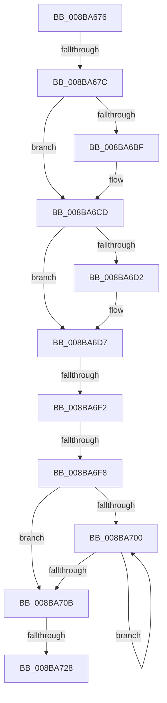

# sub_008BA676

- RVA: `0x008BA676`–`0x008BA74A` (길이 `212` bytes)
- VA: `0x00000001408BA676`
- 실행 섹션: `PAGE`
- PDB 이름 있음: `아니요`; PDB Function 태그: `아니요`
- unwind 정보 RVA: `0x00082D54`
- 디코드: `55`개 명령, `212/212` bytes 표시
- 미해석 바이트: `0` (있으면 어셈블리에 `.byte`로 보존)

> 이 문서는 커널 이미지의 기계어와 PDB 기호를 분석해 생성했습니다. 4번과 5번은 함수 원형과 자료형을 바이너리 사용 방식에서 추정한 C 해석이며 원본 소스 복구 결과는 아닙니다.

## 1. Dependencies

- 직접 호출 지점: **5**; 고유 호출 대상: **5**
- 직접 호출자로 확인된 함수: **0**
- RIP 상대 이미지 참조: **1**

### Outgoing calls
- `0x008BA6AE` → [KeAbPreAcquire](../../text/21/KeAbPreAcquire_function_00210230.md) (function, `0x00210230`)
- `0x008BA6C8` → [ExfAcquirePushLockExclusiveEx](../../text/20/ExfAcquirePushLockExclusiveEx_function_0020FC90.md) (function, `0x0020FC90`)
- `0x008BA72B` → [KeAbPostRelease](../../text/2E/KeAbPostRelease_function_002E1600.md) (function, `0x002E1600`)
- `0x008BA733` → [KeLeaveCriticalRegionThread](../../text/25/KeLeaveCriticalRegionThread_function_0025EFF0.md) (function, `0x0025EFF0`)
- `0x008BA740` → [ExFreePoolWithTag](../../poolcode/B8/ExFreePoolWithTag_function_00B82870.md) (function, `0x00B82870`)

### Direct callers
- 이 함수 시작 RVA로 연결되는 직접 call은 확인되지 않았습니다. 간접 호출은 완전히 역산할 수 없습니다.

### Static image references
- `0x008BA690` → RVA `0x00FD0EC0` (`CACHEALI`; read)

## 2. Other-region calls and transfers

- 다른 실행 섹션으로 향하는 call: **5**
  - `0x008BA6AE` → [KeAbPreAcquire](../../text/21/KeAbPreAcquire_function_00210230.md) (`PAGE` → `.text`)
  - `0x008BA6C8` → [ExfAcquirePushLockExclusiveEx](../../text/20/ExfAcquirePushLockExclusiveEx_function_0020FC90.md) (`PAGE` → `.text`)
  - `0x008BA72B` → [KeAbPostRelease](../../text/2E/KeAbPostRelease_function_002E1600.md) (`PAGE` → `.text`)
  - `0x008BA733` → [KeLeaveCriticalRegionThread](../../text/25/KeLeaveCriticalRegionThread_function_0025EFF0.md) (`PAGE` → `.text`)
  - `0x008BA740` → [ExFreePoolWithTag](../../poolcode/B8/ExFreePoolWithTag_function_00B82870.md) (`PAGE` → `POOLCODE`)
- call이 아닌 외부 분기/꼬리 이동: **5**
  - `0x008BA676` → [sub_008BAD05](Unknown_function_008BAD05.md) (`tail-transfer`)
  - `0x008BA6EC` → [sub_008BAA3C + 0x7](Unknown_function_008BAA3C.md) (`tail-transfer`)
  - `0x008BA6F2` → [sub_008BAA3C](Unknown_function_008BAA3C.md) (`tail-transfer`)
  - `0x008BA722` → [sub_008BAC50](Unknown_function_008BAC50.md) (`tail-transfer`)
  - `0x008BA745` → [SeDefaultObjectMethod + 0x62](SeDefaultObjectMethod_function_008BA2B0.md) (`tail-transfer`)

## 3. Assembly (complete function range)

```asm
008BA676  0F 85 89 06 00 00               jne 0x1408bad05
008BA67C  8B 43 10                        mov eax, dword ptr [rbx + 0x10]
008BA67F  45 33 C0                        xor r8d, r8d
008BA682  65 4C 8B 3C 25 88 01 00 00      mov r15, qword ptr gs:[0x188]
008BA68B  33 D2                           xor edx, edx
008BA68D  0F B6 E8                        movzx ebp, al
008BA690  48 8D 05 29 68 71 00            lea rax, [rip + 0x716829]
008BA697  48 C1 E5 04                     shl rbp, 4
008BA69B  48 03 E8                        add rbp, rax
008BA69E  66 41 FF 8F E4 01 00 00         dec word ptr [r15 + 0x1e4]
008BA6A6  48 8B CD                        mov rcx, rbp
008BA6A9  90                              nop
008BA6AA  48 8D 75 08                     lea rsi, [rbp + 8]
008BA6AE  E8 7D 5B 95 FF                  call 0x140210230
008BA6B3  F0 48 0F BA 6D 00 00            lock bts qword ptr [rbp], 0
008BA6BA  4C 8B F0                        mov r14, rax
008BA6BD  73 0E                           jae 0x1408ba6cd
008BA6BF  4C 8B C5                        mov r8, rbp
008BA6C2  48 8B D0                        mov rdx, rax
008BA6C5  48 8B CD                        mov rcx, rbp
008BA6C8  E8 C3 55 95 FF                  call 0x14020fc90
008BA6CD  4D 85 F6                        test r14, r14
008BA6D0  74 05                           je 0x1408ba6d7
008BA6D2  41 C6 46 0A 01                  mov byte ptr [r14 + 0xa], 1
008BA6D7  8B C7                           mov eax, edi
008BA6D9  F7 D8                           neg eax
008BA6DB  48 63 C8                        movsxd rcx, eax
008BA6DE  F0 48 0F C1 4B 08               lock xadd qword ptr [rbx + 8], rcx
008BA6E4  8B C7                           mov eax, edi
008BA6E6  48 2B C8                        sub rcx, rax
008BA6E9  48 85 C9                        test rcx, rcx
008BA6EC  0F 8F 51 03 00 00               jg 0x1408baa43
008BA6F2  0F 85 44 03 00 00               jne 0x1408baa3c
008BA6F8  48 8B 06                        mov rax, qword ptr [rsi]
008BA6FB  48 3B C3                        cmp rax, rbx
008BA6FE  74 0B                           je 0x1408ba70b
008BA700  48 8B F0                        mov rsi, rax
008BA703  48 8B 00                        mov rax, qword ptr [rax]
008BA706  48 3B C3                        cmp rax, rbx
008BA709  75 F5                           jne 0x1408ba700
008BA70B  48 8B 03                        mov rax, qword ptr [rbx]
008BA70E  48 89 06                        mov qword ptr [rsi], rax
008BA711  48 C7 C0 FF FF FF FF            mov rax, 0xffffffffffffffff
008BA718  F0 48 0F C1 45 00               lock xadd qword ptr [rbp], rax
008BA71E  24 06                           and al, 6
008BA720  3C 02                           cmp al, 2
008BA722  0F 84 28 05 00 00               je 0x1408bac50
008BA728  48 8B CD                        mov rcx, rbp
008BA72B  E8 D0 6E A2 FF                  call 0x1402e1600
008BA730  49 8B CF                        mov rcx, r15
008BA733  E8 B8 48 9A FF                  call 0x14025eff0
008BA738  BA 4F 62 53 63                  mov edx, 0x6353624f
008BA73D  48 8B CB                        mov rcx, rbx
008BA740  E8 2B 81 2C 00                  call 0x140b82870
008BA745  E9 C8 FB FF FF                  jmp 0x1408ba312
```

## 4. C-style interpretation (structured pseudocode)

```c
__int64 __fastcall sub_008BA676(__int64 a1, int a2, int a3)
{
    __int64 result;
    __int64 v_rbp;

    a3 = 0;
    a2 = 0;
    v_rbp = ((unsigned __int8)((unsigned int)(*(unsigned int *)(v_rbx + 16)))) << (4);
    v_rbp = (v_rbp) + (v_rip + 7432233);
    result = KeAbPreAcquire(v_rbp, a2, a3, a4);
    if (!(condition_is_above_or_equal)) {
        a3 = v_rbp;
        a2 = result;
        a1 = v_rbp;
        result = ExfAcquirePushLockExclusiveEx(a1, a2, a3, a4);
    }
    if (result != 0) {
        *(unsigned __int8 *)(result + 10) = 1;
    }
    result = (unsigned int)(-((unsigned int)((unsigned int)(v_rdi))));
    a1 = ((int)((unsigned int)(result))) - ((unsigned int)((unsigned int)(v_rdi)));
    if ((*(unsigned __int64 *)(v_rbp + 8)) == v_rbx) goto loc_008BA70B;
loc_008BA700:
    if ((*(unsigned __int64 *)(*(unsigned __int64 *)(v_rbp + 8))) != v_rbx) goto loc_008BA700;
loc_008BA70B:
    *(unsigned __int64 *)(*(unsigned __int64 *)(v_rbp + 8)) = *(unsigned __int64 *)(v_rbx);
    result = (unsigned __int8)((-1) & (6));
    result = KeAbPostRelease(v_rbp, a2, a3, a4);
    result = KeLeaveCriticalRegionThread(*(unsigned __int64 *)(gs_base + (0 + 392)), a2, a3, a4);
    result = ExFreePoolWithTag(v_rbx, (unsigned int)(0x6353624FULL), a3, a4);
}
```

## 5. (Beta) C Style

```c
int64_t sub_008BA676(int64_t Arg1, int32_t Arg2, int32_t Arg3)
{
    int64_t result;
    int64_t local_rbp;

    Arg3 = 0;
    Arg2 = 0;
    local_rbp = ((uint8_t)((uint32_t)(*(uint32_t *)(local_rbx + 0x10)))) << (4);
    local_rbp = (local_rbp) + (v_rip + 7432233);
    result = KeAbPreAcquire(local_rbp, Arg2, Arg3, a4);
    if (!(condition_is_above_or_equal)) {
        Arg3 = local_rbp;
        Arg2 = result;
        Arg1 = local_rbp;
        result = ExfAcquirePushLockExclusiveEx(Arg1, Arg2, Arg3, a4);
    }
    if (result != 0) {
        *(uint8_t *)(result + 0xA) = 1;
    }
    result = (uint32_t)(-((uint32_t)((uint32_t)(local_rdi))));
    Arg1 = ((int32_t)((uint32_t)(result))) - ((uint32_t)((uint32_t)(local_rdi)));
    if ((*(uint64_t *)(local_rbp + 0x8)) == local_rbx) goto loc_008BA70B;
loc_008BA700:
    if ((*(uint64_t *)(*(uint64_t *)(local_rbp + 0x8))) != local_rbx) goto loc_008BA700;
loc_008BA70B:
    *(uint64_t *)(*(uint64_t *)(local_rbp + 0x8)) = *(uint64_t *)(local_rbx);
    result = (uint8_t)((-1) & (6));
    result = KeAbPostRelease(local_rbp, Arg2, Arg3, a4);
    result = KeLeaveCriticalRegionThread(*(uint64_t *)(gs_base + (0 + 0x188)), Arg2, Arg3, a4);
    result = ExFreePoolWithTag(local_rbx, (uint32_t)(0x6353624FULL), Arg3, a4);
}
```

## 6. Execution-region graph

[열기: 2D/3D 그래프와 함수 탐색 컨트롤 패널](../../../control-panel.html?section=page&rva=0x008BA676&view=graph)

- 2D 그래프는 위에서 아래로 흐르고, 3D 그래프는 빈 공간을 드래그해 회전합니다. Shift+드래그는 이동, 휠은 확대·축소, 함수 노드 선택은 대상 보고서 이동입니다.

### Static fallback


