# sub_008BA74A

- RVA: `0x008BA74A`–`0x008BAA3C` (길이 `754` bytes)
- VA: `0x00000001408BA74A`
- 실행 섹션: `PAGE`
- PDB 이름 있음: `아니요`; PDB Function 태그: `아니요`
- unwind 정보 RVA: `0x00082D64`
- 디코드: `186`개 명령, `754/754` bytes 표시
- 미해석 바이트: `0` (있으면 어셈블리에 `.byte`로 보존)

> 이 문서는 커널 이미지의 기계어와 PDB 기호를 분석해 생성했습니다. 4번과 5번은 함수 원형과 자료형을 바이너리 사용 방식에서 추정한 C 해석이며 원본 소스 복구 결과는 아닙니다.

## 1. Dependencies

- 직접 호출 지점: **13**; 고유 호출 대상: **11**
- 직접 호출자로 확인된 함수: **0**
- RIP 상대 이미지 참조: **2**

### Outgoing calls
- `0x008BA77C` → [KeAbPreAcquire](../../text/21/KeAbPreAcquire_function_00210230.md) (function, `0x00210230`)
- `0x008BA798` → [ExfAcquirePushLockExclusiveEx](../../text/20/ExfAcquirePushLockExclusiveEx_function_0020FC90.md) (function, `0x0020FC90`)
- `0x008BA7EF` → [RtlpSetSecurityObject](RtlpSetSecurityObject_function_008BB500.md) (function, `0x008BB500`)
- `0x008BA80B` → [ObLogSecurityDescriptor](../8C/ObLogSecurityDescriptor_function_008C0020.md) (function, `0x008C0020`)
- `0x008BA8EA` → [PspChargeQuota](../../text/39/PspChargeQuota_function_00390330.md) (function, `0x00390330`)
- `0x008BA91F` → [PsReturnSharedPoolQuota](PsReturnSharedPoolQuota_function_008BCC30.md) (function, `0x008BCC30`)
- `0x008BA97E` → [KeAbPostRelease](../../text/2E/KeAbPostRelease_function_002E1600.md) (function, `0x002E1600`)
- `0x008BA98C` → [KeLeaveCriticalRegionThread](../../text/25/KeLeaveCriticalRegionThread_function_0025EFF0.md) (function, `0x0025EFF0`)
- `0x008BA9D9` → [ExFreePoolWithTag](../../poolcode/B8/ExFreePoolWithTag_function_00B82870.md) (function, `0x00B82870`)
- `0x008BA9E9` → [ExfReleasePushLock](../../text/26/ExfReleasePushLock_function_002638D0.md) (function, `0x002638D0`)
- `0x008BAA17` → [ExfReleasePushLockShared](../../text/26/ExfReleasePushLockShared_function_00263440.md) (function, `0x00263440`)
- `0x008BAA1F` → [KeAbPostRelease](../../text/2E/KeAbPostRelease_function_002E1600.md) (function, `0x002E1600`)
- `0x008BAA29` → [KeLeaveCriticalRegionThread](../../text/25/KeLeaveCriticalRegionThread_function_0025EFF0.md) (function, `0x0025EFF0`)

### Direct callers
- 이 함수 시작 RVA로 연결되는 직접 call은 확인되지 않았습니다. 간접 호출은 완전히 역산할 수 없습니다.

### Static image references
- `0x008BA8A8` → RVA `0x00F0FF80` (`.data`; read)
- `0x008BA8C9` → RVA `0x00FC6AB0` (`ALMOSTRO`; read)

## 2. Other-region calls and transfers

- 다른 실행 섹션으로 향하는 call: **10**
  - `0x008BA77C` → [KeAbPreAcquire](../../text/21/KeAbPreAcquire_function_00210230.md) (`PAGE` → `.text`)
  - `0x008BA798` → [ExfAcquirePushLockExclusiveEx](../../text/20/ExfAcquirePushLockExclusiveEx_function_0020FC90.md) (`PAGE` → `.text`)
  - `0x008BA8EA` → [PspChargeQuota](../../text/39/PspChargeQuota_function_00390330.md) (`PAGE` → `.text`)
  - `0x008BA97E` → [KeAbPostRelease](../../text/2E/KeAbPostRelease_function_002E1600.md) (`PAGE` → `.text`)
  - `0x008BA98C` → [KeLeaveCriticalRegionThread](../../text/25/KeLeaveCriticalRegionThread_function_0025EFF0.md) (`PAGE` → `.text`)
  - `0x008BA9D9` → [ExFreePoolWithTag](../../poolcode/B8/ExFreePoolWithTag_function_00B82870.md) (`PAGE` → `POOLCODE`)
  - `0x008BA9E9` → [ExfReleasePushLock](../../text/26/ExfReleasePushLock_function_002638D0.md) (`PAGE` → `.text`)
  - `0x008BAA17` → [ExfReleasePushLockShared](../../text/26/ExfReleasePushLockShared_function_00263440.md) (`PAGE` → `.text`)
  - `0x008BAA1F` → [KeAbPostRelease](../../text/2E/KeAbPostRelease_function_002E1600.md) (`PAGE` → `.text`)
  - `0x008BAA29` → [KeLeaveCriticalRegionThread](../../text/25/KeLeaveCriticalRegionThread_function_0025EFF0.md) (`PAGE` → `.text`)
- call이 아닌 외부 분기/꼬리 이동: **19**
  - `0x008BA752` → [sub_008BA32C + 0x80](Unknown_function_008BA32C.md) (`tail-transfer`)
  - `0x008BA7BA` → [sub_008BAA6F + 0x8A](Unknown_function_008BAA6F.md) (`tail-transfer`)
  - `0x008BA7F8` → [sub_008BAA6F + 0x8F](Unknown_function_008BAA6F.md) (`tail-transfer`)
  - `0x008BA825` → [sub_008BAA6F + 0x172](Unknown_function_008BAA6F.md) (`tail-transfer`)
  - `0x008BA832` → [sub_008BAA6F + 0x1D8](Unknown_function_008BAA6F.md) (`tail-transfer`)
  - `0x008BA83D` → [sub_008BAA6F + 0x8](Unknown_function_008BAA6F.md) (`tail-transfer`)
  - `0x008BA849` → [sub_008BAA6F + 0x16A](Unknown_function_008BAA6F.md) (`tail-transfer`)
  - `0x008BA852` → [sub_008BAC72 + 0xD](Unknown_function_008BAC72.md) (`tail-transfer`)
  - `0x008BA85D` → [sub_008BAC5D](Unknown_function_008BAC5D.md) (`tail-transfer`)
  - `0x008BA89F` → [sub_008BAA6F + 0x1AE](Unknown_function_008BAA6F.md) (`tail-transfer`)
  - `0x008BA8D0` → [sub_008BAA6F + 0x7B](Unknown_function_008BAA6F.md) (`tail-transfer`)
  - `0x008BA8F1` → [sub_008BAA6F + 0x10](Unknown_function_008BAA6F.md) (`tail-transfer`)
  - `0x008BA90A` → [sub_008BAA6F + 0x10](Unknown_function_008BAA6F.md) (`tail-transfer`)
  - `0x008BA93B` → [sub_008BAA6F](Unknown_function_008BAA6F.md) (`tail-transfer`)
  - `0x008BA999` → [sub_008BAC72 + 0x7A](Unknown_function_008BAC72.md) (`tail-transfer`)
  - `0x008BA9BF` → [sub_008BAA6F + 0x99](Unknown_function_008BAA6F.md) (`tail-transfer`)
  - `0x008BA9E0` → [sub_008BA32C + 0x335](Unknown_function_008BA32C.md) (`tail-transfer`)
  - `0x008BA9FF` → [sub_008BA32C + 0x18E](Unknown_function_008BA32C.md) (`tail-transfer`)
  - `0x008BAA37` → [sub_008BA32C + 0x311](Unknown_function_008BA32C.md) (`tail-transfer`)

## 3. Assembly (complete function range)

```asm
008BA74A  49 8B 41 10                     mov rax, qword ptr [r9 + 0x10]
008BA74E  49 8D 51 10                     lea rdx, [r9 + 0x10]
008BA752  E9 55 FC FF FF                  jmp 0x1408ba3ac
008BA757  65 48 8B 04 25 88 01 00 00      mov rax, qword ptr gs:[0x188]
008BA760  45 33 F6                        xor r14d, r14d
008BA763  45 33 C0                        xor r8d, r8d
008BA766  4C 89 74 24 58                  mov qword ptr [rsp + 0x58], r14
008BA76B  33 D2                           xor edx, edx
008BA76D  48 83 C1 E0                     add rcx, -0x20
008BA771  41 8B DE                        mov ebx, r14d
008BA774  66 FF 88 E4 01 00 00            dec word ptr [rax + 0x1e4]
008BA77B  90                              nop
008BA77C  E8 AF 5A 95 FF                  call 0x140210230
008BA781  F0 49 0F BA 6F E0 00            lock bts qword ptr [r15 - 0x20], 0
008BA788  4C 8B E8                        mov r13, rax
008BA78B  73 10                           jae 0x1408ba79d
008BA78D  4D 8D 47 E0                     lea r8, [r15 - 0x20]
008BA791  48 8B D0                        mov rdx, rax
008BA794  49 8D 4F E0                     lea rcx, [r15 - 0x20]
008BA798  E8 F3 54 95 FF                  call 0x14020fc90
008BA79D  4D 85 ED                        test r13, r13
008BA7A0  74 05                           je 0x1408ba7a7
008BA7A2  41 C6 45 0A 01                  mov byte ptr [r13 + 0xa], 1
008BA7A7  49 8B 77 F8                     mov rsi, qword ptr [r15 - 8]
008BA7AB  41 BC 10 00 00 00               mov r12d, 0x10
008BA7B1  48 83 E6 F0                     and rsi, 0xfffffffffffffff0
008BA7B5  48 89 74 24 40                  mov qword ptr [rsp + 0x40], rsi
008BA7BA  0F 84 39 03 00 00               je 0x1408baaf9
008BA7C0  48 8B 84 24 E8 00 00 00         mov rax, qword ptr [rsp + 0xe8]
008BA7C8  4C 8D 4C 24 40                  lea r9, [rsp + 0x40]
008BA7CD  8B 17                           mov edx, dword ptr [rdi]
008BA7CF  4C 8B C5                        mov r8, rbp
008BA7D2  4C 89 74 24 38                  mov qword ptr [rsp + 0x38], r14
008BA7D7  49 8B CF                        mov rcx, r15
008BA7DA  48 89 44 24 30                  mov qword ptr [rsp + 0x30], rax
008BA7DF  8B 84 24 E0 00 00 00            mov eax, dword ptr [rsp + 0xe0]
008BA7E6  89 44 24 28                     mov dword ptr [rsp + 0x28], eax
008BA7EA  44 89 74 24 20                  mov dword ptr [rsp + 0x20], r14d
008BA7EF  E8 0C 0D 00 00                  call 0x1408bb500
008BA7F4  8B E8                           mov ebp, eax
008BA7F6  85 C0                           test eax, eax
008BA7F8  0F 88 00 03 00 00               js 0x1408baafe
008BA7FE  48 8B 4C 24 40                  mov rcx, qword ptr [rsp + 0x40]
008BA803  48 8D 54 24 58                  lea rdx, [rsp + 0x58]
008BA808  45 8B C4                        mov r8d, r12d
008BA80B  E8 10 58 00 00                  call 0x1408c0020
008BA810  8B E8                           mov ebp, eax
008BA812  85 C0                           test eax, eax
008BA814  0F 88 39 01 00 00               js 0x1408ba953
008BA81A  48 8B 44 24 40                  mov rax, qword ptr [rsp + 0x40]
008BA81F  41 8B FE                        mov edi, r14d
008BA822  80 38 01                        cmp byte ptr [rax], 1
008BA825  0F 85 B6 03 00 00               jne 0x1408babe1
008BA82B  0F B7 48 02                     movzx ecx, word ptr [rax + 2]
008BA82F  66 85 C9                        test cx, cx
008BA832  0F 89 0F 04 00 00               jns 0x1408bac47
008BA838  8B 50 08                        mov edx, dword ptr [rax + 8]
008BA83B  85 D2                           test edx, edx
008BA83D  0F 84 34 02 00 00               je 0x1408baa77
008BA843  48 03 D0                        add rdx, rax
008BA846  F6 C1 04                        test cl, 4
008BA849  0F 84 8A 03 00 00               je 0x1408babd9
008BA84F  66 85 C9                        test cx, cx
008BA852  0F 89 27 04 00 00               jns 0x1408bac7f
008BA858  8B 48 10                        mov ecx, dword ptr [rax + 0x10]
008BA85B  85 C9                           test ecx, ecx
008BA85D  0F 84 FA 03 00 00               je 0x1408bac5d
008BA863  48 03 C8                        add rcx, rax
008BA866  48 85 D2                        test rdx, rdx
008BA869  74 0E                           je 0x1408ba879
008BA86B  0F B6 42 01                     movzx eax, byte ptr [rdx + 1]
008BA86F  8D 3C 85 0B 00 00 00            lea edi, [rax*4 + 0xb]
008BA876  83 E7 FC                        and edi, 0xfffffffc
008BA879  48 85 C9                        test rcx, rcx
008BA87C  74 0C                           je 0x1408ba88a
008BA87E  0F B7 41 02                     movzx eax, word ptr [rcx + 2]
008BA882  83 C0 03                        add eax, 3
008BA885  83 E0 FC                        and eax, 0xfffffffc
008BA888  03 F8                           add edi, eax
008BA88A  49 83 7F F0 01                  cmp qword ptr [r15 - 0x10], 1
008BA88F  49 8D 6F D0                     lea rbp, [r15 - 0x30]
008BA893  0F 84 97 00 00 00               je 0x1408ba930
008BA899  0F B6 45 1A                     movzx eax, byte ptr [rbp + 0x1a]
008BA89D  A8 08                           test al, 8
008BA89F  0F 84 78 03 00 00               je 0x1408bac1d
008BA8A5  83 E0 0F                        and eax, 0xf
008BA8A8  48 8D 0D D1 56 65 00            lea rcx, [rip + 0x6556d1]
008BA8AF  0F B6 04 08                     movzx eax, byte ptr [rax + rcx]
008BA8B3  48 2B E8                        sub rbp, rax
008BA8B6  65 48 8B 04 25 88 01 00 00      mov rax, qword ptr gs:[0x188]
008BA8BF  44 8B CF                        mov r9d, edi
008BA8C2  4C 8B A8 B8 00 00 00            mov r13, qword ptr [rax + 0xb8]
008BA8C9  4C 3B 2D E0 C1 70 00            cmp r13, qword ptr [rip + 0x70c1e0]
008BA8D0  0F 84 14 02 00 00               je 0x1408baaea
008BA8D6  4D 8B AD F8 02 00 00            mov r13, qword ptr [r13 + 0x2f8]
008BA8DD  85 FF                           test edi, edi
008BA8DF  74 16                           je 0x1408ba8f7
008BA8E1  33 D2                           xor edx, edx
008BA8E3  49 8B CD                        mov rcx, r13
008BA8E6  44 8D 42 01                     lea r8d, [rdx + 1]
008BA8EA  E8 41 5A AD FF                  call 0x140390330
008BA8EF  85 C0                           test eax, eax
008BA8F1  0F 88 88 01 00 00               js 0x1408baa7f
008BA8F7  F0 41 FF 85 00 02 00 00         lock inc dword ptr [r13 + 0x200]
008BA8FF  49 8B C5                        mov rax, r13
008BA902  48 89 44 24 60                  mov qword ptr [rsp + 0x60], rax
008BA907  4D 85 ED                        test r13, r13
008BA90A  0F 84 6F 01 00 00               je 0x1408baa7f
008BA910  48 8B 4D 10                     mov rcx, qword ptr [rbp + 0x10]
008BA914  48 85 C9                        test rcx, rcx
008BA917  74 10                           je 0x1408ba929
008BA919  8B 55 08                        mov edx, dword ptr [rbp + 8]
008BA91C  45 33 C0                        xor r8d, r8d
008BA91F  E8 0C 23 00 00                  call 0x1408bcc30
008BA924  48 8B 44 24 60                  mov rax, qword ptr [rsp + 0x60]
008BA929  89 7D 08                        mov dword ptr [rbp + 8], edi
008BA92C  48 89 45 10                     mov qword ptr [rbp + 0x10], rax
008BA930  48 8B 5C 24 58                  mov rbx, qword ptr [rsp + 0x58]
008BA935  41 8B EE                        mov ebp, r14d
008BA938  48 85 DB                        test rbx, rbx
008BA93B  0F 84 2E 01 00 00               je 0x1408baa6f
008BA941  48 83 CB 0F                     or rbx, 0xf
008BA945  49 87 5F F8                     xchg qword ptr [r15 - 8], rbx
008BA949  83 E3 0F                        and ebx, 0xf
008BA94C  4C 89 74 24 58                  mov qword ptr [rsp + 0x58], r14
008BA951  FF C3                           inc ebx
008BA953  41 0F 0D 4F E0                  prefetchw byte ptr [r15 - 0x20]
008BA958  49 8B 47 E0                     mov rax, qword ptr [r15 - 0x20]
008BA95C  48 8B C8                        mov rcx, rax
008BA95F  48 83 E1 F0                     and rcx, 0xfffffffffffffff0
008BA963  49 3B CC                        cmp rcx, r12
008BA966  48 8D 50 F0                     lea rdx, [rax - 0x10]
008BA96A  49 0F 46 D6                     cmovbe rdx, r14
008BA96E  A8 02                           test al, 2
008BA970  75 73                           jne 0x1408ba9e5
008BA972  F0 49 0F B1 57 E0               lock cmpxchg qword ptr [r15 - 0x20], rdx
008BA978  75 6B                           jne 0x1408ba9e5
008BA97A  49 8D 4F E0                     lea rcx, [r15 - 0x20]
008BA97E  E8 7D 6C A2 FF                  call 0x1402e1600
008BA983  65 48 8B 0C 25 88 01 00 00      mov rcx, qword ptr gs:[0x188]
008BA98C  E8 5F 46 9A FF                  call 0x14025eff0
008BA991  48 8B 4C 24 58                  mov rcx, qword ptr [rsp + 0x58]
008BA996  48 85 C9                        test rcx, rcx
008BA999  0F 85 4D 03 00 00               jne 0x1408bacec
008BA99F  48 85 F6                        test rsi, rsi
008BA9A2  74 29                           je 0x1408ba9cd
008BA9A4  85 DB                           test ebx, ebx
008BA9A6  74 25                           je 0x1408ba9cd
008BA9A8  48 83 C6 E0                     add rsi, -0x20
008BA9AC  0F 0D 4E 08                     prefetchw byte ptr [rsi + 8]
008BA9B0  48 8B 46 08                     mov rax, qword ptr [rsi + 8]
008BA9B4  8B D3                           mov edx, ebx
008BA9B6  48 8B C8                        mov rcx, rax
008BA9B9  48 2B CA                        sub rcx, rdx
008BA9BC  48 85 C9                        test rcx, rcx
008BA9BF  0F 8E 43 01 00 00               jle 0x1408bab08
008BA9C5  F0 48 0F B1 4E 08               lock cmpxchg qword ptr [rsi + 8], rcx
008BA9CB  75 E9                           jne 0x1408ba9b6
008BA9CD  48 8B 4C 24 40                  mov rcx, qword ptr [rsp + 0x40]
008BA9D2  48 85 C9                        test rcx, rcx
008BA9D5  74 07                           je 0x1408ba9de
008BA9D7  33 D2                           xor edx, edx
008BA9D9  E8 92 7E 2C 00                  call 0x140b82870
008BA9DE  8B C5                           mov eax, ebp
008BA9E0  E9 7C FC FF FF                  jmp 0x1408ba661
008BA9E5  49 8D 4F E0                     lea rcx, [r15 - 0x20]
008BA9E9  E8 E2 8E 9A FF                  call 0x1402638d0
008BA9EE  EB 8A                           jmp 0x1408ba97a
008BA9F0  48 89 39                        mov qword ptr [rcx], rdi
008BA9F3  48 8B C7                        mov rax, rdi
008BA9F6  F0 49 0F B1 4D 00               lock cmpxchg qword ptr [r13], rcx
008BA9FC  4C 8B E8                        mov r13, rax
008BA9FF  0F 85 B5 FA FF FF               jne 0x1408ba4ba
008BAA05  48 8B 5C 24 60                  mov rbx, qword ptr [rsp + 0x60]
008BAA0A  48 8B C2                        mov rax, rdx
008BAA0D  F0 4C 0F B1 33                  lock cmpxchg qword ptr [rbx], r14
008BAA12  74 08                           je 0x1408baa1c
008BAA14  48 8B CB                        mov rcx, rbx
008BAA17  E8 24 8A 9A FF                  call 0x140263440
008BAA1C  48 8B CB                        mov rcx, rbx
008BAA1F  E8 DC 6B A2 FF                  call 0x1402e1600
008BAA24  48 8B 4C 24 48                  mov rcx, qword ptr [rsp + 0x48]
008BAA29  E8 C2 45 9A FF                  call 0x14025eff0
008BAA2E  4C 8B 6C 24 50                  mov r13, qword ptr [rsp + 0x50]
008BAA33  49 83 C5 20                     add r13, 0x20
008BAA37  E9 01 FC FF FF                  jmp 0x1408ba63d
```

## 4. C-style interpretation (structured pseudocode)

```c
__int64 __fastcall sub_008BA74A(__int64 a1, __int64 a2, int a3, __int64 a4)
{
    unsigned int v_stack_p20;
    unsigned int v_stack_p28;
    unsigned __int64 v_stack_p30;
    unsigned __int64 v_stack_p38;
    unsigned __int64 v_stack_p40;
    unsigned __int64 v_stack_p48;
    unsigned __int64 v_stack_p50;
    unsigned __int64 v_stack_p58;
    unsigned __int64 v_stack_p60;
    unsigned int v_stack_pE0;
    unsigned __int64 v_stack_pE8;
}
```

## 5. (Beta) C Style

```c
int64_t sub_008BA74A(int64_t Arg1, int64_t Arg2, int32_t Arg3, void *Arg4)
{
    uint8_t *arg4 = (uint8_t *)Arg4;

    uint32_t v_stack_p20;
    uint32_t v_stack_p28;
    uint64_t v_stack_p30;
    uint64_t v_stack_p38;
    uint64_t v_stack_p40;
    uint64_t v_stack_p48;
    uint64_t v_stack_p50;
    uint64_t v_stack_p58;
    uint64_t v_stack_p60;
    uint32_t v_stack_pE0;
    uint64_t v_stack_pE8;
}
```

### 관측된 메모리 오프셋

구조체 형식이 확인되지 않은 접근은 인자 기준의 오프셋으로만 기록했습니다.

| 기준 인자 | 오프셋 표현 | 폭 (bit) | 접근 |
|---|---:|---:|---|
| `Arg4` | `+ 0x10` | `64` | `R` |

## 6. Execution-region graph

[열기: 2D/3D 그래프와 함수 탐색 컨트롤 패널](../../../control-panel.html?section=page&rva=0x008BA74A&view=graph)

- 2D 그래프는 위에서 아래로 흐르고, 3D 그래프는 빈 공간을 드래그해 회전합니다. Shift+드래그는 이동, 휠은 확대·축소, 함수 노드 선택은 대상 보고서 이동입니다.

### Static fallback

```mermaid
flowchart TD
  bb_008BA74A[BB_008BA74A]
  bb_008BA757[BB_008BA757]
  bb_008BA78D[BB_008BA78D]
  bb_008BA79D[BB_008BA79D]
  bb_008BA7A2[BB_008BA7A2]
  bb_008BA7A7[BB_008BA7A7]
  bb_008BA7C0[BB_008BA7C0]
  bb_008BA7FE[BB_008BA7FE]
  bb_008BA81A[BB_008BA81A]
  bb_008BA82B[BB_008BA82B]
  bb_008BA838[BB_008BA838]
  bb_008BA843[BB_008BA843]
  bb_008BA84F[BB_008BA84F]
  bb_008BA858[BB_008BA858]
  bb_008BA863[BB_008BA863]
  bb_008BA86B[BB_008BA86B]
  bb_008BA879[BB_008BA879]
  bb_008BA87E[BB_008BA87E]
  bb_008BA88A[BB_008BA88A]
  bb_008BA899[BB_008BA899]
  bb_008BA8A5[BB_008BA8A5]
  bb_008BA8D6[BB_008BA8D6]
  bb_008BA8E1[BB_008BA8E1]
  bb_008BA8F7[BB_008BA8F7]
  bb_008BA910[BB_008BA910]
  bb_008BA919[BB_008BA919]
  bb_008BA929[BB_008BA929]
  bb_008BA930[BB_008BA930]
  bb_008BA941[BB_008BA941]
  bb_008BA953[BB_008BA953]
  bb_008BA972[BB_008BA972]
  bb_008BA97A[BB_008BA97A]
  bb_008BA99F[BB_008BA99F]
  bb_008BA9A4[BB_008BA9A4]
  bb_008BA9A8[BB_008BA9A8]
  bb_008BA9B6[BB_008BA9B6]
  bb_008BA9C5[BB_008BA9C5]
  bb_008BA9CD[BB_008BA9CD]
  bb_008BA9D7[BB_008BA9D7]
  bb_008BA9DE[BB_008BA9DE]
  bb_008BA9E5[BB_008BA9E5]
  bb_008BA9F0[BB_008BA9F0]
  bb_008BAA05[BB_008BAA05]
  bb_008BAA14[BB_008BAA14]
  bb_008BAA1C[BB_008BAA1C]
  bb_008BA757 -->|branch| bb_008BA79D
  bb_008BA757 -->|fallthrough| bb_008BA78D
  bb_008BA78D -->|flow| bb_008BA79D
  bb_008BA79D -->|branch| bb_008BA7A7
  bb_008BA79D -->|fallthrough| bb_008BA7A2
  bb_008BA7A2 -->|flow| bb_008BA7A7
  bb_008BA7A7 -->|fallthrough| bb_008BA7C0
  bb_008BA7C0 -->|fallthrough| bb_008BA7FE
  bb_008BA7FE -->|branch| bb_008BA953
  bb_008BA7FE -->|fallthrough| bb_008BA81A
  bb_008BA81A -->|fallthrough| bb_008BA82B
  bb_008BA82B -->|fallthrough| bb_008BA838
  bb_008BA838 -->|fallthrough| bb_008BA843
  bb_008BA843 -->|fallthrough| bb_008BA84F
  bb_008BA84F -->|fallthrough| bb_008BA858
  bb_008BA858 -->|fallthrough| bb_008BA863
  bb_008BA863 -->|branch| bb_008BA879
  bb_008BA863 -->|fallthrough| bb_008BA86B
  bb_008BA86B -->|flow| bb_008BA879
  bb_008BA879 -->|branch| bb_008BA88A
  bb_008BA879 -->|fallthrough| bb_008BA87E
  bb_008BA87E -->|flow| bb_008BA88A
  bb_008BA88A -->|branch| bb_008BA930
  bb_008BA88A -->|fallthrough| bb_008BA899
  bb_008BA899 -->|fallthrough| bb_008BA8A5
  bb_008BA8A5 -->|fallthrough| bb_008BA8D6
  bb_008BA8D6 -->|branch| bb_008BA8F7
  bb_008BA8D6 -->|fallthrough| bb_008BA8E1
  bb_008BA8E1 -->|fallthrough| bb_008BA8F7
  bb_008BA8F7 -->|fallthrough| bb_008BA910
  bb_008BA910 -->|branch| bb_008BA929
  bb_008BA910 -->|fallthrough| bb_008BA919
  bb_008BA919 -->|flow| bb_008BA929
  bb_008BA929 -->|flow| bb_008BA930
  bb_008BA930 -->|fallthrough| bb_008BA941
  bb_008BA941 -->|flow| bb_008BA953
  bb_008BA953 -->|branch| bb_008BA9E5
  bb_008BA953 -->|fallthrough| bb_008BA972
  bb_008BA972 -->|branch| bb_008BA9E5
  bb_008BA972 -->|fallthrough| bb_008BA97A
  bb_008BA97A -->|fallthrough| bb_008BA99F
  bb_008BA99F -->|branch| bb_008BA9CD
  bb_008BA99F -->|fallthrough| bb_008BA9A4
  bb_008BA9A4 -->|branch| bb_008BA9CD
  bb_008BA9A4 -->|fallthrough| bb_008BA9A8
  bb_008BA9A8 -->|flow| bb_008BA9B6
  bb_008BA9B6 -->|fallthrough| bb_008BA9C5
  bb_008BA9C5 -->|branch| bb_008BA9B6
  bb_008BA9C5 -->|fallthrough| bb_008BA9CD
  bb_008BA9CD -->|branch| bb_008BA9DE
  bb_008BA9CD -->|fallthrough| bb_008BA9D7
  bb_008BA9D7 -->|flow| bb_008BA9DE
  bb_008BA9E5 -->|branch| bb_008BA97A
  bb_008BA9F0 -->|fallthrough| bb_008BAA05
  bb_008BAA05 -->|branch| bb_008BAA1C
  bb_008BAA05 -->|fallthrough| bb_008BAA14
  bb_008BAA14 -->|flow| bb_008BAA1C
```


