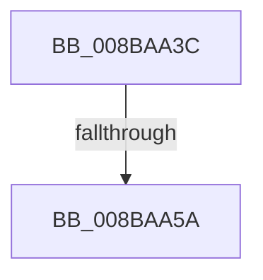

# sub_008BAA3C

- RVA: `0x008BAA3C`–`0x008BAA6F` (길이 `51` bytes)
- VA: `0x00000001408BAA3C`
- 실행 섹션: `PAGE`
- PDB 이름 있음: `아니요`; PDB Function 태그: `아니요`
- unwind 정보 RVA: `0x00082D7C`
- 디코드: `12`개 명령, `51/51` bytes 표시
- 미해석 바이트: `0` (있으면 어셈블리에 `.byte`로 보존)

> 이 문서는 커널 이미지의 기계어와 PDB 기호를 분석해 생성했습니다. 4번과 5번은 함수 원형과 자료형을 바이너리 사용 방식에서 추정한 C 해석이며 원본 소스 복구 결과는 아닙니다.

## 1. Dependencies

- 직접 호출 지점: **2**; 고유 호출 대상: **2**
- 직접 호출자로 확인된 함수: **0**
- RIP 상대 이미지 참조: **0**

### Outgoing calls
- `0x008BAA5D` → [KeAbPostRelease](../../text/2E/KeAbPostRelease_function_002E1600.md) (function, `0x002E1600`)
- `0x008BAA65` → [KeLeaveCriticalRegionThread](../../text/25/KeLeaveCriticalRegionThread_function_0025EFF0.md) (function, `0x0025EFF0`)

### Direct callers
- 이 함수 시작 RVA로 연결되는 직접 call은 확인되지 않았습니다. 간접 호출은 완전히 역산할 수 없습니다.

### Static image references
- 디코드된 RIP-relative 메모리 참조가 없습니다.

## 2. Other-region calls and transfers

- 다른 실행 섹션으로 향하는 call: **2**
  - `0x008BAA5D` → [KeAbPostRelease](../../text/2E/KeAbPostRelease_function_002E1600.md) (`PAGE` → `.text`)
  - `0x008BAA65` → [KeLeaveCriticalRegionThread](../../text/25/KeLeaveCriticalRegionThread_function_0025EFF0.md) (`PAGE` → `.text`)
- call이 아닌 외부 분기/꼬리 이동: **2**
  - `0x008BAA54` → [sub_008BAC65](Unknown_function_008BAC65.md) (`tail-transfer`)
  - `0x008BAA6A` → [SeDefaultObjectMethod + 0x62](SeDefaultObjectMethod_function_008BA2B0.md) (`tail-transfer`)

## 3. Assembly (complete function range)

```asm
008BAA3C  B9 0E 00 00 00                  mov ecx, 0xe
008BAA41  CD 29                           int 0x29
008BAA43  48 C7 C0 FF FF FF FF            mov rax, 0xffffffffffffffff
008BAA4A  F0 48 0F C1 45 00               lock xadd qword ptr [rbp], rax
008BAA50  24 06                           and al, 6
008BAA52  3C 02                           cmp al, 2
008BAA54  0F 84 0B 02 00 00               je 0x1408bac65
008BAA5A  48 8B CD                        mov rcx, rbp
008BAA5D  E8 9E 6B A2 FF                  call 0x1402e1600
008BAA62  49 8B CF                        mov rcx, r15
008BAA65  E8 86 45 9A FF                  call 0x14025eff0
008BAA6A  E9 A3 F8 FF FF                  jmp 0x1408ba312
```

## 4. C-style interpretation (structured pseudocode)

```c
__int64 __fastcall sub_008BAA3C(void)
{
    __int64 result;

    result = (unsigned __int8)((-1) & (6));
    result = KeAbPostRelease(v_rbp, a2, a3, a4);
    result = KeLeaveCriticalRegionThread(v_r15, a2, a3, a4);
}
```

## 5. (Beta) C Style

```c
void sub_008BAA3C(void)
{
    int64_t result;

    result = (uint8_t)((-1) & (6));
    result = KeAbPostRelease(local_rbp, a2, a3, a4);
    result = KeLeaveCriticalRegionThread(local_r15, a2, a3, a4);
}
```

## 6. Execution-region graph

[열기: 2D/3D 그래프와 함수 탐색 컨트롤 패널](../../../control-panel.html?section=page&rva=0x008BAA3C&view=graph)

- 2D 그래프는 위에서 아래로 흐르고, 3D 그래프는 빈 공간을 드래그해 회전합니다. Shift+드래그는 이동, 휠은 확대·축소, 함수 노드 선택은 대상 보고서 이동입니다.

### Static fallback


