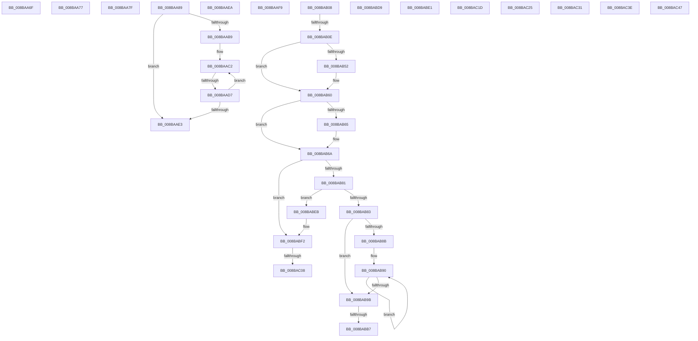

# sub_008BAA6F

- RVA: `0x008BAA6F`–`0x008BAC50` (길이 `481` bytes)
- VA: `0x00000001408BAA6F`
- 실행 섹션: `PAGE`
- PDB 이름 있음: `아니요`; PDB Function 태그: `아니요`
- unwind 정보 RVA: `0x00082D8C`
- 디코드: `120`개 명령, `481/481` bytes 표시
- 미해석 바이트: `0` (있으면 어셈블리에 `.byte`로 보존)

> 이 문서는 커널 이미지의 기계어와 PDB 기호를 분석해 생성했습니다. 4번과 5번은 함수 원형과 자료형을 바이너리 사용 방식에서 추정한 C 해석이며 원본 소스 복구 결과는 아닙니다.

## 1. Dependencies

- 직접 호출 지점: **10**; 고유 호출 대상: **8**
- 직접 호출자로 확인된 함수: **0**
- RIP 상대 이미지 참조: **1**

### Outgoing calls
- `0x008BAA8D` → [ObpReferenceSecurityDescriptor](ObpReferenceSecurityDescriptor_function_008B6D90.md) (function, `0x008B6D90`)
- `0x008BAAAD` → [SeQuerySecurityDescriptorInfo](../87/SeQuerySecurityDescriptorInfo_function_00872820.md) (function, `0x00872820`)
- `0x008BAB42` → [KeAbPreAcquire](../../text/21/KeAbPreAcquire_function_00210230.md) (function, `0x00210230`)
- `0x008BAB5B` → [ExfAcquirePushLockExclusiveEx](../../text/20/ExfAcquirePushLockExclusiveEx_function_0020FC90.md) (function, `0x0020FC90`)
- `0x008BABBA` → [KeAbPostRelease](../../text/2E/KeAbPostRelease_function_002E1600.md) (function, `0x002E1600`)
- `0x008BABC2` → [KeLeaveCriticalRegionThread](../../text/25/KeLeaveCriticalRegionThread_function_0025EFF0.md) (function, `0x0025EFF0`)
- `0x008BABCF` → [ExFreePoolWithTag](../../poolcode/B8/ExFreePoolWithTag_function_00B82870.md) (function, `0x00B82870`)
- `0x008BAC0B` → [KeAbPostRelease](../../text/2E/KeAbPostRelease_function_002E1600.md) (function, `0x002E1600`)
- `0x008BAC13` → [KeLeaveCriticalRegionThread](../../text/25/KeLeaveCriticalRegionThread_function_0025EFF0.md) (function, `0x0025EFF0`)
- `0x008BAC34` → [ExfReleasePushLockShared](../../text/26/ExfReleasePushLockShared_function_00263440.md) (function, `0x00263440`)

### Direct callers
- 이 함수 시작 RVA로 연결되는 직접 call은 확인되지 않았습니다. 간접 호출은 완전히 역산할 수 없습니다.

### Static image references
- `0x008BAB23` → RVA `0x00FD0EC0` (`CACHEALI`; read)

## 2. Other-region calls and transfers

- 다른 실행 섹션으로 향하는 call: **8**
  - `0x008BAB42` → [KeAbPreAcquire](../../text/21/KeAbPreAcquire_function_00210230.md) (`PAGE` → `.text`)
  - `0x008BAB5B` → [ExfAcquirePushLockExclusiveEx](../../text/20/ExfAcquirePushLockExclusiveEx_function_0020FC90.md) (`PAGE` → `.text`)
  - `0x008BABBA` → [KeAbPostRelease](../../text/2E/KeAbPostRelease_function_002E1600.md) (`PAGE` → `.text`)
  - `0x008BABC2` → [KeLeaveCriticalRegionThread](../../text/25/KeLeaveCriticalRegionThread_function_0025EFF0.md) (`PAGE` → `.text`)
  - `0x008BABCF` → [ExFreePoolWithTag](../../poolcode/B8/ExFreePoolWithTag_function_00B82870.md) (`PAGE` → `POOLCODE`)
  - `0x008BAC0B` → [KeAbPostRelease](../../text/2E/KeAbPostRelease_function_002E1600.md) (`PAGE` → `.text`)
  - `0x008BAC13` → [KeLeaveCriticalRegionThread](../../text/25/KeLeaveCriticalRegionThread_function_0025EFF0.md) (`PAGE` → `.text`)
  - `0x008BAC34` → [ExfReleasePushLockShared](../../text/26/ExfReleasePushLockShared_function_00263440.md) (`PAGE` → `.text`)
- call이 아닌 외부 분기/꼬리 이동: **19**
  - `0x008BAA72` → [sub_008BA74A + 0x1FB](Unknown_function_008BA74A.md) (`tail-transfer`)
  - `0x008BAA7A` → [sub_008BA74A + 0xFC](Unknown_function_008BA74A.md) (`tail-transfer`)
  - `0x008BAA84` → [sub_008BA74A + 0x209](Unknown_function_008BA74A.md) (`tail-transfer`)
  - `0x008BAAD1` → [sub_008BAC72 + 0x2C](Unknown_function_008BAC72.md) (`tail-transfer`)
  - `0x008BAAE5` → [sub_008BA32C + 0x335](Unknown_function_008BA32C.md) (`tail-transfer`)
  - `0x008BAAF4` → [sub_008BA74A + 0x1C6](Unknown_function_008BA74A.md) (`tail-transfer`)
  - `0x008BAB03` → [sub_008BA74A + 0x209](Unknown_function_008BA74A.md) (`tail-transfer`)
  - `0x008BAB08` → [sub_008BAC72 + 0x87](Unknown_function_008BAC72.md) (`tail-transfer`)
  - `0x008BABB1` → [sub_008BAC72](Unknown_function_008BAC72.md) (`tail-transfer`)
  - `0x008BABD4` → [sub_008BA74A + 0x283](Unknown_function_008BA74A.md) (`tail-transfer`)
  - `0x008BABDC` → [sub_008BA74A + 0x11C](Unknown_function_008BA74A.md) (`tail-transfer`)
  - `0x008BABE6` → [sub_008BA74A + 0x209](Unknown_function_008BA74A.md) (`tail-transfer`)
  - `0x008BAC02` → [sub_008BAC72 + 0x16](Unknown_function_008BAC72.md) (`tail-transfer`)
  - `0x008BAC18` → [sub_008BA74A + 0x283](Unknown_function_008BA74A.md) (`tail-transfer`)
  - `0x008BAC20` → [sub_008BA74A + 0x16C](Unknown_function_008BA74A.md) (`tail-transfer`)
  - `0x008BAC2C` → [sub_008BA32C + 0x2D3](Unknown_function_008BA32C.md) (`tail-transfer`)
  - `0x008BAC39` → [sub_008BA32C + 0x2E8](Unknown_function_008BA32C.md) (`tail-transfer`)
  - `0x008BAC42` → [sub_008BA32C + 0xAC](Unknown_function_008BA32C.md) (`tail-transfer`)
  - `0x008BAC4B` → [sub_008BA74A + 0xFC](Unknown_function_008BA74A.md) (`tail-transfer`)

## 3. Assembly (complete function range)

```asm
008BAA6F  49 8B DE                        mov rbx, r14
008BAA72  E9 CE FE FF FF                  jmp 0x1408ba945
008BAA77  49 8B D6                        mov rdx, r14
008BAA7A  E9 C7 FD FF FF                  jmp 0x1408ba846
008BAA7F  BD 44 00 00 C0                  mov ebp, 0xc0000044
008BAA84  E9 CA FE FF FF                  jmp 0x1408ba953
008BAA89  48 83 C1 D0                     add rcx, -0x30
008BAA8D  E8 FE C2 FF FF                  call 0x1408b6d90
008BAA92  4C 8B 84 24 D0 00 00 00         mov r8, qword ptr [rsp + 0xd0]
008BAA9A  4C 8D 4C 24 68                  lea r9, [rsp + 0x68]
008BAA9F  48 8B D5                        mov rdx, rbp
008BAAA2  48 89 44 24 68                  mov qword ptr [rsp + 0x68], rax
008BAAA7  48 8B CF                        mov rcx, rdi
008BAAAA  48 8B D8                        mov rbx, rax
008BAAAD  E8 6E 7D FB FF                  call 0x140872820
008BAAB2  8B F8                           mov edi, eax
008BAAB4  48 85 DB                        test rbx, rbx
008BAAB7  74 2A                           je 0x1408baae3
008BAAB9  41 0F 0D 4F F8                  prefetchw byte ptr [r15 - 8]
008BAABE  49 8B 47 F8                     mov rax, qword ptr [r15 - 8]
008BAAC2  4C 8B 44 24 68                  mov r8, qword ptr [rsp + 0x68]
008BAAC7  48 8B C8                        mov rcx, rax
008BAACA  49 33 C8                        xor rcx, r8
008BAACD  48 83 F9 0F                     cmp rcx, 0xf
008BAAD1  0F 83 C7 01 00 00               jae 0x1408bac9e
008BAAD7  48 8D 48 01                     lea rcx, [rax + 1]
008BAADB  F0 49 0F B1 4F F8               lock cmpxchg qword ptr [r15 - 8], rcx
008BAAE1  75 DF                           jne 0x1408baac2
008BAAE3  8B C7                           mov eax, edi
008BAAE5  E9 77 FB FF FF                  jmp 0x1408ba661
008BAAEA  B8 01 00 00 00                  mov eax, 1
008BAAEF  48 89 44 24 60                  mov qword ptr [rsp + 0x60], rax
008BAAF4  E9 17 FE FF FF                  jmp 0x1408ba910
008BAAF9  BD D7 00 00 C0                  mov ebp, 0xc00000d7
008BAAFE  4C 89 74 24 40                  mov qword ptr [rsp + 0x40], r14
008BAB03  E9 4B FE FF FF                  jmp 0x1408ba953
008BAB08  0F 85 EB 01 00 00               jne 0x1408bacf9
008BAB0E  8B 46 10                        mov eax, dword ptr [rsi + 0x10]
008BAB11  45 33 C0                        xor r8d, r8d
008BAB14  65 4C 8B 24 25 88 01 00 00      mov r12, qword ptr gs:[0x188]
008BAB1D  33 D2                           xor edx, edx
008BAB1F  44 0F B6 F0                     movzx r14d, al
008BAB23  48 8D 05 96 63 71 00            lea rax, [rip + 0x716396]
008BAB2A  49 C1 E6 04                     shl r14, 4
008BAB2E  4C 03 F0                        add r14, rax
008BAB31  66 41 FF 8C 24 E4 01 00 00      dec word ptr [r12 + 0x1e4]
008BAB3A  49 8B CE                        mov rcx, r14
008BAB3D  90                              nop
008BAB3E  49 8D 7E 08                     lea rdi, [r14 + 8]
008BAB42  E8 E9 56 95 FF                  call 0x140210230
008BAB47  F0 49 0F BA 2E 00               lock bts qword ptr [r14], 0
008BAB4D  4C 8B F8                        mov r15, rax
008BAB50  73 0E                           jae 0x1408bab60
008BAB52  4D 8B C6                        mov r8, r14
008BAB55  48 8B D0                        mov rdx, rax
008BAB58  49 8B CE                        mov rcx, r14
008BAB5B  E8 30 51 95 FF                  call 0x14020fc90
008BAB60  4D 85 FF                        test r15, r15
008BAB63  74 05                           je 0x1408bab6a
008BAB65  41 C6 47 0A 01                  mov byte ptr [r15 + 0xa], 1
008BAB6A  8B C3                           mov eax, ebx
008BAB6C  F7 D8                           neg eax
008BAB6E  48 63 C8                        movsxd rcx, eax
008BAB71  F0 48 0F C1 4E 08               lock xadd qword ptr [rsi + 8], rcx
008BAB77  8B C3                           mov eax, ebx
008BAB79  48 2B C8                        sub rcx, rax
008BAB7C  48 85 C9                        test rcx, rcx
008BAB7F  7F 71                           jg 0x1408babf2
008BAB81  75 68                           jne 0x1408babeb
008BAB83  48 8B 07                        mov rax, qword ptr [rdi]
008BAB86  48 3B C6                        cmp rax, rsi
008BAB89  74 10                           je 0x1408bab9b
008BAB8B  0F 1F 44 00 00                  nop dword ptr [rax + rax]
008BAB90  48 8B F8                        mov rdi, rax
008BAB93  48 8B 00                        mov rax, qword ptr [rax]
008BAB96  48 3B C6                        cmp rax, rsi
008BAB99  75 F5                           jne 0x1408bab90
008BAB9B  48 8B 06                        mov rax, qword ptr [rsi]
008BAB9E  48 89 07                        mov qword ptr [rdi], rax
008BABA1  48 C7 C0 FF FF FF FF            mov rax, 0xffffffffffffffff
008BABA8  F0 49 0F C1 06                  lock xadd qword ptr [r14], rax
008BABAD  24 06                           and al, 6
008BABAF  3C 02                           cmp al, 2
008BABB1  0F 84 BB 00 00 00               je 0x1408bac72
008BABB7  49 8B CE                        mov rcx, r14
008BABBA  E8 41 6A A2 FF                  call 0x1402e1600
008BABBF  49 8B CC                        mov rcx, r12
008BABC2  E8 29 44 9A FF                  call 0x14025eff0
008BABC7  BA 4F 62 53 63                  mov edx, 0x6353624f
008BABCC  48 8B CE                        mov rcx, rsi
008BABCF  E8 9C 7C 2C 00                  call 0x140b82870
008BABD4  E9 F4 FD FF FF                  jmp 0x1408ba9cd
008BABD9  49 8B CE                        mov rcx, r14
008BABDC  E9 85 FC FF FF                  jmp 0x1408ba866
008BABE1  BD 58 00 00 C0                  mov ebp, 0xc0000058
008BABE6  E9 68 FD FF FF                  jmp 0x1408ba953
008BABEB  B9 0E 00 00 00                  mov ecx, 0xe
008BABF0  CD 29                           int 0x29
008BABF2  48 C7 C0 FF FF FF FF            mov rax, 0xffffffffffffffff
008BABF9  F0 49 0F C1 06                  lock xadd qword ptr [r14], rax
008BABFE  24 06                           and al, 6
008BAC00  3C 02                           cmp al, 2
008BAC02  0F 84 80 00 00 00               je 0x1408bac88
008BAC08  49 8B CE                        mov rcx, r14
008BAC0B  E8 F0 69 A2 FF                  call 0x1402e1600
008BAC10  49 8B CC                        mov rcx, r12
008BAC13  E8 D8 43 9A FF                  call 0x14025eff0
008BAC18  E9 B0 FD FF FF                  jmp 0x1408ba9cd
008BAC1D  49 8B EE                        mov rbp, r14
008BAC20  E9 91 FC FF FF                  jmp 0x1408ba8b6
008BAC25  B9 0E 00 00 00                  mov ecx, 0xe
008BAC2A  CD 29                           int 0x29
008BAC2C  E9 CE F9 FF FF                  jmp 0x1408ba5ff
008BAC31  48 8B CB                        mov rcx, rbx
008BAC34  E8 07 88 9A FF                  call 0x140263440
008BAC39  E9 D6 F9 FF FF                  jmp 0x1408ba614
008BAC3E  49 8B 41 20                     mov rax, qword ptr [r9 + 0x20]
008BAC42  E9 91 F7 FF FF                  jmp 0x1408ba3d8
008BAC47  48 8B 50 10                     mov rdx, qword ptr [rax + 0x10]
008BAC4B  E9 F6 FB FF FF                  jmp 0x1408ba846
```

## 4. C-style interpretation (structured pseudocode)

```c
__int64 __fastcall sub_008BAA6F(__int64 a1)
{
    unsigned __int64 v_stack_p40;
    unsigned __int64 v_stack_p60;
    unsigned __int64 v_stack_p68;
    unsigned __int64 v_stack_pD0;
}
```

## 5. (Beta) C Style

```c
int64_t sub_008BAA6F(int64_t Arg1)
{
    uint64_t v_stack_p40;
    uint64_t v_stack_p60;
    uint64_t v_stack_p68;
    uint64_t v_stack_pD0;
}
```

## 6. Execution-region graph

[열기: 2D/3D 그래프와 함수 탐색 컨트롤 패널](../../../control-panel.html?section=page&rva=0x008BAA6F&view=graph)

- 2D 그래프는 위에서 아래로 흐르고, 3D 그래프는 빈 공간을 드래그해 회전합니다. Shift+드래그는 이동, 휠은 확대·축소, 함수 노드 선택은 대상 보고서 이동입니다.

### Static fallback


