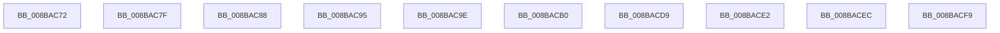

# sub_008BAC72

- RVA: `0x008BAC72`–`0x008BAD05` (길이 `147` bytes)
- VA: `0x00000001408BAC72`
- 실행 섹션: `PAGE`
- PDB 이름 있음: `아니요`; PDB Function 태그: `아니요`
- unwind 정보 RVA: `0x00082DDC`
- 디코드: `35`개 명령, `147/147` bytes 표시
- 미해석 바이트: `0` (있으면 어셈블리에 `.byte`로 보존)

> 이 문서는 커널 이미지의 기계어와 PDB 기호를 분석해 생성했습니다. 4번과 5번은 함수 원형과 자료형을 바이너리 사용 방식에서 추정한 C 해석이며 원본 소스 복구 결과는 아닙니다.

## 1. Dependencies

- 직접 호출 지점: **5**; 고유 호출 대상: **3**
- 직접 호출자로 확인된 함수: **0**
- RIP 상대 이미지 참조: **0**

### Outgoing calls
- `0x008BAC75` → [ExfTryToWakePushLock](../../text/26/ExfTryToWakePushLock_function_00265DD0.md) (function, `0x00265DD0`)
- `0x008BAC8B` → [ExfTryToWakePushLock](../../text/26/ExfTryToWakePushLock_function_00265DD0.md) (function, `0x00265DD0`)
- `0x008BACA6` → [ObDereferenceSecurityDescriptor](../87/ObDereferenceSecurityDescriptor_function_008740A0.md) (function, `0x008740A0`)
- `0x008BACC7` → [KeBugCheckEx](../../text/4F/KeBugCheckEx_function_004FD660.md) (function, `0x004FD660`)
- `0x008BACEF` → [ObDereferenceSecurityDescriptor](../87/ObDereferenceSecurityDescriptor_function_008740A0.md) (function, `0x008740A0`)

### Direct callers
- 이 함수 시작 RVA로 연결되는 직접 call은 확인되지 않았습니다. 간접 호출은 완전히 역산할 수 없습니다.

### Static image references
- 디코드된 RIP-relative 메모리 참조가 없습니다.

## 2. Other-region calls and transfers

- 다른 실행 섹션으로 향하는 call: **3**
  - `0x008BAC75` → [ExfTryToWakePushLock](../../text/26/ExfTryToWakePushLock_function_00265DD0.md) (`PAGE` → `.text`)
  - `0x008BAC8B` → [ExfTryToWakePushLock](../../text/26/ExfTryToWakePushLock_function_00265DD0.md) (`PAGE` → `.text`)
  - `0x008BACC7` → [KeBugCheckEx](../../text/4F/KeBugCheckEx_function_004FD660.md) (`PAGE` → `.text`)
- call이 아닌 외부 분기/꼬리 이동: **10**
  - `0x008BAC7A` → [sub_008BAA6F + 0x148](Unknown_function_008BAA6F.md) (`tail-transfer`)
  - `0x008BAC83` → [sub_008BA74A + 0x11C](Unknown_function_008BA74A.md) (`tail-transfer`)
  - `0x008BAC90` → [sub_008BAA6F + 0x199](Unknown_function_008BAA6F.md) (`tail-transfer`)
  - `0x008BAC99` → [sub_008BA32C + 0x32F](Unknown_function_008BA32C.md) (`tail-transfer`)
  - `0x008BACAB` → [sub_008BAA6F + 0x74](Unknown_function_008BAA6F.md) (`tail-transfer`)
  - `0x008BACD4` → [sub_008BA32C + 0x332](Unknown_function_008BA32C.md) (`tail-transfer`)
  - `0x008BACDD` → [sub_008BA32C + 0xD6](Unknown_function_008BA32C.md) (`tail-transfer`)
  - `0x008BACE7` → [sub_008BA32C + 0x32F](Unknown_function_008BA32C.md) (`tail-transfer`)
  - `0x008BACF4` → [sub_008BA74A + 0x255](Unknown_function_008BA74A.md) (`tail-transfer`)
  - `0x008BAD00` → [sub_008BAA6F + 0x9F](Unknown_function_008BAA6F.md) (`tail-transfer`)

## 3. Assembly (complete function range)

```asm
008BAC72  49 8B CE                        mov rcx, r14
008BAC75  E8 56 B1 9A FF                  call 0x140265dd0
008BAC7A  E9 38 FF FF FF                  jmp 0x1408babb7
008BAC7F  48 8B 48 20                     mov rcx, qword ptr [rax + 0x20]
008BAC83  E9 DE FB FF FF                  jmp 0x1408ba866
008BAC88  49 8B CE                        mov rcx, r14
008BAC8B  E8 40 B1 9A FF                  call 0x140265dd0
008BAC90  E9 73 FF FF FF                  jmp 0x1408bac08
008BAC95  4D 89 77 F8                     mov qword ptr [r15 - 8], r14
008BAC99  E9 BD F9 FF FF                  jmp 0x1408ba65b
008BAC9E  BA 01 00 00 00                  mov edx, 1
008BACA3  49 8B C8                        mov rcx, r8
008BACA6  E8 F5 93 FB FF                  call 0x1408740a0
008BACAB  E9 33 FE FF FF                  jmp 0x1408baae3
008BACB0  33 D2                           xor edx, edx
008BACB2  45 33 F6                        xor r14d, r14d
008BACB5  45 33 C9                        xor r9d, r9d
008BACB8  4C 89 74 24 20                  mov qword ptr [rsp + 0x20], r14
008BACBD  49 C7 C0 0D 00 00 C0            mov r8, 0xffffffffc000000d
008BACC4  8D 4A 29                        lea ecx, [rdx + 0x29]
008BACC7  E8 94 29 C4 FF                  call 0x1404fd660
008BACCC  CC                              int3
008BACCD  45 33 F6                        xor r14d, r14d
008BACD0  4C 89 71 F8                     mov qword ptr [rcx - 8], r14
008BACD4  E9 85 F9 FF FF                  jmp 0x1408ba65e
008BACD9  49 8B 41 18                     mov rax, qword ptr [r9 + 0x18]
008BACDD  E9 20 F7 FF FF                  jmp 0x1408ba402
008BACE2  BB 9A 00 00 C0                  mov ebx, 0xc000009a
008BACE7  E9 6F F9 FF FF                  jmp 0x1408ba65b
008BACEC  41 8B D4                        mov edx, r12d
008BACEF  E8 AC 93 FB FF                  call 0x1408740a0
008BACF4  E9 A6 FC FF FF                  jmp 0x1408ba99f
008BACF9  B9 0E 00 00 00                  mov ecx, 0xe
008BACFE  CD 29                           int 0x29
008BAD00  E9 09 FE FF FF                  jmp 0x1408bab0e
```

## 4. C-style interpretation (structured pseudocode)

```c
__int64 __fastcall sub_008BAC72(__int64 a1, __int64 a2, __int64 a3, int a4)
{
    __int64 result;
    unsigned __int64 v_stack_p20;

    result = ExfTryToWakePushLock(v_r14, a2, a3, a4);
}
```

## 5. (Beta) C Style

```c
int64_t sub_008BAC72(int64_t Arg1, int64_t Arg2, int64_t Arg3, int32_t Arg4)
{
    int64_t result;
    uint64_t v_stack_p20;

    result = ExfTryToWakePushLock(local_r14, Arg2, Arg3, Arg4);
}
```

## 6. Execution-region graph

[열기: 2D/3D 그래프와 함수 탐색 컨트롤 패널](../../../control-panel.html?section=page&rva=0x008BAC72&view=graph)

- 2D 그래프는 위에서 아래로 흐르고, 3D 그래프는 빈 공간을 드래그해 회전합니다. Shift+드래그는 이동, 휠은 확대·축소, 함수 노드 선택은 대상 보고서 이동입니다.

### Static fallback


