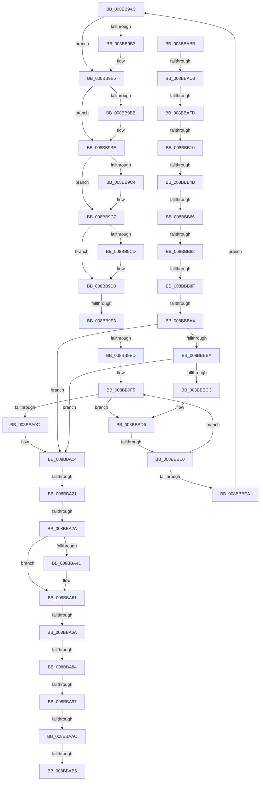

# sub_008BB9AC

- RVA: `0x008BB9AC`–`0x008BBBEF` (길이 `579` bytes)
- VA: `0x00000001408BB9AC`
- 실행 섹션: `PAGE`
- PDB 이름 있음: `아니요`; PDB Function 태그: `아니요`
- unwind 정보 RVA: `0x00082E8C`
- 디코드: `144`개 명령, `579/579` bytes 표시
- 미해석 바이트: `0` (있으면 어셈블리에 `.byte`로 보존)

> 이 문서는 커널 이미지의 기계어와 PDB 기호를 분석해 생성했습니다. 4번과 5번은 함수 원형과 자료형을 바이너리 사용 방식에서 추정한 C 해석이며 원본 소스 복구 결과는 아닙니다.

## 1. Dependencies

- 직접 호출 지점: **3**; 고유 호출 대상: **2**
- 직접 호출자로 확인된 함수: **0**
- RIP 상대 이미지 참조: **0**

### Outgoing calls
- `0x008BBA76` → [memcpy](../../text/6C/memcpy_function_006C6840.md) (function, `0x006C6840`)
- `0x008BBB36` → [ExAllocatePoolWithTag](../../poolcode/B8/ExAllocatePoolWithTag_function_00B82010.md) (function, `0x00B82010`)
- `0x008BBBA9` → [memcpy](../../text/6C/memcpy_function_006C6840.md) (function, `0x006C6840`)

### Direct callers
- 이 함수 시작 RVA로 연결되는 직접 call은 확인되지 않았습니다. 간접 호출은 완전히 역산할 수 없습니다.

### Static image references
- 디코드된 RIP-relative 메모리 참조가 없습니다.

## 2. Other-region calls and transfers

- 다른 실행 섹션으로 향하는 call: **3**
  - `0x008BBA76` → [memcpy](../../text/6C/memcpy_function_006C6840.md) (`PAGE` → `.text`)
  - `0x008BBB36` → [ExAllocatePoolWithTag](../../poolcode/B8/ExAllocatePoolWithTag_function_00B82010.md) (`PAGE` → `POOLCODE`)
  - `0x008BBBA9` → [memcpy](../../text/6C/memcpy_function_006C6840.md) (`PAGE` → `.text`)
- call이 아닌 외부 분기/꼬리 이동: **19**
  - `0x008BB9DD` → [sub_008BC3C4 + 0x21F](Unknown_function_008BC3C4.md) (`tail-transfer`)
  - `0x008BB9E7` → [sub_008BC3C4 + 0x21F](Unknown_function_008BC3C4.md) (`tail-transfer`)
  - `0x008BBA1B` → [sub_008BC3C4 + 0x436](Unknown_function_008BC3C4.md) (`tail-transfer`)
  - `0x008BBA24` → [sub_008BBC01 + 0x600](Unknown_function_008BBC01.md) (`tail-transfer`)
  - `0x008BBA64` → [sub_008BBC01 + 0x4A2](Unknown_function_008BBC01.md) (`tail-transfer`)
  - `0x008BBA7E` → [sub_008BB534 + 0x2EE](Unknown_function_008BB534.md) (`tail-transfer`)
  - `0x008BBA91` → [sub_008BB534 + 0x2EE](Unknown_function_008BB534.md) (`tail-transfer`)
  - `0x008BBAA6` → [sub_008BBC01 + 0x2E](Unknown_function_008BBC01.md) (`tail-transfer`)
  - `0x008BBAB0` → [sub_008BB534 + 0x2D3](Unknown_function_008BB534.md) (`tail-transfer`)
  - `0x008BBAB6` → [sub_008BB534 + 0x289](Unknown_function_008BB534.md) (`tail-transfer`)
  - `0x008BBACD` → [sub_008BC25B + 0x26](Unknown_function_008BC25B.md) (`tail-transfer`)
  - `0x008BBAF7` → [sub_008BC25B](Unknown_function_008BC25B.md) (`tail-transfer`)
  - `0x008BBB0A` → [sub_008BC25B + 0xFB](Unknown_function_008BC25B.md) (`tail-transfer`)
  - `0x008BBB45` → [sub_008BBC01 + 0x63B](Unknown_function_008BBC01.md) (`tail-transfer`)
  - `0x008BBB60` → [sub_008BC3C4 + 0x410](Unknown_function_008BC3C4.md) (`tail-transfer`)
  - `0x008BBB7C` → [sub_008BC3C4 + 0x422](Unknown_function_008BC3C4.md) (`tail-transfer`)
  - `0x008BBB89` → [sub_008BBC01 + 0x5FD](Unknown_function_008BBC01.md) (`tail-transfer`)
  - `0x008BBB9E` → [sub_008BC25B + 0x103](Unknown_function_008BC25B.md) (`tail-transfer`)
  - `0x008BBBDE` → [sub_008BBC01](Unknown_function_008BBC01.md) (`tail-transfer`)

## 3. Assembly (complete function range)

```asm
008BB9AC  8B 51 04                        mov edx, dword ptr [rcx + 4]
008BB9AF  85 D2                           test edx, edx
008BB9B1  79 02                           jns 0x1408bb9b5
008BB9B3  0B 16                           or edx, dword ptr [rsi]
008BB9B5  0F BA E2 1E                     bt edx, 0x1e
008BB9B9  73 03                           jae 0x1408bb9be
008BB9BB  0B 56 04                        or edx, dword ptr [rsi + 4]
008BB9BE  0F BA E2 1D                     bt edx, 0x1d
008BB9C2  73 03                           jae 0x1408bb9c7
008BB9C4  0B 56 08                        or edx, dword ptr [rsi + 8]
008BB9C7  0F BA E2 1C                     bt edx, 0x1c
008BB9CB  73 03                           jae 0x1408bb9d0
008BB9CD  0B 56 0C                        or edx, dword ptr [rsi + 0xc]
008BB9D0  81 E2 FF FF FF 0F               and edx, 0xfffffff
008BB9D6  89 51 04                        mov dword ptr [rcx + 4], edx
008BB9D9  41 80 F8 0A                     cmp r8b, 0xa
008BB9DD  0F 87 00 0C 00 00               ja 0x1408bc5e3
008BB9E3  45 0F A3 C5                     bt r13d, r8d
008BB9E7  0F 83 F6 0B 00 00               jae 0x1408bc5e3
008BB9ED  8B 46 0C                        mov eax, dword ptr [rsi + 0xc]
008BB9F0  23 C2                           and eax, edx
008BB9F2  89 41 04                        mov dword ptr [rcx + 4], eax
008BB9F5  0F B7 41 02                     movzx eax, word ptr [rcx + 2]
008BB9F9  41 FF C1                        inc r9d
008BB9FC  48 03 C8                        add rcx, rax
008BB9FF  0F B7 43 04                     movzx eax, word ptr [rbx + 4]
008BBA03  44 3B C8                        cmp r9d, eax
008BBA06  0F 82 CA 01 00 00               jb 0x1408bbbd6
008BBA0C  48 8B 75 E8                     mov rsi, qword ptr [rbp - 0x18]
008BBA10  4C 8B 6D D0                     mov r13, qword ptr [rbp - 0x30]
008BBA14  41 0F B7 4D 02                  movzx ecx, word ptr [r13 + 2]
008BBA19  3B F9                           cmp edi, ecx
008BBA1B  0F 87 D9 0D 00 00               ja 0x1408bc7fa
008BBA21  4D 85 F6                        test r14, r14
008BBA24  0F 84 D7 07 00 00               je 0x1408bc201
008BBA2A  8B C7                           mov eax, edi
008BBA2C  48 03 D8                        add rbx, rax
008BBA2F  44 2B F6                        sub r14d, esi
008BBA32  4C 8B 6D B8                     mov r13, qword ptr [rbp - 0x48]
008BBA36  B8 0C 00 00 00                  mov eax, 0xc
008BBA3B  48 8B CE                        mov rcx, rsi
008BBA3E  44 89 34 08                     mov dword ptr [rax + rcx], r14d
008BBA42  44 8B 74 24 54                  mov r14d, dword ptr [rsp + 0x54]
008BBA47  41 F6 C6 10                     test r14b, 0x10
008BBA4B  75 14                           jne 0x1408bba61
008BBA4D  49 8B 45 00                     mov rax, qword ptr [r13]
008BBA51  0F B7 48 02                     movzx ecx, word ptr [rax + 2]
008BBA55  B8 30 28 00 00                  mov eax, 0x2830
008BBA5A  66 23 C8                        and cx, ax
008BBA5D  66 09 4E 02                     or word ptr [rsi + 2], cx
008BBA61  4D 85 E4                        test r12, r12
008BBA64  0F 84 39 06 00 00               je 0x1408bc0a3
008BBA6A  45 0F B7 44 24 02               movzx r8d, word ptr [r12 + 2]
008BBA70  49 8B D4                        mov rdx, r12
008BBA73  48 8B CB                        mov rcx, rbx
008BBA76  E8 C5 AD E0 FF                  call 0x1406c6840
008BBA7B  48 85 DB                        test rbx, rbx
008BBA7E  0F 84 9E FD FF FF               je 0x1408bb822
008BBA84  33 C0                           xor eax, eax
008BBA86  48 8D 4B 08                     lea rcx, [rbx + 8]
008BBA8A  44 8B C0                        mov r8d, eax
008BBA8D  66 3B 43 04                     cmp ax, word ptr [rbx + 4]
008BBA91  0F 83 8B FD FF FF               jae 0x1408bb822
008BBA97  48 8B 75 C0                     mov rsi, qword ptr [rbp - 0x40]
008BBA9B  41 B9 73 06 00 00               mov r9d, 0x673
008BBAA1  0F B6 01                        movzx eax, byte ptr [rcx]
008BBAA4  3C 0A                           cmp al, 0xa
008BBAA6  0F 87 83 01 00 00               ja 0x1408bbc2f
008BBAAC  F6 41 01 08                     test byte ptr [rcx + 1], 8
008BBAB0  0F 85 51 FD FF FF               jne 0x1408bb807
008BBAB6  E9 02 FD FF FF                  jmp 0x1408bb7bd
008BBABB  0F BA EA 0A                     bts edx, 0xa
008BBABF  89 54 24 54                     mov dword ptr [rsp + 0x54], edx
008BBAC3  44 8B 74 24 54                  mov r14d, dword ptr [rsp + 0x54]
008BBAC8  80 7C 24 64 00                  cmp byte ptr [rsp + 0x64], 0
008BBACD  0F 85 AE 07 00 00               jne 0x1408bc281
008BBAD3  45 33 C0                        xor r8d, r8d
008BBAD6  41 0F B6 42 01                  movzx eax, byte ptr [r10 + 1]
008BBADB  8D 0C 85 08 00 00 00            lea ecx, [rax*4 + 8]
008BBAE2  0F B6 47 01                     movzx eax, byte ptr [rdi + 1]
008BBAE6  89 4D CC                        mov dword ptr [rbp - 0x34], ecx
008BBAE9  8D 14 85 08 00 00 00            lea edx, [rax*4 + 8]
008BBAF0  89 54 24 70                     mov dword ptr [rsp + 0x70], edx
008BBAF4  48 85 F6                        test rsi, rsi
008BBAF7  0F 84 5E 07 00 00               je 0x1408bc25b
008BBAFD  0F B7 7E 02                     movzx edi, word ptr [rsi + 2]
008BBB01  83 C7 03                        add edi, 3
008BBB04  83 E7 FC                        and edi, 0xfffffffc
008BBB07  4D 85 E4                        test r12, r12
008BBB0A  0F 84 46 08 00 00               je 0x1408bc356
008BBB10  45 0F B7 7C 24 02               movzx r15d, word ptr [r12 + 2]
008BBB16  41 83 C7 03                     add r15d, 3
008BBB1A  41 83 E7 FC                     and r15d, 0xfffffffc
008BBB1E  83 C1 14                        add ecx, 0x14
008BBB21  41 8D 04 3F                     lea eax, [r15 + rdi]
008BBB25  03 D0                           add edx, eax
008BBB27  41 B8 53 65 53 64               mov r8d, 0x64536553
008BBB2D  03 D1                           add edx, ecx
008BBB2F  8B 4D 38                        mov ecx, dword ptr [rbp + 0x38]
008BBB32  0F BA E9 0A                     bts ecx, 0xa
008BBB36  E8 D5 64 2C 00                  call 0x140b82010
008BBB3B  48 89 45 E8                     mov qword ptr [rbp - 0x18], rax
008BBB3F  48 8B F0                        mov rsi, rax
008BBB42  48 85 C0                        test rax, rax
008BBB45  0F 84 F1 06 00 00               je 0x1408bc23c
008BBB4B  33 C0                           xor eax, eax
008BBB4D  48 8D 5E 14                     lea rbx, [rsi + 0x14]
008BBB51  0F 57 C0                        xorps xmm0, xmm0
008BBB54  0F 11 06                        movups xmmword ptr [rsi], xmm0
008BBB57  89 46 10                        mov dword ptr [rsi + 0x10], eax
008BBB5A  C6 06 01                        mov byte ptr [rsi], 1
008BBB5D  38 45 C8                        cmp byte ptr [rbp - 0x38], al
008BBB60  0F 85 6E 0C 00 00               jne 0x1408bc7d4
008BBB66  41 0F B7 CE                     movzx ecx, r14w
008BBB6A  BA 00 40 00 00                  mov edx, 0x4000
008BBB6F  66 0B 4E 02                     or cx, word ptr [rsi + 2]
008BBB73  66 89 4E 02                     mov word ptr [rsi + 2], cx
008BBB77  66 41 85 55 02                  test word ptr [r13 + 2], dx
008BBB7C  0F 85 64 0C 00 00               jne 0x1408bc7e6
008BBB82  4C 8B 6D D0                     mov r13, qword ptr [rbp - 0x30]
008BBB86  4D 85 ED                        test r13, r13
008BBB89  0F 84 6F 06 00 00               je 0x1408bc1fe
008BBB8F  85 95 10 01 00 00               test dword ptr [rbp + 0x110], edx
008BBB95  4C 8B F3                        mov r14, rbx
008BBB98  49 8B D5                        mov rdx, r13
008BBB9B  48 8B CB                        mov rcx, rbx
008BBB9E  0F 85 BA 07 00 00               jne 0x1408bc35e
008BBBA4  45 0F B7 45 02                  movzx r8d, word ptr [r13 + 2]
008BBBA9  E8 92 AC E0 FF                  call 0x1406c6840
008BBBAE  45 33 D2                        xor r10d, r10d
008BBBB1  48 85 DB                        test rbx, rbx
008BBBB4  0F 84 5A FE FF FF               je 0x1408bba14
008BBBBA  48 8D 4B 08                     lea rcx, [rbx + 8]
008BBBBE  45 8B CA                        mov r9d, r10d
008BBBC1  66 44 3B 53 04                  cmp r10w, word ptr [rbx + 4]
008BBBC6  0F 83 48 FE FF FF               jae 0x1408bba14
008BBBCC  48 8B 75 C0                     mov rsi, qword ptr [rbp - 0x40]
008BBBD0  41 BD 73 06 00 00               mov r13d, 0x673
008BBBD6  44 0F B6 01                     movzx r8d, byte ptr [rcx]
008BBBDA  41 80 F8 0A                     cmp r8b, 0xa
008BBBDE  77 21                           ja 0x1408bbc01
008BBBE0  F6 41 01 08                     test byte ptr [rcx + 1], 8
008BBBE4  0F 85 0B FE FF FF               jne 0x1408bb9f5
008BBBEA  E9 BD FD FF FF                  jmp 0x1408bb9ac
```

## 4. C-style interpretation (structured pseudocode)

```c
__int64 __fastcall sub_008BB9AC(__int64 a1, __int64 a2, int a3, int a4)
{
    __int64 result;
    __int64 v_r14;
    __int64 v_rbx;
    unsigned int v_stack_p54;
    unsigned __int8 v_stack_p64;
    unsigned int v_stack_p70;

    if (sign_flag) {
        a2 = (unsigned int)(((unsigned int)(*(unsigned int *)(a1 + 4))) | (*(unsigned int *)(v_rsi)));
    }
    if (!(condition_is_above_or_equal)) {
        a2 = (unsigned int)((a2) | (*(unsigned int *)(v_rsi + 4)));
    }
    if (!(condition_is_above_or_equal)) {
        a2 = (unsigned int)((a2) | (*(unsigned int *)(v_rsi + 8)));
    }
    if (!(condition_is_above_or_equal)) {
        a2 = (unsigned int)((a2) | (*(unsigned int *)(v_rsi + 12)));
    }
    a2 = (unsigned int)((a2) & (0xFFFFFFFULL));
    *(unsigned int *)(a1 + 4) = (unsigned int)(a2);
    result = (unsigned int)(((unsigned int)(*(unsigned int *)(v_rsi + 12))) & ((unsigned int)(a2)));
    *(unsigned int *)(a1 + 4) = (unsigned int)(result);
loc_008BB9F5:
    a4 = (unsigned int)((a4) + 1);
    a1 = (a1) + (*(unsigned __int16 *)(a1 + 2));
    if (a4 < ((unsigned int)(*(unsigned __int16 *)(v_rbx + 4)))) goto loc_008BBBD6;
loc_008BBA14:
    v_rbx = (v_rbx) + ((unsigned int)((unsigned int)(v_rdi)));
    v_r14 = (unsigned int)((v_r14) - ((unsigned int)(*(unsigned __int64 *)(v_rbp - 24))));
    *(unsigned int *)(12 + *(unsigned __int64 *)(v_rbp - 24) * 1) = (unsigned int)(v_r14);
    result = 12;
    if ((((unsigned __int8)((unsigned int)(v_stack_p54))) & (16)) == 0) {
        result = *(unsigned __int64 *)(*(unsigned __int64 *)(v_rbp - 72));
        a1 = *(unsigned __int16 *)(result + 2);
        result = 0x2830ULL;
        a1 = (unsigned __int16)((a1) & ((unsigned __int16)(result)));
    }
    result = memcpy(v_rbx, v_r12, *(unsigned __int16 *)(v_r12 + 2), a4);
    result = 0;
loc_008BBBD6:
    if (((*(unsigned __int8 *)(v_rbx + 8 + 1)) & (8)) != 0) goto loc_008BB9F5;
    goto loc_008BB9AC;
}
```

## 5. (Beta) C Style

```c
int64_t sub_008BB9AC(void *Arg1, int64_t Arg2, int32_t Arg3, int32_t Arg4)
{
    uint8_t *arg1 = (uint8_t *)Arg1;

    int64_t result;
    int64_t local_r14;
    int64_t local_rbx;
    uint32_t v_stack_p54;
    uint8_t v_stack_p64;
    uint32_t v_stack_p70;

    if (sign_flag) {
        Arg2 = (uint32_t)(((uint32_t)(*(uint32_t *)(arg1 + 0x4))) | (*(uint32_t *)(local_rsi)));
    }
    if (!(condition_is_above_or_equal)) {
        Arg2 = (uint32_t)((Arg2) | (*(uint32_t *)(local_rsi + 0x4)));
    }
    if (!(condition_is_above_or_equal)) {
        Arg2 = (uint32_t)((Arg2) | (*(uint32_t *)(local_rsi + 0x8)));
    }
    if (!(condition_is_above_or_equal)) {
        Arg2 = (uint32_t)((Arg2) | (*(uint32_t *)(local_rsi + 0xC)));
    }
    Arg2 = (uint32_t)((Arg2) & (0xFFFFFFFULL));
    *(uint32_t *)(arg1 + 0x4) = (uint32_t)(Arg2);
    result = (uint32_t)(((uint32_t)(*(uint32_t *)(local_rsi + 0xC))) & ((uint32_t)(Arg2)));
    *(uint32_t *)(arg1 + 0x4) = (uint32_t)(result);
loc_008BB9F5:
    Arg4 = (uint32_t)((Arg4) + 1);
    Arg1 = (Arg1) + (*(uint16_t *)(arg1 + 0x2));
    if (Arg4 < ((uint32_t)(*(uint16_t *)(local_rbx + 0x4)))) goto loc_008BBBD6;
loc_008BBA14:
    local_rbx = (local_rbx) + ((uint32_t)((uint32_t)(local_rdi)));
    local_r14 = (uint32_t)((local_r14) - ((uint32_t)(*(uint64_t *)(local_rbp - 0x18))));
    *(uint32_t *)(12 + *(uint64_t *)(local_rbp - 0x18) * 1) = (uint32_t)(local_r14);
    result = 12;
    if ((((uint8_t)((uint32_t)(v_stack_p54))) & (16)) == 0) {
        result = *(uint64_t *)(*(uint64_t *)(local_rbp - 0x48));
        Arg1 = *(uint16_t *)(result + 0x2);
        result = 0x2830ULL;
        Arg1 = (uint16_t)((Arg1) & ((uint16_t)(result)));
    }
    result = memcpy(local_rbx, local_r12, *(uint16_t *)(local_r12 + 0x2), Arg4);
    result = 0;
loc_008BBBD6:
    if (((*(uint8_t *)(local_rbx + 0x8 + 0x1)) & (8)) != 0) goto loc_008BB9F5;
    goto loc_008BB9AC;
}
```

### 관측된 메모리 오프셋

구조체 형식이 확인되지 않은 접근은 인자 기준의 오프셋으로만 기록했습니다.

| 기준 인자 | 오프셋 표현 | 폭 (bit) | 접근 |
|---|---:|---:|---|
| `Arg1` | `+ 0x0` | `8` | `R` |
| `Arg1` | `+ 0x1` | `8` | `R` |
| `Arg1` | `+ 0x2` | `16` | `R` |
| `Arg1` | `+ 0x4` | `32` | `R` |
| `Arg1` | `+ 0x4` | `32` | `W` |

## 6. Execution-region graph

[열기: 2D/3D 그래프와 함수 탐색 컨트롤 패널](../../../control-panel.html?section=page&rva=0x008BB9AC&view=graph)

- 2D 그래프는 위에서 아래로 흐르고, 3D 그래프는 빈 공간을 드래그해 회전합니다. Shift+드래그는 이동, 휠은 확대·축소, 함수 노드 선택은 대상 보고서 이동입니다.

### Static fallback


