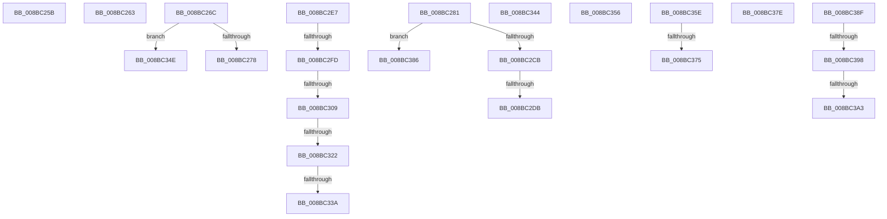

# sub_008BC25B

- RVA: `0x008BC25B`–`0x008BC3BC` (길이 `353` bytes)
- VA: `0x00000001408BC25B`
- 실행 섹션: `PAGE`
- PDB 이름 있음: `아니요`; PDB Function 태그: `아니요`
- unwind 정보 RVA: `0x00082F24`
- 디코드: `84`개 명령, `353/353` bytes 표시
- 미해석 바이트: `0` (있으면 어셈블리에 `.byte`로 보존)

> 이 문서는 커널 이미지의 기계어와 PDB 기호를 분석해 생성했습니다. 4번과 5번은 함수 원형과 자료형을 바이너리 사용 방식에서 추정한 C 해석이며 원본 소스 복구 결과는 아닙니다.

## 1. Dependencies

- 직접 호출 지점: **4**; 고유 호출 대상: **4**
- 직접 호출자로 확인된 함수: **0**
- RIP 상대 이미지 참조: **0**

### Outgoing calls
- `0x008BC2B3` → [RtlpCreateServerAcl](RtlpCreateServerAcl_function_008BCF58.md) (function, `0x008BCF58`)
- `0x008BC32D` → [SepValidOwnerSubjectContext](../A3/SepValidOwnerSubjectContext_function_00A37568.md) (function, `0x00A37568`)
- `0x008BC362` → [RtlpNormalizeAcl](RtlpNormalizeAcl_function_008BC950.md) (function, `0x008BC950`)
- `0x008BC3A8` → [ExFreePoolWithTag](../../poolcode/B8/ExFreePoolWithTag_function_00B82870.md) (function, `0x00B82870`)

### Direct callers
- 이 함수 시작 RVA로 연결되는 직접 call은 확인되지 않았습니다. 간접 호출은 완전히 역산할 수 없습니다.

### Static image references
- 디코드된 RIP-relative 메모리 참조가 없습니다.

## 2. Other-region calls and transfers

- 다른 실행 섹션으로 향하는 call: **1**
  - `0x008BC3A8` → [ExFreePoolWithTag](../../poolcode/B8/ExFreePoolWithTag_function_00B82870.md) (`PAGE` → `POOLCODE`)
- call이 아닌 외부 분기/꼬리 이동: **20**
  - `0x008BC25E` → [sub_008BB9AC + 0x15B](Unknown_function_008BB9AC.md) (`tail-transfer`)
  - `0x008BC267` → [sub_008BB534 + 0x1FC](Unknown_function_008BB534.md) (`tail-transfer`)
  - `0x008BC27C` → [sub_008BBC01 + 0x4A](Unknown_function_008BBC01.md) (`tail-transfer`)
  - `0x008BC2D5` → [sub_008BC3C4 + 0x3F5](Unknown_function_008BC3C4.md) (`tail-transfer`)
  - `0x008BC2E2` → [sub_008BB9AC + 0x127](Unknown_function_008BB9AC.md) (`tail-transfer`)
  - `0x008BC2F7` → [sub_008BC3C4 + 0xA7](Unknown_function_008BC3C4.md) (`tail-transfer`)
  - `0x008BC303` → [sub_008BC3C4 + 0x301](Unknown_function_008BC3C4.md) (`tail-transfer`)
  - `0x008BC31C` → [sub_008BC3C4 + 0x3D](Unknown_function_008BC3C4.md) (`tail-transfer`)
  - `0x008BC334` → [sub_008BC3C4 + 0x3D](Unknown_function_008BC3C4.md) (`tail-transfer`)
  - `0x008BC33F` → [sub_008BB534 + 0x419](Unknown_function_008BB534.md) (`tail-transfer`)
  - `0x008BC349` → [sub_008BB534 + 0x419](Unknown_function_008BB534.md) (`tail-transfer`)
  - `0x008BC351` → [sub_008BBC01 + 0x4A](Unknown_function_008BBC01.md) (`tail-transfer`)
  - `0x008BC359` → [sub_008BB9AC + 0x172](Unknown_function_008BB9AC.md) (`tail-transfer`)
  - `0x008BC36F` → [sub_008BC3C4 + 0xB0](Unknown_function_008BC3C4.md) (`tail-transfer`)
  - `0x008BC379` → [sub_008BB9AC + 0x75](Unknown_function_008BB9AC.md) (`tail-transfer`)
  - `0x008BC381` → [sub_008BB9AC + 0x12A](Unknown_function_008BB9AC.md) (`tail-transfer`)
  - `0x008BC38A` → [sub_008BB534 + 0x3A8](Unknown_function_008BB534.md) (`tail-transfer`)
  - `0x008BC392` → [sub_008BBC01 + 0x5A1](Unknown_function_008BBC01.md) (`tail-transfer`)
  - `0x008BC39D` → [sub_008BBC01 + 0x5A1](Unknown_function_008BBC01.md) (`tail-transfer`)
  - `0x008BC3B7` → [sub_008BBC01 + 0x5A1](Unknown_function_008BBC01.md) (`tail-transfer`)

## 3. Assembly (complete function range)

```asm
008BC25B  41 8B F8                        mov edi, r8d
008BC25E  E9 A4 F8 FF FF                  jmp 0x1408bbb07
008BC263  48 8B 78 10                     mov rdi, qword ptr [rax + 0x10]
008BC267  E9 C4 F4 FF FF                  jmp 0x1408bb730
008BC26C  41 8B 45 10                     mov eax, dword ptr [r13 + 0x10]
008BC270  85 C0                           test eax, eax
008BC272  0F 84 D6 00 00 00               je 0x1408bc34e
008BC278  4E 8D 24 28                     lea r12, [rax + r13]
008BC27C  E9 CA F9 FF FF                  jmp 0x1408bbc4b
008BC281  48 8B 45 D8                     mov rax, qword ptr [rbp - 0x28]
008BC285  4C 8D 4D 30                     lea r9, [rbp + 0x30]
008BC289  0F B6 54 24 65                  movzx edx, byte ptr [rsp + 0x65]
008BC28E  48 8B 40 10                     mov rax, qword ptr [rax + 0x10]
008BC292  8B 88 90 00 00 00               mov ecx, dword ptr [rax + 0x90]
008BC298  4C 8B 80 98 00 00 00            mov r8, qword ptr [rax + 0x98]
008BC29F  48 03 C9                        add rcx, rcx
008BC2A2  48 8D 44 24 58                  lea rax, [rsp + 0x58]
008BC2A7  48 89 44 24 20                  mov qword ptr [rsp + 0x20], rax
008BC2AC  4D 8B 04 C8                     mov r8, qword ptr [r8 + rcx*8]
008BC2B0  49 8B CC                        mov rcx, r12
008BC2B3  E8 A0 0C 00 00                  call 0x1408bcf58
008BC2B8  8B D8                           mov ebx, eax
008BC2BA  85 C0                           test eax, eax
008BC2BC  0F B6 44 24 58                  movzx eax, byte ptr [rsp + 0x58]
008BC2C1  88 44 24 50                     mov byte ptr [rsp + 0x50], al
008BC2C5  0F 88 BB 00 00 00               js 0x1408bc386
008BC2CB  48 8B 5D 30                     mov rbx, qword ptr [rbp + 0x30]
008BC2CF  48 89 5D B0                     mov qword ptr [rbp - 0x50], rbx
008BC2D3  84 C0                           test al, al
008BC2D5  0F 85 DE 04 00 00               jne 0x1408bc7b9
008BC2DB  4C 8B 55 88                     mov r10, qword ptr [rbp - 0x78]
008BC2DF  4C 8B E3                        mov r12, rbx
008BC2E2  E9 EC F7 FF FF                  jmp 0x1408bbad3
008BC2E7  41 8B C6                        mov eax, r14d
008BC2EA  C1 E8 02                        shr eax, 2
008BC2ED  F6 D0                           not al
008BC2EF  24 01                           and al, 1
008BC2F1  89 45 F0                        mov dword ptr [rbp - 0x10], eax
008BC2F4  66 85 D2                        test dx, dx
008BC2F7  0F 89 6E 01 00 00               jns 0x1408bc46b
008BC2FD  41 8B 45 04                     mov eax, dword ptr [r13 + 4]
008BC301  85 C0                           test eax, eax
008BC303  0F 84 BC 03 00 00               je 0x1408bc6c5
008BC309  49 03 C5                        add rax, r13
008BC30C  F6 85 10 01 00 00 08            test byte ptr [rbp + 0x110], 8
008BC313  48 89 45 88                     mov qword ptr [rbp - 0x78], rax
008BC317  C6 44 24 66 01                  mov byte ptr [rsp + 0x66], 1
008BC31C  0F 85 DF 00 00 00               jne 0x1408bc401
008BC322  48 8B 4D D8                     mov rcx, qword ptr [rbp - 0x28]
008BC326  45 0F B6 C2                     movzx r8d, r10b
008BC32A  48 8B D0                        mov rdx, rax
008BC32D  E8 36 B2 17 00                  call 0x140a37568
008BC332  84 C0                           test al, al
008BC334  0F 85 C7 00 00 00               jne 0x1408bc401
008BC33A  BB 5A 00 00 C0                  mov ebx, 0xc000005a
008BC33F  E9 09 F6 FF FF                  jmp 0x1408bb94d
008BC344  BB 5B 00 00 C0                  mov ebx, 0xc000005b
008BC349  E9 FF F5 FF FF                  jmp 0x1408bb94d
008BC34E  45 33 E4                        xor r12d, r12d
008BC351  E9 F5 F8 FF FF                  jmp 0x1408bbc4b
008BC356  45 8B F8                        mov r15d, r8d
008BC359  E9 C0 F7 FF FF                  jmp 0x1408bbb1e
008BC35E  4C 8B 45 C0                     mov r8, qword ptr [rbp - 0x40]
008BC362  E8 E9 05 00 00                  call 0x1408bc950
008BC367  45 33 D2                        xor r10d, r10d
008BC36A  66 44 39 53 04                  cmp word ptr [rbx + 4], r10w
008BC36F  0F 84 FF 00 00 00               je 0x1408bc474
008BC375  0F B7 7B 02                     movzx edi, word ptr [rbx + 2]
008BC379  E9 A3 F6 FF FF                  jmp 0x1408bba21
008BC37E  4D 8B E0                        mov r12, r8
008BC381  E9 50 F7 FF FF                  jmp 0x1408bbad6
008BC386  4C 8B 6D 30                     mov r13, qword ptr [rbp + 0x30]
008BC38A  E9 4D F5 FF FF                  jmp 0x1408bb8dc
008BC38F  48 85 F6                        test rsi, rsi
008BC392  0F 84 0A FE FF FF               je 0x1408bc1a2
008BC398  66 83 7E 04 00                  cmp word ptr [rsi + 4], 0
008BC39D  0F 85 FF FD FF FF               jne 0x1408bc1a2
008BC3A3  33 D2                           xor edx, edx
008BC3A5  48 8B CE                        mov rcx, rsi
008BC3A8  E8 C3 64 2C 00                  call 0x140b82870
008BC3AD  33 F6                           xor esi, esi
008BC3AF  48 89 75 D0                     mov qword ptr [rbp - 0x30], rsi
008BC3B3  48 89 75 28                     mov qword ptr [rbp + 0x28], rsi
008BC3B7  E9 E6 FD FF FF                  jmp 0x1408bc1a2
```

## 4. C-style interpretation (structured pseudocode)

```c
__int64 __fastcall sub_008BC25B(__int64 a1, __int64 a2, int a3)
{
    unsigned __int64 v_stack_p20;
    unsigned __int8 v_stack_p50;
    unsigned __int64 v_stack_p58;
    unsigned __int8 v_stack_p65;
    unsigned __int8 v_stack_p66;
}
```

## 5. (Beta) C Style

```c
int64_t sub_008BC25B(int64_t Arg1, int64_t Arg2, int32_t Arg3)
{
    uint64_t v_stack_p20;
    uint8_t v_stack_p50;
    uint64_t v_stack_p58;
    uint8_t v_stack_p65;
    uint8_t v_stack_p66;
}
```

## 6. Execution-region graph

[열기: 2D/3D 그래프와 함수 탐색 컨트롤 패널](../../../control-panel.html?section=page&rva=0x008BC25B&view=graph)

- 2D 그래프는 위에서 아래로 흐르고, 3D 그래프는 빈 공간을 드래그해 회전합니다. Shift+드래그는 이동, 휠은 확대·축소, 함수 노드 선택은 대상 보고서 이동입니다.

### Static fallback


