# sub_008BC3C4

- RVA: `0x008BC3C4`–`0x008BC85C` (길이 `1,176` bytes)
- VA: `0x00000001408BC3C4`
- 실행 섹션: `PAGE`
- PDB 이름 있음: `아니요`; PDB Function 태그: `아니요`
- unwind 정보 RVA: `0x00082F70`
- 디코드: `290`개 명령, `1,176/1,176` bytes 표시
- 미해석 바이트: `0` (있으면 어셈블리에 `.byte`로 보존)

> 이 문서는 커널 이미지의 기계어와 PDB 기호를 분석해 생성했습니다. 4번과 5번은 함수 원형과 자료형을 바이너리 사용 방식에서 추정한 C 해석이며 원본 소스 복구 결과는 아닙니다.

## 1. Dependencies

- 직접 호출 지점: **11**; 고유 호출 대상: **6**
- 직접 호출자로 확인된 함수: **0**
- RIP 상대 이미지 참조: **2**

### Outgoing calls
- `0x008BC440` → [RtlSidDominates](../../text/3F/RtlSidDominates_function_003FBD50.md) (function, `0x003FBD50`)
- `0x008BC4E4` → [RtlpComputeMergedAcl](../AC/RtlpComputeMergedAcl_function_00AC9B34.md) (function, `0x00AC9B34`)
- `0x008BC5AE` → [RtlpComputeMergedAcl](../AC/RtlpComputeMergedAcl_function_00AC9B34.md) (function, `0x00AC9B34`)
- `0x008BC660` → [RtlpComputeMergedAcl](../AC/RtlpComputeMergedAcl_function_00AC9B34.md) (function, `0x00AC9B34`)
- `0x008BC6A1` → [SeSinglePrivilegeCheckEx](../87/SeSinglePrivilegeCheckEx_function_00871AC0.md) (function, `0x00871AC0`)
- `0x008BC6DE` → [RtlpValidTrustSubjectContext](../../text/3E/RtlpValidTrustSubjectContext_function_003ED770.md) (function, `0x003ED770`)
- `0x008BC7C9` → [ExFreePoolWithTag](../../poolcode/B8/ExFreePoolWithTag_function_00B82870.md) (function, `0x00B82870`)
- `0x008BC805` → [memset](../../text/6C/memset_function_006C6C40.md) (function, `0x006C6C40`)
- `0x008BC81D` → [memset](../../text/6C/memset_function_006C6C40.md) (function, `0x006C6C40`)
- `0x008BC843` → [ExFreePoolWithTag](../../poolcode/B8/ExFreePoolWithTag_function_00B82870.md) (function, `0x00B82870`)
- `0x008BC852` → [ExFreePoolWithTag](../../poolcode/B8/ExFreePoolWithTag_function_00B82870.md) (function, `0x00B82870`)

### Direct callers
- 이 함수 시작 RVA로 연결되는 직접 call은 확인되지 않았습니다. 간접 호출은 완전히 역산할 수 없습니다.

### Static image references
- `0x008BC42A` → RVA `0x00FD9AA0` (`PAGEDATA`; read)
- `0x008BC69A` → RVA `0x00FD9B28` (`PAGEDATA`; read)

## 2. Other-region calls and transfers

- 다른 실행 섹션으로 향하는 call: **7**
  - `0x008BC440` → [RtlSidDominates](../../text/3F/RtlSidDominates_function_003FBD50.md) (`PAGE` → `.text`)
  - `0x008BC6DE` → [RtlpValidTrustSubjectContext](../../text/3E/RtlpValidTrustSubjectContext_function_003ED770.md) (`PAGE` → `.text`)
  - `0x008BC7C9` → [ExFreePoolWithTag](../../poolcode/B8/ExFreePoolWithTag_function_00B82870.md) (`PAGE` → `POOLCODE`)
  - `0x008BC805` → [memset](../../text/6C/memset_function_006C6C40.md) (`PAGE` → `.text`)
  - `0x008BC81D` → [memset](../../text/6C/memset_function_006C6C40.md) (`PAGE` → `.text`)
  - `0x008BC843` → [ExFreePoolWithTag](../../poolcode/B8/ExFreePoolWithTag_function_00B82870.md) (`PAGE` → `POOLCODE`)
  - `0x008BC852` → [ExFreePoolWithTag](../../poolcode/B8/ExFreePoolWithTag_function_00B82870.md) (`PAGE` → `POOLCODE`)
- call이 아닌 외부 분기/꼬리 이동: **42**
  - `0x008BC3E0` → [sub_008BB534 + 0x1FC](Unknown_function_008BB534.md) (`tail-transfer`)
  - `0x008BC3FC` → [sub_008BBC01 + 0x330](Unknown_function_008BBC01.md) (`tail-transfer`)
  - `0x008BC405` → [sub_008BB534 + 0x1A9](Unknown_function_008BB534.md) (`tail-transfer`)
  - `0x008BC40E` → [sub_008BB9AC + 0x12A](Unknown_function_008BB9AC.md) (`tail-transfer`)
  - `0x008BC416` → [sub_008BB534 + 0x11A](Unknown_function_008BB534.md) (`tail-transfer`)
  - `0x008BC41F` → [sub_008BB534 + 0x11A](Unknown_function_008BB534.md) (`tail-transfer`)
  - `0x008BC447` → [sub_008BBC01 + 0x366](Unknown_function_008BBC01.md) (`tail-transfer`)
  - `0x008BC452` → [sub_008BBC01 + 0x152](Unknown_function_008BBC01.md) (`tail-transfer`)
  - `0x008BC466` → [sub_008BBC01 + 0x152](Unknown_function_008BBC01.md) (`tail-transfer`)
  - `0x008BC46F` → [sub_008BC25B + 0xB1](Unknown_function_008BC25B.md) (`tail-transfer`)
  - `0x008BC47A` → [sub_008BB9AC + 0x75](Unknown_function_008BB9AC.md) (`tail-transfer`)
  - `0x008BC52A` → [sub_008BBC01 + 0x454](Unknown_function_008BBC01.md) (`tail-transfer`)
  - `0x008BC532` → [sub_008BBC01 + 0x330](Unknown_function_008BBC01.md) (`tail-transfer`)
  - `0x008BC53E` → [sub_008BB534 + 0x1FC](Unknown_function_008BB534.md) (`tail-transfer`)
  - `0x008BC5D5` → [sub_008BB534 + 0x3C7](Unknown_function_008BB534.md) (`tail-transfer`)
  - `0x008BC5DE` → [sub_008BBC01 + 0x330](Unknown_function_008BBC01.md) (`tail-transfer`)
  - `0x008BC5EA` → [sub_008BB9AC + 0x44](Unknown_function_008BB9AC.md) (`tail-transfer`)
  - `0x008BC5F6` → [sub_008BB534 + 0x2CE](Unknown_function_008BB534.md) (`tail-transfer`)
  - `0x008BC68E` → [sub_008BBC01 + 0x25D](Unknown_function_008BBC01.md) (`tail-transfer`)
  - `0x008BC6A8` → [sub_008BBC01 + 0x178](Unknown_function_008BBC01.md) (`tail-transfer`)
  - `0x008BC6AE` → [sub_008BBC01 + 0x366](Unknown_function_008BBC01.md) (`tail-transfer`)
  - `0x008BC6B6` → [sub_008BB534 + 0x152](Unknown_function_008BB534.md) (`tail-transfer`)
  - `0x008BC6C0` → [sub_008BB534 + 0x165](Unknown_function_008BB534.md) (`tail-transfer`)
  - `0x008BC6C7` → [sub_008BC25B + 0xB1](Unknown_function_008BC25B.md) (`tail-transfer`)
  - `0x008BC6D0` → [sub_00B1A906 + 0x66](../B1/Unknown_function_00B1A906.md) (`tail-transfer`)
  - `0x008BC6E5` → [sub_00B1A906 + 0x98](../B1/Unknown_function_00B1A906.md) (`tail-transfer`)
  - `0x008BC6EF` → [sub_008BBC01 + 0x232](Unknown_function_008BBC01.md) (`tail-transfer`)
  - `0x008BC72F` → [sub_008BBC01 + 0x3C8](Unknown_function_008BBC01.md) (`tail-transfer`)
  - `0x008BC775` → [sub_008BBC01 + 0x414](Unknown_function_008BBC01.md) (`tail-transfer`)
  - `0x008BC793` → [sub_008BBC01 + 0x454](Unknown_function_008BBC01.md) (`tail-transfer`)
  - `0x008BC7A0` → [sub_008BBC01 + 0x502](Unknown_function_008BBC01.md) (`tail-transfer`)
  - `0x008BC7AB` → [sub_00B1A906 + 0x235](../B1/Unknown_function_00B1A906.md) (`tail-transfer`)
  - `0x008BC7B4` → [sub_00B1A906 + 0x251](../B1/Unknown_function_00B1A906.md) (`tail-transfer`)
  - `0x008BC7BE` → [sub_00B1A906 + 0x2F2](../B1/Unknown_function_00B1A906.md) (`tail-transfer`)
  - `0x008BC7CF` → [sub_00B1A906 + 0x2F2](../B1/Unknown_function_00B1A906.md) (`tail-transfer`)
  - `0x008BC7E1` → [sub_008BB9AC + 0x1BA](Unknown_function_008BB9AC.md) (`tail-transfer`)
  - `0x008BC7F5` → [sub_008BB9AC + 0x1D6](Unknown_function_008BB9AC.md) (`tail-transfer`)
  - `0x008BC80D` → [sub_008BB9AC + 0x75](Unknown_function_008BB9AC.md) (`tail-transfer`)
  - `0x008BC822` → [sub_008BB534 + 0x307](Unknown_function_008BB534.md) (`tail-transfer`)
  - `0x008BC838` → [sub_008BBC01 + 0x321](Unknown_function_008BBC01.md) (`tail-transfer`)
  - `0x008BC848` → [sub_008BB534 + 0x3B3](Unknown_function_008BB534.md) (`tail-transfer`)
  - `0x008BC857` → [sub_008BB534 + 0x419](Unknown_function_008BB534.md) (`tail-transfer`)

## 3. Assembly (complete function range)

```asm
008BC3C4  66 45 39 65 02                  cmp word ptr [r13 + 2], r12w
008BC3C9  7D 59                           jge 0x1408bc424
008BC3CB  41 8B 45 08                     mov eax, dword ptr [r13 + 8]
008BC3CF  85 C0                           test eax, eax
008BC3D1  0F 84 60 01 00 00               je 0x1408bc537
008BC3D7  4A 8D 3C 28                     lea rdi, [rax + r13]
008BC3DB  C6 44 24 67 01                  mov byte ptr [rsp + 0x67], 1
008BC3E0  E9 4B F3 FF FF                  jmp 0x1408bb730
008BC3E5  66 85 C0                        test ax, ax
008BC3E8  0F 89 EC 01 00 00               jns 0x1408bc5da
008BC3EE  8B 07                           mov eax, dword ptr [rdi]
008BC3F0  85 C0                           test eax, eax
008BC3F2  0F 84 37 01 00 00               je 0x1408bc52f
008BC3F8  48 8D 0C 06                     lea rcx, [rsi + rax]
008BC3FC  E9 30 FB FF FF                  jmp 0x1408bbf31
008BC401  4C 8B 55 88                     mov r10, qword ptr [rbp - 0x78]
008BC405  E9 D3 F2 FF FF                  jmp 0x1408bb6dd
008BC40A  4C 8B 60 20                     mov r12, qword ptr [rax + 0x20]
008BC40E  E9 C3 F6 FF FF                  jmp 0x1408bbad6
008BC413  4D 8B F8                        mov r15, r8
008BC416  E9 33 F2 FF FF                  jmp 0x1408bb64e
008BC41B  4C 8B 78 18                     mov r15, qword ptr [rax + 0x18]
008BC41F  E9 2A F2 FF FF                  jmp 0x1408bb64e
008BC424  49 8B 7D 10                     mov rdi, qword ptr [r13 + 0x10]
008BC428  EB B1                           jmp 0x1408bc3db
008BC42A  48 8B 15 6F D6 71 00            mov rdx, qword ptr [rip + 0x71d66f]
008BC431  4C 8D 44 24 50                  lea r8, [rsp + 0x50]
008BC436  48 8B CE                        mov rcx, rsi
008BC439  48 8B 92 E8 01 00 00            mov rdx, qword ptr [rdx + 0x1e8]
008BC440  E8 0B F9 B3 FF                  call 0x1403fbd50
008BC445  85 C0                           test eax, eax
008BC447  0F 88 1A FB FF FF               js 0x1408bbf67
008BC44D  80 7C 24 50 00                  cmp byte ptr [rsp + 0x50], 0
008BC452  0F 85 FB F8 FF FF               jne 0x1408bbd53
008BC458  48 8B 05 41 D6 71 00            mov rax, qword ptr [rip + 0x71d641]
008BC45F  48 8B B0 E8 01 00 00            mov rsi, qword ptr [rax + 0x1e8]
008BC466  E9 E8 F8 FF FF                  jmp 0x1408bbd53
008BC46B  49 8B 45 08                     mov rax, qword ptr [r13 + 8]
008BC46F  E9 98 FE FF FF                  jmp 0x1408bc30c
008BC474  4D 8B F2                        mov r14, r10
008BC477  41 8B FA                        mov edi, r10d
008BC47A  E9 A2 F5 FF FF                  jmp 0x1408bba21
008BC47F  48 8B 45 B8                     mov rax, qword ptr [rbp - 0x48]
008BC483  44 8B CA                        mov r9d, edx
008BC486  41 23 D2                        and edx, r10d
008BC489  41 D1 E9                        shr r9d, 1
008BC48C  41 83 E1 18                     and r9d, 0x18
008BC490  44 0B CA                        or r9d, edx
008BC493  48 8B 00                        mov rax, qword ptr [rax]
008BC496  41 D1 E9                        shr r9d, 1
008BC499  0F B7 48 02                     movzx ecx, word ptr [rax + 2]
008BC49D  48 8D 44 24 60                  lea rax, [rsp + 0x60]
008BC4A2  48 89 44 24 48                  mov qword ptr [rsp + 0x48], rax
008BC4A7  8B D1                           mov edx, ecx
008BC4A9  D1 EA                           shr edx, 1
008BC4AB  48 8D 45 10                     lea rax, [rbp + 0x10]
008BC4AF  48 89 44 24 40                  mov qword ptr [rsp + 0x40], rax
008BC4B4  83 E2 18                        and edx, 0x18
008BC4B7  48 8B 45 C0                     mov rax, qword ptr [rbp - 0x40]
008BC4BB  41 23 CA                        and ecx, r10d
008BC4BE  C7 44 24 38 02 00 00 00         mov dword ptr [rsp + 0x38], 2
008BC4C6  0B D1                           or edx, ecx
008BC4C8  48 89 44 24 30                  mov qword ptr [rsp + 0x30], rax
008BC4CD  49 8B CF                        mov rcx, r15
008BC4D0  48 8B 45 80                     mov rax, qword ptr [rbp - 0x80]
008BC4D4  48 89 44 24 28                  mov qword ptr [rsp + 0x28], rax
008BC4D9  48 8B 45 88                     mov rax, qword ptr [rbp - 0x78]
008BC4DD  D1 EA                           shr edx, 1
008BC4DF  48 89 44 24 20                  mov qword ptr [rsp + 0x20], rax
008BC4E4  E8 4B D6 20 00                  call 0x140ac9b34
008BC4E9  8B D8                           mov ebx, eax
008BC4EB  85 C0                           test eax, eax
008BC4ED  0F 88 87 02 00 00               js 0x1408bc77a
008BC4F3  8B 44 24 60                     mov eax, dword ptr [rsp + 0x60]
008BC4F7  BB 00 0A 00 00                  mov ebx, 0xa00
008BC4FC  4C 8B 45 10                     mov r8, qword ptr [rbp + 0x10]
008BC500  44 8B C8                        mov r9d, eax
008BC503  41 83 E1 08                     and r9d, 8
008BC507  C6 44 24 6A 01                  mov byte ptr [rsp + 0x6a], 1
008BC50C  41 83 C9 04                     or r9d, 4
008BC510  4C 89 45 A0                     mov qword ptr [rbp - 0x60], r8
008BC514  45 03 C9                        add r9d, r9d
008BC517  25 00 14 00 00                  and eax, 0x1400
008BC51C  44 0B C8                        or r9d, eax
008BC51F  45 03 C9                        add r9d, r9d
008BC522  44 0B CE                        or r9d, esi
008BC525  44 89 4C 24 54                  mov dword ptr [rsp + 0x54], r9d
008BC52A  E9 26 FB FF FF                  jmp 0x1408bc055
008BC52F  49 8B CD                        mov rcx, r13
008BC532  E9 FA F9 FF FF                  jmp 0x1408bbf31
008BC537  33 FF                           xor edi, edi
008BC539  C6 44 24 67 01                  mov byte ptr [rsp + 0x67], 1
008BC53E  E9 ED F1 FF FF                  jmp 0x1408bb730
008BC543  48 8B 45 B8                     mov rax, qword ptr [rbp - 0x48]
008BC547  81 E2 00 28 00 00               and edx, 0x2800
008BC54D  41 D1 E9                        shr r9d, 1
008BC550  4C 8B C6                        mov r8, rsi
008BC553  41 83 E1 18                     and r9d, 0x18
008BC557  44 0B CA                        or r9d, edx
008BC55A  48 8B 00                        mov rax, qword ptr [rax]
008BC55D  41 D1 E9                        shr r9d, 1
008BC560  0F B7 48 02                     movzx ecx, word ptr [rax + 2]
008BC564  48 8D 44 24 60                  lea rax, [rsp + 0x60]
008BC569  48 89 44 24 48                  mov qword ptr [rsp + 0x48], rax
008BC56E  8B D1                           mov edx, ecx
008BC570  D1 EA                           shr edx, 1
008BC572  48 8D 45 40                     lea rax, [rbp + 0x40]
008BC576  48 89 44 24 40                  mov qword ptr [rsp + 0x40], rax
008BC57B  83 E2 18                        and edx, 0x18
008BC57E  48 8B 45 C0                     mov rax, qword ptr [rbp - 0x40]
008BC582  81 E1 00 28 00 00               and ecx, 0x2800
008BC588  C7 44 24 38 02 00 00 00         mov dword ptr [rsp + 0x38], 2
008BC590  0B D1                           or edx, ecx
008BC592  48 89 44 24 30                  mov qword ptr [rsp + 0x30], rax
008BC597  49 8B CF                        mov rcx, r15
008BC59A  48 8B 45 80                     mov rax, qword ptr [rbp - 0x80]
008BC59E  48 89 44 24 28                  mov qword ptr [rsp + 0x28], rax
008BC5A3  48 8B 45 88                     mov rax, qword ptr [rbp - 0x78]
008BC5A7  D1 EA                           shr edx, 1
008BC5A9  48 89 44 24 20                  mov qword ptr [rsp + 0x20], rax
008BC5AE  E8 81 D5 20 00                  call 0x140ac9b34
008BC5B3  8B D8                           mov ebx, eax
008BC5B5  85 C0                           test eax, eax
008BC5B7  0F 89 37 01 00 00               jns 0x1408bc6f4
008BC5BD  48 8B 75 40                     mov rsi, qword ptr [rbp + 0x40]
008BC5C1  4C 8B 7D 98                     mov r15, qword ptr [rbp - 0x68]
008BC5C5  4C 8B 65 A0                     mov r12, qword ptr [rbp - 0x60]
008BC5C9  4C 8B 75 90                     mov r14, qword ptr [rbp - 0x70]
008BC5CD  48 8B 7D A8                     mov rdi, qword ptr [rbp - 0x58]
008BC5D1  4C 8B 6D B0                     mov r13, qword ptr [rbp - 0x50]
008BC5D5  E9 21 F3 FF FF                  jmp 0x1408bb8fb
008BC5DA  48 8B 4E 20                     mov rcx, qword ptr [rsi + 0x20]
008BC5DE  E9 4E F9 FF FF                  jmp 0x1408bbf31
008BC5E3  8B 46 0C                        mov eax, dword ptr [rsi + 0xc]
008BC5E6  0F BA E8 18                     bts eax, 0x18
008BC5EA  E9 01 F4 FF FF                  jmp 0x1408bb9f0
008BC5EF  8B 46 0C                        mov eax, dword ptr [rsi + 0xc]
008BC5F2  0F BA E8 18                     bts eax, 0x18
008BC5F6  E9 07 F2 FF FF                  jmp 0x1408bb802
008BC5FB  48 8B 45 B8                     mov rax, qword ptr [rbp - 0x48]
008BC5FF  44 8B CA                        mov r9d, edx
008BC602  41 23 D2                        and edx, r10d
008BC605  41 D1 E9                        shr r9d, 1
008BC608  41 83 E1 18                     and r9d, 0x18
008BC60C  44 0B CA                        or r9d, edx
008BC60F  48 8B 00                        mov rax, qword ptr [rax]
008BC612  41 D1 E9                        shr r9d, 1
008BC615  0F B7 48 02                     movzx ecx, word ptr [rax + 2]
008BC619  48 8D 44 24 60                  lea rax, [rsp + 0x60]
008BC61E  48 89 44 24 48                  mov qword ptr [rsp + 0x48], rax
008BC623  8B D1                           mov edx, ecx
008BC625  D1 EA                           shr edx, 1
008BC627  48 8D 45 08                     lea rax, [rbp + 8]
008BC62B  48 89 44 24 40                  mov qword ptr [rsp + 0x40], rax
008BC630  83 E2 18                        and edx, 0x18
008BC633  48 8B 45 C0                     mov rax, qword ptr [rbp - 0x40]
008BC637  41 23 CA                        and ecx, r10d
008BC63A  C7 44 24 38 02 00 00 00         mov dword ptr [rsp + 0x38], 2
008BC642  0B D1                           or edx, ecx
008BC644  48 89 44 24 30                  mov qword ptr [rsp + 0x30], rax
008BC649  49 8B CF                        mov rcx, r15
008BC64C  48 8B 45 80                     mov rax, qword ptr [rbp - 0x80]
008BC650  48 89 44 24 28                  mov qword ptr [rsp + 0x28], rax
008BC655  48 8B 45 88                     mov rax, qword ptr [rbp - 0x78]
008BC659  D1 EA                           shr edx, 1
008BC65B  48 89 44 24 20                  mov qword ptr [rsp + 0x20], rax
008BC660  E8 CF D4 20 00                  call 0x140ac9b34
008BC665  8B D8                           mov ebx, eax
008BC667  85 C0                           test eax, eax
008BC669  0F 89 C5 00 00 00               jns 0x1408bc734
008BC66F  4C 8B 7D 08                     mov r15, qword ptr [rbp + 8]
008BC673  48 8B 75 68                     mov rsi, qword ptr [rbp + 0x68]
008BC677  E9 49 FF FF FF                  jmp 0x1408bc5c5
008BC67C  F7 40 04 00 00 00 FF            test dword ptr [rax + 4], 0xff000000
008BC683  48 8D 50 08                     lea rdx, [rax + 8]
008BC687  74 43                           je 0x1408bc6cc
008BC689  BB 0D 00 00 C0                  mov ebx, 0xc000000d
008BC68E  E9 CB F7 FF FF                  jmp 0x1408bbe5e
008BC693  48 8B 55 D8                     mov rdx, qword ptr [rbp - 0x28]
008BC697  41 B0 01                        mov r8b, 1
008BC69A  48 8B 0D 87 D4 71 00            mov rcx, qword ptr [rip + 0x71d487]
008BC6A1  E8 1A 54 FB FF                  call 0x140871ac0
008BC6A6  84 C0                           test al, al
008BC6A8  0F 85 CB F6 FF FF               jne 0x1408bbd79
008BC6AE  E9 B4 F8 FF FF                  jmp 0x1408bbf67
008BC6B3  41 B2 01                        mov r10b, 1
008BC6B6  E9 CB EF FF FF                  jmp 0x1408bb686
008BC6BB  C6 44 24 65 01                  mov byte ptr [rsp + 0x65], 1
008BC6C0  E9 D4 EF FF FF                  jmp 0x1408bb699
008BC6C5  33 C0                           xor eax, eax
008BC6C7  E9 40 FC FF FF                  jmp 0x1408bc30c
008BC6CC  F6 40 01 40                     test byte ptr [rax + 1], 0x40
008BC6D0  0F 84 96 E2 25 00               je 0x140b1a96c
008BC6D6  4C 8D 4C 24 70                  lea r9, [rsp + 0x70]
008BC6DB  48 8B CF                        mov rcx, rdi
008BC6DE  E8 8D 10 B3 FF                  call 0x1403ed770
008BC6E3  84 C0                           test al, al
008BC6E5  0F 84 B3 E2 25 00               je 0x140b1a99e
008BC6EB  FF 44 24 5C                     inc dword ptr [rsp + 0x5c]
008BC6EF  E9 3F F7 FF FF                  jmp 0x1408bbe33
008BC6F4  8B 44 24 60                     mov eax, dword ptr [rsp + 0x60]
008BC6F8  BB 00 0A 00 00                  mov ebx, 0xa00
008BC6FD  48 8B 4D E0                     mov rcx, qword ptr [rbp - 0x20]
008BC701  44 8B C8                        mov r9d, eax
008BC704  41 83 E1 08                     and r9d, 8
008BC708  C6 44 24 68 01                  mov byte ptr [rsp + 0x68], 1
008BC70D  41 81 C9 04 20 00 00            or r9d, 0x2004
008BC714  25 00 14 00 00                  and eax, 0x1400
008BC719  45 03 C9                        add r9d, r9d
008BC71C  44 0B C8                        or r9d, eax
008BC71F  48 8B 45 40                     mov rax, qword ptr [rbp + 0x40]
008BC723  45 03 C9                        add r9d, r9d
008BC726  48 89 45 68                     mov qword ptr [rbp + 0x68], rax
008BC72A  44 89 4C 24 54                  mov dword ptr [rsp + 0x54], r9d
008BC72F  E9 95 F8 FF FF                  jmp 0x1408bbfc9
008BC734  8B 44 24 60                     mov eax, dword ptr [rsp + 0x60]
008BC738  BB 00 0A 00 00                  mov ebx, 0xa00
008BC73D  48 8B 4D E0                     mov rcx, qword ptr [rbp - 0x20]
008BC741  44 8B C8                        mov r9d, eax
008BC744  41 83 E1 08                     and r9d, 8
008BC748  C6 44 24 69 01                  mov byte ptr [rsp + 0x69], 1
008BC74D  41 83 C9 04                     or r9d, 4
008BC751  25 00 14 00 00                  and eax, 0x1400
008BC756  45 03 C9                        add r9d, r9d
008BC759  41 BA 00 08 00 00               mov r10d, 0x800
008BC75F  44 0B C8                        or r9d, eax
008BC762  48 8B 45 08                     mov rax, qword ptr [rbp + 8]
008BC766  45 03 C9                        add r9d, r9d
008BC769  48 89 45 98                     mov qword ptr [rbp - 0x68], rax
008BC76D  44 0B CE                        or r9d, esi
008BC770  44 89 4C 24 54                  mov dword ptr [rsp + 0x54], r9d
008BC775  E9 9B F8 FF FF                  jmp 0x1408bc015
008BC77A  4C 8B 65 10                     mov r12, qword ptr [rbp + 0x10]
008BC77E  48 8B 75 68                     mov rsi, qword ptr [rbp + 0x68]
008BC782  4C 8B 7D 98                     mov r15, qword ptr [rbp - 0x68]
008BC786  E9 3E FE FF FF                  jmp 0x1408bc5c9
008BC78B  45 0B CA                        or r9d, r10d
008BC78E  44 89 4C 24 54                  mov dword ptr [rsp + 0x54], r9d
008BC793  E9 BD F8 FF FF                  jmp 0x1408bc055
008BC798  45 0B CC                        or r9d, r12d
008BC79B  44 89 4C 24 54                  mov dword ptr [rsp + 0x54], r9d
008BC7A0  E9 5E F9 FF FF                  jmp 0x1408bc103
008BC7A5  45 33 C9                        xor r9d, r9d
008BC7A8  66 85 C0                        test ax, ax
008BC7AB  0F 85 8A E3 25 00               jne 0x140b1ab3b
008BC7B1  45 8B C1                        mov r8d, r9d
008BC7B4  E9 9E E3 25 00                  jmp 0x140b1ab57
008BC7B9  80 7C 24 59 00                  cmp byte ptr [rsp + 0x59], 0
008BC7BE  0F 84 34 E4 25 00               je 0x140b1abf8
008BC7C4  33 D2                           xor edx, edx
008BC7C6  49 8B CF                        mov rcx, r15
008BC7C9  E8 A2 60 2C 00                  call 0x140b82870
008BC7CE  90                              nop
008BC7CF  E9 24 E4 25 00                  jmp 0x140b1abf8
008BC7D4  B8 00 08 00 00                  mov eax, 0x800
008BC7D9  44 0B F0                        or r14d, eax
008BC7DC  44 89 74 24 54                  mov dword ptr [rsp + 0x54], r14d
008BC7E1  E9 80 F3 FF FF                  jmp 0x1408bbb66
008BC7E6  41 0F B6 45 01                  movzx eax, byte ptr [r13 + 1]
008BC7EB  66 0B CA                        or cx, dx
008BC7EE  88 46 01                        mov byte ptr [rsi + 1], al
008BC7F1  66 89 4E 02                     mov word ptr [rsi + 2], cx
008BC7F5  E9 88 F3 FF FF                  jmp 0x1408bbb82
008BC7FA  44 8B C7                        mov r8d, edi
008BC7FD  33 D2                           xor edx, edx
008BC7FF  44 2B C1                        sub r8d, ecx
008BC802  48 03 CB                        add rcx, rbx
008BC805  E8 36 A4 E0 FF                  call 0x1406c6c40
008BC80A  45 33 D2                        xor r10d, r10d
008BC80D  E9 0F F2 FF FF                  jmp 0x1408bba21
008BC812  45 8B C7                        mov r8d, r15d
008BC815  33 D2                           xor edx, edx
008BC817  44 2B C1                        sub r8d, ecx
008BC81A  48 03 CB                        add rcx, rbx
008BC81D  E8 1E A4 E0 FF                  call 0x1406c6c40
008BC822  E9 14 F0 FF FF                  jmp 0x1408bb83b
008BC827  0F B6 48 01                     movzx ecx, byte ptr [rax + 1]
008BC82B  80 E1 FC                        and cl, 0xfc
008BC82E  80 C9 08                        or cl, 8
008BC831  FF 44 24 5C                     inc dword ptr [rsp + 0x5c]
008BC835  88 48 01                        mov byte ptr [rax + 1], cl
008BC838  E9 E5 F6 FF FF                  jmp 0x1408bbf22
008BC83D  48 8B 4D F8                     mov rcx, qword ptr [rbp - 8]
008BC841  33 D2                           xor edx, edx
008BC843  E8 28 60 2C 00                  call 0x140b82870
008BC848  E9 9A F0 FF FF                  jmp 0x1408bb8e7
008BC84D  33 D2                           xor edx, edx
008BC84F  49 8B CD                        mov rcx, r13
008BC852  E8 19 60 2C 00                  call 0x140b82870
008BC857  E9 F1 F0 FF FF                  jmp 0x1408bb94d
```

## 4. C-style interpretation (structured pseudocode)

```c
__int64 __fastcall sub_008BC3C4(__int64 a1, __int64 a2, __int64 a3)
{
    __int64 v_rdi;
    unsigned __int64 v_stack_p20;
    unsigned __int64 v_stack_p28;
    unsigned __int64 v_stack_p30;
    unsigned int v_stack_p38;
    unsigned __int64 v_stack_p40;
    unsigned __int64 v_stack_p48;
    unsigned __int64 v_stack_p50;
    unsigned int v_stack_p54;
    unsigned __int8 v_stack_p59;
    unsigned int v_stack_p5C;
    unsigned __int64 v_stack_p60;
    unsigned __int8 v_stack_p65;
    unsigned __int8 v_stack_p67;
    unsigned __int8 v_stack_p68;
    unsigned __int8 v_stack_p69;
    unsigned __int8 v_stack_p6A;
    unsigned __int64 v_stack_p70;

    if ((*(unsigned __int16 *)(v_r13 + 2)) >= ((unsigned __int16)(v_r12))) goto loc_008BC424;
    if ((unsigned int)((unsigned int)(*(unsigned int *)(v_r13 + 8))) == 0) goto loc_008BC537;
loc_008BC3DB:
    v_stack_p67 = 1;
loc_008BC424:
    goto loc_008BC3DB;
loc_008BC537:
    v_rdi = 0;
    v_stack_p67 = 1;
}
```

## 5. (Beta) C Style

```c
int64_t sub_008BC3C4(int64_t Arg1, int64_t Arg2, int64_t Arg3)
{
    int64_t local_rdi;
    uint64_t v_stack_p20;
    uint64_t v_stack_p28;
    uint64_t v_stack_p30;
    uint32_t v_stack_p38;
    uint64_t v_stack_p40;
    uint64_t v_stack_p48;
    uint64_t v_stack_p50;
    uint32_t v_stack_p54;
    uint8_t v_stack_p59;
    uint32_t v_stack_p5C;
    uint64_t v_stack_p60;
    uint8_t v_stack_p65;
    uint8_t v_stack_p67;
    uint8_t v_stack_p68;
    uint8_t v_stack_p69;
    uint8_t v_stack_p6A;
    uint64_t v_stack_p70;

    if ((*(uint16_t *)(local_r13 + 0x2)) >= ((uint16_t)(local_r12))) goto loc_008BC424;
    if ((uint32_t)((uint32_t)(*(uint32_t *)(local_r13 + 0x8))) == 0) goto loc_008BC537;
loc_008BC3DB:
    v_stack_p67 = 1;
loc_008BC424:
    goto loc_008BC3DB;
loc_008BC537:
    local_rdi = 0;
    v_stack_p67 = 1;
}
```

## 6. Execution-region graph

[열기: 2D/3D 그래프와 함수 탐색 컨트롤 패널](../../../control-panel.html?section=page&rva=0x008BC3C4&view=graph)

- 2D 그래프는 위에서 아래로 흐르고, 3D 그래프는 빈 공간을 드래그해 회전합니다. Shift+드래그는 이동, 휠은 확대·축소, 함수 노드 선택은 대상 보고서 이동입니다.

### Static fallback

```mermaid
flowchart TD
  bb_008BC3C4[BB_008BC3C4]
  bb_008BC3CB[BB_008BC3CB]
  bb_008BC3D7[BB_008BC3D7]
  bb_008BC3DB[BB_008BC3DB]
  bb_008BC3E5[BB_008BC3E5]
  bb_008BC3EE[BB_008BC3EE]
  bb_008BC3F8[BB_008BC3F8]
  bb_008BC401[BB_008BC401]
  bb_008BC40A[BB_008BC40A]
  bb_008BC413[BB_008BC413]
  bb_008BC41B[BB_008BC41B]
  bb_008BC424[BB_008BC424]
  bb_008BC42A[BB_008BC42A]
  bb_008BC44D[BB_008BC44D]
  bb_008BC458[BB_008BC458]
  bb_008BC46B[BB_008BC46B]
  bb_008BC474[BB_008BC474]
  bb_008BC47F[BB_008BC47F]
  bb_008BC4F3[BB_008BC4F3]
  bb_008BC52F[BB_008BC52F]
  bb_008BC537[BB_008BC537]
  bb_008BC543[BB_008BC543]
  bb_008BC5BD[BB_008BC5BD]
  bb_008BC5C5[BB_008BC5C5]
  bb_008BC5C9[BB_008BC5C9]
  bb_008BC5DA[BB_008BC5DA]
  bb_008BC5E3[BB_008BC5E3]
  bb_008BC5EF[BB_008BC5EF]
  bb_008BC5FB[BB_008BC5FB]
  bb_008BC66F[BB_008BC66F]
  bb_008BC67C[BB_008BC67C]
  bb_008BC689[BB_008BC689]
  bb_008BC693[BB_008BC693]
  bb_008BC6AE[BB_008BC6AE]
  bb_008BC6B3[BB_008BC6B3]
  bb_008BC6BB[BB_008BC6BB]
  bb_008BC6C5[BB_008BC6C5]
  bb_008BC6CC[BB_008BC6CC]
  bb_008BC6D6[BB_008BC6D6]
  bb_008BC6EB[BB_008BC6EB]
  bb_008BC6F4[BB_008BC6F4]
  bb_008BC734[BB_008BC734]
  bb_008BC77A[BB_008BC77A]
  bb_008BC78B[BB_008BC78B]
  bb_008BC798[BB_008BC798]
  bb_008BC7A5[BB_008BC7A5]
  bb_008BC7B1[BB_008BC7B1]
  bb_008BC7B9[BB_008BC7B9]
  bb_008BC7C4[BB_008BC7C4]
  bb_008BC7D4[BB_008BC7D4]
  bb_008BC7E6[BB_008BC7E6]
  bb_008BC7FA[BB_008BC7FA]
  bb_008BC812[BB_008BC812]
  bb_008BC827[BB_008BC827]
  bb_008BC83D[BB_008BC83D]
  bb_008BC84D[BB_008BC84D]
  bb_008BC3C4 -->|branch| bb_008BC424
  bb_008BC3C4 -->|fallthrough| bb_008BC3CB
  bb_008BC3CB -->|branch| bb_008BC537
  bb_008BC3CB -->|fallthrough| bb_008BC3D7
  bb_008BC3D7 -->|flow| bb_008BC3DB
  bb_008BC3E5 -->|branch| bb_008BC5DA
  bb_008BC3E5 -->|fallthrough| bb_008BC3EE
  bb_008BC3EE -->|branch| bb_008BC52F
  bb_008BC3EE -->|fallthrough| bb_008BC3F8
  bb_008BC424 -->|branch| bb_008BC3DB
  bb_008BC42A -->|fallthrough| bb_008BC44D
  bb_008BC44D -->|fallthrough| bb_008BC458
  bb_008BC47F -->|branch| bb_008BC77A
  bb_008BC47F -->|fallthrough| bb_008BC4F3
  bb_008BC543 -->|branch| bb_008BC6F4
  bb_008BC543 -->|fallthrough| bb_008BC5BD
  bb_008BC5BD -->|flow| bb_008BC5C5
  bb_008BC5C5 -->|flow| bb_008BC5C9
  bb_008BC5FB -->|branch| bb_008BC734
  bb_008BC5FB -->|fallthrough| bb_008BC66F
  bb_008BC66F -->|branch| bb_008BC5C5
  bb_008BC67C -->|branch| bb_008BC6CC
  bb_008BC67C -->|fallthrough| bb_008BC689
  bb_008BC693 -->|fallthrough| bb_008BC6AE
  bb_008BC6CC -->|fallthrough| bb_008BC6D6
  bb_008BC6D6 -->|fallthrough| bb_008BC6EB
  bb_008BC77A -->|branch| bb_008BC5C9
  bb_008BC7A5 -->|fallthrough| bb_008BC7B1
  bb_008BC7B9 -->|fallthrough| bb_008BC7C4
```


