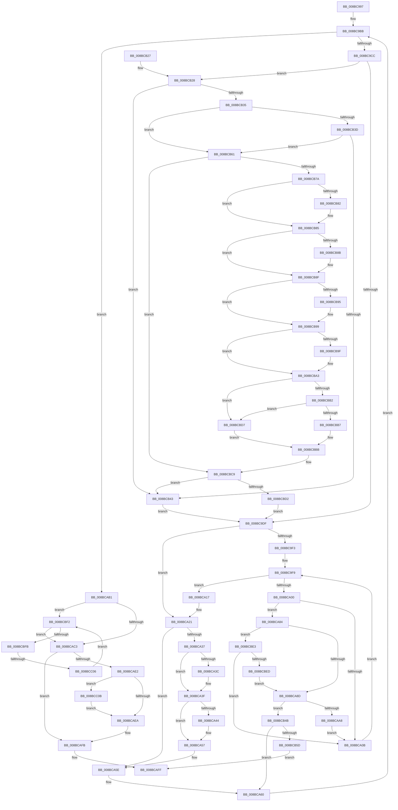

# sub_008BC997

- RVA: `0x008BC997`–`0x008BCC1D` (길이 `646` bytes)
- VA: `0x00000001408BC997`
- 실행 섹션: `PAGE`
- PDB 이름 있음: `아니요`; PDB Function 태그: `아니요`
- unwind 정보 RVA: `0x00082FDC`
- 디코드: `180`개 명령, `646/646` bytes 표시
- 미해석 바이트: `0` (있으면 어셈블리에 `.byte`로 보존)

> 이 문서는 커널 이미지의 기계어와 PDB 기호를 분석해 생성했습니다. 4번과 5번은 함수 원형과 자료형을 바이너리 사용 방식에서 추정한 C 해석이며 원본 소스 복구 결과는 아닙니다.

## 1. Dependencies

- 직접 호출 지점: **4**; 고유 호출 대상: **4**
- 직접 호출자로 확인된 함수: **0**
- RIP 상대 이미지 참조: **0**

### Outgoing calls
- `0x008BCA52` → [memcpy](../../text/6C/memcpy_function_006C6840.md) (function, `0x006C6840`)
- `0x008BCA9B` → [memcmp](../../text/6C/memcmp_function_006C6B10.md) (function, `0x006C6B10`)
- `0x008BCB0F` → [_security_check_cookie](../../text/6A/_security_check_cookie_function_006AC640.md) (function, `0x006AC640`)
- `0x008BCC13` → [memset](../../text/6C/memset_function_006C6C40.md) (function, `0x006C6C40`)

### Direct callers
- 이 함수 시작 RVA로 연결되는 직접 call은 확인되지 않았습니다. 간접 호출은 완전히 역산할 수 없습니다.

### Static image references
- 디코드된 RIP-relative 메모리 참조가 없습니다.

## 2. Other-region calls and transfers

- 다른 실행 섹션으로 향하는 call: **4**
  - `0x008BCA52` → [memcpy](../../text/6C/memcpy_function_006C6840.md) (`PAGE` → `.text`)
  - `0x008BCA9B` → [memcmp](../../text/6C/memcmp_function_006C6B10.md) (`PAGE` → `.text`)
  - `0x008BCB0F` → [_security_check_cookie](../../text/6A/_security_check_cookie_function_006AC640.md) (`PAGE` → `.text`)
  - `0x008BCC13` → [memset](../../text/6C/memset_function_006C6C40.md) (`PAGE` → `.text`)
- call이 아닌 외부 분기/꼬리 이동: **1**
  - `0x008BCC00` → [sub_00B1AC14](../B1/Unknown_function_00B1AC14.md) (`tail-transfer`)

## 3. Assembly (complete function range)

```asm
008BC997  48 89 AC 24 D8 00 00 00         mov qword ptr [rsp + 0xd8], rbp
008BC99F  0F B7 4A 04                     movzx ecx, word ptr [rdx + 4]
008BC9A3  41 B8 08 00 00 00               mov r8d, 8
008BC9A9  44 89 44 24 24                  mov dword ptr [rsp + 0x24], r8d
008BC9AE  41 8B F1                        mov esi, r9d
008BC9B1  89 4C 24 3C                     mov dword ptr [rsp + 0x3c], ecx
008BC9B5  41 8B C1                        mov eax, r9d
008BC9B8  4D 8B F3                        mov r14, r11
008BC9BB  89 44 24 28                     mov dword ptr [rsp + 0x28], eax
008BC9BF  BB 73 06 00 00                  mov ebx, 0x673
008BC9C4  3B C1                           cmp eax, ecx
008BC9C6  0F 83 E5 00 00 00               jae 0x1408bcab1
008BC9CC  33 D2                           xor edx, edx
008BC9CE  45 8B E1                        mov r12d, r9d
008BC9D1  48 89 54 24 30                  mov qword ptr [rsp + 0x30], rdx
008BC9D6  4D 85 D2                        test r10, r10
008BC9D9  0F 85 49 01 00 00               jne 0x1408bcb28
008BC9DF  41 0F B7 6E 02                  movzx ebp, word ptr [r14 + 2]
008BC9E4  8B CD                           mov ecx, ebp
008BC9E6  41 2B CC                        sub ecx, r12d
008BC9E9  41 80 3E 00                     cmp byte ptr [r14], 0
008BC9ED  89 4C 24 38                     mov dword ptr [rsp + 0x38], ecx
008BC9F1  75 2E                           jne 0x1408bca21
008BC9F3  41 8B D9                        mov ebx, r9d
008BC9F6  4D 8B EB                        mov r13, r11
008BC9F9  0F B7 C5                        movzx eax, bp
008BC9FC  3B DE                           cmp ebx, esi
008BC9FE  73 17                           jae 0x1408bca17
008BCA00  45 0F B7 7D 02                  movzx r15d, word ptr [r13 + 2]
008BCA05  66 44 3B F8                     cmp r15w, ax
008BCA09  74 79                           je 0x1408bca84
008BCA0B  48 8B 54 24 30                  mov rdx, qword ptr [rsp + 0x30]
008BCA10  FF C3                           inc ebx
008BCA12  4D 03 EF                        add r13, r15
008BCA15  EB E2                           jmp 0x1408bc9f9
008BCA17  4C 8B 7C 24 40                  mov r15, qword ptr [rsp + 0x40]
008BCA1C  44 8B 44 24 24                  mov r8d, dword ptr [rsp + 0x24]
008BCA21  0F B7 DD                        movzx ebx, bp
008BCA24  0F B7 C5                        movzx eax, bp
008BCA27  49 03 DE                        add rbx, r14
008BCA2A  44 03 C0                        add r8d, eax
008BCA2D  44 89 44 24 24                  mov dword ptr [rsp + 0x24], r8d
008BCA32  4D 85 FF                        test r15, r15
008BCA35  74 27                           je 0x1408bca5e
008BCA37  45 85 E4                        test r12d, r12d
008BCA3A  74 03                           je 0x1408bca3f
008BCA3C  48 89 17                        mov qword ptr [rdi], rdx
008BCA3F  49 3B FE                        cmp rdi, r14
008BCA42  74 13                           je 0x1408bca57
008BCA44  41 8B C4                        mov eax, r12d
008BCA47  44 8B C1                        mov r8d, ecx
008BCA4A  4A 8D 14 30                     lea rdx, [rax + r14]
008BCA4E  48 8D 0C 38                     lea rcx, [rax + rdi]
008BCA52  E8 E9 9D E0 FF                  call 0x1406c6840
008BCA57  0F B7 47 02                     movzx eax, word ptr [rdi + 2]
008BCA5B  48 03 F8                        add rdi, rax
008BCA5E  FF C6                           inc esi
008BCA60  8B 44 24 28                     mov eax, dword ptr [rsp + 0x28]
008BCA64  4C 8B F3                        mov r14, rbx
008BCA67  44 8B 44 24 24                  mov r8d, dword ptr [rsp + 0x24]
008BCA6C  FF C0                           inc eax
008BCA6E  8B 4C 24 3C                     mov ecx, dword ptr [rsp + 0x3c]
008BCA72  45 33 C9                        xor r9d, r9d
008BCA75  4C 8B 54 24 48                  mov r10, qword ptr [rsp + 0x48]
008BCA7A  4C 8B 5C 24 50                  mov r11, qword ptr [rsp + 0x50]
008BCA7F  E9 37 FF FF FF                  jmp 0x1408bc9bb
008BCA84  45 85 E4                        test r12d, r12d
008BCA87  0F 85 56 01 00 00               jne 0x1408bcbe3
008BCA8D  41 8B C4                        mov eax, r12d
008BCA90  44 8B C1                        mov r8d, ecx
008BCA93  4A 8D 14 30                     lea rdx, [rax + r14]
008BCA97  4A 8D 0C 28                     lea rcx, [rax + r13]
008BCA9B  E8 70 A0 E0 FF                  call 0x1406c6b10
008BCAA0  85 C0                           test eax, eax
008BCAA2  0F 84 A3 00 00 00               je 0x1408bcb4b
008BCAA8  8B 4C 24 38                     mov ecx, dword ptr [rsp + 0x38]
008BCAAC  E9 5A FF FF FF                  jmp 0x1408bca0b
008BCAB1  41 8D 58 03                     lea ebx, [r8 + 3]
008BCAB5  83 E3 FC                        and ebx, 0xfffffffc
008BCAB8  8B CB                           mov ecx, ebx
008BCABA  41 2B C8                        sub ecx, r8d
008BCABD  0F 85 2F 01 00 00               jne 0x1408bcbf2
008BCAC3  32 D2                           xor dl, dl
008BCAC5  4C 8B 64 24 58                  mov r12, qword ptr [rsp + 0x58]
008BCACA  0F B6 EA                        movzx ebp, dl
008BCACD  BA 01 00 00 00                  mov edx, 1
008BCAD2  41 0F B7 44 24 02               movzx eax, word ptr [r12 + 2]
008BCAD8  3B D8                           cmp ebx, eax
008BCADA  0F 45 EA                        cmovne ebp, edx
008BCADD  4D 85 FF                        test r15, r15
008BCAE0  74 19                           je 0x1408bcafb
008BCAE2  3B CA                           cmp ecx, edx
008BCAE4  0F 83 21 01 00 00               jae 0x1408bcc0b
008BCAEA  49 8B 0C 24                     mov rcx, qword ptr [r12]
008BCAEE  49 89 0F                        mov qword ptr [r15], rcx
008BCAF1  66 41 89 5F 02                  mov word ptr [r15 + 2], bx
008BCAF6  66 41 89 77 04                  mov word ptr [r15 + 4], si
008BCAFB  40 0F B6 C5                     movzx eax, bpl
008BCAFF  48 8B AC 24 D8 00 00 00         mov rbp, qword ptr [rsp + 0xd8]
008BCB07  48 8B 4C 24 70                  mov rcx, qword ptr [rsp + 0x70]
008BCB0C  48 33 CC                        xor rcx, rsp
008BCB0F  E8 2C FB DE FF                  call 0x1406ac640
008BCB14  48 81 C4 80 00 00 00            add rsp, 0x80
008BCB1B  41 5F                           pop r15
008BCB1D  41 5E                           pop r14
008BCB1F  41 5D                           pop r13
008BCB21  41 5C                           pop r12
008BCB23  5F                              pop rdi
008BCB24  5E                              pop rsi
008BCB25  5B                              pop rbx
008BCB26  C3                              ret
008BCB27  CC                              int3
008BCB28  41 BC 08 00 00 00               mov r12d, 8
008BCB2E  66 45 39 66 02                  cmp word ptr [r14 + 2], r12w
008BCB33  72 0E                           jb 0x1408bcb43
008BCB35  41 0F B6 06                     movzx eax, byte ptr [r14]
008BCB39  3C 0A                           cmp al, 0xa
008BCB3B  76 24                           jbe 0x1408bcb61
008BCB3D  2C 0D                           sub al, 0xd
008BCB3F  3C 01                           cmp al, 1
008BCB41  76 1E                           jbe 0x1408bcb61
008BCB43  45 8B E1                        mov r12d, r9d
008BCB46  E9 94 FE FF FF                  jmp 0x1408bc9df
008BCB4B  4C 8B 7C 24 40                  mov r15, qword ptr [rsp + 0x40]
008BCB50  49 8D 1C 2E                     lea rbx, [r14 + rbp]
008BCB54  4D 85 FF                        test r15, r15
008BCB57  0F 85 03 FF FF FF               jne 0x1408bca60
008BCB5D  B0 01                           mov al, 1
008BCB5F  EB 9E                           jmp 0x1408bcaff
008BCB61  49 8B 16                        mov rdx, qword ptr [r14]
008BCB64  48 8B C2                        mov rax, rdx
008BCB67  48 89 54 24 30                  mov qword ptr [rsp + 0x30], rdx
008BCB6C  48 C1 E8 08                     shr rax, 8
008BCB70  48 89 54 24 60                  mov qword ptr [rsp + 0x60], rdx
008BCB75  41 84 C4                        test r12b, al
008BCB78  75 4F                           jne 0x1408bcbc9
008BCB7A  48 C1 EA 20                     shr rdx, 0x20
008BCB7E  85 D2                           test edx, edx
008BCB80  79 03                           jns 0x1408bcb85
008BCB82  41 0B 12                        or edx, dword ptr [r10]
008BCB85  0F BA E2 1E                     bt edx, 0x1e
008BCB89  73 04                           jae 0x1408bcb8f
008BCB8B  41 0B 52 04                     or edx, dword ptr [r10 + 4]
008BCB8F  0F BA E2 1D                     bt edx, 0x1d
008BCB93  73 04                           jae 0x1408bcb99
008BCB95  41 0B 52 08                     or edx, dword ptr [r10 + 8]
008BCB99  0F BA E2 1C                     bt edx, 0x1c
008BCB9D  73 04                           jae 0x1408bcba3
008BCB9F  41 0B 52 0C                     or edx, dword ptr [r10 + 0xc]
008BCBA3  0F B6 44 24 60                  movzx eax, byte ptr [rsp + 0x60]
008BCBA8  81 E2 FF FF FF 0F               and edx, 0xfffffff
008BCBAE  3C 0A                           cmp al, 0xa
008BCBB0  77 25                           ja 0x1408bcbd7
008BCBB2  0F A3 C3                        bt ebx, eax
008BCBB5  73 20                           jae 0x1408bcbd7
008BCBB7  41 23 52 0C                     and edx, dword ptr [r10 + 0xc]
008BCBBB  89 54 24 64                     mov dword ptr [rsp + 0x64], edx
008BCBBF  48 8B 54 24 60                  mov rdx, qword ptr [rsp + 0x60]
008BCBC4  48 89 54 24 30                  mov qword ptr [rsp + 0x30], rdx
008BCBC9  49 3B 16                        cmp rdx, qword ptr [r14]
008BCBCC  0F 84 71 FF FF FF               je 0x1408bcb43
008BCBD2  E9 08 FE FF FF                  jmp 0x1408bc9df
008BCBD7  41 8B 42 0C                     mov eax, dword ptr [r10 + 0xc]
008BCBDB  0F BA E8 18                     bts eax, 0x18
008BCBDF  23 D0                           and edx, eax
008BCBE1  EB D8                           jmp 0x1408bcbbb
008BCBE3  49 39 55 00                     cmp qword ptr [r13], rdx
008BCBE7  0F 85 1E FE FF FF               jne 0x1408bca0b
008BCBED  E9 9B FE FF FF                  jmp 0x1408bca8d
008BCBF2  44 3B C9                        cmp r9d, ecx
008BCBF5  0F 83 C8 FE FF FF               jae 0x1408bcac3
008BCBFB  43 80 3C 31 00                  cmp byte ptr [r9 + r14], 0
008BCC00  0F 85 0E E0 25 00               jne 0x140b1ac14
008BCC06  41 FF C1                        inc r9d
008BCC09  EB E7                           jmp 0x1408bcbf2
008BCC0B  44 8B C1                        mov r8d, ecx
008BCC0E  33 D2                           xor edx, edx
008BCC10  48 8B CF                        mov rcx, rdi
008BCC13  E8 28 A0 E0 FF                  call 0x1406c6c40
008BCC18  E9 CD FE FF FF                  jmp 0x1408bcaea
```

## 4. C-style interpretation (structured pseudocode)

```c
__int64 __fastcall sub_008BC997(__int64 a1, __int64 a2, __int64 a3, int a4, unsigned int a5, __int64 a6, unsigned int a7, __int64 a8, __int64 a9, __int64 a10, __int64 a11, unsigned __int8 a12, __int64 a13, __int64 a14, __int64 a15, __int64 a16, __int64 a17, __int64 a18, __int64 a19, __int64 a20, __int64 a21, __int64 a22, __int64 a23, __int64 a24, __int64 a25, __int64 a26, __int64 a27)
{
    __int64 result;
    __int64 v_r13;
    __int64 v_rbp;
    __int64 v_rbx;
    __int64 v_rdi;
    __int64 v_rsi;
    __int64 v_rsp;
    unsigned __int64 v_stack_p118;
    unsigned int v_stack_p11C;
    unsigned int v_stack_p24;
    unsigned int v_stack_p28;
    unsigned __int64 v_stack_p30;
    unsigned int v_stack_p38;
    unsigned int v_stack_p3C;
    unsigned __int64 v_stack_pD8;
    unsigned __int64 v_stack_pE8;

    v_stack_pD8 = v_rbp;
    v_stack_p24 = 8;
    v_stack_p3C = (unsigned int)(*(unsigned __int16 *)(a2 + 4));
loc_008BC9BB:
    v_stack_p28 = (unsigned int)((unsigned int)(a4));
    if (((unsigned int)((unsigned int)(a4))) >= ((unsigned int)(*(unsigned __int16 *)(a2 + 4)))) goto loc_008BCAB1;
    a2 = 0;
    v_stack_p30 = 0;
    if (v_r10 != 0) goto loc_008BCB28;
loc_008BC9DF:
    a1 = (unsigned int)(((unsigned int)((unsigned int)(*(unsigned __int16 *)(v_r11 + 2)))) - ((unsigned int)((unsigned int)(a4))));
    v_stack_p38 = (unsigned int)(a1);
    if ((*(unsigned __int8 *)(v_r11)) != 0) goto loc_008BCA21;
loc_008BC9F9:
    if (((unsigned int)((unsigned int)(a4))) >= ((unsigned int)((unsigned int)(a4)))) goto loc_008BCA17;
    if (((unsigned __int16)(*(unsigned __int16 *)(v_r11 + 2))) == ((unsigned __int16)((unsigned __int16)(*(unsigned __int16 *)(v_r11 + 2))))) goto loc_008BCA84;
loc_008BCA0B:
    v_rbx = (unsigned int)(((unsigned int)(a4)) + 1);
    v_r13 = (v_r11) + (*(unsigned __int16 *)(v_r11 + 2));
    goto loc_008BC9F9;
loc_008BCA17:
loc_008BCA21:
    v_rbx = ((unsigned __int16)(*(unsigned __int16 *)(v_r11 + 2))) + (v_r11);
    a3 = (unsigned int)(((unsigned int)(v_stack_p24)) + ((unsigned int)((unsigned __int16)(*(unsigned __int16 *)(v_r11 + 2)))));
    v_stack_p24 = (unsigned int)(a3);
    if (a8 == 0) goto loc_008BCA5E;
    if ((unsigned int)((unsigned int)(a4)) != 0) {
        *(unsigned __int64 *)(v_rdi) = a6;
    }
    result = (unsigned __int16)(*(unsigned __int16 *)(v_r11 + 2));
    if (v_rdi != v_r11) {
        result = (unsigned int)((unsigned int)(a4));
        a3 = (unsigned int)(a1);
        a2 = result + v_r11 * 1;
        a1 = result + v_rdi * 1;
        result = memcpy(a1, a2, a3, a4);
    }
    v_rdi = (v_rdi) + (*(unsigned __int16 *)(v_rdi + 2));
loc_008BCA5E:
    v_rsi = (unsigned int)(((unsigned int)(a4)) + 1);
loc_008BCA60:
    result = (unsigned int)(((unsigned int)(a5)) + 1);
    a4 = 0;
    goto loc_008BC9BB;
loc_008BCA84:
    if ((unsigned int)((unsigned int)(a4)) != 0) goto loc_008BCBE3;
loc_008BCA8D:
    result = memcmp((unsigned int)((unsigned int)((unsigned int)(a4))) + v_r13 * 1, (unsigned int)((unsigned int)((unsigned int)(a4))) + v_rbx * 1, (unsigned int)((unsigned int)((unsigned int)(v_stack_p3C))), a4);
    if ((unsigned int)(result) == 0) goto loc_008BCB4B;
    goto loc_008BCA0B;
loc_008BCAB1:
    v_rbx = (unsigned int)(((unsigned int)((unsigned int)((unsigned int)(v_stack_p3C))) + 3) & (0xFFFFFFFCULL));
    a1 = (unsigned int)(((unsigned int)((unsigned int)(v_rbx))) - ((unsigned int)((unsigned int)((unsigned int)((unsigned int)(v_stack_p3C))))));
    if (condition_is_not_equal) goto loc_008BCBF2;
loc_008BCAC3:
    a2 = 0;
    v_rbp = 0;
    if (((unsigned int)(v_rbx)) != ((unsigned int)(*(unsigned __int16 *)(a11 + 2)))) { v_rbp = 1; }
    if (a8 == 0) goto loc_008BCAFB;
    if (((unsigned int)(a1)) >= 1) goto loc_008BCC0B;
loc_008BCAEA:
    *(unsigned __int64 *)(a8) = *(unsigned __int64 *)(a11);
    *(unsigned __int16 *)(a8 + 2) = (unsigned __int16)(v_rbx);
    *(unsigned __int16 *)(a8 + 4) = (unsigned __int16)(v_rsi);
loc_008BCAFB:
loc_008BCAFF:
    a1 = (a14) ^ (v_rsp);
    result = _security_check_cookie(a1, 1, (unsigned int)((unsigned int)((unsigned int)(v_stack_p3C))), a4);
    v_rsp = (v_rsp) + (128);
    return result;
loc_008BCB28:
    if ((*(unsigned __int16 *)(v_rbx + 2)) < 8) goto loc_008BCB43;
    if (((unsigned __int8)(*(unsigned __int8 *)(v_rbx))) <= 10) goto loc_008BCB61;
    result = (unsigned __int8)((*(unsigned __int8 *)(v_rbx)) - (13));
    if (((unsigned __int8)(result)) <= 1) goto loc_008BCB61;
loc_008BCB43:
    goto loc_008BC9DF;
loc_008BCB4B:
    if (a8 != 0) goto loc_008BCA60;
    goto loc_008BCAFF;
loc_008BCB61:
    v_stack_pE8 = *(unsigned __int64 *)(v_rbx);
    result = (*(unsigned __int64 *)(v_rbx)) >> (8);
    v_stack_p118 = *(unsigned __int64 *)(v_rbx);
    if (((0) & ((unsigned __int8)(result))) != 0) goto loc_008BCBC9;
    a2 = (*(unsigned __int64 *)(v_rbx)) >> (32);
    if (sign_flag) {
        a2 = (unsigned int)((a2) | (*(unsigned int *)(a9)));
    }
    if (!(condition_is_above_or_equal)) {
        a2 = (unsigned int)((a2) | (*(unsigned int *)(a9 + 4)));
    }
    if (!(condition_is_above_or_equal)) {
        a2 = (unsigned int)((a2) | (*(unsigned int *)(a9 + 8)));
    }
    if (!(condition_is_above_or_equal)) {
        a2 = (unsigned int)((a2) | (*(unsigned int *)(a9 + 12)));
    }
    a2 = (unsigned int)((a2) & (0xFFFFFFFULL));
    if (a12 > 10) goto loc_008BCBD7;
    if (a12 >= 10) goto loc_008BCBD7;
    a2 = (unsigned int)((a2) & (*(unsigned int *)(a9 + 12)));
loc_008BCBBB:
    v_stack_p11C = (unsigned int)(a2);
    v_stack_pE8 = a12;
loc_008BCBC9:
    if (a12 == (*(unsigned __int64 *)(v_rbx))) goto loc_008BCB43;
    goto loc_008BC9DF;
loc_008BCBD7:
    a2 = (unsigned int)((a12) & ((unsigned int)((unsigned int)(*(unsigned int *)(a9 + 12)))));
    goto loc_008BCBBB;
loc_008BCBE3:
    if ((*(unsigned __int64 *)(v_r13)) != a2) goto loc_008BCA0B;
    goto loc_008BCA8D;
loc_008BCBF2:
    if (0 >= ((unsigned int)(a1))) goto loc_008BCAC3;
    a4 = (unsigned int)((a4) + 1);
    goto loc_008BCBF2;
loc_008BCC0B:
    a2 = 0;
    result = memset(v_rdi, a2, (unsigned int)((unsigned int)(a1)), a4);
    goto loc_008BCAEA;
}
```

## 5. (Beta) C Style

```c
int64_t sub_008BC997(int64_t Arg1, void *Arg2, int64_t Arg3, int32_t Arg4, uint32_t Arg5, int64_t Arg6, uint32_t Arg7, int64_t Arg8, int64_t Arg9, int64_t Arg10, void *Arg11, uint8_t Arg12, uint64_t Arg13, int64_t Arg14, uint64_t Arg15, uint64_t Arg16, uint64_t Arg17, uint64_t Arg18, uint64_t Arg19, uint64_t Arg20, uint64_t Arg21, uint64_t Arg22, uint64_t Arg23, uint64_t Arg24, uint64_t Arg25, uint64_t Arg26, int64_t Arg27)
{
    uint8_t *arg2 = (uint8_t *)Arg2;
    uint8_t *arg11 = (uint8_t *)Arg11;

    int64_t result;
    int64_t local_r13;
    int64_t local_rbp;
    int64_t local_rbx;
    int64_t local_rdi;
    int64_t local_rsi;
    int64_t local_rsp;
    uint64_t v_stack_p118;
    uint32_t v_stack_p11C;
    uint32_t v_stack_p24;
    uint32_t v_stack_p28;
    uint64_t v_stack_p30;
    uint32_t v_stack_p38;
    uint32_t v_stack_p3C;
    uint64_t v_stack_pD8;
    uint64_t v_stack_pE8;

    v_stack_pD8 = local_rbp;
    v_stack_p24 = 8;
    v_stack_p3C = (uint32_t)(*(uint16_t *)(arg2 + 0x4));
loc_008BC9BB:
    v_stack_p28 = (uint32_t)((uint32_t)(Arg4));
    if (((uint32_t)((uint32_t)(Arg4))) >= ((uint32_t)(*(uint16_t *)(arg2 + 0x4)))) goto loc_008BCAB1;
    Arg2 = 0;
    v_stack_p30 = 0;
    if (local_r10 != 0) goto loc_008BCB28;
loc_008BC9DF:
    Arg1 = (uint32_t)(((uint32_t)((uint32_t)(*(uint16_t *)(local_r11 + 0x2)))) - ((uint32_t)((uint32_t)(Arg4))));
    v_stack_p38 = (uint32_t)(Arg1);
    if ((*(uint8_t *)(local_r11)) != 0) goto loc_008BCA21;
loc_008BC9F9:
    if (((uint32_t)((uint32_t)(Arg4))) >= ((uint32_t)((uint32_t)(Arg4)))) goto loc_008BCA17;
    if (((uint16_t)(*(uint16_t *)(local_r11 + 0x2))) == ((uint16_t)((uint16_t)(*(uint16_t *)(local_r11 + 0x2))))) goto loc_008BCA84;
loc_008BCA0B:
    local_rbx = (uint32_t)(((uint32_t)(Arg4)) + 1);
    local_r13 = (local_r11) + (*(uint16_t *)(local_r11 + 0x2));
    goto loc_008BC9F9;
loc_008BCA17:
loc_008BCA21:
    local_rbx = ((uint16_t)(*(uint16_t *)(local_r11 + 0x2))) + (local_r11);
    Arg3 = (uint32_t)(((uint32_t)(v_stack_p24)) + ((uint32_t)((uint16_t)(*(uint16_t *)(local_r11 + 0x2)))));
    v_stack_p24 = (uint32_t)(Arg3);
    if (Arg8 == 0) goto loc_008BCA5E;
    if ((uint32_t)((uint32_t)(Arg4)) != 0) {
        *(uint64_t *)(local_rdi) = Arg6;
    }
    result = (uint16_t)(*(uint16_t *)(local_r11 + 0x2));
    if (local_rdi != local_r11) {
        result = (uint32_t)((uint32_t)(Arg4));
        Arg3 = (uint32_t)(Arg1);
        Arg2 = result + local_r11 * 1;
        Arg1 = result + local_rdi * 1;
        result = memcpy(Arg1, Arg2, Arg3, Arg4);
    }
    local_rdi = (local_rdi) + (*(uint16_t *)(local_rdi + 0x2));
loc_008BCA5E:
    local_rsi = (uint32_t)(((uint32_t)(Arg4)) + 1);
loc_008BCA60:
    result = (uint32_t)(((uint32_t)(Arg5)) + 1);
    Arg4 = 0;
    goto loc_008BC9BB;
loc_008BCA84:
    if ((uint32_t)((uint32_t)(Arg4)) != 0) goto loc_008BCBE3;
loc_008BCA8D:
    result = memcmp((uint32_t)((uint32_t)((uint32_t)(Arg4))) + local_r13 * 1, (uint32_t)((uint32_t)((uint32_t)(Arg4))) + local_rbx * 1, (uint32_t)((uint32_t)((uint32_t)(v_stack_p3C))), Arg4);
    if ((uint32_t)(result) == 0) goto loc_008BCB4B;
    goto loc_008BCA0B;
loc_008BCAB1:
    local_rbx = (uint32_t)(((uint32_t)((uint32_t)((uint32_t)(v_stack_p3C))) + 3) & (0xFFFFFFFCULL));
    Arg1 = (uint32_t)(((uint32_t)((uint32_t)(local_rbx))) - ((uint32_t)((uint32_t)((uint32_t)((uint32_t)(v_stack_p3C))))));
    if (condition_is_not_equal) goto loc_008BCBF2;
loc_008BCAC3:
    Arg2 = 0;
    local_rbp = 0;
    if (((uint32_t)(local_rbx)) != ((uint32_t)(*(uint16_t *)(arg11 + 0x2)))) { local_rbp = 1; }
    if (Arg8 == 0) goto loc_008BCAFB;
    if (((uint32_t)(Arg1)) >= 1) goto loc_008BCC0B;
loc_008BCAEA:
    *(uint64_t *)(Arg8) = *(uint64_t *)(arg11);
    *(uint16_t *)(Arg8 + 0x2) = (uint16_t)(local_rbx);
    *(uint16_t *)(Arg8 + 0x4) = (uint16_t)(local_rsi);
loc_008BCAFB:
loc_008BCAFF:
    Arg1 = (Arg14) ^ (local_rsp);
    result = _security_check_cookie(Arg1, 1, (uint32_t)((uint32_t)((uint32_t)(v_stack_p3C))), Arg4);
    local_rsp = (local_rsp) + (128);
    return result;
loc_008BCB28:
    if ((*(uint16_t *)(local_rbx + 0x2)) < 8) goto loc_008BCB43;
    if (((uint8_t)(*(uint8_t *)(local_rbx))) <= 10) goto loc_008BCB61;
    result = (uint8_t)((*(uint8_t *)(local_rbx)) - (13));
    if (((uint8_t)(result)) <= 1) goto loc_008BCB61;
loc_008BCB43:
    goto loc_008BC9DF;
loc_008BCB4B:
    if (Arg8 != 0) goto loc_008BCA60;
    goto loc_008BCAFF;
loc_008BCB61:
    v_stack_pE8 = *(uint64_t *)(local_rbx);
    result = (*(uint64_t *)(local_rbx)) >> (8);
    v_stack_p118 = *(uint64_t *)(local_rbx);
    if (((0) & ((uint8_t)(result))) != 0) goto loc_008BCBC9;
    Arg2 = (*(uint64_t *)(local_rbx)) >> (32);
    if (sign_flag) {
        Arg2 = (uint32_t)((Arg2) | (*(uint32_t *)(Arg9)));
    }
    if (!(condition_is_above_or_equal)) {
        Arg2 = (uint32_t)((Arg2) | (*(uint32_t *)(Arg9 + 0x4)));
    }
    if (!(condition_is_above_or_equal)) {
        Arg2 = (uint32_t)((Arg2) | (*(uint32_t *)(Arg9 + 0x8)));
    }
    if (!(condition_is_above_or_equal)) {
        Arg2 = (uint32_t)((Arg2) | (*(uint32_t *)(Arg9 + 0xC)));
    }
    Arg2 = (uint32_t)((Arg2) & (0xFFFFFFFULL));
    if (Arg12 > 10) goto loc_008BCBD7;
    if (Arg12 >= 10) goto loc_008BCBD7;
    Arg2 = (uint32_t)((Arg2) & (*(uint32_t *)(Arg9 + 0xC)));
loc_008BCBBB:
    v_stack_p11C = (uint32_t)(Arg2);
    v_stack_pE8 = Arg12;
loc_008BCBC9:
    if (Arg12 == (*(uint64_t *)(local_rbx))) goto loc_008BCB43;
    goto loc_008BC9DF;
loc_008BCBD7:
    Arg2 = (uint32_t)((Arg12) & ((uint32_t)((uint32_t)(*(uint32_t *)(Arg9 + 0xC)))));
    goto loc_008BCBBB;
loc_008BCBE3:
    if ((*(uint64_t *)(local_r13)) != Arg2) goto loc_008BCA0B;
    goto loc_008BCA8D;
loc_008BCBF2:
    if (0 >= ((uint32_t)(Arg1))) goto loc_008BCAC3;
    Arg4 = (uint32_t)((Arg4) + 1);
    goto loc_008BCBF2;
loc_008BCC0B:
    Arg2 = 0;
    result = memset(local_rdi, Arg2, (uint32_t)((uint32_t)(Arg1)), Arg4);
    goto loc_008BCAEA;
}
```

### 관측된 메모리 오프셋

구조체 형식이 확인되지 않은 접근은 인자 기준의 오프셋으로만 기록했습니다.

| 기준 인자 | 오프셋 표현 | 폭 (bit) | 접근 |
|---|---:|---:|---|
| `Arg2` | `+ 0x4` | `16` | `R` |
| `Arg11` | `+ 0x0` | `64` | `R` |
| `Arg11` | `+ 0x2` | `16` | `R` |

## 6. Execution-region graph

[열기: 2D/3D 그래프와 함수 탐색 컨트롤 패널](../../../control-panel.html?section=page&rva=0x008BC997&view=graph)

- 2D 그래프는 위에서 아래로 흐르고, 3D 그래프는 빈 공간을 드래그해 회전합니다. Shift+드래그는 이동, 휠은 확대·축소, 함수 노드 선택은 대상 보고서 이동입니다.

### Static fallback


