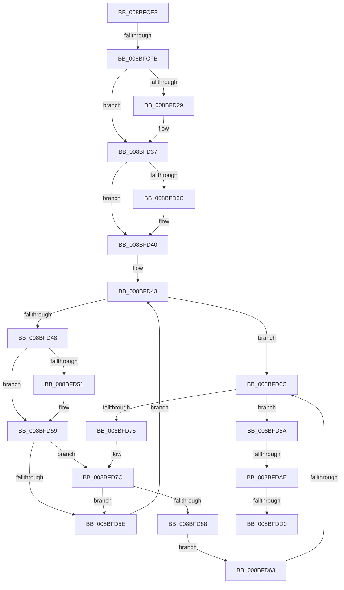

# sub_008BFCE3

- RVA: `0x008BFCE3`–`0x008BFDEA` (길이 `263` bytes)
- VA: `0x00000001408BFCE3`
- 실행 섹션: `PAGE`
- PDB 이름 있음: `아니요`; PDB Function 태그: `아니요`
- unwind 정보 RVA: `0x0008336C`
- 디코드: `75`개 명령, `263/263` bytes 표시
- 미해석 바이트: `0` (있으면 어셈블리에 `.byte`로 보존)

> 이 문서는 커널 이미지의 기계어와 PDB 기호를 분석해 생성했습니다. 4번과 5번은 함수 원형과 자료형을 바이너리 사용 방식에서 추정한 C 해석이며 원본 소스 복구 결과는 아닙니다.

## 1. Dependencies

- 직접 호출 지점: **5**; 고유 호출 대상: **5**
- 직접 호출자로 확인된 함수: **0**
- RIP 상대 이미지 참조: **0**

### Outgoing calls
- `0x008BFD18` → [KeAbPreAcquire](../../text/21/KeAbPreAcquire_function_00210230.md) (function, `0x00210230`)
- `0x008BFD32` → [ExfAcquirePushLockExclusiveEx](../../text/20/ExfAcquirePushLockExclusiveEx_function_0020FC90.md) (function, `0x0020FC90`)
- `0x008BFD7F` → [EtwpReferenceGuidEntry](../8C/EtwpReferenceGuidEntry_function_008C1ED0.md) (function, `0x008C1ED0`)
- `0x008BFDB1` → [KeAbPostRelease](../../text/2E/KeAbPostRelease_function_002E1600.md) (function, `0x002E1600`)
- `0x008BFDBF` → [KeLeaveCriticalRegionThread](../../text/25/KeLeaveCriticalRegionThread_function_0025EFF0.md) (function, `0x0025EFF0`)

### Direct callers
- 이 함수 시작 RVA로 연결되는 직접 call은 확인되지 않았습니다. 간접 호출은 완전히 역산할 수 없습니다.

### Static image references
- 디코드된 RIP-relative 메모리 참조가 없습니다.

## 2. Other-region calls and transfers

- 다른 실행 섹션으로 향하는 call: **4**
  - `0x008BFD18` → [KeAbPreAcquire](../../text/21/KeAbPreAcquire_function_00210230.md) (`PAGE` → `.text`)
  - `0x008BFD32` → [ExfAcquirePushLockExclusiveEx](../../text/20/ExfAcquirePushLockExclusiveEx_function_0020FC90.md) (`PAGE` → `.text`)
  - `0x008BFDB1` → [KeAbPostRelease](../../text/2E/KeAbPostRelease_function_002E1600.md) (`PAGE` → `.text`)
  - `0x008BFDBF` → [KeLeaveCriticalRegionThread](../../text/25/KeLeaveCriticalRegionThread_function_0025EFF0.md) (`PAGE` → `.text`)
- call이 아닌 외부 분기/꼬리 이동: **4**
  - `0x008BFCF5` → [sub_00B1AE16](../B1/Unknown_function_00B1AE16.md) (`tail-transfer`)
  - `0x008BFD66` → [sub_008BFE54](Unknown_function_008BFE54.md) (`tail-transfer`)
  - `0x008BFDAC` → [sub_008BFE00](Unknown_function_008BFE00.md) (`tail-transfer`)
  - `0x008BFDCA` → [sub_008BFE54 + 0x5F](Unknown_function_008BFE54.md) (`tail-transfer`)

## 3. Assembly (complete function range)

```asm
008BFCE3  48 89 6C 24 50                  mov qword ptr [rsp + 0x50], rbp
008BFCE8  48 6B C1 38                     imul rax, rcx, 0x38
008BFCEC  48 03 D8                        add rbx, rax
008BFCEF  48 03 F3                        add rsi, rbx
008BFCF2  4D 85 ED                        test r13, r13
008BFCF5  0F 85 1B B1 25 00               jne 0x140b1ae16
008BFCFB  65 48 8B 04 25 88 01 00 00      mov rax, qword ptr gs:[0x188]
008BFD04  48 8D 6B 30                     lea rbp, [rbx + 0x30]
008BFD08  45 33 C0                        xor r8d, r8d
008BFD0B  33 D2                           xor edx, edx
008BFD0D  48 8B CD                        mov rcx, rbp
008BFD10  66 FF 88 E4 01 00 00            dec word ptr [rax + 0x1e4]
008BFD17  90                              nop
008BFD18  E8 13 05 95 FF                  call 0x140210230
008BFD1D  F0 48 0F BA 6D 00 00            lock bts qword ptr [rbp], 0
008BFD24  48 8B D8                        mov rbx, rax
008BFD27  73 0E                           jae 0x1408bfd37
008BFD29  4C 8B C5                        mov r8, rbp
008BFD2C  48 8B D0                        mov rdx, rax
008BFD2F  48 8B CD                        mov rcx, rbp
008BFD32  E8 59 FF 94 FF                  call 0x14020fc90
008BFD37  48 85 DB                        test rbx, rbx
008BFD3A  74 04                           je 0x1408bfd40
008BFD3C  C6 43 0A 01                     mov byte ptr [rbx + 0xa], 1
008BFD40  48 8B 1E                        mov rbx, qword ptr [rsi]
008BFD43  48 3B DE                        cmp rbx, rsi
008BFD46  74 24                           je 0x1408bfd6c
008BFD48  48 8B 07                        mov rax, qword ptr [rdi]
008BFD4B  48 2B 43 28                     sub rax, qword ptr [rbx + 0x28]
008BFD4F  75 08                           jne 0x1408bfd59
008BFD51  48 8B 47 08                     mov rax, qword ptr [rdi + 8]
008BFD55  48 2B 43 30                     sub rax, qword ptr [rbx + 0x30]
008BFD59  48 85 C0                        test rax, rax
008BFD5C  74 1E                           je 0x1408bfd7c
008BFD5E  48 8B 1B                        mov rbx, qword ptr [rbx]
008BFD61  EB E0                           jmp 0x1408bfd43
008BFD63  48 85 DB                        test rbx, rbx
008BFD66  0F 85 E8 00 00 00               jne 0x1408bfe54
008BFD6C  48 8B 06                        mov rax, qword ptr [rsi]
008BFD6F  48 39 70 08                     cmp qword ptr [rax + 8], rsi
008BFD73  74 15                           je 0x1408bfd8a
008BFD75  B9 03 00 00 00                  mov ecx, 3
008BFD7A  CD 29                           int 0x29
008BFD7C  48 8B CB                        mov rcx, rbx
008BFD7F  E8 4C 21 00 00                  call 0x1408c1ed0
008BFD84  84 C0                           test al, al
008BFD86  74 D6                           je 0x1408bfd5e
008BFD88  EB D9                           jmp 0x1408bfd63
008BFD8A  49 89 07                        mov qword ptr [r15], rax
008BFD8D  49 8B DF                        mov rbx, r15
008BFD90  49 89 77 08                     mov qword ptr [r15 + 8], rsi
008BFD94  4C 89 78 08                     mov qword ptr [rax + 8], r15
008BFD98  48 C7 C0 FF FF FF FF            mov rax, 0xffffffffffffffff
008BFD9F  4C 89 3E                        mov qword ptr [rsi], r15
008BFDA2  F0 48 0F C1 45 00               lock xadd qword ptr [rbp], rax
008BFDA8  24 06                           and al, 6
008BFDAA  3C 02                           cmp al, 2
008BFDAC  74 52                           je 0x1408bfe00
008BFDAE  48 8B CD                        mov rcx, rbp
008BFDB1  E8 4A 18 A2 FF                  call 0x1402e1600
008BFDB6  65 48 8B 0C 25 88 01 00 00      mov rcx, qword ptr gs:[0x188]
008BFDBF  E8 2C F2 99 FF                  call 0x14025eff0
008BFDC4  4D 8B FC                        mov r15, r12
008BFDC7  4D 85 ED                        test r13, r13
008BFDCA  0F 85 E3 00 00 00               jne 0x1408bfeb3
008BFDD0  48 8B 6C 24 50                  mov rbp, qword ptr [rsp + 0x50]
008BFDD5  48 8B C3                        mov rax, rbx
008BFDD8  48 8B 5C 24 60                  mov rbx, qword ptr [rsp + 0x60]
008BFDDD  48 83 C4 20                     add rsp, 0x20
008BFDE1  41 5F                           pop r15
008BFDE3  41 5D                           pop r13
008BFDE5  41 5C                           pop r12
008BFDE7  5F                              pop rdi
008BFDE8  5E                              pop rsi
008BFDE9  C3                              ret
```

## 4. C-style interpretation (structured pseudocode)

```c
__int64 __fastcall sub_008BFCE3(__int64 a1, int a2, int a3, __int64 a4, __int64 a5, __int64 a6, __int64 a7, __int64 a8, __int64 a9, __int64 a10, __int64 a11, __int64 a12)
{
    __int64 result;
    __int64 v_rbx;
    __int64 v_rsi;
    __int64 v_rsp;
    unsigned __int64 v_stack_p50;

    v_stack_p50 = v_rbp;
    result = (result) * (a1);
    v_rbx = (v_rbx) + (result);
    v_rsi = (v_rsi) + (v_rbx);
    a3 = 0;
    a2 = 0;
    result = KeAbPreAcquire(v_rbx + 48, a2, a3, a4);
    if (!(condition_is_above_or_equal)) {
        a3 = v_rbx + 48;
        a2 = result;
        a1 = v_rbx + 48;
        result = ExfAcquirePushLockExclusiveEx(a1, a2, a3, a4);
    }
    if (result != 0) {
        *(unsigned __int8 *)(result + 10) = 1;
    }
loc_008BFD43:
    if ((*(unsigned __int64 *)(v_rsi)) == v_rsi) goto loc_008BFD6C;
    result = (*(unsigned __int64 *)(v_rdi)) - (*(unsigned __int64 *)(*(unsigned __int64 *)(v_rsi) + 40));
    if (!(condition_is_not_equal)) {
        result = *(unsigned __int64 *)(v_rdi + 8);
        result = (result) - (*(unsigned __int64 *)(*(unsigned __int64 *)(v_rsi) + 48));
    }
    if (result == 0) goto loc_008BFD7C;
loc_008BFD5E:
    goto loc_008BFD43;
loc_008BFD63:
loc_008BFD6C:
    if ((*(unsigned __int64 *)(*(unsigned __int64 *)(v_rsi) + 8)) == v_rsi) goto loc_008BFD8A;
loc_008BFD7C:
    result = EtwpReferenceGuidEntry(*(unsigned __int64 *)(*(unsigned __int64 *)(v_rsi)), a2, a3, a4);
    if ((unsigned __int8)(result) == 0) goto loc_008BFD5E;
    goto loc_008BFD63;
loc_008BFD8A:
    *(unsigned __int64 *)(v_r15) = result;
    *(unsigned __int64 *)(v_r15 + 8) = v_rsi;
    *(unsigned __int64 *)(result + 8) = v_r15;
    *(unsigned __int64 *)(v_rsi) = v_r15;
    result = (unsigned __int8)((-1) & (6));
    result = KeAbPostRelease(v_rbx + 48, a2, a3, a4);
    result = KeLeaveCriticalRegionThread(*(unsigned __int64 *)(gs_base + (0 + 392)), a2, a3, a4);
    v_rsp = (v_rsp) + (32);
    return v_r15;
}
```

## 5. (Beta) C Style

```c
int64_t sub_008BFCE3(int64_t Arg1, int32_t Arg2, int32_t Arg3, int64_t Arg4, uint64_t Arg5, uint64_t Arg6, uint64_t Arg7, uint64_t Arg8, uint64_t Arg9, int64_t Arg10, uint64_t Arg11, int64_t Arg12)
{
    int64_t result;
    int64_t local_rbx;
    int64_t local_rsi;
    int64_t local_rsp;
    uint64_t v_stack_p50;

    v_stack_p50 = local_rbp;
    result = (result) * (Arg1);
    local_rbx = (local_rbx) + (result);
    local_rsi = (local_rsi) + (local_rbx);
    Arg3 = 0;
    Arg2 = 0;
    result = KeAbPreAcquire(local_rbx + 48, Arg2, Arg3, Arg4);
    if (!(condition_is_above_or_equal)) {
        Arg3 = local_rbx + 48;
        Arg2 = result;
        Arg1 = local_rbx + 48;
        result = ExfAcquirePushLockExclusiveEx(Arg1, Arg2, Arg3, Arg4);
    }
    if (result != 0) {
        *(uint8_t *)(result + 0xA) = 1;
    }
loc_008BFD43:
    if ((*(uint64_t *)(local_rsi)) == local_rsi) goto loc_008BFD6C;
    result = (*(uint64_t *)(local_rdi)) - (*(uint64_t *)(*(uint64_t *)(local_rsi) + 0x28));
    if (!(condition_is_not_equal)) {
        result = *(uint64_t *)(local_rdi + 0x8);
        result = (result) - (*(uint64_t *)(*(uint64_t *)(local_rsi) + 0x30));
    }
    if (result == 0) goto loc_008BFD7C;
loc_008BFD5E:
    goto loc_008BFD43;
loc_008BFD63:
loc_008BFD6C:
    if ((*(uint64_t *)(*(uint64_t *)(local_rsi) + 0x8)) == local_rsi) goto loc_008BFD8A;
loc_008BFD7C:
    result = EtwpReferenceGuidEntry(*(uint64_t *)(*(uint64_t *)(local_rsi)), Arg2, Arg3, Arg4);
    if ((uint8_t)(result) == 0) goto loc_008BFD5E;
    goto loc_008BFD63;
loc_008BFD8A:
    *(uint64_t *)(local_r15) = result;
    *(uint64_t *)(local_r15 + 0x8) = local_rsi;
    *(uint64_t *)(result + 0x8) = local_r15;
    *(uint64_t *)(local_rsi) = local_r15;
    result = (uint8_t)((-1) & (6));
    result = KeAbPostRelease(local_rbx + 48, Arg2, Arg3, Arg4);
    result = KeLeaveCriticalRegionThread(*(uint64_t *)(gs_base + (0 + 0x188)), Arg2, Arg3, Arg4);
    local_rsp = (local_rsp) + (32);
    return local_r15;
}
```

## 6. Execution-region graph

[열기: 2D/3D 그래프와 함수 탐색 컨트롤 패널](../../../control-panel.html?section=page&rva=0x008BFCE3&view=graph)

- 2D 그래프는 위에서 아래로 흐르고, 3D 그래프는 빈 공간을 드래그해 회전합니다. Shift+드래그는 이동, 휠은 확대·축소, 함수 노드 선택은 대상 보고서 이동입니다.

### Static fallback


