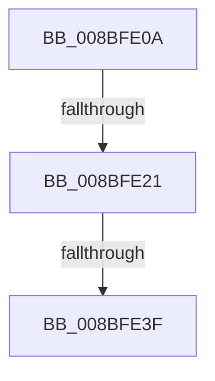

# sub_008BFE0A

- RVA: `0x008BFE0A`–`0x008BFE54` (길이 `74` bytes)
- VA: `0x00000001408BFE0A`
- 실행 섹션: `PAGE`
- PDB 이름 있음: `아니요`; PDB Function 태그: `아니요`
- unwind 정보 RVA: `0x000833AC`
- 디코드: `19`개 명령, `74/74` bytes 표시
- 미해석 바이트: `0` (있으면 어셈블리에 `.byte`로 보존)

> 이 문서는 커널 이미지의 기계어와 PDB 기호를 분석해 생성했습니다. 4번과 5번은 함수 원형과 자료형을 바이너리 사용 방식에서 추정한 C 해석이며 원본 소스 복구 결과는 아닙니다.

## 1. Dependencies

- 직접 호출 지점: **3**; 고유 호출 대상: **3**
- 직접 호출자로 확인된 함수: **0**
- RIP 상대 이미지 참조: **1**

### Outgoing calls
- `0x008BFE10` → [EtwpFindGuidEntryByGuid](../8C/EtwpFindGuidEntryByGuid_function_008C1DB0.md) (function, `0x008C1DB0`)
- `0x008BFE2E` → [EtwpAddGuidEntry](EtwpAddGuidEntry_function_008BFC80.md) (function, `0x008BFC80`)
- `0x008BFE4D` → [EtwpFreeGuidEntry](../8C/EtwpFreeGuidEntry_function_008C42E4.md) (function, `0x008C42E4`)

### Direct callers
- 이 함수 시작 RVA로 연결되는 직접 call은 확인되지 않았습니다. 간접 호출은 완전히 역산할 수 없습니다.

### Static image references
- `0x008BFE21` → RVA `0x00FC6AA8` (`ALMOSTRO`; read)

## 2. Other-region calls and transfers

- 다른 실행 섹션으로 향하는 call: **0**
- call이 아닌 외부 분기/꼬리 이동: **3**
  - `0x008BFE1B` → [EtwpAddGuidEntry + 0x41](EtwpAddGuidEntry_function_008BFC80.md) (`tail-transfer`)
  - `0x008BFE39` → [EtwpAddGuidEntry + 0x41](EtwpAddGuidEntry_function_008BFC80.md) (`tail-transfer`)
  - `0x008BFE52` → [sub_008BFDEA + 0x1](Unknown_function_008BFDEA.md) (`tail-transfer`)

## 3. Assembly (complete function range)

```asm
008BFE0A  44 8B C6                        mov r8d, esi
008BFE0D  48 8B D7                        mov rdx, rdi
008BFE10  E8 9B 1F 00 00                  call 0x1408c1db0
008BFE15  4C 8B E8                        mov r13, rax
008BFE18  48 85 C0                        test rax, rax
008BFE1B  0F 85 A0 FE FF FF               jne 0x1408bfcc1
008BFE21  48 8B 0D 80 6C 70 00            mov rcx, qword ptr [rip + 0x706c80]
008BFE28  44 8B C6                        mov r8d, esi
008BFE2B  48 8B D7                        mov rdx, rdi
008BFE2E  E8 4D FE FF FF                  call 0x1408bfc80
008BFE33  4C 8B E8                        mov r13, rax
008BFE36  48 85 C0                        test rax, rax
008BFE39  0F 85 82 FE FF FF               jne 0x1408bfcc1
008BFE3F  49 8B 47 20                     mov rax, qword ptr [r15 + 0x20]
008BFE43  49 8B CF                        mov rcx, r15
008BFE46  48 FF C8                        dec rax
008BFE49  49 89 47 20                     mov qword ptr [r15 + 0x20], rax
008BFE4D  E8 92 44 00 00                  call 0x1408c42e4
008BFE52  EB 97                           jmp 0x1408bfdeb
```

## 4. C-style interpretation (structured pseudocode)

```c
__int64 __fastcall sub_008BFE0A(void)
{
    __int64 result;

    result = EtwpFindGuidEntryByGuid(a1, v_rdi, (unsigned int)((unsigned int)(v_rsi)), a4);
    result = EtwpAddGuidEntry(*(unsigned __int64 *)(v_rip + 7367808), v_rdi, (unsigned int)((unsigned int)(v_rsi)), a4);
    result = (*(unsigned __int64 *)(v_r15 + 32)) - 1;
    *(unsigned __int64 *)(v_r15 + 32) = result;
    result = EtwpFreeGuidEntry(v_r15, v_rdi, (unsigned int)((unsigned int)(v_rsi)), a4);
}
```

## 5. (Beta) C Style

```c
void sub_008BFE0A(void)
{
    int64_t result;

    result = EtwpFindGuidEntryByGuid(a1, local_rdi, (uint32_t)((uint32_t)(local_rsi)), a4);
    result = EtwpAddGuidEntry(*(uint64_t *)(v_rip + 0x706C80), local_rdi, (uint32_t)((uint32_t)(local_rsi)), a4);
    result = (*(uint64_t *)(local_r15 + 0x20)) - 1;
    *(uint64_t *)(local_r15 + 0x20) = result;
    result = EtwpFreeGuidEntry(local_r15, local_rdi, (uint32_t)((uint32_t)(local_rsi)), a4);
}
```

## 6. Execution-region graph

[열기: 2D/3D 그래프와 함수 탐색 컨트롤 패널](../../../control-panel.html?section=page&rva=0x008BFE0A&view=graph)

- 2D 그래프는 위에서 아래로 흐르고, 3D 그래프는 빈 공간을 드래그해 회전합니다. Shift+드래그는 이동, 휠은 확대·축소, 함수 노드 선택은 대상 보고서 이동입니다.

### Static fallback


