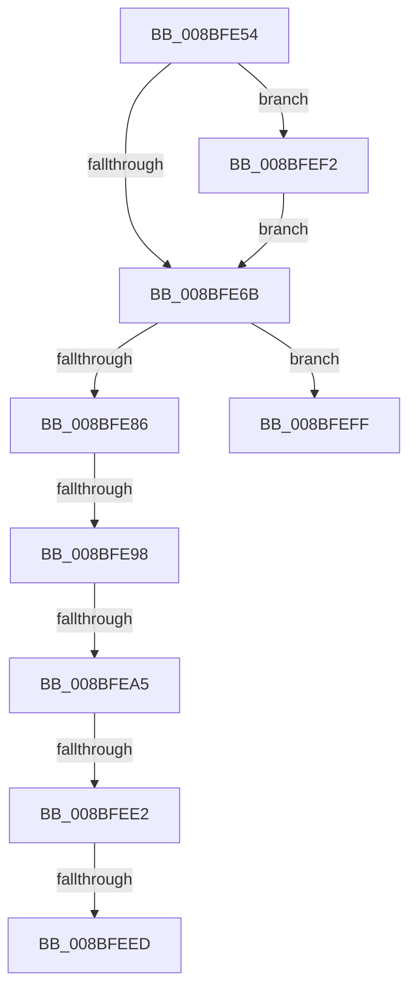

# sub_008BFE54

- RVA: `0x008BFE54`–`0x008BFF17` (길이 `195` bytes)
- VA: `0x00000001408BFE54`
- 실행 섹션: `PAGE`
- PDB 이름 있음: `아니요`; PDB Function 태그: `아니요`
- unwind 정보 RVA: `0x000833BC`
- 디코드: `44`개 명령, `195/195` bytes 표시
- 미해석 바이트: `0` (있으면 어셈블리에 `.byte`로 보존)

> 이 문서는 커널 이미지의 기계어와 PDB 기호를 분석해 생성했습니다. 4번과 5번은 함수 원형과 자료형을 바이너리 사용 방식에서 추정한 C 해석이며 원본 소스 복구 결과는 아닙니다.

## 1. Dependencies

- 직접 호출 지점: **4**; 고유 호출 대상: **4**
- 직접 호출자로 확인된 함수: **0**
- RIP 상대 이미지 참조: **0**

### Outgoing calls
- `0x008BFE6E` → [KeAbPostRelease](../../text/2E/KeAbPostRelease_function_002E1600.md) (function, `0x002E1600`)
- `0x008BFE7C` → [KeLeaveCriticalRegionThread](../../text/25/KeLeaveCriticalRegionThread_function_0025EFF0.md) (function, `0x0025EFF0`)
- `0x008BFEF5` → [ExfTryToWakePushLock](../../text/26/ExfTryToWakePushLock_function_00265DD0.md) (function, `0x00265DD0`)
- `0x008BFF0D` → [EtwpFreeGuidEntry](../8C/EtwpFreeGuidEntry_function_008C42E4.md) (function, `0x008C42E4`)

### Direct callers
- 이 함수 시작 RVA로 연결되는 직접 call은 확인되지 않았습니다. 간접 호출은 완전히 역산할 수 없습니다.

### Static image references
- 디코드된 RIP-relative 메모리 참조가 없습니다.

## 2. Other-region calls and transfers

- 다른 실행 섹션으로 향하는 call: **3**
  - `0x008BFE6E` → [KeAbPostRelease](../../text/2E/KeAbPostRelease_function_002E1600.md) (`PAGE` → `.text`)
  - `0x008BFE7C` → [KeLeaveCriticalRegionThread](../../text/25/KeLeaveCriticalRegionThread_function_0025EFF0.md) (`PAGE` → `.text`)
  - `0x008BFEF5` → [ExfTryToWakePushLock](../../text/26/ExfTryToWakePushLock_function_00265DD0.md) (`PAGE` → `.text`)
- call이 아닌 외부 분기/꼬리 이동: **6**
  - `0x008BFE92` → [sub_008BFCE3 + 0x92](Unknown_function_008BFCE3.md) (`tail-transfer`)
  - `0x008BFE9F` → [sub_008BFCE3 + 0x92](Unknown_function_008BFCE3.md) (`tail-transfer`)
  - `0x008BFEDC` → [sub_00B1AE6C + 0x43](../B1/Unknown_function_00B1AE6C.md) (`tail-transfer`)
  - `0x008BFEE7` → [sub_00B1AE6C + 0x43](../B1/Unknown_function_00B1AE6C.md) (`tail-transfer`)
  - `0x008BFEED` → [sub_00B1AE6C + 0x4B](../B1/Unknown_function_00B1AE6C.md) (`tail-transfer`)
  - `0x008BFF12` → [sub_008BFCE3 + 0xED](Unknown_function_008BFCE3.md) (`tail-transfer`)

## 3. Assembly (complete function range)

```asm
008BFE54  48 C7 C0 FF FF FF FF            mov rax, 0xffffffffffffffff
008BFE5B  F0 48 0F C1 45 00               lock xadd qword ptr [rbp], rax
008BFE61  24 06                           and al, 6
008BFE63  3C 02                           cmp al, 2
008BFE65  0F 84 87 00 00 00               je 0x1408bfef2
008BFE6B  48 8B CD                        mov rcx, rbp
008BFE6E  E8 8D 17 A2 FF                  call 0x1402e1600
008BFE73  65 48 8B 0C 25 88 01 00 00      mov rcx, qword ptr gs:[0x188]
008BFE7C  E8 6F F1 99 FF                  call 0x14025eff0
008BFE81  4D 85 ED                        test r13, r13
008BFE84  74 79                           je 0x1408bfeff
008BFE86  49 8B 57 10                     mov rdx, qword ptr [r15 + 0x10]
008BFE8A  49 8D 47 10                     lea rax, [r15 + 0x10]
008BFE8E  48 39 42 08                     cmp qword ptr [rdx + 8], rax
008BFE92  0F 85 DD FE FF FF               jne 0x1408bfd75
008BFE98  48 8B 48 08                     mov rcx, qword ptr [rax + 8]
008BFE9C  48 39 01                        cmp qword ptr [rcx], rax
008BFE9F  0F 85 D0 FE FF FF               jne 0x1408bfd75
008BFEA5  48 89 11                        mov qword ptr [rcx], rdx
008BFEA8  48 89 4A 08                     mov qword ptr [rdx + 8], rcx
008BFEAC  4D 89 A7 90 02 00 00            mov qword ptr [r15 + 0x290], r12
008BFEB3  4D 89 A5 A0 02 00 00            mov qword ptr [r13 + 0x2a0], r12
008BFEBA  49 8D BD 98 02 00 00            lea rdi, [r13 + 0x298]
008BFEC1  0F 0D 0F                        prefetchw byte ptr [rdi]
008BFEC4  48 8B 07                        mov rax, qword ptr [rdi]
008BFEC7  48 8B C8                        mov rcx, rax
008BFECA  48 83 E1 F0                     and rcx, 0xfffffffffffffff0
008BFECE  48 83 F9 10                     cmp rcx, 0x10
008BFED2  48 8D 50 F0                     lea rdx, [rax - 0x10]
008BFED6  49 0F 46 D4                     cmovbe rdx, r12
008BFEDA  A8 02                           test al, 2
008BFEDC  0F 85 CD AF 25 00               jne 0x140b1aeaf
008BFEE2  F0 48 0F B1 17                  lock cmpxchg qword ptr [rdi], rdx
008BFEE7  0F 85 C2 AF 25 00               jne 0x140b1aeaf
008BFEED  E9 C5 AF 25 00                  jmp 0x140b1aeb7
008BFEF2  48 8B CD                        mov rcx, rbp
008BFEF5  E8 D6 5E 9A FF                  call 0x140265dd0
008BFEFA  E9 6C FF FF FF                  jmp 0x1408bfe6b
008BFEFF  49 8B 47 20                     mov rax, qword ptr [r15 + 0x20]
008BFF03  49 8B CF                        mov rcx, r15
008BFF06  48 FF C8                        dec rax
008BFF09  49 89 47 20                     mov qword ptr [r15 + 0x20], rax
008BFF0D  E8 D2 43 00 00                  call 0x1408c42e4
008BFF12  E9 B9 FE FF FF                  jmp 0x1408bfdd0
```

## 4. C-style interpretation (structured pseudocode)

```c
__int64 __fastcall sub_008BFE54(void)
{
    __int64 result;

    result = (unsigned __int8)((-1) & (6));
    if (((unsigned __int8)(result)) == 2) goto loc_008BFEF2;
loc_008BFE6B:
    result = KeAbPostRelease(v_rbp, a2, a3, a4);
    result = KeLeaveCriticalRegionThread(*(unsigned __int64 *)(gs_base + (0 + 392)), a2, a3, a4);
    if (v_r13 == 0) goto loc_008BFEFF;
    *(unsigned __int64 *)(*(unsigned __int64 *)(v_r15 + 16 + 8)) = *(unsigned __int64 *)(v_r15 + 16);
    *(unsigned __int64 *)(*(unsigned __int64 *)(v_r15 + 16) + 8) = *(unsigned __int64 *)(v_r15 + 16 + 8);
    *(unsigned __int64 *)(v_r15 + 656) = v_r12;
    *(unsigned __int64 *)(v_r13 + 672) = v_r12;
    a1 = (*(unsigned __int64 *)(v_r13 + 664)) & (-16);
    a2 = *(unsigned __int64 *)(v_r13 + 664) - 16;
    if (a1 <= 16) { a2 = v_r12; }
loc_008BFEF2:
    result = ExfTryToWakePushLock(v_rbp, a2, a3, a4);
    goto loc_008BFE6B;
loc_008BFEFF:
    result = (*(unsigned __int64 *)(v_r15 + 32)) - 1;
    *(unsigned __int64 *)(v_r15 + 32) = result;
    result = EtwpFreeGuidEntry(v_r15, a2, a3, a4);
}
```

## 5. (Beta) C Style

```c
void sub_008BFE54(void)
{
    int64_t result;

    result = (uint8_t)((-1) & (6));
    if (((uint8_t)(result)) == 2) goto loc_008BFEF2;
loc_008BFE6B:
    result = KeAbPostRelease(local_rbp, a2, a3, a4);
    result = KeLeaveCriticalRegionThread(*(uint64_t *)(gs_base + (0 + 0x188)), a2, a3, a4);
    if (local_r13 == 0) goto loc_008BFEFF;
    *(uint64_t *)(*(uint64_t *)(local_r15 + 0x10 + 0x8)) = *(uint64_t *)(local_r15 + 0x10);
    *(uint64_t *)(*(uint64_t *)(local_r15 + 0x10) + 0x8) = *(uint64_t *)(local_r15 + 0x10 + 0x8);
    *(uint64_t *)(local_r15 + 0x290) = local_r12;
    *(uint64_t *)(local_r13 + 0x2A0) = local_r12;
    a1 = (*(uint64_t *)(local_r13 + 0x298)) & (-16);
    a2 = *(uint64_t *)(local_r13 + 0x298) - 16;
    if (a1 <= 16) { a2 = local_r12; }
loc_008BFEF2:
    result = ExfTryToWakePushLock(local_rbp, a2, a3, a4);
    goto loc_008BFE6B;
loc_008BFEFF:
    result = (*(uint64_t *)(local_r15 + 0x20)) - 1;
    *(uint64_t *)(local_r15 + 0x20) = result;
    result = EtwpFreeGuidEntry(local_r15, a2, a3, a4);
}
```

## 6. Execution-region graph

[열기: 2D/3D 그래프와 함수 탐색 컨트롤 패널](../../../control-panel.html?section=page&rva=0x008BFE54&view=graph)

- 2D 그래프는 위에서 아래로 흐르고, 3D 그래프는 빈 공간을 드래그해 회전합니다. Shift+드래그는 이동, 휠은 확대·축소, 함수 노드 선택은 대상 보고서 이동입니다.

### Static fallback


