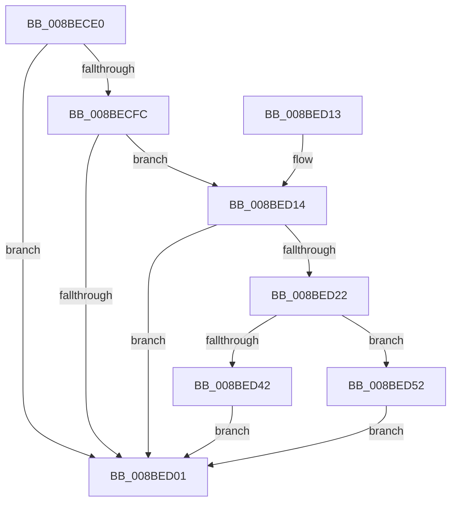

# WmipSDRegistryQueryRoutine

- RVA: `0x008BECE0`–`0x008BED59` (길이 `121` bytes)
- VA: `0x00000001408BECE0`
- 실행 섹션: `PAGE`
- PDB 이름 있음: `예`; PDB Function 태그: `아니요`
- unwind 정보 RVA: `0x00083254`
- 디코드: `38`개 명령, `121/121` bytes 표시
- 미해석 바이트: `0` (있으면 어셈블리에 `.byte`로 보존)

> 이 문서는 커널 이미지의 기계어와 PDB 기호를 분석해 생성했습니다. 4번과 5번은 함수 원형과 자료형을 바이너리 사용 방식에서 추정한 C 해석이며 원본 소스 복구 결과는 아닙니다.

## 1. Dependencies

- 직접 호출 지점: **3**; 고유 호출 대상: **3**
- 직접 호출자로 확인된 함수: **1**
- RIP 상대 이미지 참조: **0**

### Outgoing calls
- `0x008BED19` → [SeValidSecurityDescriptor](SeValidSecurityDescriptor_function_008BED60.md) (function, `0x008BED60`)
- `0x008BED30` → [ExAllocatePool2](../../poolcode/B8/ExAllocatePool2_function_00B820F0.md) (function, `0x00B820F0`)
- `0x008BED4B` → [memcpy](../../text/6C/memcpy_function_006C6840.md) (function, `0x006C6840`)

### Direct callers
- [RtlpCallQueryRegistryRoutine](RtlpCallQueryRegistryRoutine_function_008BE844.md) at `0x008BEA01`

### Static image references
- 디코드된 RIP-relative 메모리 참조가 없습니다.

## 2. Other-region calls and transfers

- 다른 실행 섹션으로 향하는 call: **2**
  - `0x008BED30` → [ExAllocatePool2](../../poolcode/B8/ExAllocatePool2_function_00B820F0.md) (`PAGE` → `POOLCODE`)
  - `0x008BED4B` → [memcpy](../../text/6C/memcpy_function_006C6840.md) (`PAGE` → `.text`)
- 별도 외부 분기/꼬리 이동을 확인하지 못했습니다.

## 3. Assembly (complete function range)

```asm
008BECE0  48 89 5C 24 08                  mov qword ptr [rsp + 8], rbx
008BECE5  48 89 74 24 10                  mov qword ptr [rsp + 0x10], rsi
008BECEA  57                              push rdi
008BECEB  48 83 EC 20                     sub rsp, 0x20
008BECEF  33 DB                           xor ebx, ebx
008BECF1  41 8B F1                        mov esi, r9d
008BECF4  49 8B F8                        mov rdi, r8
008BECF7  83 FA 03                        cmp edx, 3
008BECFA  75 05                           jne 0x1408bed01
008BECFC  4D 85 C0                        test r8, r8
008BECFF  75 13                           jne 0x1408bed14
008BED01  48 8B 74 24 38                  mov rsi, qword ptr [rsp + 0x38]
008BED06  8B C3                           mov eax, ebx
008BED08  48 8B 5C 24 30                  mov rbx, qword ptr [rsp + 0x30]
008BED0D  48 83 C4 20                     add rsp, 0x20
008BED11  5F                              pop rdi
008BED12  C3                              ret
008BED13  CC                              int3
008BED14  48 8B D7                        mov rdx, rdi
008BED17  8B CE                           mov ecx, esi
008BED19  E8 42 00 00 00                  call 0x1408bed60
008BED1E  84 C0                           test al, al
008BED20  74 DF                           je 0x1408bed01
008BED22  41 B8 57 6D 69 70               mov r8d, 0x70696d57
008BED28  48 8B D6                        mov rdx, rsi
008BED2B  B9 00 01 00 00                  mov ecx, 0x100
008BED30  E8 BB 33 2C 00                  call 0x140b820f0
008BED35  48 8B 4C 24 58                  mov rcx, qword ptr [rsp + 0x58]
008BED3A  48 89 01                        mov qword ptr [rcx], rax
008BED3D  48 85 C0                        test rax, rax
008BED40  74 10                           je 0x1408bed52
008BED42  4C 8B C6                        mov r8, rsi
008BED45  48 8B D7                        mov rdx, rdi
008BED48  48 8B C8                        mov rcx, rax
008BED4B  E8 F0 7A E0 FF                  call 0x1406c6840
008BED50  EB AF                           jmp 0x1408bed01
008BED52  BB 9A 00 00 C0                  mov ebx, 0xc000009a
008BED57  EB A8                           jmp 0x1408bed01
```

## 4. C-style interpretation (structured pseudocode)

```c
__int64 __fastcall WmipSDRegistryQueryRoutine(__int64 a1, int a2, __int64 a3, int a4, __int64 a5, __int64 a6)
{
    __int64 result;
    __int64 v_rbx;
    __int64 v_rsp;
    unsigned __int64 v_stack_p10;
    unsigned __int64 v_stack_p8;

    v_stack_p8 = v_rbx;
    v_stack_p10 = v_rsi;
    v_rsp = (v_rsp) - (32);
    v_rbx = 0;
    if (a2 != 3) goto loc_008BED01;
    if (a3 != 0) goto loc_008BED14;
loc_008BED01:
    v_rsp = (v_rsp) + (32);
    return 0;
loc_008BED14:
    result = SeValidSecurityDescriptor((unsigned int)((unsigned int)(v_stack_p10)), a3, a3, a4);
    if ((unsigned __int8)(result) == 0) goto loc_008BED01;
    result = ExAllocatePool2(256, v_stack_p10, (unsigned int)(0x70696D57ULL), a4);
    *(unsigned __int64 *)(a6) = result;
    if (result == 0) goto loc_008BED52;
    result = memcpy(result, a3, v_stack_p10, a4);
    goto loc_008BED01;
loc_008BED52:
    goto loc_008BED01;
}
```

## 5. (Beta) C Style

```c
int64_t WmipSDRegistryQueryRoutine(int64_t Arg1, int32_t Arg2, int64_t Arg3, int32_t Arg4, uint64_t Arg5, void *Arg6)
{
    uint8_t *arg6 = (uint8_t *)Arg6;

    int64_t result;
    int64_t local_rbx;
    int64_t local_rsp;
    uint64_t v_stack_p10;
    uint64_t v_stack_p8;

    v_stack_p8 = local_rbx;
    v_stack_p10 = local_rsi;
    local_rsp = (local_rsp) - (32);
    local_rbx = 0;
    if (Arg2 != 3) goto loc_008BED01;
    if (Arg3 != 0) goto loc_008BED14;
loc_008BED01:
    local_rsp = (local_rsp) + (32);
    return 0;
loc_008BED14:
    result = SeValidSecurityDescriptor((uint32_t)((uint32_t)(v_stack_p10)), Arg3, Arg3, Arg4);
    if ((uint8_t)(result) == 0) goto loc_008BED01;
    result = ExAllocatePool2(256, v_stack_p10, (uint32_t)(0x70696D57ULL), Arg4);
    *(uint64_t *)(arg6) = result;
    if (result == 0) goto loc_008BED52;
    result = memcpy(result, Arg3, v_stack_p10, Arg4);
    goto loc_008BED01;
loc_008BED52:
    goto loc_008BED01;
}
```

### 관측된 메모리 오프셋

구조체 형식이 확인되지 않은 접근은 인자 기준의 오프셋으로만 기록했습니다.

| 기준 인자 | 오프셋 표현 | 폭 (bit) | 접근 |
|---|---:|---:|---|
| `Arg6` | `+ 0x0` | `64` | `W` |

## 6. Execution-region graph

[열기: 2D/3D 그래프와 함수 탐색 컨트롤 패널](../../../control-panel.html?section=page&rva=0x008BECE0&view=graph)

- 2D 그래프는 위에서 아래로 흐르고, 3D 그래프는 빈 공간을 드래그해 회전합니다. Shift+드래그는 이동, 휠은 확대·축소, 함수 노드 선택은 대상 보고서 이동입니다.

### Static fallback


