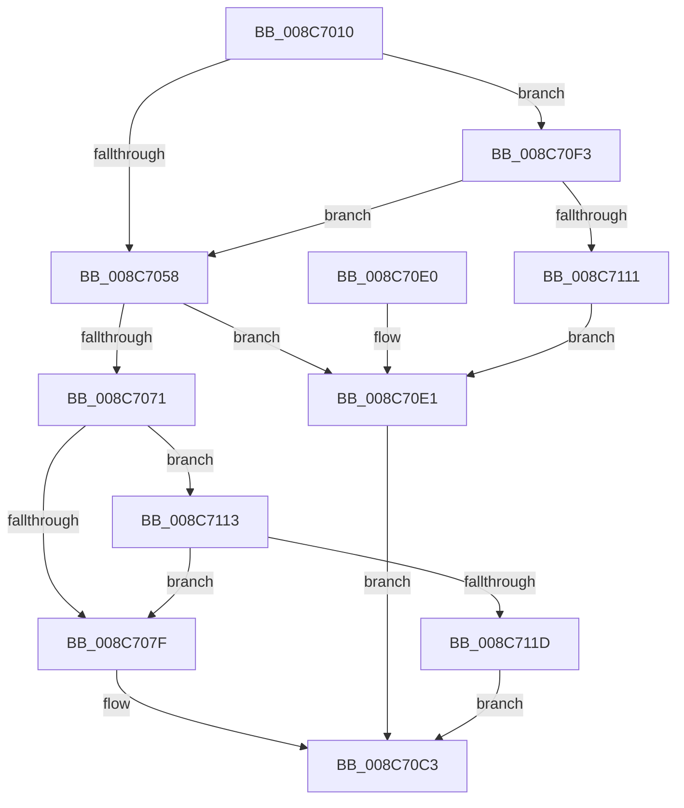

# CmpCheckCreateAccessOnKcbStack

- RVA: `0x008C7010`–`0x008C712A` (길이 `282` bytes)
- VA: `0x00000001408C7010`
- 실행 섹션: `PAGE`
- PDB 이름 있음: `예`; PDB Function 태그: `아니요`
- unwind 정보 RVA: `0x00083CE4`
- 디코드: `67`개 명령, `282/282` bytes 표시
- 미해석 바이트: `0` (있으면 어셈블리에 `.byte`로 보존)

> 이 문서는 커널 이미지의 기계어와 PDB 기호를 분석해 생성했습니다. 4번과 5번은 함수 원형과 자료형을 바이너리 사용 방식에서 추정한 C 해석이며 원본 소스 복구 결과는 아닙니다.

## 1. Dependencies

- 직접 호출 지점: **3**; 고유 호출 대상: **3**
- 직접 호출자로 확인된 함수: **2**
- RIP 상대 이미지 참조: **0**

### Outgoing calls
- `0x008C7040` → [CmpGetSecurityCacheEntryForKcbStack](CmpGetSecurityCacheEntryForKcbStack_function_008C7580.md) (function, `0x008C7580`)
- `0x008C70BC` → [CmpCheckCreateAccess](CmpCheckCreateAccess_function_008C6E8C.md) (function, `0x008C6E8C`)
- `0x008C7104` → [CmpSetAccessStateForBackupRestore](../94/CmpSetAccessStateForBackupRestore_function_00947D2C.md) (function, `0x00947D2C`)

### Direct callers
- [CmpDoParseKey](../85/CmpDoParseKey_function_0085F750.md) at `0x00861397`
- [sub_00B16F66](../B1/Unknown_function_00B16F66.md) at `0x00B170ED`

### Static image references
- 디코드된 RIP-relative 메모리 참조가 없습니다.

## 2. Other-region calls and transfers

- 다른 실행 섹션으로 향하는 call: **0**
- 별도 외부 분기/꼬리 이동을 확인하지 못했습니다.

## 3. Assembly (complete function range)

```asm
008C7010  48 8B C4                        mov rax, rsp
008C7013  48 89 58 08                     mov qword ptr [rax + 8], rbx
008C7017  48 89 70 10                     mov qword ptr [rax + 0x10], rsi
008C701B  48 89 78 18                     mov qword ptr [rax + 0x18], rdi
008C701F  4C 89 70 20                     mov qword ptr [rax + 0x20], r14
008C7023  41 57                           push r15
008C7025  48 83 EC 50                     sub rsp, 0x50
008C7029  4C 8B B4 24 98 00 00 00         mov r14, qword ptr [rsp + 0x98]
008C7031  4D 8B F8                        mov r15, r8
008C7034  48 8B CA                        mov rcx, rdx
008C7037  45 33 C0                        xor r8d, r8d
008C703A  49 8B D6                        mov rdx, r14
008C703D  49 8B F9                        mov rdi, r9
008C7040  E8 3B 05 00 00                  call 0x1408c7580
008C7045  80 BC 24 90 00 00 00 00         cmp byte ptr [rsp + 0x90], 0
008C704D  48 8B F0                        mov rsi, rax
008C7050  B3 01                           mov bl, 1
008C7052  0F 85 9B 00 00 00               jne 0x1408c70f3
008C7058  8B 94 24 88 00 00 00            mov edx, dword ptr [rsp + 0x88]
008C705F  8B CA                           mov ecx, edx
008C7061  0B 4F 18                        or ecx, dword ptr [rdi + 0x18]
008C7064  41 8B 47 60                     mov eax, dword ptr [r15 + 0x60]
008C7068  83 C9 04                        or ecx, 4
008C706B  23 C1                           and eax, ecx
008C706D  3B C1                           cmp eax, ecx
008C706F  75 70                           jne 0x1408c70e1
008C7071  80 BC 24 90 00 00 00 00         cmp byte ptr [rsp + 0x90], 0
008C7079  0F 85 94 00 00 00               jne 0x1408c7113
008C707F  48 8B 84 24 B0 00 00 00         mov rax, qword ptr [rsp + 0xb0]
008C7087  4C 8B C7                        mov r8, rdi
008C708A  44 8A 8C 24 80 00 00 00         mov r9b, byte ptr [rsp + 0x80]
008C7092  48 89 44 24 40                  mov qword ptr [rsp + 0x40], rax
008C7097  8B 84 24 A8 00 00 00            mov eax, dword ptr [rsp + 0xa8]
008C709E  89 44 24 38                     mov dword ptr [rsp + 0x38], eax
008C70A2  48 8B 84 24 A0 00 00 00         mov rax, qword ptr [rsp + 0xa0]
008C70AA  48 89 44 24 30                  mov qword ptr [rsp + 0x30], rax
008C70AF  4C 89 74 24 28                  mov qword ptr [rsp + 0x28], r14
008C70B4  89 54 24 20                     mov dword ptr [rsp + 0x20], edx
008C70B8  48 8D 56 20                     lea rdx, [rsi + 0x20]
008C70BC  E8 CB FD FF FF                  call 0x1408c6e8c
008C70C1  8A D8                           mov bl, al
008C70C3  48 8B 74 24 68                  mov rsi, qword ptr [rsp + 0x68]
008C70C8  8A C3                           mov al, bl
008C70CA  48 8B 5C 24 60                  mov rbx, qword ptr [rsp + 0x60]
008C70CF  48 8B 7C 24 70                  mov rdi, qword ptr [rsp + 0x70]
008C70D4  4C 8B 74 24 78                  mov r14, qword ptr [rsp + 0x78]
008C70D9  48 83 C4 50                     add rsp, 0x50
008C70DD  41 5F                           pop r15
008C70DF  C3                              ret
008C70E0  CC                              int3
008C70E1  48 8B 84 24 B0 00 00 00         mov rax, qword ptr [rsp + 0xb0]
008C70E9  32 DB                           xor bl, bl
008C70EB  C7 00 22 00 00 C0               mov dword ptr [rax], 0xc0000022
008C70F1  EB D0                           jmp 0x1408c70c3
008C70F3  8A 94 24 80 00 00 00            mov dl, byte ptr [rsp + 0x80]
008C70FA  4C 8D 40 20                     lea r8, [rax + 0x20]
008C70FE  44 8A CB                        mov r9b, bl
008C7101  48 8B CF                        mov rcx, rdi
008C7104  E8 23 0C 08 00                  call 0x140947d2c
008C7109  85 C0                           test eax, eax
008C710B  0F 89 47 FF FF FF               jns 0x1408c7058
008C7111  EB CE                           jmp 0x1408c70e1
008C7113  83 7F 10 00                     cmp dword ptr [rdi + 0x10], 0
008C7117  0F 85 62 FF FF FF               jne 0x1408c707f
008C711D  48 8B 84 24 B0 00 00 00         mov rax, qword ptr [rsp + 0xb0]
008C7125  83 20 00                        and dword ptr [rax], 0
008C7128  EB 99                           jmp 0x1408c70c3
```

## 4. C-style interpretation (structured pseudocode)

```c
__int64 __fastcall CmpCheckCreateAccessOnKcbStack(__int64 a1, __int64 a2, __int64 a3, __int64 a4, unsigned __int8 a5, unsigned int a6, unsigned __int8 a7, __int64 a8, __int64 a9, unsigned int a10, __int64 a11)
{
    __int64 result;
    __int64 v_rbx;
    __int64 v_rsp;
    unsigned __int64 v_stack_m18;
    unsigned int v_stack_m20;
    unsigned __int64 v_stack_m28;
    unsigned __int64 v_stack_m30;
    unsigned int v_stack_m38;
    unsigned __int64 v_stack_p10;
    unsigned __int64 v_stack_p18;
    unsigned __int64 v_stack_p20;
    unsigned __int64 v_stack_p8;

    *(unsigned __int64 *)(v_rsp + 8) = v_rbx;
    *(unsigned __int64 *)(v_rsp + 16) = v_rsi;
    *(unsigned __int64 *)(v_rsp + 24) = v_rdi;
    *(unsigned __int64 *)(v_rsp + 32) = v_r14;
    v_rsp = (v_rsp) - (80);
    a3 = 0;
    result = CmpGetSecurityCacheEntryForKcbStack(a2, a8, a3, a4);
    if (a7 != 0) goto loc_008C70F3;
loc_008C7058:
    a1 = (unsigned int)(((unsigned int)((unsigned int)((unsigned int)(a6)))) | (*(unsigned int *)(a4 + 24)));
    a1 = (unsigned int)((a1) | (4));
    result = (unsigned int)(((unsigned int)(*(unsigned int *)(a3 + 96))) & ((unsigned int)(a1)));
    if (((unsigned int)(result)) != ((unsigned int)(a1))) goto loc_008C70E1;
    if (a7 != 0) goto loc_008C7113;
loc_008C707F:
    v_stack_m18 = a11;
    v_stack_m20 = (unsigned int)((unsigned int)(a10));
    v_stack_m28 = a9;
    v_stack_m30 = a8;
    v_stack_m38 = (unsigned int)((unsigned int)(a6));
    result = CmpCheckCreateAccess(a1, result + 32, a4, a5);
loc_008C70C3:
    v_rsp = (v_rsp) + (80);
    return (unsigned __int8)((unsigned __int8)(result));
loc_008C70E1:
    v_rbx = 0;
    *(unsigned int *)(a11) = 0xC0000022ULL;
    goto loc_008C70C3;
loc_008C70F3:
    result = CmpSetAccessStateForBackupRestore(v_stack_p18, a5, a11 + 32, 0);
    if (!sign_flag) goto loc_008C7058;
    goto loc_008C70E1;
loc_008C7113:
    if ((*(unsigned int *)(v_stack_p18 + 16)) != 0) goto loc_008C707F;
    goto loc_008C70C3;
}
```

## 5. (Beta) C Style

```c
int64_t CmpCheckCreateAccessOnKcbStack(int64_t Arg1, int64_t Arg2, void *Arg3, void *Arg4, uint8_t Arg5, uint32_t Arg6, uint8_t Arg7, int64_t Arg8, int64_t Arg9, uint32_t Arg10, void *Arg11)
{
    uint8_t *arg3 = (uint8_t *)Arg3;
    uint8_t *arg4 = (uint8_t *)Arg4;
    uint8_t *arg11 = (uint8_t *)Arg11;

    int64_t result;
    int64_t local_rbx;
    int64_t local_rsp;
    uint64_t v_stack_m18;
    uint32_t v_stack_m20;
    uint64_t v_stack_m28;
    uint64_t v_stack_m30;
    uint32_t v_stack_m38;
    uint64_t v_stack_p10;
    uint64_t v_stack_p18;
    uint64_t v_stack_p20;
    uint64_t v_stack_p8;

    *(uint64_t *)(local_rsp + 0x8) = local_rbx;
    *(uint64_t *)(local_rsp + 0x10) = local_rsi;
    *(uint64_t *)(local_rsp + 0x18) = local_rdi;
    *(uint64_t *)(local_rsp + 0x20) = local_r14;
    local_rsp = (local_rsp) - (80);
    Arg3 = 0;
    result = CmpGetSecurityCacheEntryForKcbStack(Arg2, Arg8, Arg3, Arg4);
    if (Arg7 != 0) goto loc_008C70F3;
loc_008C7058:
    Arg1 = (uint32_t)(((uint32_t)((uint32_t)((uint32_t)(Arg6)))) | (*(uint32_t *)(arg4 + 0x18)));
    Arg1 = (uint32_t)((Arg1) | (4));
    result = (uint32_t)(((uint32_t)(*(uint32_t *)(arg3 + 0x60))) & ((uint32_t)(Arg1)));
    if (((uint32_t)(result)) != ((uint32_t)(Arg1))) goto loc_008C70E1;
    if (Arg7 != 0) goto loc_008C7113;
loc_008C707F:
    v_stack_m18 = Arg11;
    v_stack_m20 = (uint32_t)((uint32_t)(Arg10));
    v_stack_m28 = Arg9;
    v_stack_m30 = Arg8;
    v_stack_m38 = (uint32_t)((uint32_t)(Arg6));
    result = CmpCheckCreateAccess(Arg1, result + 32, Arg4, Arg5);
loc_008C70C3:
    local_rsp = (local_rsp) + (80);
    return (uint8_t)((uint8_t)(result));
loc_008C70E1:
    local_rbx = 0;
    *(uint32_t *)(arg11) = 0xC0000022ULL;
    goto loc_008C70C3;
loc_008C70F3:
    result = CmpSetAccessStateForBackupRestore(v_stack_p18, Arg5, Arg11 + 32, 0);
    if (!sign_flag) goto loc_008C7058;
    goto loc_008C70E1;
loc_008C7113:
    if ((*(uint32_t *)(v_stack_p18 + 0x10)) != 0) goto loc_008C707F;
    goto loc_008C70C3;
}
```

### 관측된 메모리 오프셋

구조체 형식이 확인되지 않은 접근은 인자 기준의 오프셋으로만 기록했습니다.

| 기준 인자 | 오프셋 표현 | 폭 (bit) | 접근 |
|---|---:|---:|---|
| `Arg3` | `+ 0x60` | `32` | `R` |
| `Arg4` | `+ 0x10` | `32` | `R` |
| `Arg4` | `+ 0x18` | `32` | `R` |
| `Arg11` | `+ 0x0` | `32` | `R/W` |
| `Arg11` | `+ 0x0` | `32` | `W` |

## 6. Execution-region graph

[열기: 2D/3D 그래프와 함수 탐색 컨트롤 패널](../../../control-panel.html?section=page&rva=0x008C7010&view=graph)

- 2D 그래프는 위에서 아래로 흐르고, 3D 그래프는 빈 공간을 드래그해 회전합니다. Shift+드래그는 이동, 휠은 확대·축소, 함수 노드 선택은 대상 보고서 이동입니다.

### Static fallback


