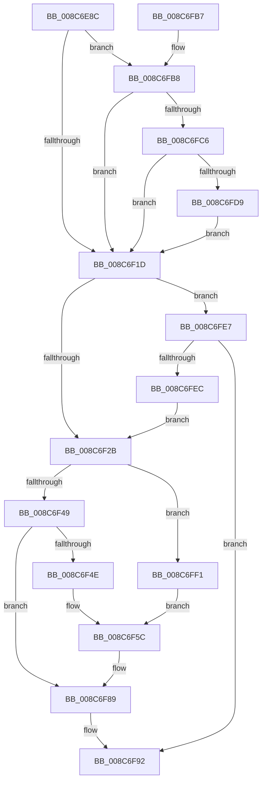

# CmpCheckCreateAccess

- RVA: `0x008C6E8C`–`0x008C7008` (길이 `380` bytes)
- VA: `0x00000001408C6E8C`
- 실행 섹션: `PAGE`
- PDB 이름 있음: `예`; PDB Function 태그: `아니요`
- unwind 정보 RVA: `0x00083CC8`
- 디코드: `90`개 명령, `380/380` bytes 표시
- 미해석 바이트: `0` (있으면 어셈블리에 `.byte`로 보존)

> 이 문서는 커널 이미지의 기계어와 PDB 기호를 분석해 생성했습니다. 4번과 5번은 함수 원형과 자료형을 바이너리 사용 방식에서 추정한 C 해석이며 원본 소스 복구 결과는 아닙니다.

## 1. Dependencies

- 직접 호출 지점: **5**; 고유 호출 대상: **5**
- 직접 호출자로 확인된 함수: **1**
- RIP 상대 이미지 참조: **1**

### Outgoing calls
- `0x008C6EBC` → [SeLockSubjectContext](SeLockSubjectContext_function_008C64C0.md) (function, `0x008C64C0`)
- `0x008C6F0D` → [SeAccessCheck](../../text/3A/SeAccessCheck_function_003A6BC0.md) (function, `0x003A6BC0`)
- `0x008C6F84` → [SeOpenObjectAuditAlarmWithTransaction](../86/SeOpenObjectAuditAlarmWithTransaction_function_0086E790.md) (function, `0x0086E790`)
- `0x008C6F95` → [SeUnlockSubjectContext](SeUnlockSubjectContext_function_008C6520.md) (function, `0x008C6520`)
- `0x008C6FCC` → [RtlIsSandboxedToken](../8B/RtlIsSandboxedToken_function_008B3AB0.md) (function, `0x008B3AB0`)

### Direct callers
- [CmpCheckCreateAccessOnKcbStack](CmpCheckCreateAccessOnKcbStack_function_008C7010.md) at `0x008C70BC`

### Static image references
- `0x008C6EC1` → RVA `0x00FC6AC0` (`ALMOSTRO`; read)

## 2. Other-region calls and transfers

- 다른 실행 섹션으로 향하는 call: **1**
  - `0x008C6F0D` → [SeAccessCheck](../../text/3A/SeAccessCheck_function_003A6BC0.md) (`PAGE` → `.text`)
- 별도 외부 분기/꼬리 이동을 확인하지 못했습니다.

## 3. Assembly (complete function range)

```asm
008C6E8C  48 8B C4                        mov rax, rsp
008C6E8F  48 89 58 10                     mov qword ptr [rax + 0x10], rbx
008C6E93  48 89 68 18                     mov qword ptr [rax + 0x18], rbp
008C6E97  48 89 70 20                     mov qword ptr [rax + 0x20], rsi
008C6E9B  48 89 48 08                     mov qword ptr [rax + 8], rcx
008C6E9F  57                              push rdi
008C6EA0  41 56                           push r14
008C6EA2  41 57                           push r15
008C6EA4  48 83 EC 50                     sub rsp, 0x50
008C6EA8  83 60 08 00                     and dword ptr [rax + 8], 0
008C6EAC  4D 8D 70 20                     lea r14, [r8 + 0x20]
008C6EB0  49 8B CE                        mov rcx, r14
008C6EB3  41 8A F1                        mov sil, r9b
008C6EB6  49 8B E8                        mov rbp, r8
008C6EB9  4C 8B FA                        mov r15, rdx
008C6EBC  E8 FF F5 FF FF                  call 0x1408c64c0
008C6EC1  48 8B 05 F8 FB 6F 00            mov rax, qword ptr [rip + 0x6ffbf8]
008C6EC8  48 8D 4C 24 70                  lea rcx, [rsp + 0x70]
008C6ECD  44 8B 8C 24 90 00 00 00         mov r9d, dword ptr [rsp + 0x90]
008C6ED5  48 83 C0 4C                     add rax, 0x4c
008C6ED9  48 8B 9C 24 B0 00 00 00         mov rbx, qword ptr [rsp + 0xb0]
008C6EE1  41 83 C9 04                     or r9d, 4
008C6EE5  48 89 5C 24 48                  mov qword ptr [rsp + 0x48], rbx
008C6EEA  41 B0 01                        mov r8b, 1
008C6EED  48 89 4C 24 40                  mov qword ptr [rsp + 0x40], rcx
008C6EF2  49 8B D6                        mov rdx, r14
008C6EF5  40 88 74 24 38                  mov byte ptr [rsp + 0x38], sil
008C6EFA  49 8B CF                        mov rcx, r15
008C6EFD  48 89 44 24 30                  mov qword ptr [rsp + 0x30], rax
008C6F02  48 83 64 24 28 00               and qword ptr [rsp + 0x28], 0
008C6F08  83 64 24 20 00                  and dword ptr [rsp + 0x20], 0
008C6F0D  E8 AE FC AD FF                  call 0x1403a6bc0
008C6F12  40 8A F8                        mov dil, al
008C6F15  84 C0                           test al, al
008C6F17  0F 85 9B 00 00 00               jne 0x1408c6fb8
008C6F1D  83 BC 24 A8 00 00 00 01         cmp dword ptr [rsp + 0xa8], 1
008C6F25  0F 84 BC 00 00 00               je 0x1408c6fe7
008C6F2B  48 8B 9C 24 A0 00 00 00         mov rbx, qword ptr [rsp + 0xa0]
008C6F33  48 8B 94 24 98 00 00 00         mov rdx, qword ptr [rsp + 0x98]
008C6F3B  66 83 4B 30 02                  or word ptr [rbx + 0x30], 2
008C6F40  48 85 D2                        test rdx, rdx
008C6F43  0F 85 A8 00 00 00               jne 0x1408c6ff1
008C6F49  40 84 F6                        test sil, sil
008C6F4C  74 3B                           je 0x1408c6f89
008C6F4E  48 8D 45 0A                     lea rax, [rbp + 0xa]
008C6F52  48 89 44 24 48                  mov qword ptr [rsp + 0x48], rax
008C6F57  48 21 54 24 40                  and qword ptr [rsp + 0x40], rdx
008C6F5C  48 8B 0D 5D FB 6F 00            mov rcx, qword ptr [rip + 0x6ffb5d]
008C6F63  4D 8B CF                        mov r9, r15
008C6F66  40 88 74 24 38                  mov byte ptr [rsp + 0x38], sil
008C6F6B  48 83 C1 10                     add rcx, 0x10
008C6F6F  40 88 7C 24 30                  mov byte ptr [rsp + 0x30], dil
008C6F74  45 33 C0                        xor r8d, r8d
008C6F77  C6 44 24 28 00                  mov byte ptr [rsp + 0x28], 0
008C6F7C  48 8B D3                        mov rdx, rbx
008C6F7F  48 89 6C 24 20                  mov qword ptr [rsp + 0x20], rbp
008C6F84  E8 07 78 FA FF                  call 0x14086e790
008C6F89  B8 FD FF 00 00                  mov eax, 0xfffd
008C6F8E  66 21 43 30                     and word ptr [rbx + 0x30], ax
008C6F92  49 8B CE                        mov rcx, r14
008C6F95  E8 86 F5 FF FF                  call 0x1408c6520
008C6F9A  4C 8D 5C 24 50                  lea r11, [rsp + 0x50]
008C6F9F  40 8A C7                        mov al, dil
008C6FA2  49 8B 5B 28                     mov rbx, qword ptr [r11 + 0x28]
008C6FA6  49 8B 6B 30                     mov rbp, qword ptr [r11 + 0x30]
008C6FAA  49 8B 73 38                     mov rsi, qword ptr [r11 + 0x38]
008C6FAE  49 8B E3                        mov rsp, r11
008C6FB1  41 5F                           pop r15
008C6FB3  41 5E                           pop r14
008C6FB5  5F                              pop rdi
008C6FB6  C3                              ret
008C6FB7  CC                              int3
008C6FB8  F6 84 24 90 00 00 00 20         test byte ptr [rsp + 0x90], 0x20
008C6FC0  0F 84 57 FF FF FF               je 0x1408c6f1d
008C6FC6  40 8A D6                        mov dl, sil
008C6FC9  49 8B CE                        mov rcx, r14
008C6FCC  E8 DF CA FE FF                  call 0x1408b3ab0
008C6FD1  84 C0                           test al, al
008C6FD3  0F 84 44 FF FF FF               je 0x1408c6f1d
008C6FD9  40 32 FF                        xor dil, dil
008C6FDC  C7 03 22 00 00 C0               mov dword ptr [rbx], 0xc0000022
008C6FE2  E9 36 FF FF FF                  jmp 0x1408c6f1d
008C6FE7  40 84 FF                        test dil, dil
008C6FEA  75 A6                           jne 0x1408c6f92
008C6FEC  E9 3A FF FF FF                  jmp 0x1408c6f2b
008C6FF1  48 8D 45 0A                     lea rax, [rbp + 0xa]
008C6FF5  48 83 C2 58                     add rdx, 0x58
008C6FF9  48 89 44 24 48                  mov qword ptr [rsp + 0x48], rax
008C6FFE  48 89 54 24 40                  mov qword ptr [rsp + 0x40], rdx
008C7003  E9 54 FF FF FF                  jmp 0x1408c6f5c
```

## 4. C-style interpretation (structured pseudocode)

```c
__int64 __fastcall CmpCheckCreateAccess(__int64 a1, __int64 a2, __int64 a3, unsigned __int8 a4, unsigned __int8 a5, __int64 a6, __int64 a7, unsigned int a8, __int64 a9)
{
    __int64 result;
    __int64 v_rdi;
    __int64 v_rsp;
    unsigned __int64 v_stack_m10;
    unsigned __int64 v_stack_m18;
    unsigned __int64 v_stack_m20;
    unsigned __int64 v_stack_m28;
    unsigned __int8 v_stack_m30;
    unsigned __int64 v_stack_m38;
    unsigned __int64 v_stack_m40;
    unsigned int v_stack_m48;
    unsigned __int64 v_stack_m8;
    unsigned __int64 v_stack_p8;

    *(unsigned __int64 *)(v_rsp + 16) = v_rbx;
    *(unsigned __int64 *)(v_rsp + 24) = v_rbp;
    *(unsigned __int64 *)(v_rsp + 32) = v_rsi;
    *(unsigned __int64 *)(v_rsp + 8) = a1;
    v_rsp = (v_rsp) - (80);
    result = SeLockSubjectContext(a3 + 32, a2, a3, a4);
    result = (*(unsigned __int64 *)(v_rip + 7339000)) + (76);
    a4 = (unsigned int)(((unsigned int)(a5)) | (4));
    v_stack_m20 = a9;
    v_stack_m28 = v_stack_p8;
    v_stack_m30 = a4;
    v_stack_m38 = result;
    result = SeAccessCheck(a2, a3 + 32, 1, a4);
    if ((unsigned __int8)(result) != 0) goto loc_008C6FB8;
loc_008C6F1D:
    if (a8 == 1) goto loc_008C6FE7;
loc_008C6F2B:
    if (a6 != 0) goto loc_008C6FF1;
    if (a4 == 0) goto loc_008C6F89;
    v_stack_m20 = a3 + 10;
loc_008C6F5C:
    v_stack_m30 = a4;
    a1 = (*(unsigned __int64 *)(v_rip + 7338845)) + (16);
    v_stack_m38 = (unsigned __int8)((unsigned __int8)(result));
    a3 = 0;
    v_stack_m40 = 0;
    v_stack_m48 = 0;
    result = SeOpenObjectAuditAlarmWithTransaction(a1, a7, a3, a2);
loc_008C6F89:
loc_008C6F92:
    result = SeUnlockSubjectContext(a3 + 32, a7, a3, a2);
    return (unsigned __int8)((unsigned __int8)(result));
loc_008C6FB8:
    if (((a5) & (32)) == 0) goto loc_008C6F1D;
    result = RtlIsSandboxedToken(a3 + 32, (unsigned __int8)(*(unsigned __int64 *)(v_stack_m18 + 56)), a3, a2);
    if ((unsigned __int8)(result) == 0) goto loc_008C6F1D;
    v_rdi = 0;
    *(unsigned int *)(*(unsigned __int64 *)(v_stack_m18 + 40)) = 0xC0000022ULL;
    goto loc_008C6F1D;
loc_008C6FE7:
    if (0 != 0) goto loc_008C6F92;
    goto loc_008C6F2B;
loc_008C6FF1:
    a2 = ((unsigned __int8)(*(unsigned __int64 *)(v_stack_m18 + 56))) + (88);
    v_stack_m8 = *(unsigned __int64 *)(v_stack_m18 + 48) + 10;
    v_stack_m10 = a2;
    goto loc_008C6F5C;
}
```

## 5. (Beta) C Style

```c
int64_t CmpCheckCreateAccess(int64_t Arg1, int64_t Arg2, void *Arg3, uint8_t Arg4, uint8_t Arg5, int64_t Arg6, void *Arg7, uint32_t Arg8, void *Arg9)
{
    uint8_t *arg3 = (uint8_t *)Arg3;
    uint8_t *arg7 = (uint8_t *)Arg7;
    uint8_t *arg9 = (uint8_t *)Arg9;

    int64_t result;
    int64_t local_rdi;
    int64_t local_rsp;
    uint64_t v_stack_m10;
    uint64_t v_stack_m18;
    uint64_t v_stack_m20;
    uint64_t v_stack_m28;
    uint8_t v_stack_m30;
    uint64_t v_stack_m38;
    uint64_t v_stack_m40;
    uint32_t v_stack_m48;
    uint64_t v_stack_m8;
    uint64_t v_stack_p8;

    *(uint64_t *)(local_rsp + 0x10) = local_rbx;
    *(uint64_t *)(local_rsp + 0x18) = local_rbp;
    *(uint64_t *)(local_rsp + 0x20) = local_rsi;
    *(uint64_t *)(local_rsp + 0x8) = Arg1;
    local_rsp = (local_rsp) - (80);
    result = SeLockSubjectContext(Arg3 + 32, Arg2, Arg3, Arg4);
    result = (*(uint64_t *)(v_rip + 0x6FFBF8)) + (76);
    Arg4 = (uint32_t)(((uint32_t)(Arg5)) | (4));
    v_stack_m20 = Arg9;
    v_stack_m28 = v_stack_p8;
    v_stack_m30 = Arg4;
    v_stack_m38 = result;
    result = SeAccessCheck(Arg2, Arg3 + 32, 1, Arg4);
    if ((uint8_t)(result) != 0) goto loc_008C6FB8;
loc_008C6F1D:
    if (Arg8 == 1) goto loc_008C6FE7;
loc_008C6F2B:
    if (Arg6 != 0) goto loc_008C6FF1;
    if (Arg4 == 0) goto loc_008C6F89;
    v_stack_m20 = Arg3 + 10;
loc_008C6F5C:
    v_stack_m30 = Arg4;
    Arg1 = (*(uint64_t *)(v_rip + 0x6FFB5D)) + (16);
    v_stack_m38 = (uint8_t)((uint8_t)(result));
    Arg3 = 0;
    v_stack_m40 = 0;
    v_stack_m48 = 0;
    result = SeOpenObjectAuditAlarmWithTransaction(Arg1, Arg7, Arg3, Arg2);
loc_008C6F89:
loc_008C6F92:
    result = SeUnlockSubjectContext(Arg3 + 32, Arg7, Arg3, Arg2);
    return (uint8_t)((uint8_t)(result));
loc_008C6FB8:
    if (((Arg5) & (32)) == 0) goto loc_008C6F1D;
    result = RtlIsSandboxedToken(Arg3 + 32, (uint8_t)(*(uint64_t *)(v_stack_m18 + 0x38)), Arg3, Arg2);
    if ((uint8_t)(result) == 0) goto loc_008C6F1D;
    local_rdi = 0;
    *(uint32_t *)(*(uint64_t *)(v_stack_m18 + 0x28)) = 0xC0000022ULL;
    goto loc_008C6F1D;
loc_008C6FE7:
    if (0 != 0) goto loc_008C6F92;
    goto loc_008C6F2B;
loc_008C6FF1:
    Arg2 = ((uint8_t)(*(uint64_t *)(v_stack_m18 + 0x38))) + (88);
    v_stack_m8 = *(uint64_t *)(v_stack_m18 + 0x30) + 10;
    v_stack_m10 = Arg2;
    goto loc_008C6F5C;
}
```

### 관측된 메모리 오프셋

구조체 형식이 확인되지 않은 접근은 인자 기준의 오프셋으로만 기록했습니다.

| 기준 인자 | 오프셋 표현 | 폭 (bit) | 접근 |
|---|---:|---:|---|
| `Arg3` | `+ 0xA` | `64` | `R` |
| `Arg3` | `+ 0x20` | `64` | `R` |
| `Arg7` | `+ 0x30` | `16` | `R/W` |
| `Arg9` | `+ 0x0` | `32` | `W` |

## 6. Execution-region graph

[열기: 2D/3D 그래프와 함수 탐색 컨트롤 패널](../../../control-panel.html?section=page&rva=0x008C6E8C&view=graph)

- 2D 그래프는 위에서 아래로 흐르고, 3D 그래프는 빈 공간을 드래그해 회전합니다. Shift+드래그는 이동, 휠은 확대·축소, 함수 노드 선택은 대상 보고서 이동입니다.

### Static fallback


