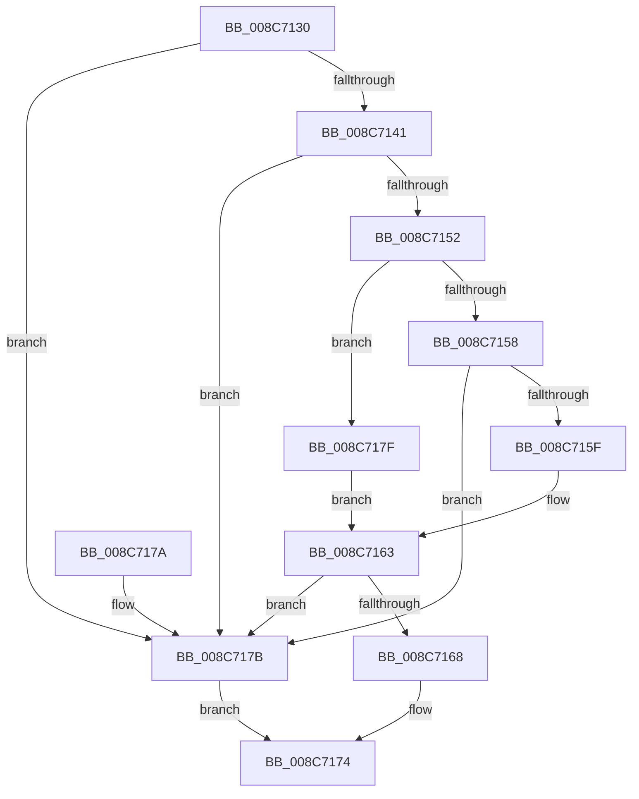

# CmpCheckKeyOwnerForPca

- RVA: `0x008C7130`–`0x008C7185` (길이 `85` bytes)
- VA: `0x00000001408C7130`
- 실행 섹션: `PAGE`
- PDB 이름 있음: `예`; PDB Function 태그: `아니요`
- unwind 정보 RVA: `0x00064CA8`
- 디코드: `28`개 명령, `85/85` bytes 표시
- 미해석 바이트: `0` (있으면 어셈블리에 `.byte`로 보존)

> 이 문서는 커널 이미지의 기계어와 PDB 기호를 분석해 생성했습니다. 4번과 5번은 함수 원형과 자료형을 바이너리 사용 방식에서 추정한 C 해석이며 원본 소스 복구 결과는 아닙니다.

## 1. Dependencies

- 직접 호출 지점: **2**; 고유 호출 대상: **2**
- 직접 호출자로 확인된 함수: **2**
- RIP 상대 이미지 참조: **1**

### Outgoing calls
- `0x008C7144` → [CmpGetSecurityCacheEntryForKcbStack](CmpGetSecurityCacheEntryForKcbStack_function_008C7580.md) (function, `0x008C7580`)
- `0x008C716F` → [RtlEqualSid](../../text/40/RtlEqualSid_function_00400AD0.md) (function, `0x00400AD0`)

### Direct callers
- [CmpCheckOpenAccessOnKeyBody](../87/CmpCheckOpenAccessOnKeyBody_function_00870000.md) at `0x008707AE`
- [sub_00B16F66](../B1/Unknown_function_00B16F66.md) at `0x00B1713E`
- [sub_00B16F66](../B1/Unknown_function_00B16F66.md) at `0x00B17224`

### Static image references
- `0x008C7138` → RVA `0x00FD8070` (`PAGEDATA`; read)

## 2. Other-region calls and transfers

- 다른 실행 섹션으로 향하는 call: **1**
  - `0x008C716F` → [RtlEqualSid](../../text/40/RtlEqualSid_function_00400AD0.md) (`PAGE` → `.text`)
- 별도 외부 분기/꼬리 이동을 확인하지 못했습니다.

## 3. Assembly (complete function range)

```asm
008C7130  40 53                           push rbx
008C7132  48 83 EC 20                     sub rsp, 0x20
008C7136  33 DB                           xor ebx, ebx
008C7138  48 39 1D 31 0F 71 00            cmp qword ptr [rip + 0x710f31], rbx
008C713F  74 3A                           je 0x1408c717b
008C7141  45 33 C0                        xor r8d, r8d
008C7144  E8 37 04 00 00                  call 0x1408c7580
008C7149  48 83 C0 20                     add rax, 0x20
008C714D  80 38 01                        cmp byte ptr [rax], 1
008C7150  75 29                           jne 0x1408c717b
008C7152  66 39 58 02                     cmp word ptr [rax + 2], bx
008C7156  7D 27                           jge 0x1408c717f
008C7158  8B 48 04                        mov ecx, dword ptr [rax + 4]
008C715B  85 C9                           test ecx, ecx
008C715D  74 1C                           je 0x1408c717b
008C715F  48 8D 14 08                     lea rdx, [rax + rcx]
008C7163  48 85 D2                        test rdx, rdx
008C7166  74 13                           je 0x1408c717b
008C7168  48 8B 0D 01 0F 71 00            mov rcx, qword ptr [rip + 0x710f01]
008C716F  E8 5C 99 B3 FF                  call 0x140400ad0
008C7174  48 83 C4 20                     add rsp, 0x20
008C7178  5B                              pop rbx
008C7179  C3                              ret
008C717A  CC                              int3
008C717B  32 C0                           xor al, al
008C717D  EB F5                           jmp 0x1408c7174
008C717F  48 8B 50 08                     mov rdx, qword ptr [rax + 8]
008C7183  EB DE                           jmp 0x1408c7163
```

## 4. C-style interpretation (structured pseudocode)

```c
__int64 __fastcall CmpCheckKeyOwnerForPca(__int64 a1, __int64 a2, int a3)
{
    __int64 result;
    __int64 v_rbx;
    __int64 v_rsp;

    v_rsp = (v_rsp) - (32);
    v_rbx = 0;
    if ((*(unsigned __int64 *)(v_rip + 7409457)) == 0) goto loc_008C717B;
    a3 = 0;
    result = CmpGetSecurityCacheEntryForKcbStack(a1, a2, a3, a4);
    result = (result) + (32);
    if ((*(unsigned __int8 *)(result)) != 1) goto loc_008C717B;
    if ((*(unsigned __int16 *)(result + 2)) >= 0) goto loc_008C717F;
    if ((unsigned int)((unsigned int)(*(unsigned int *)(result + 4))) == 0) goto loc_008C717B;
loc_008C7163:
    if (result + (unsigned int)(*(unsigned int *)(result + 4)) * 1 == 0) goto loc_008C717B;
    result = RtlEqualSid(*(unsigned __int64 *)(v_rip + 7409409), result + (unsigned int)(*(unsigned int *)(result + 4)) * 1, a3, a4);
loc_008C7174:
    v_rsp = (v_rsp) + (32);
    return result;
loc_008C717B:
    result = 0;
    goto loc_008C7174;
loc_008C717F:
    goto loc_008C7163;
}
```

## 5. (Beta) C Style

```c
int64_t CmpCheckKeyOwnerForPca(int64_t Arg1, int64_t Arg2, int32_t Arg3)
{
    int64_t result;
    int64_t local_rbx;
    int64_t local_rsp;

    local_rsp = (local_rsp) - (32);
    local_rbx = 0;
    if ((*(uint64_t *)(v_rip + 0x710F31)) == 0) goto loc_008C717B;
    Arg3 = 0;
    result = CmpGetSecurityCacheEntryForKcbStack(Arg1, Arg2, Arg3, a4);
    result = (result) + (32);
    if ((*(uint8_t *)(result)) != 1) goto loc_008C717B;
    if ((*(uint16_t *)(result + 0x2)) >= 0) goto loc_008C717F;
    if ((uint32_t)((uint32_t)(*(uint32_t *)(result + 0x4))) == 0) goto loc_008C717B;
loc_008C7163:
    if (result + (uint32_t)(*(uint32_t *)(result + 0x4)) * 1 == 0) goto loc_008C717B;
    result = RtlEqualSid(*(uint64_t *)(v_rip + 0x710F01), result + (uint32_t)(*(uint32_t *)(result + 0x4)) * 1, Arg3, a4);
loc_008C7174:
    local_rsp = (local_rsp) + (32);
    return result;
loc_008C717B:
    result = 0;
    goto loc_008C7174;
loc_008C717F:
    goto loc_008C7163;
}
```

## 6. Execution-region graph

[열기: 2D/3D 그래프와 함수 탐색 컨트롤 패널](../../../control-panel.html?section=page&rva=0x008C7130&view=graph)

- 2D 그래프는 위에서 아래로 흐르고, 3D 그래프는 빈 공간을 드래그해 회전합니다. Shift+드래그는 이동, 휠은 확대·축소, 함수 노드 선택은 대상 보고서 이동입니다.

### Static fallback


