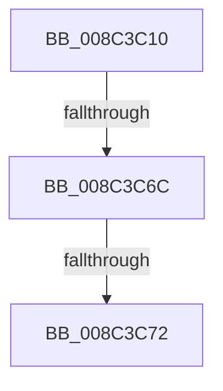

# CmpCreateKeyBody

- RVA: `0x008C3C10`–`0x008C3C89` (길이 `121` bytes)
- VA: `0x00000001408C3C10`
- 실행 섹션: `PAGE`
- PDB 이름 있음: `예`; PDB Function 태그: `아니요`
- unwind 정보 RVA: `0x00083900`
- 디코드: `33`개 명령, `121/121` bytes 표시
- 미해석 바이트: `0` (있으면 어셈블리에 `.byte`로 보존)

> 이 문서는 커널 이미지의 기계어와 PDB 기호를 분석해 생성했습니다. 4번과 5번은 함수 원형과 자료형을 바이너리 사용 방식에서 추정한 C 해석이며 원본 소스 복구 결과는 아닙니다.

## 1. Dependencies

- 직접 호출 지점: **1**; 고유 호출 대상: **1**
- 직접 호출자로 확인된 함수: **2**
- RIP 상대 이미지 참조: **0**

### Outgoing calls
- `0x008C3C83` → [KeBugCheckEx](../../text/4F/KeBugCheckEx_function_004FD660.md) (function, `0x004FD660`)

### Direct callers
- [CmpDoParseKey](../85/CmpDoParseKey_function_0085F750.md) at `0x008608E1`
- [CmpDoParseKey](../85/CmpDoParseKey_function_0085F750.md) at `0x00860C98`
- [CmpDoParseKey](../85/CmpDoParseKey_function_0085F750.md) at `0x00861224`
- [CmpDoParseKey](../85/CmpDoParseKey_function_0085F750.md) at `0x00861672`
- [CmpStartSiloRegistryNamespace](../9E/CmpStartSiloRegistryNamespace_function_009E85D0.md) at `0x009E873A`

### Static image references
- 디코드된 RIP-relative 메모리 참조가 없습니다.

## 2. Other-region calls and transfers

- 다른 실행 섹션으로 향하는 call: **1**
  - `0x008C3C83` → [KeBugCheckEx](../../text/4F/KeBugCheckEx_function_004FD660.md) (`PAGE` → `.text`)
- call이 아닌 외부 분기/꼬리 이동: **2**
  - `0x008C3C66` → [sub_008C4045](Unknown_function_008C4045.md) (`tail-transfer`)
  - `0x008C3C70` → [sub_008C3C89](Unknown_function_008C3C89.md) (`tail-transfer`)

## 3. Assembly (complete function range)

```asm
008C3C10  4C 89 4C 24 20                  mov qword ptr [rsp + 0x20], r9
008C3C15  4C 89 44 24 18                  mov qword ptr [rsp + 0x18], r8
008C3C1A  48 89 4C 24 08                  mov qword ptr [rsp + 8], rcx
008C3C1F  53                              push rbx
008C3C20  55                              push rbp
008C3C21  57                              push rdi
008C3C22  41 54                           push r12
008C3C24  41 56                           push r14
008C3C26  41 57                           push r15
008C3C28  48 81 EC 88 00 00 00            sub rsp, 0x88
008C3C2F  44 8B A4 24 E0 00 00 00         mov r12d, dword ptr [rsp + 0xe0]
008C3C37  48 8B E9                        mov rbp, rcx
008C3C3A  33 C9                           xor ecx, ecx
008C3C3C  45 0F B6 F4                     movzx r14d, r12b
008C3C40  48 89 4C 24 48                  mov qword ptr [rsp + 0x48], rcx
008C3C45  8B D9                           mov ebx, ecx
008C3C47  48 89 4C 24 58                  mov qword ptr [rsp + 0x58], rcx
008C3C4C  41 80 E6 01                     and r14b, 1
008C3C50  49 8B F8                        mov rdi, r8
008C3C53  44 0F B6 FA                     movzx r15d, dl
008C3C57  B8 01 00 00 00                  mov eax, 1
008C3C5C  F0 48 0F C1 45 00               lock xadd qword ptr [rbp], rax
008C3C62  48 83 C0 01                     add rax, 1
008C3C66  0F 84 D9 03 00 00               je 0x1408c4045
008C3C6C  48 83 F8 01                     cmp rax, 1
008C3C70  75 17                           jne 0x1408c3c89
008C3C72  48 89 4C 24 20                  mov qword ptr [rsp + 0x20], rcx
008C3C77  8D 51 15                        lea edx, [rcx + 0x15]
008C3C7A  8D 4B 51                        lea ecx, [rbx + 0x51]
008C3C7D  45 33 C9                        xor r9d, r9d
008C3C80  45 33 C0                        xor r8d, r8d
008C3C83  E8 D8 99 C3 FF                  call 0x1404fd660
008C3C88  CC                              int3
```

## 4. C-style interpretation (structured pseudocode)

```c
__int64 __fastcall CmpCreateKeyBody(__int64 a1, unsigned __int8 a2, __int64 a3, __int64 a4, unsigned int a5)
{
    __int64 result;
    __int64 v_r14;
    __int64 v_rsp;
    unsigned __int64 v_stack_m60;
    unsigned __int64 v_stack_m70;
    unsigned __int64 v_stack_m98;
    unsigned __int64 v_stack_p18;
    unsigned __int64 v_stack_p20;
    unsigned __int64 v_stack_p8;

    v_stack_p20 = a4;
    v_stack_p18 = a3;
    v_stack_p8 = a1;
    v_rsp = (v_rsp) - (136);
    a1 = 0;
    v_stack_m70 = 0;
    v_stack_m60 = 0;
    v_r14 = (unsigned __int8)(((unsigned __int8)((unsigned int)(a5))) & (1));
    result = (1) + (1);
    v_stack_m98 = 0;
    a4 = 0;
    a3 = 0;
    result = KeBugCheckEx(0 + 81, a1 + 21, a3, a4);
    return result;
}
```

## 5. (Beta) C Style

```c
int64_t CmpCreateKeyBody(void *Arg1, uint8_t Arg2, int64_t Arg3, int64_t Arg4, uint32_t Arg5)
{
    uint8_t *arg1 = (uint8_t *)Arg1;

    int64_t result;
    int64_t local_r14;
    int64_t local_rsp;
    uint64_t v_stack_m60;
    uint64_t v_stack_m70;
    uint64_t v_stack_m98;
    uint64_t v_stack_p18;
    uint64_t v_stack_p20;
    uint64_t v_stack_p8;

    v_stack_p20 = Arg4;
    v_stack_p18 = Arg3;
    v_stack_p8 = Arg1;
    local_rsp = (local_rsp) - (136);
    Arg1 = 0;
    v_stack_m70 = 0;
    v_stack_m60 = 0;
    local_r14 = (uint8_t)(((uint8_t)((uint32_t)(Arg5))) & (1));
    result = (1) + (1);
    v_stack_m98 = 0;
    Arg4 = 0;
    Arg3 = 0;
    result = KeBugCheckEx(0 + 81, Arg1 + 21, Arg3, Arg4);
    return result;
}
```

### 관측된 메모리 오프셋

구조체 형식이 확인되지 않은 접근은 인자 기준의 오프셋으로만 기록했습니다.

| 기준 인자 | 오프셋 표현 | 폭 (bit) | 접근 |
|---|---:|---:|---|
| `Arg1` | `+ 0x0` | `64` | `R/W` |

## 6. Execution-region graph

[열기: 2D/3D 그래프와 함수 탐색 컨트롤 패널](../../../control-panel.html?section=page&rva=0x008C3C10&view=graph)

- 2D 그래프는 위에서 아래로 흐르고, 3D 그래프는 빈 공간을 드래그해 회전합니다. Shift+드래그는 이동, 휠은 확대·축소, 함수 노드 선택은 대상 보고서 이동입니다.

### Static fallback


