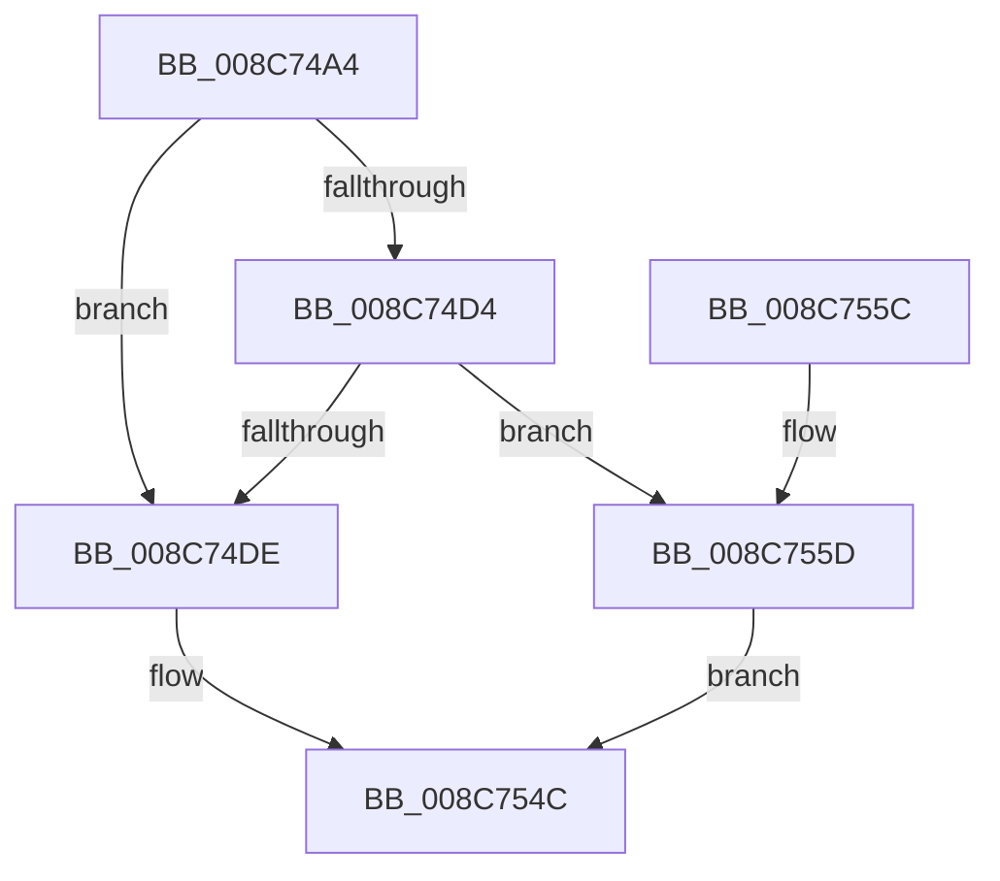

# CmpNotifyTriggerCheck

- RVA: `0x008C74A4`–`0x008C756D` (길이 `201` bytes)
- VA: `0x00000001408C74A4`
- 실행 섹션: `PAGE`
- PDB 이름 있음: `예`; PDB Function 태그: `아니요`
- unwind 정보 RVA: `0x00083E3C`
- 디코드: `49`개 명령, `201/201` bytes 표시
- 미해석 바이트: `0` (있으면 어셈블리에 `.byte`로 보존)

> 이 문서는 커널 이미지의 기계어와 PDB 기호를 분석해 생성했습니다. 4번과 5번은 함수 원형과 자료형을 바이너리 사용 방식에서 추정한 C 해석이며 원본 소스 복구 결과는 아닙니다.

## 1. Dependencies

- 직접 호출 지점: **5**; 고유 호출 대상: **4**
- 직접 호출자로 확인된 함수: **1**
- RIP 상대 이미지 참조: **2**

### Outgoing calls
- `0x008C74C3` → [ExAcquireFastMutexUnsafe](../../text/3F/ExAcquireFastMutexUnsafe_function_003F3720.md) (function, `0x003F3720`)
- `0x008C74E5` → [ExReleaseFastMutexUnsafe](../../text/25/ExReleaseFastMutexUnsafe_function_002503A0.md) (function, `0x002503A0`)
- `0x008C74FD` → [CmpGetSecurityCacheEntryForKcbStack](CmpGetSecurityCacheEntryForKcbStack_function_008C7580.md) (function, `0x008C7580`)
- `0x008C7547` → [SeAccessCheck](../../text/3A/SeAccessCheck_function_003A6BC0.md) (function, `0x003A6BC0`)
- `0x008C7564` → [ExReleaseFastMutexUnsafe](../../text/25/ExReleaseFastMutexUnsafe_function_002503A0.md) (function, `0x002503A0`)

### Direct callers
- [sub_008C73D5](Unknown_function_008C73D5.md) at `0x008C73F7`

### Static image references
- `0x008C74B9` → RVA `0x00EF5940` (`.data`; read)
- `0x008C7502` → RVA `0x00FC6AC0` (`ALMOSTRO`; read)

## 2. Other-region calls and transfers

- 다른 실행 섹션으로 향하는 call: **4**
  - `0x008C74C3` → [ExAcquireFastMutexUnsafe](../../text/3F/ExAcquireFastMutexUnsafe_function_003F3720.md) (`PAGE` → `.text`)
  - `0x008C74E5` → [ExReleaseFastMutexUnsafe](../../text/25/ExReleaseFastMutexUnsafe_function_002503A0.md) (`PAGE` → `.text`)
  - `0x008C7547` → [SeAccessCheck](../../text/3A/SeAccessCheck_function_003A6BC0.md) (`PAGE` → `.text`)
  - `0x008C7564` → [ExReleaseFastMutexUnsafe](../../text/25/ExReleaseFastMutexUnsafe_function_002503A0.md) (`PAGE` → `.text`)
- 별도 외부 분기/꼬리 이동을 확인하지 못했습니다.

## 3. Assembly (complete function range)

```asm
008C74A4  48 89 5C 24 10                  mov qword ptr [rsp + 0x10], rbx
008C74A9  48 89 74 24 18                  mov qword ptr [rsp + 0x18], rsi
008C74AE  57                              push rdi
008C74AF  48 83 EC 50                     sub rsp, 0x50
008C74B3  48 8B D9                        mov rbx, rcx
008C74B6  49 8B F8                        mov rdi, r8
008C74B9  48 8D 0D 80 E4 62 00            lea rcx, [rip + 0x62e480]
008C74C0  48 8B F2                        mov rsi, rdx
008C74C3  E8 58 C2 B2 FF                  call 0x1403f3720
008C74C8  48 8D 43 10                     lea rax, [rbx + 0x10]
008C74CC  4C 8B 08                        mov r9, qword ptr [rax]
008C74CF  4C 3B C8                        cmp r9, rax
008C74D2  74 0A                           je 0x1408c74de
008C74D4  41 8B 41 38                     mov eax, dword ptr [r9 + 0x38]
008C74D8  66 83 F8 03                     cmp ax, 3
008C74DC  74 7F                           je 0x1408c755d
008C74DE  48 8D 0D 5B E4 62 00            lea rcx, [rip + 0x62e45b]
008C74E5  E8 B6 8E 98 FF                  call 0x1402503a0
008C74EA  83 64 24 60 00                  and dword ptr [rsp + 0x60], 0
008C74EF  45 33 C0                        xor r8d, r8d
008C74F2  83 64 24 78 00                  and dword ptr [rsp + 0x78], 0
008C74F7  48 8B D7                        mov rdx, rdi
008C74FA  48 8B CE                        mov rcx, rsi
008C74FD  E8 7E 00 00 00                  call 0x1408c7580
008C7502  4C 8B 05 B7 F5 6F 00            mov r8, qword ptr [rip + 0x6ff5b7]
008C7509  48 8D 53 38                     lea rdx, [rbx + 0x38]
008C750D  49 83 C0 4C                     add r8, 0x4c
008C7511  41 B9 10 00 00 00               mov r9d, 0x10
008C7517  48 8D 48 20                     lea rcx, [rax + 0x20]
008C751B  48 8D 44 24 60                  lea rax, [rsp + 0x60]
008C7520  48 89 44 24 48                  mov qword ptr [rsp + 0x48], rax
008C7525  48 8D 44 24 78                  lea rax, [rsp + 0x78]
008C752A  48 89 44 24 40                  mov qword ptr [rsp + 0x40], rax
008C752F  C6 44 24 38 01                  mov byte ptr [rsp + 0x38], 1
008C7534  4C 89 44 24 30                  mov qword ptr [rsp + 0x30], r8
008C7539  45 33 C0                        xor r8d, r8d
008C753C  48 83 64 24 28 00               and qword ptr [rsp + 0x28], 0
008C7542  83 64 24 20 00                  and dword ptr [rsp + 0x20], 0
008C7547  E8 74 F6 AD FF                  call 0x1403a6bc0
008C754C  48 8B 5C 24 68                  mov rbx, qword ptr [rsp + 0x68]
008C7551  48 8B 74 24 70                  mov rsi, qword ptr [rsp + 0x70]
008C7556  48 83 C4 50                     add rsp, 0x50
008C755A  5F                              pop rdi
008C755B  C3                              ret
008C755C  CC                              int3
008C755D  48 8D 0D DC E3 62 00            lea rcx, [rip + 0x62e3dc]
008C7564  E8 37 8E 98 FF                  call 0x1402503a0
008C7569  B0 01                           mov al, 1
008C756B  EB DF                           jmp 0x1408c754c
```

## 4. C-style interpretation (structured pseudocode)

```c
__int64 __fastcall CmpNotifyTriggerCheck(__int64 a1, __int64 a2, __int64 a3)
{
    __int64 result;
    __int64 v_rsp;
    unsigned __int64 v_stack_m10;
    unsigned __int64 v_stack_m18;
    unsigned __int8 v_stack_m20;
    unsigned __int64 v_stack_m28;
    unsigned __int64 v_stack_m30;
    unsigned int v_stack_m38;
    unsigned __int64 v_stack_p10;
    unsigned __int64 v_stack_p18;
    unsigned int v_stack_p20;
    unsigned int v_stack_p8;

    v_stack_p10 = v_rbx;
    v_stack_p18 = v_rsi;
    v_rsp = (v_rsp) - (80);
    result = ExAcquireFastMutexUnsafe(v_rip + 6481024, a2, a3, a4);
    if ((*(unsigned __int64 *)(a1 + 16)) == (a1 + 16)) goto loc_008C74DE;
    if (((unsigned __int16)((unsigned int)(*(unsigned int *)(*(unsigned __int64 *)(a1 + 16) + 56)))) == 3) goto loc_008C755D;
loc_008C74DE:
    result = ExReleaseFastMutexUnsafe(v_rip + 6480987, a2, a3, *(unsigned __int64 *)(a1 + 16));
    a3 = 0;
    result = CmpGetSecurityCacheEntryForKcbStack(a2, 0, a3, *(unsigned __int64 *)(a1 + 16));
    a3 = (*(unsigned __int64 *)(v_rip + 7337399)) + (76);
    v_stack_m10 = v_stack_p8;
    v_stack_m18 = v_stack_p20;
    v_stack_m20 = 1;
    v_stack_m28 = a3;
    a3 = 0;
    result = SeAccessCheck(result + 32, a1 + 56, a3, 16);
loc_008C754C:
    v_rsp = (v_rsp) + (80);
    return result;
loc_008C755D:
    result = ExReleaseFastMutexUnsafe(v_rip + 6480860, a1 + 56, a3, 16);
    goto loc_008C754C;
}
```

## 5. (Beta) C Style

```c
int64_t CmpNotifyTriggerCheck(void *Arg1, int64_t Arg2, int64_t Arg3)
{
    uint8_t *arg1 = (uint8_t *)Arg1;

    int64_t result;
    int64_t local_rsp;
    uint64_t v_stack_m10;
    uint64_t v_stack_m18;
    uint8_t v_stack_m20;
    uint64_t v_stack_m28;
    uint64_t v_stack_m30;
    uint32_t v_stack_m38;
    uint64_t v_stack_p10;
    uint64_t v_stack_p18;
    uint32_t v_stack_p20;
    uint32_t v_stack_p8;

    v_stack_p10 = local_rbx;
    v_stack_p18 = local_rsi;
    local_rsp = (local_rsp) - (80);
    result = ExAcquireFastMutexUnsafe(v_rip + 6481024, Arg2, Arg3, a4);
    if ((*(uint64_t *)(arg1 + 0x10)) == (Arg1 + 16)) goto loc_008C74DE;
    if (((uint16_t)((uint32_t)(*(uint32_t *)(*(uint64_t *)(arg1 + 0x10) + 0x38)))) == 3) goto loc_008C755D;
loc_008C74DE:
    result = ExReleaseFastMutexUnsafe(v_rip + 6480987, Arg2, Arg3, *(uint64_t *)(arg1 + 0x10));
    Arg3 = 0;
    result = CmpGetSecurityCacheEntryForKcbStack(Arg2, 0, Arg3, *(uint64_t *)(arg1 + 0x10));
    Arg3 = (*(uint64_t *)(v_rip + 0x6FF5B7)) + (76);
    v_stack_m10 = v_stack_p8;
    v_stack_m18 = v_stack_p20;
    v_stack_m20 = 1;
    v_stack_m28 = Arg3;
    Arg3 = 0;
    result = SeAccessCheck(result + 32, Arg1 + 56, Arg3, 16);
loc_008C754C:
    local_rsp = (local_rsp) + (80);
    return result;
loc_008C755D:
    result = ExReleaseFastMutexUnsafe(v_rip + 6480860, Arg1 + 56, Arg3, 16);
    goto loc_008C754C;
}
```

### 관측된 메모리 오프셋

구조체 형식이 확인되지 않은 접근은 인자 기준의 오프셋으로만 기록했습니다.

| 기준 인자 | 오프셋 표현 | 폭 (bit) | 접근 |
|---|---:|---:|---|
| `Arg1` | `+ 0x0` | `64` | `R` |
| `Arg1` | `+ 0x10` | `64` | `R` |
| `Arg1` | `+ 0x38` | `64` | `R` |

## 6. Execution-region graph

[열기: 2D/3D 그래프와 함수 탐색 컨트롤 패널](../../../control-panel.html?section=page&rva=0x008C74A4&view=graph)

- 2D 그래프는 위에서 아래로 흐르고, 3D 그래프는 빈 공간을 드래그해 회전합니다. Shift+드래그는 이동, 휠은 확대·축소, 함수 노드 선택은 대상 보고서 이동입니다.

### Static fallback


