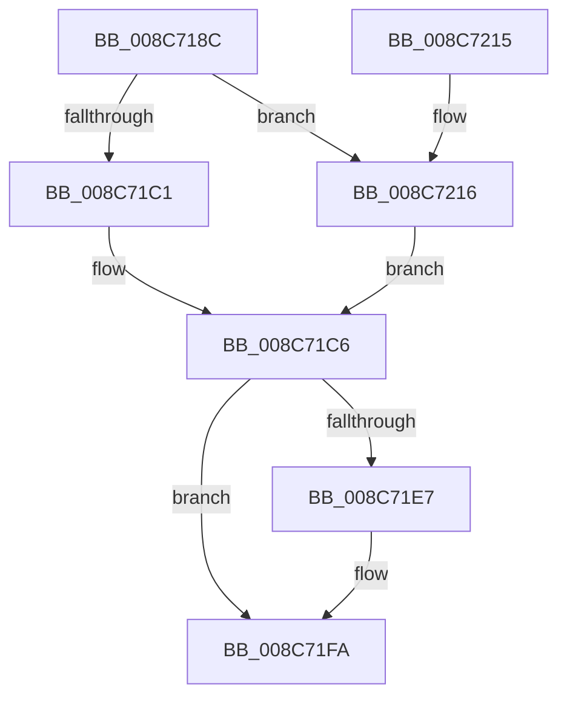

# CmpReportNotifyForKcbStack

- RVA: `0x008C718C`–`0x008C7221` (길이 `149` bytes)
- VA: `0x00000001408C718C`
- 실행 섹션: `PAGE`
- PDB 이름 있음: `예`; PDB Function 태그: `아니요`
- unwind 정보 RVA: `0x00083D00`
- 디코드: `41`개 명령, `149/149` bytes 표시
- 미해석 바이트: `0` (있으면 어셈블리에 `.byte`로 보존)

> 이 문서는 커널 이미지의 기계어와 PDB 기호를 분석해 생성했습니다. 4번과 5번은 함수 원형과 자료형을 바이너리 사용 방식에서 추정한 C 해석이며 원본 소스 복구 결과는 아닙니다.

## 1. Dependencies

- 직접 호출 지점: **2**; 고유 호출 대상: **1**
- 직접 호출자로 확인된 함수: **5**
- RIP 상대 이미지 참조: **1**

### Outgoing calls
- `0x008C71D5` → [CmpReportNotifyHelper](CmpReportNotifyHelper_function_008C7230.md) (function, `0x008C7230`)
- `0x008C71F5` → [CmpReportNotifyHelper](CmpReportNotifyHelper_function_008C7230.md) (function, `0x008C7230`)

### Direct callers
- [CmDeleteLayeredKey](../../text/41/CmDeleteLayeredKey_function_0041B598.md) at `0x0041B7AF`
- [sub_006ED542](../../text/6E/Unknown_function_006ED542.md) at `0x006ED614`
- [CmpReportNotify](CmpReportNotify_function_008C8094.md) at `0x008C80D1`
- [CmpCreateChild](../94/CmpCreateChild_function_0094817C.md) at `0x009487AF`
- [CmpCreateChild](../94/CmpCreateChild_function_0094817C.md) at `0x00948E14`
- [sub_00B16440](../B1/Unknown_function_00B16440.md) at `0x00B1650D`

### Static image references
- `0x008C71DA` → RVA `0x00FD9A90` (`PAGEDATA`; read)

## 2. Other-region calls and transfers

- 다른 실행 섹션으로 향하는 call: **0**
- 별도 외부 분기/꼬리 이동을 확인하지 못했습니다.

## 3. Assembly (complete function range)

```asm
008C718C  48 8B C4                        mov rax, rsp
008C718F  48 89 58 08                     mov qword ptr [rax + 8], rbx
008C7193  48 89 68 10                     mov qword ptr [rax + 0x10], rbp
008C7197  48 89 70 18                     mov qword ptr [rax + 0x18], rsi
008C719B  48 89 78 20                     mov qword ptr [rax + 0x20], rdi
008C719F  41 56                           push r14
008C71A1  48 83 EC 30                     sub rsp, 0x30
008C71A5  48 0F BF 41 02                  movsx rax, word ptr [rcx + 2]
008C71AA  49 8B F1                        mov rsi, r9
008C71AD  48 8B F8                        mov rdi, rax
008C71B0  41 8B E8                        mov ebp, r8d
008C71B3  4C 8B F2                        mov r14, rdx
008C71B6  48 8B D9                        mov rbx, rcx
008C71B9  0F AE E8                        lfence
008C71BC  83 F8 02                        cmp eax, 2
008C71BF  7D 55                           jge 0x1408c7216
008C71C1  48 8B 7C C1 08                  mov rdi, qword ptr [rcx + rax*8 + 8]
008C71C6  48 8B 57 20                     mov rdx, qword ptr [rdi + 0x20]
008C71CA  44 8B CD                        mov r9d, ebp
008C71CD  4D 8B C6                        mov r8, r14
008C71D0  48 89 74 24 20                  mov qword ptr [rsp + 0x20], rsi
008C71D5  E8 56 00 00 00                  call 0x1408c7230
008C71DA  48 8B 15 AF 28 71 00            mov rdx, qword ptr [rip + 0x7128af]
008C71E1  48 39 57 20                     cmp qword ptr [rdi + 0x20], rdx
008C71E5  74 13                           je 0x1408c71fa
008C71E7  44 8B CD                        mov r9d, ebp
008C71EA  48 89 74 24 20                  mov qword ptr [rsp + 0x20], rsi
008C71EF  4D 8B C6                        mov r8, r14
008C71F2  48 8B CB                        mov rcx, rbx
008C71F5  E8 36 00 00 00                  call 0x1408c7230
008C71FA  48 8B 5C 24 40                  mov rbx, qword ptr [rsp + 0x40]
008C71FF  48 8B 6C 24 48                  mov rbp, qword ptr [rsp + 0x48]
008C7204  48 8B 74 24 50                  mov rsi, qword ptr [rsp + 0x50]
008C7209  48 8B 7C 24 58                  mov rdi, qword ptr [rsp + 0x58]
008C720E  48 83 C4 30                     add rsp, 0x30
008C7212  41 5E                           pop r14
008C7214  C3                              ret
008C7215  CC                              int3
008C7216  48 8B 41 18                     mov rax, qword ptr [rcx + 0x18]
008C721A  48 8B 7C F8 F0                  mov rdi, qword ptr [rax + rdi*8 - 0x10]
008C721F  EB A5                           jmp 0x1408c71c6
```

## 4. C-style interpretation (structured pseudocode)

```c
__int64 __fastcall CmpReportNotifyForKcbStack(__int64 a1, __int64 a2, int a3, __int64 a4)
{
    __int64 result;
    __int64 v_rsp;
    unsigned __int64 v_stack_m18;
    unsigned __int64 v_stack_p10;
    unsigned __int64 v_stack_p18;
    unsigned __int64 v_stack_p20;
    unsigned __int64 v_stack_p8;

    *(unsigned __int64 *)(v_rsp + 8) = v_rbx;
    *(unsigned __int64 *)(v_rsp + 16) = v_rbp;
    *(unsigned __int64 *)(v_rsp + 24) = v_rsi;
    *(unsigned __int64 *)(v_rsp + 32) = v_rdi;
    v_rsp = (v_rsp) - (48);
    if (((unsigned int)((__int16)(*(unsigned __int16 *)(a1 + 2)))) >= 2) goto loc_008C7216;
loc_008C71C6:
    v_stack_m18 = a4;
    result = CmpReportNotifyHelper(a1, *(unsigned __int64 *)(*(unsigned __int64 *)(a1 + (__int16)(*(unsigned __int16 *)(a1 + 2)) * 8 + 8) + 32), a2, (unsigned int)((unsigned int)((unsigned int)(a3))));
    if ((*(unsigned __int64 *)(*(unsigned __int64 *)(a1 + (__int16)(*(unsigned __int16 *)(a1 + 2)) * 8 + 8) + 32)) != (*(unsigned __int64 *)(v_rip + 7415983))) {
        a4 = (unsigned int)((unsigned int)(a3));
        v_stack_m18 = a4;
        a3 = a2;
        a1 = a1;
        result = CmpReportNotifyHelper(a1, *(unsigned __int64 *)(v_rip + 7415983), a3, a4);
    }
    v_rsp = (v_rsp) + (48);
    return result;
loc_008C7216:
    goto loc_008C71C6;
}
```

## 5. (Beta) C Style

```c
int64_t CmpReportNotifyForKcbStack(void *Arg1, int64_t Arg2, int32_t Arg3, int64_t Arg4)
{
    uint8_t *arg1 = (uint8_t *)Arg1;

    int64_t result;
    int64_t local_rsp;
    uint64_t v_stack_m18;
    uint64_t v_stack_p10;
    uint64_t v_stack_p18;
    uint64_t v_stack_p20;
    uint64_t v_stack_p8;

    *(uint64_t *)(local_rsp + 0x8) = local_rbx;
    *(uint64_t *)(local_rsp + 0x10) = local_rbp;
    *(uint64_t *)(local_rsp + 0x18) = local_rsi;
    *(uint64_t *)(local_rsp + 0x20) = local_rdi;
    local_rsp = (local_rsp) - (48);
    if (((uint32_t)((int16_t)(*(uint16_t *)(arg1 + 0x2)))) >= 2) goto loc_008C7216;
loc_008C71C6:
    v_stack_m18 = Arg4;
    result = CmpReportNotifyHelper(Arg1, *(uint64_t *)(*(uint64_t *)(arg1 + (int16_t)(*(uint16_t *)(arg1 + 0x2)) * 8 + 0x8) + 0x20), Arg2, (uint32_t)((uint32_t)((uint32_t)(Arg3))));
    if ((*(uint64_t *)(*(uint64_t *)(arg1 + (int16_t)(*(uint16_t *)(arg1 + 0x2)) * 8 + 0x8) + 0x20)) != (*(uint64_t *)(v_rip + 0x7128AF))) {
        Arg4 = (uint32_t)((uint32_t)(Arg3));
        v_stack_m18 = Arg4;
        Arg3 = Arg2;
        Arg1 = Arg1;
        result = CmpReportNotifyHelper(Arg1, *(uint64_t *)(v_rip + 0x7128AF), Arg3, Arg4);
    }
    local_rsp = (local_rsp) + (48);
    return result;
loc_008C7216:
    goto loc_008C71C6;
}
```

### 관측된 메모리 오프셋

구조체 형식이 확인되지 않은 접근은 인자 기준의 오프셋으로만 기록했습니다.

| 기준 인자 | 오프셋 표현 | 폭 (bit) | 접근 |
|---|---:|---:|---|
| `Arg1` | `+ 0x2` | `16` | `R` |
| `Arg1` | `+ 0x8 + rax*8` | `64` | `R` |
| `Arg1` | `+ 0x18` | `64` | `R` |

## 6. Execution-region graph

[열기: 2D/3D 그래프와 함수 탐색 컨트롤 패널](../../../control-panel.html?section=page&rva=0x008C718C&view=graph)

- 2D 그래프는 위에서 아래로 흐르고, 3D 그래프는 빈 공간을 드래그해 회전합니다. Shift+드래그는 이동, 휠은 확대·축소, 함수 노드 선택은 대상 보고서 이동입니다.

### Static fallback


