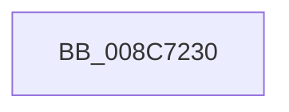

# CmpReportNotifyHelper

- RVA: `0x008C7230`–`0x008C7238` (길이 `8` bytes)
- VA: `0x00000001408C7230`
- 실행 섹션: `PAGE`
- PDB 이름 있음: `예`; PDB Function 태그: `아니요`
- unwind 정보 RVA: `0x00083D1C`
- 디코드: `3`개 명령, `8/8` bytes 표시
- 미해석 바이트: `0` (있으면 어셈블리에 `.byte`로 보존)

> 이 문서는 커널 이미지의 기계어와 PDB 기호를 분석해 생성했습니다. 4번과 5번은 함수 원형과 자료형을 바이너리 사용 방식에서 추정한 C 해석이며 원본 소스 복구 결과는 아닙니다.

## 1. Dependencies

- 직접 호출 지점: **0**; 고유 호출 대상: **0**
- 직접 호출자로 확인된 함수: **7**
- RIP 상대 이미지 참조: **0**

### Outgoing calls
- 직접 디코드된 call 명령이 없습니다.

### Direct callers
- [CmSetValueKey](../84/CmSetValueKey_function_008457C0.md) at `0x00845EB6`
- [CmSetValueKey](../84/CmSetValueKey_function_008457C0.md) at `0x00845EDF`
- [CmDeleteValueKey](../84/CmDeleteValueKey_function_008476E8.md) at `0x00847BF3`
- [CmDeleteValueKey](../84/CmDeleteValueKey_function_008476E8.md) at `0x00847C1A`
- [CmDeleteKey](../84/CmDeleteKey_function_00848E5C.md) at `0x008491FA`
- [CmDeleteKey](../84/CmDeleteKey_function_00848E5C.md) at `0x00849223`
- [CmDeleteKey](../84/CmDeleteKey_function_00848E5C.md) at `0x008495C1`
- [CmDeleteKey](../84/CmDeleteKey_function_00848E5C.md) at `0x008495EC`
- [CmpReportNotifyForKcbStack](CmpReportNotifyForKcbStack_function_008C718C.md) at `0x008C71D5`
- [CmpReportNotifyForKcbStack](CmpReportNotifyForKcbStack_function_008C718C.md) at `0x008C71F5`
- [CmpSetKeySecurity](../94/CmpSetKeySecurity_function_0094A124.md) at `0x0094A3E8`
- [CmpSetKeySecurity](../94/CmpSetKeySecurity_function_0094A124.md) at `0x0094A412`
- [CmpPerformUnloadKey](../9A/CmpPerformUnloadKey_function_009AFA28.md) at `0x009AFB46`
- [CmpPerformUnloadKey](../9A/CmpPerformUnloadKey_function_009AFA28.md) at `0x009AFB6E`
- [CmpProcessLightWeightUOW](../9B/CmpProcessLightWeightUOW_function_009B0EAC.md) at `0x009B0FC7`
- [CmpProcessLightWeightUOW](../9B/CmpProcessLightWeightUOW_function_009B0EAC.md) at `0x009B0FEF`

### Static image references
- 디코드된 RIP-relative 메모리 참조가 없습니다.

## 2. Other-region calls and transfers

- 다른 실행 섹션으로 향하는 call: **0**
- 별도 외부 분기/꼬리 이동을 확인하지 못했습니다.

## 3. Assembly (complete function range)

```asm
008C7230  4C 8B DC                        mov r11, rsp
008C7233  53                              push rbx
008C7234  48 83 EC 70                     sub rsp, 0x70
```

## 4. C-style interpretation (structured pseudocode)

```c
void __fastcall CmpReportNotifyHelper(void)
{
    __int64 v_rsp;

    v_rsp = (v_rsp) - (112);
    return;
}
```

## 5. (Beta) C Style

```c
void CmpReportNotifyHelper(void)
{
    int64_t local_rsp;

    local_rsp = (local_rsp) - (112);
    return;
}
```

## 6. Execution-region graph

[열기: 2D/3D 그래프와 함수 탐색 컨트롤 패널](../../../control-panel.html?section=page&rva=0x008C7230&view=graph)

- 2D 그래프는 위에서 아래로 흐르고, 3D 그래프는 빈 공간을 드래그해 회전합니다. Shift+드래그는 이동, 휠은 확대·축소, 함수 노드 선택은 대상 보고서 이동입니다.

### Static fallback


