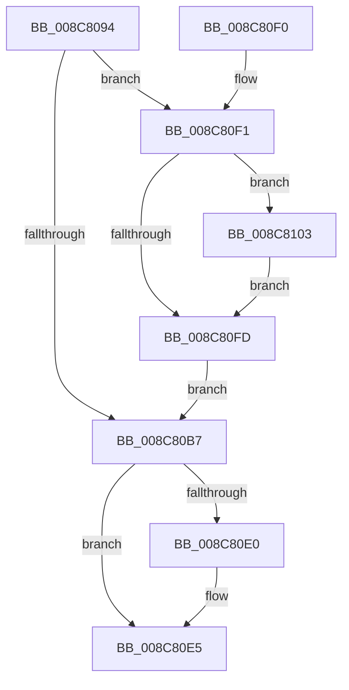

# CmpReportNotify

- RVA: `0x008C8094`–`0x008C8109` (길이 `117` bytes)
- VA: `0x00000001408C8094`
- 실행 섹션: `PAGE`
- PDB 이름 있음: `예`; PDB Function 태그: `아니요`
- unwind 정보 RVA: `0x00084014`
- 디코드: `33`개 명령, `117/117` bytes 표시
- 미해석 바이트: `0` (있으면 어셈블리에 `.byte`로 보존)

> 이 문서는 커널 이미지의 기계어와 PDB 기호를 분석해 생성했습니다. 4번과 5번은 함수 원형과 자료형을 바이너리 사용 방식에서 추정한 C 해석이며 원본 소스 복구 결과는 아닙니다.

## 1. Dependencies

- 직접 호출 지점: **3**; 고유 호출 대상: **3**
- 직접 호출자로 확인된 함수: **3**
- RIP 상대 이미지 참조: **0**

### Outgoing calls
- `0x008C80BF` → [CmpStartKcbStackForTopLayerKcb](../84/CmpStartKcbStackForTopLayerKcb_function_00848390.md) (function, `0x00848390`)
- `0x008C80D1` → [CmpReportNotifyForKcbStack](CmpReportNotifyForKcbStack_function_008C718C.md) (function, `0x008C718C`)
- `0x008C80E0` → [CmSiFreeMemory](../../text/47/CmSiFreeMemory_function_00475D80.md) (function, `0x00475D80`)

### Direct callers
- [CmRestoreKey](../7D/CmRestoreKey_function_007DCF04.md) at `0x007DDA4E`
- [CmRenameKey](../7E/CmRenameKey_function_007E8F48.md) at `0x007E920C`
- [sub_00B2DAE6](../B2/Unknown_function_00B2DAE6.md) at `0x00B2DAF4`
- [sub_00B2DAE6](../B2/Unknown_function_00B2DAE6.md) at `0x00B2DB2B`
- [sub_00B2DAE6](../B2/Unknown_function_00B2DAE6.md) at `0x00B2DB4C`

### Static image references
- 디코드된 RIP-relative 메모리 참조가 없습니다.

## 2. Other-region calls and transfers

- 다른 실행 섹션으로 향하는 call: **1**
  - `0x008C80E0` → [CmSiFreeMemory](../../text/47/CmSiFreeMemory_function_00475D80.md) (`PAGE` → `.text`)
- 별도 외부 분기/꼬리 이동을 확인하지 못했습니다.

## 3. Assembly (complete function range)

```asm
008C8094  48 89 5C 24 08                  mov qword ptr [rsp + 8], rbx
008C8099  57                              push rdi
008C809A  48 83 EC 40                     sub rsp, 0x40
008C809E  0F 57 C0                        xorps xmm0, xmm0
008C80A1  49 8B F9                        mov rdi, r9
008C80A4  41 8B D8                        mov ebx, r8d
008C80A7  0F 11 44 24 20                  movups xmmword ptr [rsp + 0x20], xmm0
008C80AC  0F 11 44 24 30                  movups xmmword ptr [rsp + 0x30], xmm0
008C80B1  41 83 F8 01                     cmp r8d, 1
008C80B5  74 3A                           je 0x1408c80f1
008C80B7  48 8B D1                        mov rdx, rcx
008C80BA  48 8D 4C 24 20                  lea rcx, [rsp + 0x20]
008C80BF  E8 CC 02 F8 FF                  call 0x140848390
008C80C4  4C 8B CF                        mov r9, rdi
008C80C7  48 8D 4C 24 20                  lea rcx, [rsp + 0x20]
008C80CC  44 8B C3                        mov r8d, ebx
008C80CF  33 D2                           xor edx, edx
008C80D1  E8 B6 F0 FF FF                  call 0x1408c718c
008C80D6  48 8B 4C 24 38                  mov rcx, qword ptr [rsp + 0x38]
008C80DB  48 85 C9                        test rcx, rcx
008C80DE  74 05                           je 0x1408c80e5
008C80E0  E8 9B DC BA FF                  call 0x140475d80
008C80E5  48 8B 5C 24 50                  mov rbx, qword ptr [rsp + 0x50]
008C80EA  48 83 C4 40                     add rsp, 0x40
008C80EE  5F                              pop rdi
008C80EF  C3                              ret
008C80F0  CC                              int3
008C80F1  F7 81 B8 00 00 00 00 00 04 00   test dword ptr [rcx + 0xb8], 0x40000
008C80FB  75 06                           jne 0x1408c8103
008C80FD  48 8B 49 48                     mov rcx, qword ptr [rcx + 0x48]
008C8101  EB B4                           jmp 0x1408c80b7
008C8103  48 8B 49 48                     mov rcx, qword ptr [rcx + 0x48]
008C8107  EB F4                           jmp 0x1408c80fd
```

## 4. C-style interpretation (structured pseudocode)

```c
__int64 __fastcall CmpReportNotify(__int64 a1, __int64 a2, int a3, __int64 a4)
{
    __int64 result;
    __int64 v_rsp;
    unsigned __int64 v_stack_m10;
    unsigned __int64 v_stack_m18;
    unsigned __int64 v_stack_m28;
    unsigned __int64 v_stack_p8;

    v_stack_p8 = v_rbx;
    v_rsp = (v_rsp) - (64);
    v_stack_m28 = v_xmm0;
    v_stack_m18 = v_xmm0;
    if (a3 == 1) goto loc_008C80F1;
loc_008C80B7:
    result = CmpStartKcbStackForTopLayerKcb(v_stack_m28, a1, a3, a4);
    a2 = 0;
    result = CmpReportNotifyForKcbStack(v_stack_m28, a2, (unsigned int)((unsigned int)((unsigned int)(a3))), a4);
    if (v_stack_m10 != 0) {
        result = CmSiFreeMemory(v_stack_m10, a2, (unsigned int)((unsigned int)((unsigned int)(a3))), a4);
    }
    v_rsp = (v_rsp) + (64);
    return result;
loc_008C80F1:
    if (((*(unsigned int *)(v_stack_m10 + 184)) & (0x40000ULL)) != 0) goto loc_008C8103;
loc_008C80FD:
    goto loc_008C80B7;
loc_008C8103:
    goto loc_008C80FD;
}
```

## 5. (Beta) C Style

```c
int64_t CmpReportNotify(void *Arg1, int64_t Arg2, int32_t Arg3, int64_t Arg4)
{
    uint8_t *arg1 = (uint8_t *)Arg1;

    int64_t result;
    int64_t local_rsp;
    uint64_t v_stack_m10;
    uint64_t v_stack_m18;
    uint64_t v_stack_m28;
    uint64_t v_stack_p8;

    v_stack_p8 = local_rbx;
    local_rsp = (local_rsp) - (64);
    v_stack_m28 = v_xmm0;
    v_stack_m18 = v_xmm0;
    if (Arg3 == 1) goto loc_008C80F1;
loc_008C80B7:
    result = CmpStartKcbStackForTopLayerKcb(v_stack_m28, Arg1, Arg3, Arg4);
    Arg2 = 0;
    result = CmpReportNotifyForKcbStack(v_stack_m28, Arg2, (uint32_t)((uint32_t)((uint32_t)(Arg3))), Arg4);
    if (v_stack_m10 != 0) {
        result = CmSiFreeMemory(v_stack_m10, Arg2, (uint32_t)((uint32_t)((uint32_t)(Arg3))), Arg4);
    }
    local_rsp = (local_rsp) + (64);
    return result;
loc_008C80F1:
    if (((*(uint32_t *)(v_stack_m10 + 0xB8)) & (0x40000ULL)) != 0) goto loc_008C8103;
loc_008C80FD:
    goto loc_008C80B7;
loc_008C8103:
    goto loc_008C80FD;
}
```

### 관측된 메모리 오프셋

구조체 형식이 확인되지 않은 접근은 인자 기준의 오프셋으로만 기록했습니다.

| 기준 인자 | 오프셋 표현 | 폭 (bit) | 접근 |
|---|---:|---:|---|
| `Arg1` | `+ 0x48` | `64` | `R` |
| `Arg1` | `+ 0xB8` | `32` | `R` |

## 6. Execution-region graph

[열기: 2D/3D 그래프와 함수 탐색 컨트롤 패널](../../../control-panel.html?section=page&rva=0x008C8094&view=graph)

- 2D 그래프는 위에서 아래로 흐르고, 3D 그래프는 빈 공간을 드래그해 회전합니다. Shift+드래그는 이동, 휠은 확대·축소, 함수 노드 선택은 대상 보고서 이동입니다.

### Static fallback


