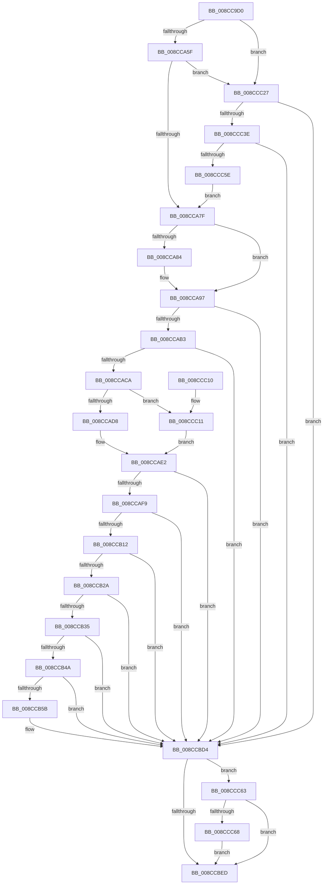

# EtwTiLogImpersonateClient

- RVA: `0x008CC9D0`–`0x008CCC82` (길이 `690` bytes)
- VA: `0x00000001408CC9D0`
- 실행 섹션: `PAGE`
- PDB 이름 있음: `예`; PDB Function 태그: `아니요`
- unwind 정보 RVA: `0x00084600`
- 디코드: `170`개 명령, `690/690` bytes 표시
- 미해석 바이트: `0` (있으면 어셈블리에 `.byte`로 보존)

> 이 문서는 커널 이미지의 기계어와 PDB 기호를 분석해 생성했습니다. 4번과 5번은 함수 원형과 자료형을 바이너리 사용 방식에서 추정한 C 해석이며 원본 소스 복구 결과는 아닙니다.

## 1. Dependencies

- 직접 호출 지점: **21**; 고유 호출 대상: **13**
- 직접 호출자로 확인된 함수: **1**
- RIP 상대 이미지 참조: **4**

### Outgoing calls
- `0x008CCA52` → [EtwEventEnabled](../../text/39/EtwEventEnabled_function_00392450.md) (function, `0x00392450`)
- `0x008CCA72` → [EtwProviderEnabled](../../text/3B/EtwProviderEnabled_function_003BA250.md) (function, `0x003BA250`)
- `0x008CCA8C` → [PsReferencePrimaryTokenWithTag](../../text/20/PsReferencePrimaryTokenWithTag_function_0020FF80.md) (function, `0x0020FF80`)
- `0x008CCAA6` → [SeQueryInformationToken](../8B/SeQueryInformationToken_function_008B5090.md) (function, `0x008B5090`)
- `0x008CCABD` → [SeQueryInformationToken](../8B/SeQueryInformationToken_function_008B5090.md) (function, `0x008B5090`)
- `0x008CCAEC` → [EtwEventEnabled](../../text/39/EtwEventEnabled_function_00392450.md) (function, `0x00392450`)
- `0x008CCB05` → [EtwProviderEnabled](../../text/3B/EtwProviderEnabled_function_003BA250.md) (function, `0x003BA250`)
- `0x008CCB1D` → [SeCompareTokens](../8F/SeCompareTokens_function_008F6F40.md) (function, `0x008F6F40`)
- `0x008CCB3D` → [EtwpTiQueryTokenIdentity](../A8/EtwpTiQueryTokenIdentity_function_00A87A7C.md) (function, `0x00A87A7C`)
- `0x008CCB52` → [EtwpTiQueryTokenIdentity](../A8/EtwpTiQueryTokenIdentity_function_00A87A7C.md) (function, `0x00A87A7C`)
- `0x008CCB67` → [EtwpTiFillProcessIdentity](../../text/3B/EtwpTiFillProcessIdentity_function_003B8F30.md) (function, `0x003B8F30`)
- `0x008CCB7E` → [EtwpTiFillThreadIdentity](../../text/47/EtwpTiFillThreadIdentity_function_00471C1C.md) (function, `0x00471C1C`)
- `0x008CCB97` → [EtwpTiFillTokenIdentity](../A9/EtwpTiFillTokenIdentity_function_00A97594.md) (function, `0x00A97594`)
- `0x008CCBB0` → [EtwpTiFillTokenIdentity](../A9/EtwpTiFillTokenIdentity_function_00A97594.md) (function, `0x00A97594`)
- `0x008CCBCF` → [EtwWrite](../../text/41/EtwWrite_function_0041C720.md) (function, `0x0041C720`)
- `0x008CCBD9` → [EtwpTiFreeTokenIdentity](../AA/EtwpTiFreeTokenIdentity_function_00AAE7A0.md) (function, `0x00AAE7A0`)
- `0x008CCBE3` → [EtwpTiFreeTokenIdentity](../AA/EtwpTiFreeTokenIdentity_function_00AAE7A0.md) (function, `0x00AAE7A0`)
- `0x008CCBF7` → [_security_check_cookie](../../text/6A/_security_check_cookie_function_006AC640.md) (function, `0x006AC640`)
- `0x008CCC35` → [EtwEventEnabled](../../text/39/EtwEventEnabled_function_00392450.md) (function, `0x00392450`)
- `0x008CCC51` → [EtwProviderEnabled](../../text/3B/EtwProviderEnabled_function_003BA250.md) (function, `0x003BA250`)
- `0x008CCC78` → [ObFastDereferenceObject](../../text/3E/ObFastDereferenceObject_function_003ED5F0.md) (function, `0x003ED5F0`)

### Direct callers
- [PsImpersonateClient](PsImpersonateClient_function_008CBE10.md) at `0x008CBF95`

### Static image references
- `0x008CC9EC` → RVA `0x00E0A740` (`.data`; read)
- `0x008CC9FF` → RVA `0x00011420` (`.rdata`; read)
- `0x008CCA23` → RVA `0x00EFFA30` (`.data`; read)
- `0x008CCC1B` → RVA `0x00011430` (`.rdata`; read)

## 2. Other-region calls and transfers

- 다른 실행 섹션으로 향하는 call: **12**
  - `0x008CCA52` → [EtwEventEnabled](../../text/39/EtwEventEnabled_function_00392450.md) (`PAGE` → `.text`)
  - `0x008CCA72` → [EtwProviderEnabled](../../text/3B/EtwProviderEnabled_function_003BA250.md) (`PAGE` → `.text`)
  - `0x008CCA8C` → [PsReferencePrimaryTokenWithTag](../../text/20/PsReferencePrimaryTokenWithTag_function_0020FF80.md) (`PAGE` → `.text`)
  - `0x008CCAEC` → [EtwEventEnabled](../../text/39/EtwEventEnabled_function_00392450.md) (`PAGE` → `.text`)
  - `0x008CCB05` → [EtwProviderEnabled](../../text/3B/EtwProviderEnabled_function_003BA250.md) (`PAGE` → `.text`)
  - `0x008CCB67` → [EtwpTiFillProcessIdentity](../../text/3B/EtwpTiFillProcessIdentity_function_003B8F30.md) (`PAGE` → `.text`)
  - `0x008CCB7E` → [EtwpTiFillThreadIdentity](../../text/47/EtwpTiFillThreadIdentity_function_00471C1C.md) (`PAGE` → `.text`)
  - `0x008CCBCF` → [EtwWrite](../../text/41/EtwWrite_function_0041C720.md) (`PAGE` → `.text`)
  - `0x008CCBF7` → [_security_check_cookie](../../text/6A/_security_check_cookie_function_006AC640.md) (`PAGE` → `.text`)
  - `0x008CCC35` → [EtwEventEnabled](../../text/39/EtwEventEnabled_function_00392450.md) (`PAGE` → `.text`)
  - `0x008CCC51` → [EtwProviderEnabled](../../text/3B/EtwProviderEnabled_function_003BA250.md) (`PAGE` → `.text`)
  - `0x008CCC78` → [ObFastDereferenceObject](../../text/3E/ObFastDereferenceObject_function_003ED5F0.md) (`PAGE` → `.text`)
- 별도 외부 분기/꼬리 이동을 확인하지 못했습니다.

## 3. Assembly (complete function range)

```asm
008CC9D0  40 55                           push rbp
008CC9D2  53                              push rbx
008CC9D3  56                              push rsi
008CC9D4  57                              push rdi
008CC9D5  41 54                           push r12
008CC9D7  41 55                           push r13
008CC9D9  41 56                           push r14
008CC9DB  41 57                           push r15
008CC9DD  48 8D AC 24 08 FE FF FF         lea rbp, [rsp - 0x1f8]
008CC9E5  48 81 EC F8 02 00 00            sub rsp, 0x2f8
008CC9EC  48 8B 05 4D DD 53 00            mov rax, qword ptr [rip + 0x53dd4d]
008CC9F3  48 33 C4                        xor rax, rsp
008CC9F6  48 89 85 E0 01 00 00            mov qword ptr [rbp + 0x1e0], rax
008CC9FD  33 C0                           xor eax, eax
008CC9FF  4C 8D 35 1A 4A 74 FF            lea r14, [rip - 0x8bb5e6]
008CCA06  48 21 44 24 40                  and qword ptr [rsp + 0x40], rax
008CCA0B  0F 57 C0                        xorps xmm0, xmm0
008CCA0E  21 44 24 38                     and dword ptr [rsp + 0x38], eax
008CCA12  0F 57 C9                        xorps xmm1, xmm1
008CCA15  21 44 24 34                     and dword ptr [rsp + 0x34], eax
008CCA19  4C 8B EA                        mov r13, rdx
008CCA1C  4C 8B F9                        mov r15, rcx
008CCA1F  48 89 45 90                     mov qword ptr [rbp - 0x70], rax
008CCA23  48 8B 0D 06 30 63 00            mov rcx, qword ptr [rip + 0x633006]
008CCA2A  49 8B D6                        mov rdx, r14
008CCA2D  49 8B F1                        mov rsi, r9
008CCA30  48 89 44 24 68                  mov qword ptr [rsp + 0x68], rax
008CCA35  49 8B F8                        mov rdi, r8
008CCA38  88 44 24 30                     mov byte ptr [rsp + 0x30], al
008CCA3C  0F 11 44 24 70                  movups xmmword ptr [rsp + 0x70], xmm0
008CCA41  45 32 E4                        xor r12b, r12b
008CCA44  0F 11 45 80                     movups xmmword ptr [rbp - 0x80], xmm0
008CCA48  0F 11 4C 24 48                  movups xmmword ptr [rsp + 0x48], xmm1
008CCA4D  0F 11 4C 24 58                  movups xmmword ptr [rsp + 0x58], xmm1
008CCA52  E8 F9 59 AC FF                  call 0x140392450
008CCA57  84 C0                           test al, al
008CCA59  0F 84 C8 01 00 00               je 0x1408ccc27
008CCA5F  48 8B 0D CA 2F 63 00            mov rcx, qword ptr [rip + 0x632fca]
008CCA66  33 D2                           xor edx, edx
008CCA68  49 B8 00 00 00 00 40 00 00 00   movabs r8, 0x4000000000
008CCA72  E8 D9 D7 AE FF                  call 0x1403ba250
008CCA77  84 C0                           test al, al
008CCA79  0F 84 A8 01 00 00               je 0x1408ccc27
008CCA7F  48 85 FF                        test rdi, rdi
008CCA82  75 13                           jne 0x1408cca97
008CCA84  BA 44 66 6C 74                  mov edx, 0x746c6644
008CCA89  49 8B CF                        mov rcx, r15
008CCA8C  E8 EF 34 94 FF                  call 0x14020ff80
008CCA91  48 8B F8                        mov rdi, rax
008CCA94  41 B4 01                        mov r12b, 1
008CCA97  BB 19 00 00 00                  mov ebx, 0x19
008CCA9C  4C 8D 44 24 38                  lea r8, [rsp + 0x38]
008CCAA1  8B D3                           mov edx, ebx
008CCAA3  48 8B CE                        mov rcx, rsi
008CCAA6  E8 E5 85 FE FF                  call 0x1408b5090
008CCAAB  85 C0                           test eax, eax
008CCAAD  0F 88 21 01 00 00               js 0x1408ccbd4
008CCAB3  4C 8D 44 24 34                  lea r8, [rsp + 0x34]
008CCAB8  8B D3                           mov edx, ebx
008CCABA  48 8B CF                        mov rcx, rdi
008CCABD  E8 CE 85 FE FF                  call 0x1408b5090
008CCAC2  85 C0                           test eax, eax
008CCAC4  0F 88 0A 01 00 00               js 0x1408ccbd4
008CCACA  8B 44 24 34                     mov eax, dword ptr [rsp + 0x34]
008CCACE  39 44 24 38                     cmp dword ptr [rsp + 0x38], eax
008CCAD2  0F 82 39 01 00 00               jb 0x1408ccc11
008CCAD8  48 BB 00 00 00 00 40 00 00 00   movabs rbx, 0x4000000000
008CCAE2  48 8B 0D 47 2F 63 00            mov rcx, qword ptr [rip + 0x632f47]
008CCAE9  49 8B D6                        mov rdx, r14
008CCAEC  E8 5F 59 AC FF                  call 0x140392450
008CCAF1  84 C0                           test al, al
008CCAF3  0F 84 DB 00 00 00               je 0x1408ccbd4
008CCAF9  48 8B 0D 30 2F 63 00            mov rcx, qword ptr [rip + 0x632f30]
008CCB00  4C 8B C3                        mov r8, rbx
008CCB03  33 D2                           xor edx, edx
008CCB05  E8 46 D7 AE FF                  call 0x1403ba250
008CCB0A  84 C0                           test al, al
008CCB0C  0F 84 C2 00 00 00               je 0x1408ccbd4
008CCB12  4C 8D 44 24 30                  lea r8, [rsp + 0x30]
008CCB17  48 8B D6                        mov rdx, rsi
008CCB1A  48 8B CF                        mov rcx, rdi
008CCB1D  E8 1E A4 02 00                  call 0x1408f6f40
008CCB22  85 C0                           test eax, eax
008CCB24  0F 88 AA 00 00 00               js 0x1408ccbd4
008CCB2A  80 7C 24 30 00                  cmp byte ptr [rsp + 0x30], 0
008CCB2F  0F 85 9F 00 00 00               jne 0x1408ccbd4
008CCB35  48 8B D7                        mov rdx, rdi
008CCB38  48 8D 4C 24 48                  lea rcx, [rsp + 0x48]
008CCB3D  E8 3A AF 1B 00                  call 0x140a87a7c
008CCB42  85 C0                           test eax, eax
008CCB44  0F 88 8A 00 00 00               js 0x1408ccbd4
008CCB4A  48 8B D6                        mov rdx, rsi
008CCB4D  48 8D 4C 24 70                  lea rcx, [rsp + 0x70]
008CCB52  E8 25 AF 1B 00                  call 0x140a87a7c
008CCB57  85 C0                           test eax, eax
008CCB59  78 79                           js 0x1408ccbd4
008CCB5B  4C 8D 44 24 40                  lea r8, [rsp + 0x40]
008CCB60  49 8B D7                        mov rdx, r15
008CCB63  48 8D 4D A0                     lea rcx, [rbp - 0x60]
008CCB67  E8 C4 C3 AE FF                  call 0x1403b8f30
008CCB6C  8B C8                           mov ecx, eax
008CCB6E  49 8B D5                        mov rdx, r13
008CCB71  8B D8                           mov ebx, eax
008CCB73  48 8D 45 A0                     lea rax, [rbp - 0x60]
008CCB77  48 C1 E1 04                     shl rcx, 4
008CCB7B  48 03 C8                        add rcx, rax
008CCB7E  E8 99 50 BA FF                  call 0x140471c1c
008CCB83  03 D8                           add ebx, eax
008CCB85  48 8D 54 24 48                  lea rdx, [rsp + 0x48]
008CCB8A  48 8D 45 A0                     lea rax, [rbp - 0x60]
008CCB8E  8B CB                           mov ecx, ebx
008CCB90  48 C1 E1 04                     shl rcx, 4
008CCB94  48 03 C8                        add rcx, rax
008CCB97  E8 F8 A9 1C 00                  call 0x140a97594
008CCB9C  03 D8                           add ebx, eax
008CCB9E  48 8D 4D A0                     lea rcx, [rbp - 0x60]
008CCBA2  8B C3                           mov eax, ebx
008CCBA4  48 8D 54 24 70                  lea rdx, [rsp + 0x70]
008CCBA9  48 C1 E0 04                     shl rax, 4
008CCBAD  48 03 C8                        add rcx, rax
008CCBB0  E8 DF A9 1C 00                  call 0x140a97594
008CCBB5  48 8B 0D 74 2E 63 00            mov rcx, qword ptr [rip + 0x632e74]
008CCBBC  45 33 C0                        xor r8d, r8d
008CCBBF  49 8B D6                        mov rdx, r14
008CCBC2  44 8D 0C 18                     lea r9d, [rax + rbx]
008CCBC6  48 8D 45 A0                     lea rax, [rbp - 0x60]
008CCBCA  48 89 44 24 20                  mov qword ptr [rsp + 0x20], rax
008CCBCF  E8 4C FB B4 FF                  call 0x14041c720
008CCBD4  48 8D 4C 24 48                  lea rcx, [rsp + 0x48]
008CCBD9  E8 C2 1B 1E 00                  call 0x140aae7a0
008CCBDE  48 8D 4C 24 70                  lea rcx, [rsp + 0x70]
008CCBE3  E8 B8 1B 1E 00                  call 0x140aae7a0
008CCBE8  45 84 E4                        test r12b, r12b
008CCBEB  75 76                           jne 0x1408ccc63
008CCBED  48 8B 8D E0 01 00 00            mov rcx, qword ptr [rbp + 0x1e0]
008CCBF4  48 33 CC                        xor rcx, rsp
008CCBF7  E8 44 FA DD FF                  call 0x1406ac640
008CCBFC  48 81 C4 F8 02 00 00            add rsp, 0x2f8
008CCC03  41 5F                           pop r15
008CCC05  41 5E                           pop r14
008CCC07  41 5D                           pop r13
008CCC09  41 5C                           pop r12
008CCC0B  5F                              pop rdi
008CCC0C  5E                              pop rsi
008CCC0D  5B                              pop rbx
008CCC0E  5D                              pop rbp
008CCC0F  C3                              ret
008CCC10  CC                              int3
008CCC11  48 BB 00 00 00 00 00 04 00 00   movabs rbx, 0x40000000000
008CCC1B  4C 8D 35 0E 48 74 FF            lea r14, [rip - 0x8bb7f2]
008CCC22  E9 BB FE FF FF                  jmp 0x1408ccae2
008CCC27  48 8B 0D 02 2E 63 00            mov rcx, qword ptr [rip + 0x632e02]
008CCC2E  48 8D 15 FB 47 74 FF            lea rdx, [rip - 0x8bb805]
008CCC35  E8 16 58 AC FF                  call 0x140392450
008CCC3A  84 C0                           test al, al
008CCC3C  74 96                           je 0x1408ccbd4
008CCC3E  48 8B 0D EB 2D 63 00            mov rcx, qword ptr [rip + 0x632deb]
008CCC45  33 D2                           xor edx, edx
008CCC47  49 B8 00 00 00 00 00 04 00 00   movabs r8, 0x40000000000
008CCC51  E8 FA D5 AE FF                  call 0x1403ba250
008CCC56  84 C0                           test al, al
008CCC58  0F 84 76 FF FF FF               je 0x1408ccbd4
008CCC5E  E9 1C FE FF FF                  jmp 0x1408cca7f
008CCC63  48 85 FF                        test rdi, rdi
008CCC66  74 85                           je 0x1408ccbed
008CCC68  49 8D 8F 48 02 00 00            lea rcx, [r15 + 0x248]
008CCC6F  41 B8 44 66 6C 74               mov r8d, 0x746c6644
008CCC75  48 8B D7                        mov rdx, rdi
008CCC78  E8 73 09 B2 FF                  call 0x1403ed5f0
008CCC7D  E9 6B FF FF FF                  jmp 0x1408ccbed
```

## 4. C-style interpretation (structured pseudocode)

```c
__int64 __fastcall EtwTiLogImpersonateClient(__int64 a1, __int64 a2, __int64 a3, __int64 a4)
{
    __int64 result;
    __int64 v_r12;
    __int64 v_rbx;
    __int64 v_rdi;
    __int64 v_rsp;
    unsigned __int64 v_stack_m238;
    unsigned __int64 v_stack_m298;
    unsigned __int64 v_stack_m2A8;
    unsigned __int64 v_stack_m2B8;
    unsigned __int64 v_stack_m2C8;
    unsigned __int64 v_stack_m2D0;
    unsigned __int64 v_stack_m2E0;
    unsigned __int64 v_stack_m2F0;
    unsigned __int64 v_stack_m2F8;
    unsigned int v_stack_m300;
    unsigned int v_stack_m304;
    unsigned __int8 v_stack_m308;
    unsigned __int64 v_stack_m318;
    unsigned __int64 v_stack_m58;

    v_rsp = (v_rsp) - (760);
    result = (*(unsigned __int64 *)(v_rip + 5496141)) ^ (v_rsp);
    v_stack_m58 = result;
    result = 0;
    v_stack_m2A8 = 0;
    v_stack_m2D0 = 0;
    v_stack_m308 = 0;
    v_stack_m2C8 = v_xmm0;
    v_r12 = 0;
    v_stack_m2B8 = v_xmm0;
    v_stack_m2F0 = v_xmm1;
    v_stack_m2E0 = v_xmm1;
    result = EtwEventEnabled(*(unsigned __int64 *)(v_rip + 6500358), v_rip - 9156070, a3, a4);
    if ((unsigned __int8)(result) == 0) goto loc_008CCC27;
    a2 = 0;
    result = EtwProviderEnabled(*(unsigned __int64 *)(v_rip + 6500298), a2, a3, a4);
    if ((unsigned __int8)(result) == 0) goto loc_008CCC27;
loc_008CCA7F:
    v_rdi = a3;
    if (a3 == 0) {
        a2 = 0x746C6644ULL;
        a1 = a1;
        result = PsReferencePrimaryTokenWithTag(a1, a2, a3, a4);
        v_rdi = result;
        v_r12 = 1;
    }
    result = SeQueryInformationToken(a4, 25, v_stack_m300, a4);
    if (sign_flag) goto loc_008CCBD4;
    result = SeQueryInformationToken(v_rdi, 25, v_stack_m304, a4);
    if (sign_flag) goto loc_008CCBD4;
    if (v_stack_m300 < ((unsigned int)((unsigned int)(v_stack_m304)))) goto loc_008CCC11;
loc_008CCAE2:
    result = EtwEventEnabled(*(unsigned __int64 *)(v_rip + 6500167), v_rip - 9156070, v_stack_m304, a4);
    if ((unsigned __int8)(result) == 0) goto loc_008CCBD4;
    a2 = 0;
    result = EtwProviderEnabled(*(unsigned __int64 *)(v_rip + 6500144), a2, 25, a4);
    if ((unsigned __int8)(result) == 0) goto loc_008CCBD4;
    result = SeCompareTokens(v_rdi, a4, v_stack_m308, a4);
    if (sign_flag) goto loc_008CCBD4;
    if (v_stack_m308 != 0) goto loc_008CCBD4;
    result = EtwpTiQueryTokenIdentity(v_stack_m2F0, v_rdi, v_stack_m308, a4);
    if (sign_flag) goto loc_008CCBD4;
    result = EtwpTiQueryTokenIdentity(v_stack_m2C8, a4, v_stack_m308, a4);
    v_rbx = 25;
    if (!(sign_flag)) {
        a3 = v_stack_m2F8;
        a2 = a1;
        a1 = v_stack_m298;
        result = EtwpTiFillProcessIdentity(a1, a2, a3, a4);
        a1 = (unsigned int)(result);
        a2 = a2;
        v_rbx = (unsigned int)(result);
        result = v_stack_m298;
        a1 = (a1) << (4);
        a1 = (a1) + (result);
        result = EtwpTiFillThreadIdentity(a1, a2, a3, a4);
        v_rbx = (unsigned int)((v_rbx) + ((unsigned int)(result)));
        a2 = v_stack_m2F0;
        result = v_stack_m298;
        a1 = (unsigned int)(v_rbx);
        a1 = (a1) << (4);
        a1 = (a1) + (result);
        result = EtwpTiFillTokenIdentity(a1, a2, a3, a4);
        v_rbx = (unsigned int)((v_rbx) + ((unsigned int)(result)));
        a1 = v_stack_m298;
        result = (unsigned int)(v_rbx);
        a2 = v_stack_m2C8;
        result = (result) << (4);
        a1 = (a1) + (result);
        result = EtwpTiFillTokenIdentity(a1, a2, a3, a4);
        a1 = *(unsigned __int64 *)(v_rip + 6499956);
        a3 = 0;
        a2 = v_rip - 9156070;
        a4 = result + v_rbx * 1;
        result = v_stack_m298;
        v_stack_m318 = result;
        result = EtwWrite(a1, a2, a3, a4);
    }
    result = EtwpTiFreeTokenIdentity(v_stack_m2F0, a2, a3, a4);
    result = EtwpTiFreeTokenIdentity(v_stack_m2C8, a2, a3, a4);
    if ((unsigned __int8)(v_r12) != 0) goto loc_008CCC63;
loc_008CCBED:
    a1 = (v_stack_m58) ^ (v_rsp);
    result = _security_check_cookie(a1, a2, a3, a4);
    v_rsp = (v_rsp) + (760);
    return result;
loc_008CCC11:
    goto loc_008CCAE2;
loc_008CCC27:
    result = EtwEventEnabled(*(unsigned __int64 *)(v_rip + 6499842), v_rip - 9156613, a3, a4);
    if ((unsigned __int8)(result) == 0) goto loc_008CCBD4;
    a2 = 0;
    result = EtwProviderEnabled(*(unsigned __int64 *)(v_rip + 6499819), a2, a3, a4);
    if ((unsigned __int8)(result) == 0) goto loc_008CCBD4;
    goto loc_008CCA7F;
loc_008CCC63:
    if (v_rdi == 0) goto loc_008CCBED;
    result = ObFastDereferenceObject(a1 + 584, v_rdi, (unsigned int)(0x746C6644ULL), a4);
    goto loc_008CCBED;
}
```

## 5. (Beta) C Style

```c
int64_t EtwTiLogImpersonateClient(void *Arg1, int64_t Arg2, int64_t Arg3, int64_t Arg4)
{
    uint8_t *arg1 = (uint8_t *)Arg1;

    int64_t result;
    int64_t local_r12;
    int64_t local_rbx;
    int64_t local_rdi;
    int64_t local_rsp;
    uint64_t v_stack_m238;
    uint64_t v_stack_m298;
    uint64_t v_stack_m2A8;
    uint64_t v_stack_m2B8;
    uint64_t v_stack_m2C8;
    uint64_t v_stack_m2D0;
    uint64_t v_stack_m2E0;
    uint64_t v_stack_m2F0;
    uint64_t v_stack_m2F8;
    uint32_t v_stack_m300;
    uint32_t v_stack_m304;
    uint8_t v_stack_m308;
    uint64_t v_stack_m318;
    uint64_t v_stack_m58;

    local_rsp = (local_rsp) - (760);
    result = (*(uint64_t *)(v_rip + 0x53DD4D)) ^ (local_rsp);
    v_stack_m58 = result;
    result = 0;
    v_stack_m2A8 = 0;
    v_stack_m2D0 = 0;
    v_stack_m308 = 0;
    v_stack_m2C8 = v_xmm0;
    local_r12 = 0;
    v_stack_m2B8 = v_xmm0;
    v_stack_m2F0 = v_xmm1;
    v_stack_m2E0 = v_xmm1;
    result = EtwEventEnabled(*(uint64_t *)(v_rip + 0x633006), v_rip - 9156070, Arg3, Arg4);
    if ((uint8_t)(result) == 0) goto loc_008CCC27;
    Arg2 = 0;
    result = EtwProviderEnabled(*(uint64_t *)(v_rip + 0x632FCA), Arg2, Arg3, Arg4);
    if ((uint8_t)(result) == 0) goto loc_008CCC27;
loc_008CCA7F:
    local_rdi = Arg3;
    if (Arg3 == 0) {
        Arg2 = 0x746C6644ULL;
        Arg1 = Arg1;
        result = PsReferencePrimaryTokenWithTag(Arg1, Arg2, Arg3, Arg4);
        local_rdi = result;
        local_r12 = 1;
    }
    result = SeQueryInformationToken(Arg4, 25, v_stack_m300, Arg4);
    if (sign_flag) goto loc_008CCBD4;
    result = SeQueryInformationToken(local_rdi, 25, v_stack_m304, Arg4);
    if (sign_flag) goto loc_008CCBD4;
    if (v_stack_m300 < ((uint32_t)((uint32_t)(v_stack_m304)))) goto loc_008CCC11;
loc_008CCAE2:
    result = EtwEventEnabled(*(uint64_t *)(v_rip + 0x632F47), v_rip - 9156070, v_stack_m304, Arg4);
    if ((uint8_t)(result) == 0) goto loc_008CCBD4;
    Arg2 = 0;
    result = EtwProviderEnabled(*(uint64_t *)(v_rip + 0x632F30), Arg2, 25, Arg4);
    if ((uint8_t)(result) == 0) goto loc_008CCBD4;
    result = SeCompareTokens(local_rdi, Arg4, v_stack_m308, Arg4);
    if (sign_flag) goto loc_008CCBD4;
    if (v_stack_m308 != 0) goto loc_008CCBD4;
    result = EtwpTiQueryTokenIdentity(v_stack_m2F0, local_rdi, v_stack_m308, Arg4);
    if (sign_flag) goto loc_008CCBD4;
    result = EtwpTiQueryTokenIdentity(v_stack_m2C8, Arg4, v_stack_m308, Arg4);
    local_rbx = 25;
    if (!(sign_flag)) {
        Arg3 = v_stack_m2F8;
        Arg2 = Arg1;
        Arg1 = v_stack_m298;
        result = EtwpTiFillProcessIdentity(Arg1, Arg2, Arg3, Arg4);
        Arg1 = (uint32_t)(result);
        Arg2 = Arg2;
        local_rbx = (uint32_t)(result);
        result = v_stack_m298;
        Arg1 = (Arg1) << (4);
        Arg1 = (Arg1) + (result);
        result = EtwpTiFillThreadIdentity(Arg1, Arg2, Arg3, Arg4);
        local_rbx = (uint32_t)((local_rbx) + ((uint32_t)(result)));
        Arg2 = v_stack_m2F0;
        result = v_stack_m298;
        Arg1 = (uint32_t)(local_rbx);
        Arg1 = (Arg1) << (4);
        Arg1 = (Arg1) + (result);
        result = EtwpTiFillTokenIdentity(Arg1, Arg2, Arg3, Arg4);
        local_rbx = (uint32_t)((local_rbx) + ((uint32_t)(result)));
        Arg1 = v_stack_m298;
        result = (uint32_t)(local_rbx);
        Arg2 = v_stack_m2C8;
        result = (result) << (4);
        Arg1 = (Arg1) + (result);
        result = EtwpTiFillTokenIdentity(Arg1, Arg2, Arg3, Arg4);
        Arg1 = *(uint64_t *)(v_rip + 0x632E74);
        Arg3 = 0;
        Arg2 = v_rip - 9156070;
        Arg4 = result + local_rbx * 1;
        result = v_stack_m298;
        v_stack_m318 = result;
        result = EtwWrite(Arg1, Arg2, Arg3, Arg4);
    }
    result = EtwpTiFreeTokenIdentity(v_stack_m2F0, Arg2, Arg3, Arg4);
    result = EtwpTiFreeTokenIdentity(v_stack_m2C8, Arg2, Arg3, Arg4);
    if ((uint8_t)(local_r12) != 0) goto loc_008CCC63;
loc_008CCBED:
    Arg1 = (v_stack_m58) ^ (local_rsp);
    result = _security_check_cookie(Arg1, Arg2, Arg3, Arg4);
    local_rsp = (local_rsp) + (760);
    return result;
loc_008CCC11:
    goto loc_008CCAE2;
loc_008CCC27:
    result = EtwEventEnabled(*(uint64_t *)(v_rip + 0x632E02), v_rip - 9156613, Arg3, Arg4);
    if ((uint8_t)(result) == 0) goto loc_008CCBD4;
    Arg2 = 0;
    result = EtwProviderEnabled(*(uint64_t *)(v_rip + 0x632DEB), Arg2, Arg3, Arg4);
    if ((uint8_t)(result) == 0) goto loc_008CCBD4;
    goto loc_008CCA7F;
loc_008CCC63:
    if (local_rdi == 0) goto loc_008CCBED;
    result = ObFastDereferenceObject(Arg1 + 584, local_rdi, (uint32_t)(0x746C6644ULL), Arg4);
    goto loc_008CCBED;
}
```

### 관측된 메모리 오프셋

구조체 형식이 확인되지 않은 접근은 인자 기준의 오프셋으로만 기록했습니다.

| 기준 인자 | 오프셋 표현 | 폭 (bit) | 접근 |
|---|---:|---:|---|
| `Arg1` | `+ 0x248` | `64` | `R` |

## 6. Execution-region graph

[열기: 2D/3D 그래프와 함수 탐색 컨트롤 패널](../../../control-panel.html?section=page&rva=0x008CC9D0&view=graph)

- 2D 그래프는 위에서 아래로 흐르고, 3D 그래프는 빈 공간을 드래그해 회전합니다. Shift+드래그는 이동, 휠은 확대·축소, 함수 노드 선택은 대상 보고서 이동입니다.

### Static fallback


