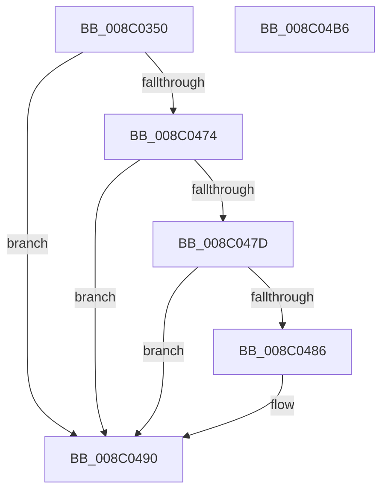

# EtwpAccessCheckFromState

- RVA: `0x008C0350`–`0x008C04B7` (길이 `359` bytes)
- VA: `0x00000001408C0350`
- 실행 섹션: `PAGE`
- PDB 이름 있음: `예`; PDB Function 태그: `아니요`
- unwind 정보 RVA: `0x00083438`
- 디코드: `88`개 명령, `359/359` bytes 표시
- 미해석 바이트: `0` (있으면 어셈블리에 `.byte`로 보존)

> 이 문서는 커널 이미지의 기계어와 PDB 기호를 분석해 생성했습니다. 4번과 5번은 함수 원형과 자료형을 바이너리 사용 방식에서 추정한 C 해석이며 원본 소스 복구 결과는 아닙니다.

## 1. Dependencies

- 직접 호출 지점: **6**; 고유 호출 대상: **6**
- 직접 호출자로 확인된 함수: **1**
- RIP 상대 이미지 참조: **5**

### Outgoing calls
- `0x008C03FF` → [RtlStringCbPrintfW](../../text/40/RtlStringCbPrintfW_function_0040FB40.md) (function, `0x0040FB40`)
- `0x008C040C` → [RtlInitUnicodeString](../../text/42/RtlInitUnicodeString_function_0042A780.md) (function, `0x0042A780`)
- `0x008C0419` → [EtwpGetGuidSecurityDescriptor](EtwpGetGuidSecurityDescriptor_function_008C05D4.md) (function, `0x008C05D4`)
- `0x008C046A` → [SeAccessCheckFromState](../../text/3A/SeAccessCheckFromState_function_003A6650.md) (function, `0x003A6650`)
- `0x008C048B` → [ExFreePoolWithTag](../../poolcode/B8/ExFreePoolWithTag_function_00B82870.md) (function, `0x00B82870`)
- `0x008C049A` → [_security_check_cookie](../../text/6A/_security_check_cookie_function_006AC640.md) (function, `0x006AC640`)

### Direct callers
- [EtwpAddRegEntryToGroup](../9F/EtwpAddRegEntryToGroup_function_009F39D4.md) at `0x009F3C52`
- [EtwpAddRegEntryToGroup](../9F/EtwpAddRegEntryToGroup_function_009F39D4.md) at `0x009F3D97`

### Static image references
- `0x008C0368` → RVA `0x00E0A740` (`.data`; read)
- `0x008C03D9` → RVA `0x00B06E40` (` ?? ::NNGAKEGL::`string'`; read)
- `0x008C0438` → RVA `0x00E68510` (`.data`; read)
- `0x008C0450` → RVA `0x00011360` (`.rdata`; read)
- `0x008C0474` → RVA `0x00FC6D68` (`ALMOSTRO`; read)

## 2. Other-region calls and transfers

- 다른 실행 섹션으로 향하는 call: **5**
  - `0x008C03FF` → [RtlStringCbPrintfW](../../text/40/RtlStringCbPrintfW_function_0040FB40.md) (`PAGE` → `.text`)
  - `0x008C040C` → [RtlInitUnicodeString](../../text/42/RtlInitUnicodeString_function_0042A780.md) (`PAGE` → `.text`)
  - `0x008C046A` → [SeAccessCheckFromState](../../text/3A/SeAccessCheckFromState_function_003A6650.md) (`PAGE` → `.text`)
  - `0x008C048B` → [ExFreePoolWithTag](../../poolcode/B8/ExFreePoolWithTag_function_00B82870.md) (`PAGE` → `POOLCODE`)
  - `0x008C049A` → [_security_check_cookie](../../text/6A/_security_check_cookie_function_006AC640.md) (`PAGE` → `.text`)
- 별도 외부 분기/꼬리 이동을 확인하지 못했습니다.

## 3. Assembly (complete function range)

```asm
008C0350  48 89 5C 24 10                  mov qword ptr [rsp + 0x10], rbx
008C0355  55                              push rbp
008C0356  56                              push rsi
008C0357  57                              push rdi
008C0358  41 56                           push r14
008C035A  41 57                           push r15
008C035C  48 8D 6C 24 C9                  lea rbp, [rsp - 0x37]
008C0361  48 81 EC F0 00 00 00            sub rsp, 0xf0
008C0368  48 8B 05 D1 A3 54 00            mov rax, qword ptr [rip + 0x54a3d1]
008C036F  48 33 C4                        xor rax, rsp
008C0372  48 89 45 27                     mov qword ptr [rbp + 0x27], rax
008C0376  0F B6 41 0F                     movzx eax, byte ptr [rcx + 0xf]
008C037A  4C 8B C9                        mov r9, rcx
008C037D  0F B6 49 0E                     movzx ecx, byte ptr [rcx + 0xe]
008C0381  4D 8B F8                        mov r15, r8
008C0384  83 65 B7 00                     and dword ptr [rbp - 0x49], 0
008C0388  0F 57 C0                        xorps xmm0, xmm0
008C038B  83 65 BB 00                     and dword ptr [rbp - 0x45], 0
008C038F  41 0F B6 51 0D                  movzx edx, byte ptr [r9 + 0xd]
008C0394  45 0F B6 41 0C                  movzx r8d, byte ptr [r9 + 0xc]
008C0399  45 0F B6 51 0B                  movzx r10d, byte ptr [r9 + 0xb]
008C039E  45 0F B6 59 0A                  movzx r11d, byte ptr [r9 + 0xa]
008C03A3  41 0F B6 59 09                  movzx ebx, byte ptr [r9 + 9]
008C03A8  41 0F B6 79 08                  movzx edi, byte ptr [r9 + 8]
008C03AD  41 0F B7 71 06                  movzx esi, word ptr [r9 + 6]
008C03B2  45 0F B7 71 04                  movzx r14d, word ptr [r9 + 4]
008C03B7  45 8B 09                        mov r9d, dword ptr [r9]
008C03BA  48 83 65 BF 00                  and qword ptr [rbp - 0x41], 0
008C03BF  89 44 24 68                     mov dword ptr [rsp + 0x68], eax
008C03C3  89 4C 24 60                     mov dword ptr [rsp + 0x60], ecx
008C03C7  48 8D 4D D7                     lea rcx, [rbp - 0x29]
008C03CB  89 54 24 58                     mov dword ptr [rsp + 0x58], edx
008C03CF  BA 4C 00 00 00                  mov edx, 0x4c
008C03D4  44 89 44 24 50                  mov dword ptr [rsp + 0x50], r8d
008C03D9  4C 8D 05 60 6A 24 00            lea r8, [rip + 0x246a60]
008C03E0  44 89 54 24 48                  mov dword ptr [rsp + 0x48], r10d
008C03E5  44 89 5C 24 40                  mov dword ptr [rsp + 0x40], r11d
008C03EA  89 5C 24 38                     mov dword ptr [rsp + 0x38], ebx
008C03EE  89 7C 24 30                     mov dword ptr [rsp + 0x30], edi
008C03F2  89 74 24 28                     mov dword ptr [rsp + 0x28], esi
008C03F6  44 89 74 24 20                  mov dword ptr [rsp + 0x20], r14d
008C03FB  0F 11 45 C7                     movups xmmword ptr [rbp - 0x39], xmm0
008C03FF  E8 3C F7 B4 FF                  call 0x14040fb40
008C0404  48 8D 55 D7                     lea rdx, [rbp - 0x29]
008C0408  48 8D 4D C7                     lea rcx, [rbp - 0x39]
008C040C  E8 6F A3 B6 FF                  call 0x14042a780
008C0411  48 8D 55 BF                     lea rdx, [rbp - 0x41]
008C0415  48 8D 4D C7                     lea rcx, [rbp - 0x39]
008C0419  E8 B6 01 00 00                  call 0x1408c05d4
008C041E  48 8B 5D BF                     mov rbx, qword ptr [rbp - 0x41]
008C0422  48 8D 45 B7                     lea rax, [rbp - 0x49]
008C0426  48 89 44 24 48                  mov qword ptr [rsp + 0x48], rax
008C042B  48 85 DB                        test rbx, rbx
008C042E  48 8D 45 BB                     lea rax, [rbp - 0x45]
008C0432  41 B9 80 00 00 00               mov r9d, 0x80
008C0438  48 0F 44 1D D0 80 5A 00         cmove rbx, qword ptr [rip + 0x5a80d0]
008C0440  49 8B D7                        mov rdx, r15
008C0443  48 89 44 24 40                  mov qword ptr [rsp + 0x40], rax
008C0448  45 33 C0                        xor r8d, r8d
008C044B  C6 44 24 38 01                  mov byte ptr [rsp + 0x38], 1
008C0450  48 8D 05 09 0F 75 FF            lea rax, [rip - 0x8af0f7]
008C0457  48 89 44 24 30                  mov qword ptr [rsp + 0x30], rax
008C045C  48 8B CB                        mov rcx, rbx
008C045F  48 83 64 24 28 00               and qword ptr [rsp + 0x28], 0
008C0465  83 64 24 20 00                  and dword ptr [rsp + 0x20], 0
008C046A  E8 E1 61 AE FF                  call 0x1403a6650
008C046F  48 85 DB                        test rbx, rbx
008C0472  74 1C                           je 0x1408c0490
008C0474  48 3B 1D ED 68 70 00            cmp rbx, qword ptr [rip + 0x7068ed]
008C047B  74 13                           je 0x1408c0490
008C047D  48 3B 1D 8C 80 5A 00            cmp rbx, qword ptr [rip + 0x5a808c]
008C0484  74 0A                           je 0x1408c0490
008C0486  33 D2                           xor edx, edx
008C0488  48 8B CB                        mov rcx, rbx
008C048B  E8 E0 23 2C 00                  call 0x140b82870
008C0490  8B 45 B7                        mov eax, dword ptr [rbp - 0x49]
008C0493  48 8B 4D 27                     mov rcx, qword ptr [rbp + 0x27]
008C0497  48 33 CC                        xor rcx, rsp
008C049A  E8 A1 C1 DE FF                  call 0x1406ac640
008C049F  48 8B 9C 24 28 01 00 00         mov rbx, qword ptr [rsp + 0x128]
008C04A7  48 81 C4 F0 00 00 00            add rsp, 0xf0
008C04AE  41 5F                           pop r15
008C04B0  41 5E                           pop r14
008C04B2  5F                              pop rdi
008C04B3  5E                              pop rsi
008C04B4  5D                              pop rbp
008C04B5  C3                              ret
008C04B6  CC                              int3
```

## 4. C-style interpretation (structured pseudocode)

```c
__int64 __fastcall EtwpAccessCheckFromState(__int64 a1, __int64 a2, __int64 a3)
{
    __int64 result;
    __int64 v_rbx;
    __int64 v_rsp;
    unsigned __int64 v_stack_m38;
    unsigned __int64 v_stack_m5F;
    unsigned __int64 v_stack_m88;
    unsigned __int64 v_stack_m98;
    unsigned __int64 v_stack_mA0;
    unsigned int v_stack_mA4;
    unsigned int v_stack_mA8;
    unsigned int v_stack_mB0;
    unsigned int v_stack_mB8;
    unsigned int v_stack_mC0;
    unsigned int v_stack_mC8;
    unsigned int v_stack_mD0;
    unsigned int v_stack_mD8;
    unsigned int v_stack_mE0;
    unsigned int v_stack_mE8;
    unsigned int v_stack_mF0;
    unsigned int v_stack_mF8;
    unsigned __int64 v_stack_p10;

    v_stack_p10 = v_rbx;
    v_rsp = (v_rsp) - (240);
    result = (*(unsigned __int64 *)(v_rip + 5546961)) ^ (v_rsp);
    v_stack_m38 = result;
    v_stack_mB0 = (unsigned int)(*(unsigned __int8 *)(a1 + 15));
    v_stack_mB8 = (unsigned int)(*(unsigned __int8 *)(a1 + 14));
    v_stack_mC0 = (unsigned int)(*(unsigned __int8 *)(a1 + 13));
    v_stack_mC8 = (unsigned int)(*(unsigned __int8 *)(a1 + 12));
    v_stack_mD0 = (unsigned int)(*(unsigned __int8 *)(a1 + 11));
    v_stack_mD8 = (unsigned int)(*(unsigned __int8 *)(a1 + 10));
    v_stack_mE0 = (unsigned int)(*(unsigned __int8 *)(a1 + 9));
    v_stack_mE8 = (unsigned int)(*(unsigned __int8 *)(a1 + 8));
    v_stack_mF0 = (unsigned int)(*(unsigned __int16 *)(a1 + 6));
    v_stack_mF8 = (unsigned int)(*(unsigned __int16 *)(a1 + 4));
    v_stack_m98 = v_xmm0;
    result = RtlStringCbPrintfW(v_stack_m88, 76, v_rip + 2386528, (unsigned int)(*(unsigned int *)(a1)));
    result = RtlInitUnicodeString(v_stack_m98, v_stack_m88, v_rip + 2386528, (unsigned int)(*(unsigned int *)(a1)));
    result = EtwpGetGuidSecurityDescriptor(v_stack_m98, v_stack_mA0, v_rip + 2386528, (unsigned int)(*(unsigned int *)(a1)));
    v_stack_mD0 = v_stack_mA8;
    v_rbx = v_stack_mA0;
    if (v_stack_mA0 == 0) { v_rbx = *(unsigned __int64 *)(v_rip + 5931216); }
    v_stack_mD8 = v_stack_mA4;
    a3 = 0;
    v_stack_mE0 = 1;
    v_stack_mE8 = v_rip - 9105655;
    result = SeAccessCheckFromState(v_rbx, a3, a3, 128);
    if (v_rbx == 0) goto loc_008C0490;
    if (v_rbx == (*(unsigned __int64 *)(v_rip + 7366893))) goto loc_008C0490;
    if (v_rbx != (*(unsigned __int64 *)(v_rip + 5931148))) {
        a2 = 0;
        a1 = v_rbx;
        result = ExFreePoolWithTag(a1, a2, a3, 128);
    }
    a1 = (v_stack_m38) ^ (v_rsp);
    result = _security_check_cookie(a1, a2, a3, 128);
    v_rsp = (v_rsp) + (240);
    return result;
}
```

## 5. (Beta) C Style

```c
int64_t EtwpAccessCheckFromState(void *Arg1, int64_t Arg2, int64_t Arg3)
{
    uint8_t *arg1 = (uint8_t *)Arg1;

    int64_t result;
    int64_t local_rbx;
    int64_t local_rsp;
    uint64_t v_stack_m38;
    uint64_t v_stack_m5F;
    uint64_t v_stack_m88;
    uint64_t v_stack_m98;
    uint64_t v_stack_mA0;
    uint32_t v_stack_mA4;
    uint32_t v_stack_mA8;
    uint32_t v_stack_mB0;
    uint32_t v_stack_mB8;
    uint32_t v_stack_mC0;
    uint32_t v_stack_mC8;
    uint32_t v_stack_mD0;
    uint32_t v_stack_mD8;
    uint32_t v_stack_mE0;
    uint32_t v_stack_mE8;
    uint32_t v_stack_mF0;
    uint32_t v_stack_mF8;
    uint64_t v_stack_p10;

    v_stack_p10 = local_rbx;
    local_rsp = (local_rsp) - (240);
    result = (*(uint64_t *)(v_rip + 0x54A3D1)) ^ (local_rsp);
    v_stack_m38 = result;
    v_stack_mB0 = (uint32_t)(*(uint8_t *)(arg1 + 0xF));
    v_stack_mB8 = (uint32_t)(*(uint8_t *)(arg1 + 0xE));
    v_stack_mC0 = (uint32_t)(*(uint8_t *)(arg1 + 0xD));
    v_stack_mC8 = (uint32_t)(*(uint8_t *)(arg1 + 0xC));
    v_stack_mD0 = (uint32_t)(*(uint8_t *)(arg1 + 0xB));
    v_stack_mD8 = (uint32_t)(*(uint8_t *)(arg1 + 0xA));
    v_stack_mE0 = (uint32_t)(*(uint8_t *)(arg1 + 0x9));
    v_stack_mE8 = (uint32_t)(*(uint8_t *)(arg1 + 0x8));
    v_stack_mF0 = (uint32_t)(*(uint16_t *)(arg1 + 0x6));
    v_stack_mF8 = (uint32_t)(*(uint16_t *)(arg1 + 0x4));
    v_stack_m98 = v_xmm0;
    result = RtlStringCbPrintfW(v_stack_m88, 76, v_rip + 2386528, (uint32_t)(*(uint32_t *)(arg1)));
    result = RtlInitUnicodeString(v_stack_m98, v_stack_m88, v_rip + 2386528, (uint32_t)(*(uint32_t *)(arg1)));
    result = EtwpGetGuidSecurityDescriptor(v_stack_m98, v_stack_mA0, v_rip + 2386528, (uint32_t)(*(uint32_t *)(arg1)));
    v_stack_mD0 = v_stack_mA8;
    local_rbx = v_stack_mA0;
    if (v_stack_mA0 == 0) { local_rbx = *(uint64_t *)(v_rip + 0x5A80D0); }
    v_stack_mD8 = v_stack_mA4;
    Arg3 = 0;
    v_stack_mE0 = 1;
    v_stack_mE8 = v_rip - 9105655;
    result = SeAccessCheckFromState(local_rbx, Arg3, Arg3, 128);
    if (local_rbx == 0) goto loc_008C0490;
    if (local_rbx == (*(uint64_t *)(v_rip + 0x7068ED))) goto loc_008C0490;
    if (local_rbx != (*(uint64_t *)(v_rip + 0x5A808C))) {
        Arg2 = 0;
        Arg1 = local_rbx;
        result = ExFreePoolWithTag(Arg1, Arg2, Arg3, 128);
    }
    Arg1 = (v_stack_m38) ^ (local_rsp);
    result = _security_check_cookie(Arg1, Arg2, Arg3, 128);
    local_rsp = (local_rsp) + (240);
    return result;
}
```

### 관측된 메모리 오프셋

구조체 형식이 확인되지 않은 접근은 인자 기준의 오프셋으로만 기록했습니다.

| 기준 인자 | 오프셋 표현 | 폭 (bit) | 접근 |
|---|---:|---:|---|
| `Arg1` | `+ 0x0` | `32` | `R` |
| `Arg1` | `+ 0x4` | `16` | `R` |
| `Arg1` | `+ 0x6` | `16` | `R` |
| `Arg1` | `+ 0x8` | `8` | `R` |
| `Arg1` | `+ 0x9` | `8` | `R` |
| `Arg1` | `+ 0xA` | `8` | `R` |
| `Arg1` | `+ 0xB` | `8` | `R` |
| `Arg1` | `+ 0xC` | `8` | `R` |
| `Arg1` | `+ 0xD` | `8` | `R` |
| `Arg1` | `+ 0xE` | `8` | `R` |
| `Arg1` | `+ 0xF` | `8` | `R` |

## 6. Execution-region graph

[열기: 2D/3D 그래프와 함수 탐색 컨트롤 패널](../../../control-panel.html?section=page&rva=0x008C0350&view=graph)

- 2D 그래프는 위에서 아래로 흐르고, 3D 그래프는 빈 공간을 드래그해 회전합니다. Shift+드래그는 이동, 휠은 확대·축소, 함수 노드 선택은 대상 보고서 이동입니다.

### Static fallback


