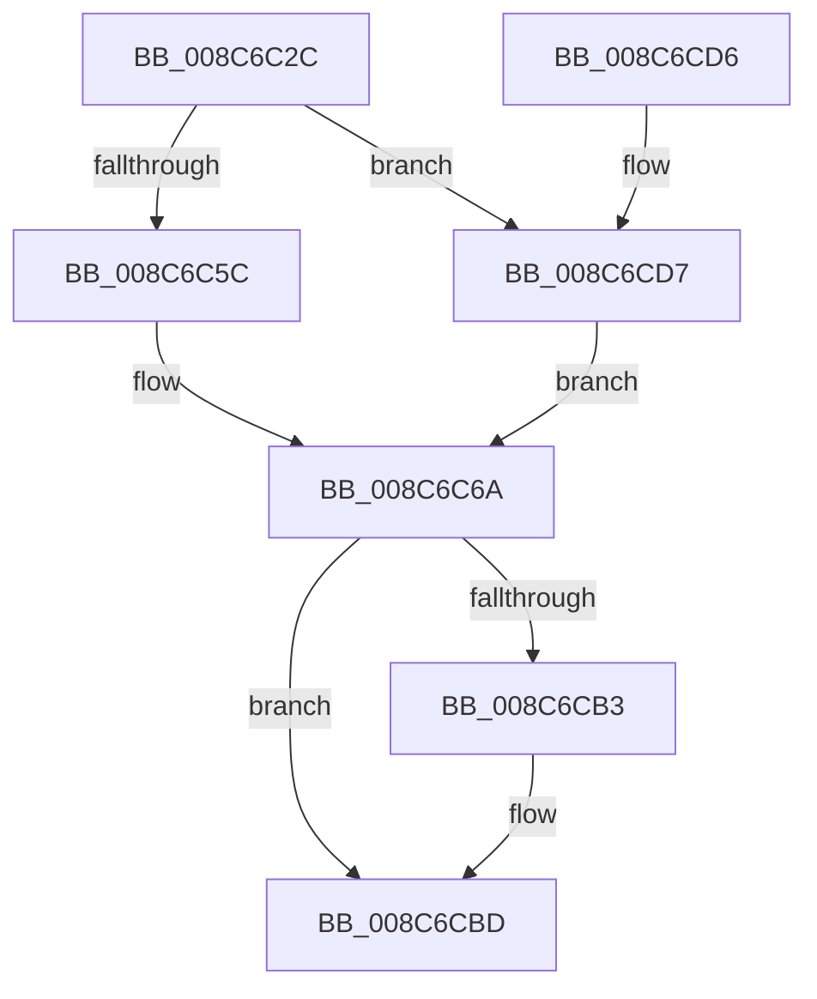

# EtwpAccessCheck

- RVA: `0x008C6C2C`–`0x008C6CDC` (길이 `176` bytes)
- VA: `0x00000001408C6C2C`
- 실행 섹션: `PAGE`
- PDB 이름 있음: `예`; PDB Function 태그: `아니요`
- unwind 정보 RVA: `0x00083C8C`
- 디코드: `45`개 명령, `176/176` bytes 표시
- 미해석 바이트: `0` (있으면 어셈블리에 `.byte`로 보존)

> 이 문서는 커널 이미지의 기계어와 PDB 기호를 분석해 생성했습니다. 4번과 5번은 함수 원형과 자료형을 바이너리 사용 방식에서 추정한 C 해석이며 원본 소스 복구 결과는 아닙니다.

## 1. Dependencies

- 직접 호출 지점: **3**; 고유 호출 대상: **3**
- 직접 호출자로 확인된 함수: **5**
- RIP 상대 이미지 참조: **1**

### Outgoing calls
- `0x008C6C60` → [SeCaptureSubjectContext](../86/SeCaptureSubjectContext_function_0086B820.md) (function, `0x0086B820`)
- `0x008C6CA9` → [SeAccessCheck](../../text/3A/SeAccessCheck_function_003A6BC0.md) (function, `0x003A6BC0`)
- `0x008C6CB8` → [SeReleaseSubjectContext](../86/SeReleaseSubjectContext_function_0086B710.md) (function, `0x0086B710`)

### Direct callers
- [NtTraceEvent](../../text/2F/NtTraceEvent_function_002FA6C0.md) at `0x002FB001`
- [EtwpCheckGuidAccess](EtwpCheckGuidAccess_function_008C697C.md) at `0x008C69A8`
- [EtwpNotifyGuid](EtwpNotifyGuid_function_008C8110.md) at `0x008C81D0`
- [EtwpCheckCurrentUserProcessAccess](../9E/EtwpCheckCurrentUserProcessAccess_function_009EB530.md) at `0x009EB565`
- [EtwpStartLogger](../A9/EtwpStartLogger_function_00A99D80.md) at `0x00A9A31F`

### Static image references
- `0x008C6C8D` → RVA `0x00011360` (`.rdata`; read)

## 2. Other-region calls and transfers

- 다른 실행 섹션으로 향하는 call: **1**
  - `0x008C6CA9` → [SeAccessCheck](../../text/3A/SeAccessCheck_function_003A6BC0.md) (`PAGE` → `.text`)
- 별도 외부 분기/꼬리 이동을 확인하지 못했습니다.

## 3. Assembly (complete function range)

```asm
008C6C2C  48 8B C4                        mov rax, rsp
008C6C2F  48 89 58 08                     mov qword ptr [rax + 8], rbx
008C6C33  48 89 70 10                     mov qword ptr [rax + 0x10], rsi
008C6C37  57                              push rdi
008C6C38  48 83 EC 70                     sub rsp, 0x70
008C6C3C  83 60 18 00                     and dword ptr [rax + 0x18], 0
008C6C40  0F 57 C0                        xorps xmm0, xmm0
008C6C43  83 60 20 00                     and dword ptr [rax + 0x20], 0
008C6C47  49 8B D8                        mov rbx, r8
008C6C4A  8B FA                           mov edi, edx
008C6C4C  48 8B F1                        mov rsi, rcx
008C6C4F  0F 11 40 D8                     movups xmmword ptr [rax - 0x28], xmm0
008C6C53  0F 11 40 E8                     movups xmmword ptr [rax - 0x18], xmm0
008C6C57  4D 85 C0                        test r8, r8
008C6C5A  75 7B                           jne 0x1408c6cd7
008C6C5C  48 8D 48 D8                     lea rcx, [rax - 0x28]
008C6C60  E8 BB 4B FA FF                  call 0x14086b820
008C6C65  48 8D 54 24 50                  lea rdx, [rsp + 0x50]
008C6C6A  48 8D 84 24 90 00 00 00         lea rax, [rsp + 0x90]
008C6C72  44 8B CF                        mov r9d, edi
008C6C75  48 89 44 24 48                  mov qword ptr [rsp + 0x48], rax
008C6C7A  45 33 C0                        xor r8d, r8d
008C6C7D  48 8D 84 24 98 00 00 00         lea rax, [rsp + 0x98]
008C6C85  48 8B CE                        mov rcx, rsi
008C6C88  48 89 44 24 40                  mov qword ptr [rsp + 0x40], rax
008C6C8D  48 8D 05 CC A6 74 FF            lea rax, [rip - 0x8b5934]
008C6C94  C6 44 24 38 01                  mov byte ptr [rsp + 0x38], 1
008C6C99  48 89 44 24 30                  mov qword ptr [rsp + 0x30], rax
008C6C9E  48 83 64 24 28 00               and qword ptr [rsp + 0x28], 0
008C6CA4  83 64 24 20 00                  and dword ptr [rsp + 0x20], 0
008C6CA9  E8 12 FF AD FF                  call 0x1403a6bc0
008C6CAE  48 85 DB                        test rbx, rbx
008C6CB1  75 0A                           jne 0x1408c6cbd
008C6CB3  48 8D 4C 24 50                  lea rcx, [rsp + 0x50]
008C6CB8  E8 53 4A FA FF                  call 0x14086b710
008C6CBD  8B 84 24 90 00 00 00            mov eax, dword ptr [rsp + 0x90]
008C6CC4  4C 8D 5C 24 70                  lea r11, [rsp + 0x70]
008C6CC9  49 8B 5B 10                     mov rbx, qword ptr [r11 + 0x10]
008C6CCD  49 8B 73 18                     mov rsi, qword ptr [r11 + 0x18]
008C6CD1  49 8B E3                        mov rsp, r11
008C6CD4  5F                              pop rdi
008C6CD5  C3                              ret
008C6CD6  CC                              int3
008C6CD7  48 8B D3                        mov rdx, rbx
008C6CDA  EB 8E                           jmp 0x1408c6c6a
```

## 4. C-style interpretation (structured pseudocode)

```c
__int64 __fastcall EtwpAccessCheck(__int64 a1, int a2, __int64 a3)
{
    __int64 result;
    __int64 v_rsp;
    unsigned __int64 v_stack_m28;
    unsigned __int64 v_stack_m30;
    unsigned __int64 v_stack_m38;
    unsigned __int8 v_stack_m40;
    unsigned __int64 v_stack_m48;
    unsigned __int64 v_stack_m50;
    unsigned int v_stack_m58;
    unsigned __int64 v_stack_m8;
    unsigned __int64 v_stack_p18;
    unsigned __int64 v_stack_p20;

    *(unsigned __int64 *)(v_rsp + 8) = v_rbx;
    *(unsigned __int64 *)(v_rsp + 16) = v_rsi;
    v_rsp = (v_rsp) - (112);
    *(unsigned __int64 *)(v_rsp - 40) = v_xmm0;
    *(unsigned __int64 *)(v_rsp - 24) = v_xmm0;
    if (a3 != 0) goto loc_008C6CD7;
    result = SeCaptureSubjectContext(v_rsp - 40, a2, a3, a4);
loc_008C6C6A:
    v_stack_m30 = v_stack_p18;
    a3 = 0;
    v_stack_m38 = v_stack_p20;
    v_stack_m40 = 1;
    v_stack_m48 = v_rip - 9132340;
    result = SeAccessCheck(a1, v_stack_m28, a3, (unsigned int)((unsigned int)((unsigned int)(a2))));
    if (0 == 0) {
        a1 = v_stack_m28;
        result = SeReleaseSubjectContext(a1, v_stack_m28, a3, (unsigned int)((unsigned int)((unsigned int)(a2))));
    }
    return (unsigned int)(v_stack_p18);
loc_008C6CD7:
    goto loc_008C6C6A;
}
```

## 5. (Beta) C Style

```c
int64_t EtwpAccessCheck(int64_t Arg1, int32_t Arg2, int64_t Arg3)
{
    int64_t result;
    int64_t local_rsp;
    uint64_t v_stack_m28;
    uint64_t v_stack_m30;
    uint64_t v_stack_m38;
    uint8_t v_stack_m40;
    uint64_t v_stack_m48;
    uint64_t v_stack_m50;
    uint32_t v_stack_m58;
    uint64_t v_stack_m8;
    uint64_t v_stack_p18;
    uint64_t v_stack_p20;

    *(uint64_t *)(local_rsp + 0x8) = local_rbx;
    *(uint64_t *)(local_rsp + 0x10) = local_rsi;
    local_rsp = (local_rsp) - (112);
    *(uint64_t *)(local_rsp - 0x28) = v_xmm0;
    *(uint64_t *)(local_rsp - 0x18) = v_xmm0;
    if (Arg3 != 0) goto loc_008C6CD7;
    result = SeCaptureSubjectContext(local_rsp - 40, Arg2, Arg3, a4);
loc_008C6C6A:
    v_stack_m30 = v_stack_p18;
    Arg3 = 0;
    v_stack_m38 = v_stack_p20;
    v_stack_m40 = 1;
    v_stack_m48 = v_rip - 9132340;
    result = SeAccessCheck(Arg1, v_stack_m28, Arg3, (uint32_t)((uint32_t)((uint32_t)(Arg2))));
    if (0 == 0) {
        Arg1 = v_stack_m28;
        result = SeReleaseSubjectContext(Arg1, v_stack_m28, Arg3, (uint32_t)((uint32_t)((uint32_t)(Arg2))));
    }
    return (uint32_t)(v_stack_p18);
loc_008C6CD7:
    goto loc_008C6C6A;
}
```

## 6. Execution-region graph

[열기: 2D/3D 그래프와 함수 탐색 컨트롤 패널](../../../control-panel.html?section=page&rva=0x008C6C2C&view=graph)

- 2D 그래프는 위에서 아래로 흐르고, 3D 그래프는 빈 공간을 드래그해 회전합니다. Shift+드래그는 이동, 휠은 확대·축소, 함수 노드 선택은 대상 보고서 이동입니다.

### Static fallback


