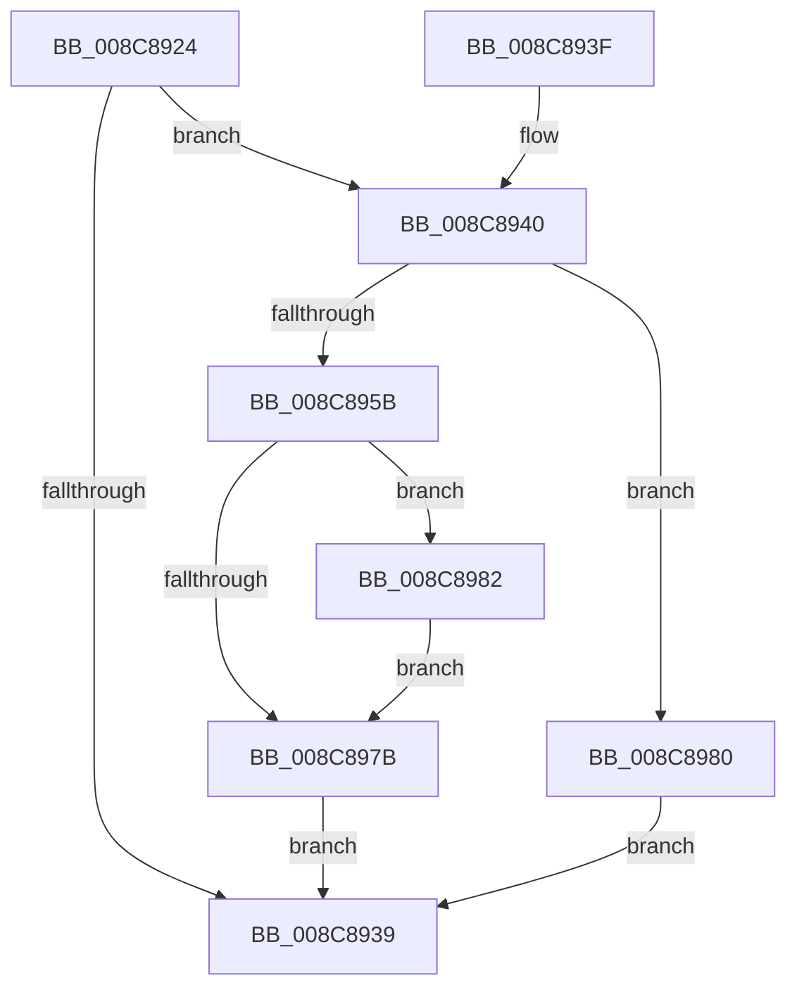

# EtwpAddDataSource

- RVA: `0x008C8924`–`0x008C898E` (길이 `106` bytes)
- VA: `0x00000001408C8924`
- 실행 섹션: `PAGE`
- PDB 이름 있음: `예`; PDB Function 태그: `아니요`
- unwind 정보 RVA: `0x000840A8`
- 디코드: `32`개 명령, `106/106` bytes 표시
- 미해석 바이트: `0` (있으면 어셈블리에 `.byte`로 보존)

> 이 문서는 커널 이미지의 기계어와 PDB 기호를 분석해 생성했습니다. 4번과 5번은 함수 원형과 자료형을 바이너리 사용 방식에서 추정한 C 해석이며 원본 소스 복구 결과는 아닙니다.

## 1. Dependencies

- 직접 호출 지점: **2**; 고유 호출 대상: **2**
- 직접 호출자로 확인된 함수: **2**
- RIP 상대 이미지 참조: **0**

### Outgoing calls
- `0x008C894E` → [ExAllocatePool2](../../poolcode/B8/ExAllocatePool2_function_00B820F0.md) (function, `0x00B820F0`)
- `0x008C8984` → [ExFreePoolWithTag](../../poolcode/B8/ExFreePoolWithTag_function_00B82870.md) (function, `0x00B82870`)

### Direct callers
- [EtwpQueueNotification](EtwpQueueNotification_function_008C870C.md) at `0x008C873E`
- [EtwpAddNotificationEvent](../A5/EtwpAddNotificationEvent_function_00A5FC44.md) at `0x00A5FC98`

### Static image references
- 디코드된 RIP-relative 메모리 참조가 없습니다.

## 2. Other-region calls and transfers

- 다른 실행 섹션으로 향하는 call: **2**
  - `0x008C894E` → [ExAllocatePool2](../../poolcode/B8/ExAllocatePool2_function_00B820F0.md) (`PAGE` → `POOLCODE`)
  - `0x008C8984` → [ExFreePoolWithTag](../../poolcode/B8/ExFreePoolWithTag_function_00B82870.md) (`PAGE` → `POOLCODE`)
- 별도 외부 분기/꼬리 이동을 확인하지 못했습니다.

## 3. Assembly (complete function range)

```asm
008C8924  40 53                           push rbx
008C8926  48 83 EC 20                     sub rsp, 0x20
008C892A  48 8B 81 20 03 00 00            mov rax, qword ptr [rcx + 0x320]
008C8931  48 8B D9                        mov rbx, rcx
008C8934  48 85 C0                        test rax, rax
008C8937  74 07                           je 0x1408c8940
008C8939  48 83 C4 20                     add rsp, 0x20
008C893D  5B                              pop rbx
008C893E  C3                              ret
008C893F  CC                              int3
008C8940  BA 28 00 00 00                  mov edx, 0x28
008C8945  41 B8 45 74 77 53               mov r8d, 0x53777445
008C894B  8D 4A 18                        lea ecx, [rdx + 0x18]
008C894E  E8 9D 97 2B 00                  call 0x140b820f0
008C8953  48 8B C8                        mov rcx, rax
008C8956  48 85 C0                        test rax, rax
008C8959  74 25                           je 0x1408c8980
008C895B  48 83 C0 18                     add rax, 0x18
008C895F  48 89 40 08                     mov qword ptr [rax + 8], rax
008C8963  48 89 00                        mov qword ptr [rax], rax
008C8966  48 83 61 10 00                  and qword ptr [rcx + 0x10], 0
008C896B  33 C0                           xor eax, eax
008C896D  F0 48 0F B1 8B 20 03 00 00      lock cmpxchg qword ptr [rbx + 0x320], rcx
008C8976  48 8B D8                        mov rbx, rax
008C8979  75 07                           jne 0x1408c8982
008C897B  48 8B C1                        mov rax, rcx
008C897E  EB B9                           jmp 0x1408c8939
008C8980  EB B7                           jmp 0x1408c8939
008C8982  33 D2                           xor edx, edx
008C8984  E8 E7 9E 2B 00                  call 0x140b82870
008C8989  48 8B CB                        mov rcx, rbx
008C898C  EB ED                           jmp 0x1408c897b
```

## 4. C-style interpretation (structured pseudocode)

```c
__int64 __fastcall EtwpAddDataSource(__int64 a1)
{
    __int64 result;
    __int64 v_rsp;

    v_rsp = (v_rsp) - (32);
    if (*(unsigned __int64 *)(a1 + 800) == 0) goto loc_008C8940;
loc_008C8939:
    v_rsp = (v_rsp) + (32);
    return *(unsigned __int64 *)(a1 + 800);
loc_008C8940:
    result = ExAllocatePool2(40 + 24, 40, (unsigned int)(0x53777445ULL), a4);
    if (result == 0) goto loc_008C8980;
    result = (result) + (24);
    *(unsigned __int64 *)(result + 8) = result;
    *(unsigned __int64 *)(result) = result;
    result = 0;
    if (condition_is_not_equal) goto loc_008C8982;
loc_008C897B:
    goto loc_008C8939;
loc_008C8980:
    goto loc_008C8939;
loc_008C8982:
    a2 = 0;
    result = ExFreePoolWithTag(result, a2, (unsigned int)(0x53777445ULL), a4);
    goto loc_008C897B;
}
```

## 5. (Beta) C Style

```c
int64_t EtwpAddDataSource(void *Arg1)
{
    uint8_t *arg1 = (uint8_t *)Arg1;

    int64_t result;
    int64_t local_rsp;

    local_rsp = (local_rsp) - (32);
    if (*(uint64_t *)(arg1 + 0x320) == 0) goto loc_008C8940;
loc_008C8939:
    local_rsp = (local_rsp) + (32);
    return *(uint64_t *)(arg1 + 0x320);
loc_008C8940:
    result = ExAllocatePool2(40 + 24, 40, (uint32_t)(0x53777445ULL), a4);
    if (result == 0) goto loc_008C8980;
    result = (result) + (24);
    *(uint64_t *)(result + 0x8) = result;
    *(uint64_t *)(result) = result;
    result = 0;
    if (condition_is_not_equal) goto loc_008C8982;
loc_008C897B:
    goto loc_008C8939;
loc_008C8980:
    goto loc_008C8939;
loc_008C8982:
    a2 = 0;
    result = ExFreePoolWithTag(result, a2, (uint32_t)(0x53777445ULL), a4);
    goto loc_008C897B;
}
```

### 관측된 메모리 오프셋

구조체 형식이 확인되지 않은 접근은 인자 기준의 오프셋으로만 기록했습니다.

| 기준 인자 | 오프셋 표현 | 폭 (bit) | 접근 |
|---|---:|---:|---|
| `Arg1` | `+ 0x320` | `64` | `R` |

## 6. Execution-region graph

[열기: 2D/3D 그래프와 함수 탐색 컨트롤 패널](../../../control-panel.html?section=page&rva=0x008C8924&view=graph)

- 2D 그래프는 위에서 아래로 흐르고, 3D 그래프는 빈 공간을 드래그해 회전합니다. Shift+드래그는 이동, 휠은 확대·축소, 함수 노드 선택은 대상 보고서 이동입니다.

### Static fallback


