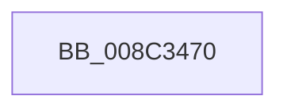

# EtwpApplyScopeFilters

- RVA: `0x008C3470`–`0x008C348B` (길이 `27` bytes)
- VA: `0x00000001408C3470`
- 실행 섹션: `PAGE`
- PDB 이름 있음: `예`; PDB Function 태그: `예`
- unwind 정보 RVA: `0x00083814`
- 디코드: `9`개 명령, `27/27` bytes 표시
- 미해석 바이트: `0` (있으면 어셈블리에 `.byte`로 보존)

> 이 문서는 커널 이미지의 기계어와 PDB 기호를 분석해 생성했습니다. 4번과 5번은 함수 원형과 자료형을 바이너리 사용 방식에서 추정한 C 해석이며 원본 소스 복구 결과는 아닙니다.

## 1. Dependencies

- 직접 호출 지점: **0**; 고유 호출 대상: **0**
- 직접 호출자로 확인된 함수: **4**
- RIP 상대 이미지 참조: **0**

### Outgoing calls
- 직접 디코드된 call 명령이 없습니다.

### Direct callers
- [EtwpUpdateRegEntryEnableMask](EtwpUpdateRegEntryEnableMask_function_008C1990.md) at `0x008C19E8`
- [sub_008C28B0](Unknown_function_008C28B0.md) at `0x008C2A63`
- [EtwpAddRegEntryToGroup](../9F/EtwpAddRegEntryToGroup_function_009F39D4.md) at `0x009F3CD5`
- [EtwpAddRegEntryToGroup](../9F/EtwpAddRegEntryToGroup_function_009F39D4.md) at `0x009F3E1A`
- [sub_00B1AF56](../B1/Unknown_function_00B1AF56.md) at `0x00B1AFA3`

### Static image references
- 디코드된 RIP-relative 메모리 참조가 없습니다.

## 2. Other-region calls and transfers

- 다른 실행 섹션으로 향하는 call: **0**
- call이 아닌 외부 분기/꼬리 이동: **1**
  - `0x008C3489` → [sub_008C3500](Unknown_function_008C3500.md) (`tail-transfer`)

## 3. Assembly (complete function range)

```asm
008C3470  40 55                           push rbp
008C3472  41 56                           push r14
008C3474  41 57                           push r15
008C3476  48 83 EC 30                     sub rsp, 0x30
008C347A  F6 41 62 01                     test byte ptr [rcx + 0x62], 1
008C347E  41 0F B6 E9                     movzx ebp, r9b
008C3482  44 0F B6 F2                     movzx r14d, dl
008C3486  4C 8B F9                        mov r15, rcx
008C3489  75 75                           jne 0x1408c3500
```

## 4. C-style interpretation (structured pseudocode)

```c
void __fastcall EtwpApplyScopeFilters(__int64 a1, unsigned __int8 a2, __int64 a3, unsigned __int8 a4)
{
    __int64 v_rsp;

    v_rsp = (v_rsp) - (48);
}
```

## 5. (Beta) C Style

```c
void EtwpApplyScopeFilters(void *Arg1, uint8_t Arg2, int64_t Arg3, uint8_t Arg4)
{
    uint8_t *arg1 = (uint8_t *)Arg1;

    int64_t local_rsp;

    local_rsp = (local_rsp) - (48);
}
```

### 관측된 메모리 오프셋

구조체 형식이 확인되지 않은 접근은 인자 기준의 오프셋으로만 기록했습니다.

| 기준 인자 | 오프셋 표현 | 폭 (bit) | 접근 |
|---|---:|---:|---|
| `Arg1` | `+ 0x62` | `8` | `R` |

## 6. Execution-region graph

[열기: 2D/3D 그래프와 함수 탐색 컨트롤 패널](../../../control-panel.html?section=page&rva=0x008C3470&view=graph)

- 2D 그래프는 위에서 아래로 흐르고, 3D 그래프는 빈 공간을 드래그해 회전합니다. Shift+드래그는 이동, 휠은 확대·축소, 함수 노드 선택은 대상 보고서 이동입니다.

### Static fallback


