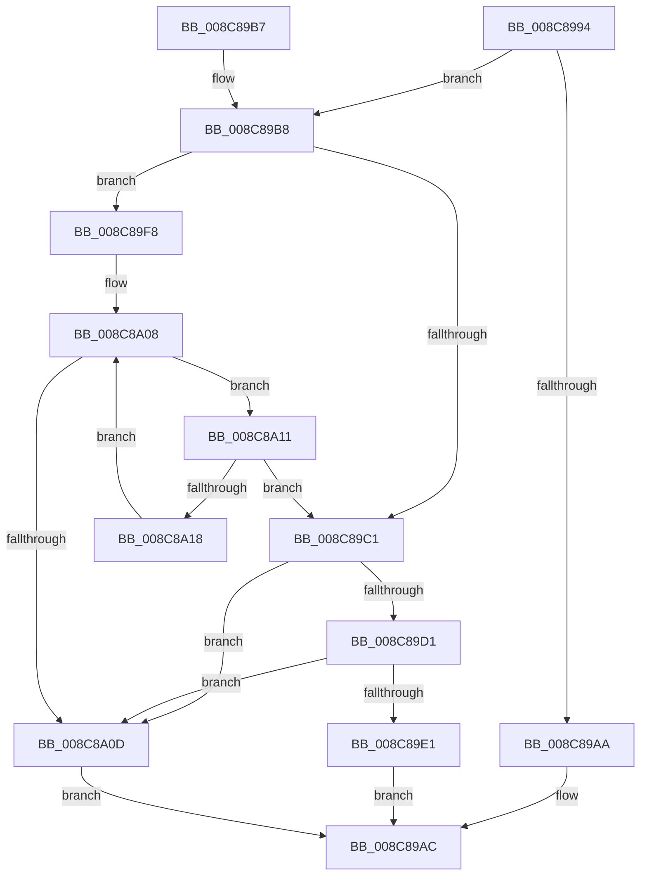

# EtwpApplyTransientFilters

- RVA: `0x008C8994`–`0x008C8A1C` (길이 `136` bytes)
- VA: `0x00000001408C8994`
- 실행 섹션: `PAGE`
- PDB 이름 있음: `예`; PDB Function 태그: `아니요`
- unwind 정보 RVA: `0x000840B4`
- 디코드: `45`개 명령, `136/136` bytes 표시
- 미해석 바이트: `0` (있으면 어셈블리에 `.byte`로 보존)

> 이 문서는 커널 이미지의 기계어와 PDB 기호를 분석해 생성했습니다. 4번과 5번은 함수 원형과 자료형을 바이너리 사용 방식에서 추정한 C 해석이며 원본 소스 복구 결과는 아닙니다.

## 1. Dependencies

- 직접 호출 지점: **3**; 고유 호출 대상: **3**
- 직접 호출자로 확인된 함수: **2**
- RIP 상대 이미지 참조: **0**

### Outgoing calls
- `0x008C89C8` → [EtwpApplyExeFilter](../A9/EtwpApplyExeFilter_function_00A95D8C.md) (function, `0x00A95D8C`)
- `0x008C89D8` → [EtwpApplyContainerFilter](../A9/EtwpApplyContainerFilter_function_00A95454.md) (function, `0x00A95454`)
- `0x008C89EC` → [EtwpApplyPackageIdFilter](../A9/EtwpApplyPackageIdFilter_function_00A961F4.md) (function, `0x00A961F4`)

### Direct callers
- [EtwpNotifyGuid](EtwpNotifyGuid_function_008C8110.md) at `0x008C830E`
- [EtwpIsRegEntryAllowed](../9E/EtwpIsRegEntryAllowed_function_009EB2D0.md) at `0x009EB41A`

### Static image references
- 디코드된 RIP-relative 메모리 참조가 없습니다.

## 2. Other-region calls and transfers

- 다른 실행 섹션으로 향하는 call: **0**
- 별도 외부 분기/꼬리 이동을 확인하지 못했습니다.

## 3. Assembly (complete function range)

```asm
008C8994  48 89 5C 24 08                  mov qword ptr [rsp + 8], rbx
008C8999  57                              push rdi
008C899A  48 83 EC 20                     sub rsp, 0x20
008C899E  F6 41 62 01                     test byte ptr [rcx + 0x62], 1
008C89A2  48 8B DA                        mov rbx, rdx
008C89A5  48 8B F9                        mov rdi, rcx
008C89A8  74 0E                           je 0x1408c89b8
008C89AA  B0 01                           mov al, 1
008C89AC  48 8B 5C 24 30                  mov rbx, qword ptr [rsp + 0x30]
008C89B1  48 83 C4 20                     add rsp, 0x20
008C89B5  5F                              pop rdi
008C89B6  C3                              ret
008C89B7  CC                              int3
008C89B8  48 8B 52 08                     mov rdx, qword ptr [rdx + 8]
008C89BC  48 85 D2                        test rdx, rdx
008C89BF  75 37                           jne 0x1408c89f8
008C89C1  48 8B 53 10                     mov rdx, qword ptr [rbx + 0x10]
008C89C5  48 8B CF                        mov rcx, rdi
008C89C8  E8 BF D3 1C 00                  call 0x140a95d8c
008C89CD  84 C0                           test al, al
008C89CF  74 3C                           je 0x1408c8a0d
008C89D1  48 8B 53 28                     mov rdx, qword ptr [rbx + 0x28]
008C89D5  48 8B CF                        mov rcx, rdi
008C89D8  E8 77 CA 1C 00                  call 0x140a95454
008C89DD  84 C0                           test al, al
008C89DF  74 2C                           je 0x1408c8a0d
008C89E1  4C 8B 43 20                     mov r8, qword ptr [rbx + 0x20]
008C89E5  48 8B CF                        mov rcx, rdi
008C89E8  48 8B 53 18                     mov rdx, qword ptr [rbx + 0x18]
008C89EC  E8 03 D8 1C 00                  call 0x140a961f4
008C89F1  84 C0                           test al, al
008C89F3  0F 95 C0                        setne al
008C89F6  EB B4                           jmp 0x1408c89ac
008C89F8  48 8B 41 50                     mov rax, qword ptr [rcx + 0x50]
008C89FC  33 C9                           xor ecx, ecx
008C89FE  44 8B 02                        mov r8d, dword ptr [rdx]
008C8A01  44 8B 88 D0 01 00 00            mov r9d, dword ptr [rax + 0x1d0]
008C8A08  41 3B C8                        cmp ecx, r8d
008C8A0B  72 04                           jb 0x1408c8a11
008C8A0D  32 C0                           xor al, al
008C8A0F  EB 9B                           jmp 0x1408c89ac
008C8A11  44 39 4C 8A 04                  cmp dword ptr [rdx + rcx*4 + 4], r9d
008C8A16  74 A9                           je 0x1408c89c1
008C8A18  FF C1                           inc ecx
008C8A1A  EB EC                           jmp 0x1408c8a08
```

## 4. C-style interpretation (structured pseudocode)

```c
__int64 __fastcall EtwpApplyTransientFilters(__int64 a1, __int64 a2)
{
    __int64 result;
    __int64 v_rsp;
    unsigned __int64 v_stack_p8;

    v_stack_p8 = v_rbx;
    v_rsp = (v_rsp) - (32);
    if (((*(unsigned __int8 *)(a1 + 98)) & (1)) == 0) goto loc_008C89B8;
loc_008C89AC:
    v_rsp = (v_rsp) + (32);
    return 1;
loc_008C89B8:
    if (*(unsigned __int64 *)(a2 + 8) != 0) goto loc_008C89F8;
loc_008C89C1:
    result = EtwpApplyExeFilter(a1, *(unsigned __int64 *)(v_stack_p8 + 16), a3, a4);
    if ((unsigned __int8)(result) == 0) goto loc_008C8A0D;
    result = EtwpApplyContainerFilter(a1, *(unsigned __int64 *)(v_stack_p8 + 40), a3, a4);
    if ((unsigned __int8)(result) == 0) goto loc_008C8A0D;
    result = EtwpApplyPackageIdFilter(a1, *(unsigned __int64 *)(v_stack_p8 + 24), *(unsigned __int64 *)(v_stack_p8 + 32), a4);
    result = ((unsigned __int8)(result) != 0) ? 1 : 0;
    goto loc_008C89AC;
loc_008C89F8:
    a1 = 0;
loc_008C8A08:
    if (0 < ((unsigned int)((unsigned int)(*(unsigned int *)(*(unsigned __int64 *)(v_stack_p8 + 24)))))) goto loc_008C8A11;
loc_008C8A0D:
    result = 0;
    goto loc_008C89AC;
loc_008C8A11:
    if ((*(unsigned int *)(*(unsigned __int64 *)(v_stack_p8 + 24) + a1 * 4 + 4)) == ((unsigned int)((unsigned int)(*(unsigned int *)(*(unsigned __int64 *)(a1 + 80) + 464))))) goto loc_008C89C1;
    a1 = (unsigned int)((a1) + 1);
    goto loc_008C8A08;
}
```

## 5. (Beta) C Style

```c
int64_t EtwpApplyTransientFilters(void *Arg1, void *Arg2)
{
    uint8_t *arg1 = (uint8_t *)Arg1;
    uint8_t *arg2 = (uint8_t *)Arg2;

    int64_t result;
    int64_t local_rsp;
    uint64_t v_stack_p8;

    v_stack_p8 = local_rbx;
    local_rsp = (local_rsp) - (32);
    if (((*(uint8_t *)(arg1 + 0x62)) & (1)) == 0) goto loc_008C89B8;
loc_008C89AC:
    local_rsp = (local_rsp) + (32);
    return 1;
loc_008C89B8:
    if (*(uint64_t *)(arg2 + 0x8) != 0) goto loc_008C89F8;
loc_008C89C1:
    result = EtwpApplyExeFilter(Arg1, *(uint64_t *)(v_stack_p8 + 0x10), a3, a4);
    if ((uint8_t)(result) == 0) goto loc_008C8A0D;
    result = EtwpApplyContainerFilter(Arg1, *(uint64_t *)(v_stack_p8 + 0x28), a3, a4);
    if ((uint8_t)(result) == 0) goto loc_008C8A0D;
    result = EtwpApplyPackageIdFilter(Arg1, *(uint64_t *)(v_stack_p8 + 0x18), *(uint64_t *)(v_stack_p8 + 0x20), a4);
    result = ((uint8_t)(result) != 0) ? 1 : 0;
    goto loc_008C89AC;
loc_008C89F8:
    Arg1 = 0;
loc_008C8A08:
    if (0 < ((uint32_t)((uint32_t)(*(uint32_t *)(*(uint64_t *)(v_stack_p8 + 0x18)))))) goto loc_008C8A11;
loc_008C8A0D:
    result = 0;
    goto loc_008C89AC;
loc_008C8A11:
    if ((*(uint32_t *)(*(uint64_t *)(v_stack_p8 + 0x18) + arg1 * 4 + 0x4)) == ((uint32_t)((uint32_t)(*(uint32_t *)(*(uint64_t *)(arg1 + 0x50) + 0x1D0))))) goto loc_008C89C1;
    Arg1 = (uint32_t)((Arg1) + 1);
    goto loc_008C8A08;
}
```

### 관측된 메모리 오프셋

구조체 형식이 확인되지 않은 접근은 인자 기준의 오프셋으로만 기록했습니다.

| 기준 인자 | 오프셋 표현 | 폭 (bit) | 접근 |
|---|---:|---:|---|
| `Arg1` | `+ 0x50` | `64` | `R` |
| `Arg1` | `+ 0x62` | `8` | `R` |
| `Arg2` | `+ 0x8` | `64` | `R` |
| `Arg2` | `+ 0x10` | `64` | `R` |
| `Arg2` | `+ 0x18` | `64` | `R` |
| `Arg2` | `+ 0x20` | `64` | `R` |
| `Arg2` | `+ 0x28` | `64` | `R` |

## 6. Execution-region graph

[열기: 2D/3D 그래프와 함수 탐색 컨트롤 패널](../../../control-panel.html?section=page&rva=0x008C8994&view=graph)

- 2D 그래프는 위에서 아래로 흐르고, 3D 그래프는 빈 공간을 드래그해 회전합니다. Shift+드래그는 이동, 휠은 확대·축소, 함수 노드 선택은 대상 보고서 이동입니다.

### Static fallback


