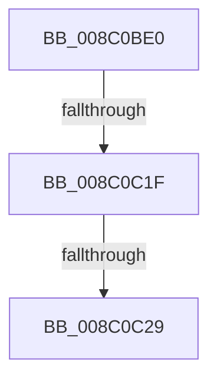

# EtwpCalculateUpdateNotification

- RVA: `0x008C0BE0`–`0x008C0C36` (길이 `86` bytes)
- VA: `0x00000001408C0BE0`
- 실행 섹션: `PAGE`
- PDB 이름 있음: `예`; PDB Function 태그: `아니요`
- unwind 정보 RVA: `0x000834F4`
- 디코드: `21`개 명령, `86/86` bytes 표시
- 미해석 바이트: `0` (있으면 어셈블리에 `.byte`로 보존)

> 이 문서는 커널 이미지의 기계어와 PDB 기호를 분석해 생성했습니다. 4번과 5번은 함수 원형과 자료형을 바이너리 사용 방식에서 추정한 C 해석이며 원본 소스 복구 결과는 아닙니다.

## 1. Dependencies

- 직접 호출 지점: **0**; 고유 호출 대상: **0**
- 직접 호출자로 확인된 함수: **2**
- RIP 상대 이미지 참조: **1**

### Outgoing calls
- 직접 디코드된 call 명령이 없습니다.

### Direct callers
- [EtwpNotifyDisallowedGuidChange](../9E/EtwpNotifyDisallowedGuidChange_function_009EAD14.md) at `0x009EAF5A`
- [EtwpEnableGuid](../A5/EtwpEnableGuid_function_00A5CD28.md) at `0x00A5D4D6`

### Static image references
- `0x008C0BFB` → RVA `0x00E0A740` (`.data`; read)

## 2. Other-region calls and transfers

- 다른 실행 섹션으로 향하는 call: **0**
- call이 아닌 외부 분기/꼬리 이동: **2**
  - `0x008C0C19` → [sub_008C0DF3](Unknown_function_008C0DF3.md) (`tail-transfer`)
  - `0x008C0C23` → [sub_008C0F95](Unknown_function_008C0F95.md) (`tail-transfer`)

## 3. Assembly (complete function range)

```asm
008C0BE0  48 89 74 24 18                  mov qword ptr [rsp + 0x18], rsi
008C0BE5  48 89 7C 24 20                  mov qword ptr [rsp + 0x20], rdi
008C0BEA  55                              push rbp
008C0BEB  41 56                           push r14
008C0BED  41 57                           push r15
008C0BEF  48 8D 6C 24 D9                  lea rbp, [rsp - 0x27]
008C0BF4  48 81 EC A0 00 00 00            sub rsp, 0xa0
008C0BFB  48 8B 05 3E 9B 54 00            mov rax, qword ptr [rip + 0x549b3e]
008C0C02  48 33 C4                        xor rax, rsp
008C0C05  48 89 45 1F                     mov qword ptr [rbp + 0x1f], rax
008C0C09  0F B6 45 67                     movzx eax, byte ptr [rbp + 0x67]
008C0C0D  45 33 F6                        xor r14d, r14d
008C0C10  4C 8B 7D 7F                     mov r15, qword ptr [rbp + 0x7f]
008C0C14  48 8B F9                        mov rdi, rcx
008C0C17  84 C0                           test al, al
008C0C19  0F 85 D4 01 00 00               jne 0x1408c0df3
008C0C1F  44 38 75 6F                     cmp byte ptr [rbp + 0x6f], r14b
008C0C23  0F 85 6C 03 00 00               jne 0x1408c0f95
008C0C29  0F B7 49 64                     movzx ecx, word ptr [rcx + 0x64]
008C0C2D  44 0F B7 57 68                  movzx r10d, word ptr [rdi + 0x68]
008C0C32  0F B7 77 62                     movzx esi, word ptr [rdi + 0x62]
```

## 4. C-style interpretation (structured pseudocode)

```c
__int64 __fastcall EtwpCalculateUpdateNotification(__int64 a1, __int64 a2, __int64 a3, __int64 a4, unsigned __int8 a5, unsigned __int8 a6, __int64 a7, __int64 a8)
{
    __int64 result;
    __int64 v_r14;
    __int64 v_rsp;
    unsigned __int64 v_stack_m20;
    unsigned __int64 v_stack_m3F;
    unsigned __int64 v_stack_p18;
    unsigned __int64 v_stack_p20;

    v_stack_p18 = v_rsi;
    v_stack_p20 = v_rdi;
    v_rsp = (v_rsp) - (160);
    result = (*(unsigned __int64 *)(v_rip + 5544766)) ^ (v_rsp);
    v_stack_m20 = result;
    v_r14 = 0;
    return a5;
}
```

## 5. (Beta) C Style

```c
int64_t EtwpCalculateUpdateNotification(void *Arg1, int64_t Arg2, int64_t Arg3, int64_t Arg4, uint8_t Arg5, uint8_t Arg6, uint64_t Arg7, int64_t Arg8)
{
    uint8_t *arg1 = (uint8_t *)Arg1;

    int64_t result;
    int64_t local_r14;
    int64_t local_rsp;
    uint64_t v_stack_m20;
    uint64_t v_stack_m3F;
    uint64_t v_stack_p18;
    uint64_t v_stack_p20;

    v_stack_p18 = local_rsi;
    v_stack_p20 = local_rdi;
    local_rsp = (local_rsp) - (160);
    result = (*(uint64_t *)(v_rip + 0x549B3E)) ^ (local_rsp);
    v_stack_m20 = result;
    local_r14 = 0;
    return Arg5;
}
```

### 관측된 메모리 오프셋

구조체 형식이 확인되지 않은 접근은 인자 기준의 오프셋으로만 기록했습니다.

| 기준 인자 | 오프셋 표현 | 폭 (bit) | 접근 |
|---|---:|---:|---|
| `Arg1` | `+ 0x62` | `16` | `R` |
| `Arg1` | `+ 0x64` | `16` | `R` |
| `Arg1` | `+ 0x68` | `16` | `R` |

## 6. Execution-region graph

[열기: 2D/3D 그래프와 함수 탐색 컨트롤 패널](../../../control-panel.html?section=page&rva=0x008C0BE0&view=graph)

- 2D 그래프는 위에서 아래로 흐르고, 3D 그래프는 빈 공간을 드래그해 회전합니다. Shift+드래그는 이동, 휠은 확대·축소, 함수 노드 선택은 대상 보고서 이동입니다.

### Static fallback


