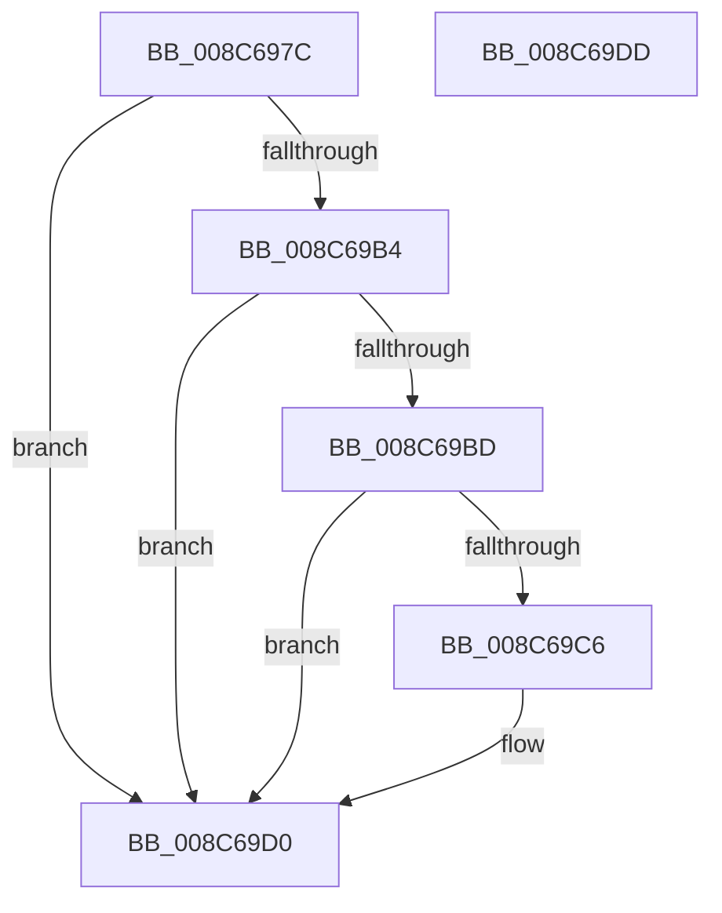

# EtwpCheckGuidAccess

- RVA: `0x008C697C`–`0x008C69DE` (길이 `98` bytes)
- VA: `0x00000001408C697C`
- 실행 섹션: `PAGE`
- PDB 이름 있음: `예`; PDB Function 태그: `아니요`
- unwind 정보 RVA: `0x0005CAAC`
- 디코드: `29`개 명령, `98/98` bytes 표시
- 미해석 바이트: `0` (있으면 어셈블리에 `.byte`로 보존)

> 이 문서는 커널 이미지의 기계어와 PDB 기호를 분석해 생성했습니다. 4번과 5번은 함수 원형과 자료형을 바이너리 사용 방식에서 추정한 C 해석이며 원본 소스 복구 결과는 아닙니다.

## 1. Dependencies

- 직접 호출 지점: **3**; 고유 호출 대상: **3**
- 직접 호출자로 확인된 함수: **8**
- RIP 상대 이미지 참조: **2**

### Outgoing calls
- `0x008C6996` → [EtwpGetSecurityDescriptorByGuid](EtwpGetSecurityDescriptorByGuid_function_008C04C0.md) (function, `0x008C04C0`)
- `0x008C69A8` → [EtwpAccessCheck](EtwpAccessCheck_function_008C6C2C.md) (function, `0x008C6C2C`)
- `0x008C69CB` → [ExFreePoolWithTag](../../poolcode/B8/ExFreePoolWithTag_function_00B82870.md) (function, `0x00B82870`)

### Direct callers
- [EtwpLogFileNameRundown](../7C/EtwpLogFileNameRundown_function_007C00F0.md) at `0x007C0113`
- [EtwpCheckNotificationAccess](EtwpCheckNotificationAccess_function_008C770C.md) at `0x008C7724`
- [EtwpCheckNotificationAccess](EtwpCheckNotificationAccess_function_008C770C.md) at `0x008C7738`
- [EtwpCheckGuidAccessAndDoRundown](../9E/EtwpCheckGuidAccessAndDoRundown_function_009E3E18.md) at `0x009E3E6B`
- [EtwpIsRegEntryAllowed](../9E/EtwpIsRegEntryAllowed_function_009EB2D0.md) at `0x009EB36B`
- [EtwpCheckSystemTraceAccess](../A8/EtwpCheckSystemTraceAccess_function_00A8DE44.md) at `0x00A8DE5F`
- [EtwpStartLogger](../A9/EtwpStartLogger_function_00A99D80.md) at `0x00A9A683`
- [sub_00B1B0BE](../B1/Unknown_function_00B1B0BE.md) at `0x00B1B0D2`
- [sub_00B3C988](../B3/Unknown_function_00B3C988.md) at `0x00B3C9D4`
- [sub_00B3C988](../B3/Unknown_function_00B3C988.md) at `0x00B3CA5E`
- [sub_00B3C988](../B3/Unknown_function_00B3C988.md) at `0x00B3CC66`

### Static image references
- `0x008C69B4` → RVA `0x00FC6D68` (`ALMOSTRO`; read)
- `0x008C69BD` → RVA `0x00E68510` (`.data`; read)

## 2. Other-region calls and transfers

- 다른 실행 섹션으로 향하는 call: **1**
  - `0x008C69CB` → [ExFreePoolWithTag](../../poolcode/B8/ExFreePoolWithTag_function_00B82870.md) (`PAGE` → `POOLCODE`)
- 별도 외부 분기/꼬리 이동을 확인하지 못했습니다.

## 3. Assembly (complete function range)

```asm
008C697C  48 89 5C 24 08                  mov qword ptr [rsp + 8], rbx
008C6981  57                              push rdi
008C6982  48 83 EC 20                     sub rsp, 0x20
008C6986  48 83 64 24 48 00               and qword ptr [rsp + 0x48], 0
008C698C  8B FA                           mov edi, edx
008C698E  48 8D 54 24 48                  lea rdx, [rsp + 0x48]
008C6993  49 8B D8                        mov rbx, r8
008C6996  E8 25 9B FF FF                  call 0x1408c04c0
008C699B  4C 8B C3                        mov r8, rbx
008C699E  8B D7                           mov edx, edi
008C69A0  48 8B 5C 24 48                  mov rbx, qword ptr [rsp + 0x48]
008C69A5  48 8B CB                        mov rcx, rbx
008C69A8  E8 7F 02 00 00                  call 0x1408c6c2c
008C69AD  8B F8                           mov edi, eax
008C69AF  48 85 DB                        test rbx, rbx
008C69B2  74 1C                           je 0x1408c69d0
008C69B4  48 3B 1D AD 03 70 00            cmp rbx, qword ptr [rip + 0x7003ad]
008C69BB  74 13                           je 0x1408c69d0
008C69BD  48 3B 1D 4C 1B 5A 00            cmp rbx, qword ptr [rip + 0x5a1b4c]
008C69C4  74 0A                           je 0x1408c69d0
008C69C6  33 D2                           xor edx, edx
008C69C8  48 8B CB                        mov rcx, rbx
008C69CB  E8 A0 BE 2B 00                  call 0x140b82870
008C69D0  48 8B 5C 24 30                  mov rbx, qword ptr [rsp + 0x30]
008C69D5  8B C7                           mov eax, edi
008C69D7  48 83 C4 20                     add rsp, 0x20
008C69DB  5F                              pop rdi
008C69DC  C3                              ret
008C69DD  CC                              int3
```

## 4. C-style interpretation (structured pseudocode)

```c
__int64 __fastcall EtwpCheckGuidAccess(__int64 a1, int a2, __int64 a3)
{
    __int64 result;
    __int64 v_rsp;
    unsigned __int64 v_stack_p20;
    unsigned __int64 v_stack_p8;

    v_stack_p8 = v_rbx;
    v_rsp = (v_rsp) - (32);
    result = EtwpGetSecurityDescriptorByGuid(a1, v_stack_p20, a3, a4);
    result = EtwpAccessCheck(v_stack_p20, (unsigned int)((unsigned int)((unsigned int)(a2))), a3, a4);
    if (v_stack_p20 == 0) goto loc_008C69D0;
    if (v_stack_p20 == (*(unsigned __int64 *)(v_rip + 7340973))) goto loc_008C69D0;
    if (v_stack_p20 != (*(unsigned __int64 *)(v_rip + 5905228))) {
        a2 = 0;
        a1 = v_stack_p20;
        result = ExFreePoolWithTag(a1, a2, a3, a4);
    }
    v_rsp = (v_rsp) + (32);
    return (unsigned int)((unsigned int)((unsigned int)((unsigned int)(result))));
}
```

## 5. (Beta) C Style

```c
int64_t EtwpCheckGuidAccess(int64_t Arg1, int32_t Arg2, int64_t Arg3)
{
    int64_t result;
    int64_t local_rsp;
    uint64_t v_stack_p20;
    uint64_t v_stack_p8;

    v_stack_p8 = local_rbx;
    local_rsp = (local_rsp) - (32);
    result = EtwpGetSecurityDescriptorByGuid(Arg1, v_stack_p20, Arg3, a4);
    result = EtwpAccessCheck(v_stack_p20, (uint32_t)((uint32_t)((uint32_t)(Arg2))), Arg3, a4);
    if (v_stack_p20 == 0) goto loc_008C69D0;
    if (v_stack_p20 == (*(uint64_t *)(v_rip + 0x7003AD))) goto loc_008C69D0;
    if (v_stack_p20 != (*(uint64_t *)(v_rip + 0x5A1B4C))) {
        Arg2 = 0;
        Arg1 = v_stack_p20;
        result = ExFreePoolWithTag(Arg1, Arg2, Arg3, a4);
    }
    local_rsp = (local_rsp) + (32);
    return (uint32_t)((uint32_t)((uint32_t)((uint32_t)(result))));
}
```

## 6. Execution-region graph

[열기: 2D/3D 그래프와 함수 탐색 컨트롤 패널](../../../control-panel.html?section=page&rva=0x008C697C&view=graph)

- 2D 그래프는 위에서 아래로 흐르고, 3D 그래프는 빈 공간을 드래그해 회전합니다. Shift+드래그는 이동, 휠은 확대·축소, 함수 노드 선택은 대상 보고서 이동입니다.

### Static fallback


