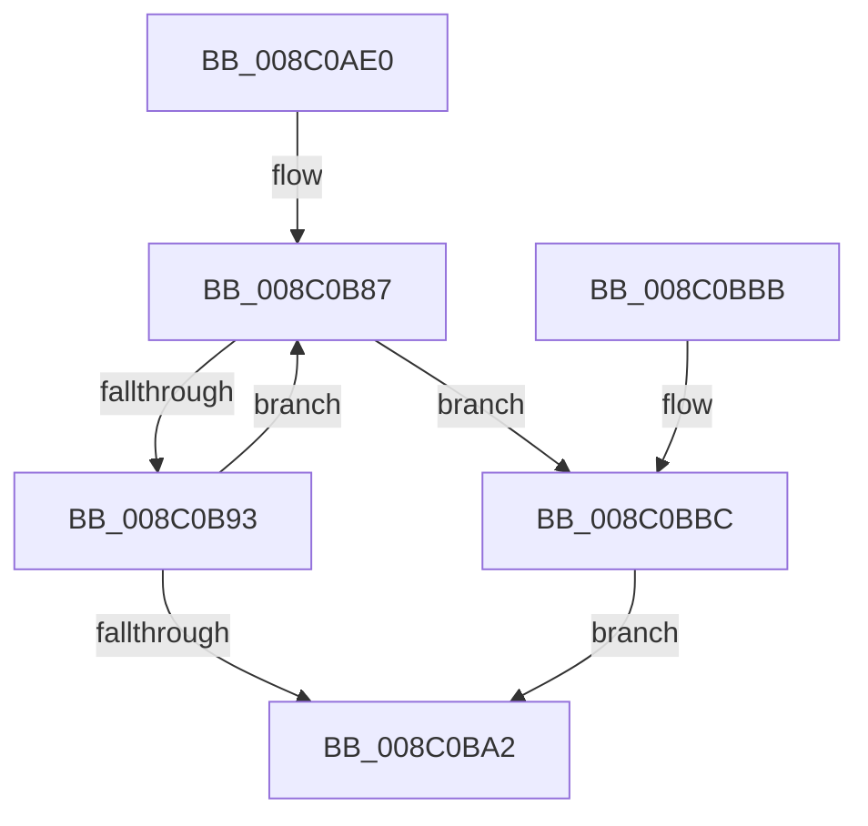

# EtwpCheckLoggerControlAccess

- RVA: `0x008C0AE0`–`0x008C0BCB` (길이 `235` bytes)
- VA: `0x00000001408C0AE0`
- 실행 섹션: `PAGE`
- PDB 이름 있음: `예`; PDB Function 태그: `아니요`
- unwind 정보 RVA: `0x000834E0`
- 디코드: `53`개 명령, `235/235` bytes 표시
- 미해석 바이트: `0` (있으면 어셈블리에 `.byte`로 보존)

> 이 문서는 커널 이미지의 기계어와 PDB 기호를 분석해 생성했습니다. 4번과 5번은 함수 원형과 자료형을 바이너리 사용 방식에서 추정한 C 해석이며 원본 소스 복구 결과는 아닙니다.

## 1. Dependencies

- 직접 호출 지점: **5**; 고유 호출 대상: **5**
- 직접 호출자로 확인된 함수: **17**
- RIP 상대 이미지 참조: **1**

### Outgoing calls
- `0x008C0AF7` → [EtwpReferenceLoggerSecurityDescriptor](EtwpReferenceLoggerSecurityDescriptor_function_008C0810.md) (function, `0x008C0810`)
- `0x008C0B21` → [SeCaptureSubjectContext](../86/SeCaptureSubjectContext_function_0086B820.md) (function, `0x0086B820`)
- `0x008C0B6A` → [SeAccessCheck](../../text/3A/SeAccessCheck_function_003A6BC0.md) (function, `0x003A6BC0`)
- `0x008C0B74` → [SeReleaseSubjectContext](../86/SeReleaseSubjectContext_function_0086B710.md) (function, `0x0086B710`)
- `0x008C0BC4` → [ObDereferenceSecurityDescriptor](../87/ObDereferenceSecurityDescriptor_function_008740A0.md) (function, `0x008740A0`)

### Direct callers
- [EtwpGetPmcSessions](../../text/64/EtwpGetPmcSessions_function_0064EB08.md) at `0x0064EB8F`
- [EtwTraceRaw](../../text/65/EtwTraceRaw_function_006516CC.md) at `0x0065177F`
- [EtwpTransitionToRealtime](../../text/65/EtwpTransitionToRealtime_function_006518D8.md) at `0x0065194B`
- [EtwpGetSoftRestartInformation](../7B/EtwpGetSoftRestartInformation_function_007BEC70.md) at `0x007BED17`
- [EtwpQueryTrace](../8B/EtwpQueryTrace_function_008BF8B0.md) at `0x008BF90C`
- [EtwpUpdateEnableMask](EtwpUpdateEnableMask_function_008C0948.md) at `0x008C0A58`
- [sub_008C28B0](Unknown_function_008C28B0.md) at `0x008C2C30`
- [EtwpStopTrace](../9B/EtwpStopTrace_function_009BCE84.md) at `0x009BD08F`
- [EtwpCheckLoggerAccessAndDoRundown](../9E/EtwpCheckLoggerAccessAndDoRundown_function_009E3EFC.md) at `0x009E3F3A`
- [EtwSetPerformanceTraceInformation](../A5/EtwSetPerformanceTraceInformation_function_00A53928.md) at `0x00A53A70`
- [EtwSetPerformanceTraceInformation](../A5/EtwSetPerformanceTraceInformation_function_00A53928.md) at `0x00A53C36`
- [EtwpSetSoftRestartInformation](../A5/EtwpSetSoftRestartInformation_function_00A53DB8.md) at `0x00A53EAC`
- [EtwpRealtimeConnect](../A6/EtwpRealtimeConnect_function_00A65C88.md) at `0x00A65E3E`
- [EtwpCheckSystemTraceAccess](../A8/EtwpCheckSystemTraceAccess_function_00A8DE44.md) at `0x00A8DE70`
- [EtwpUpdateTrace](../AB/EtwpUpdateTrace_function_00ABCC7C.md) at `0x00ABCD8B`
- [EtwQueryPerformanceTraceInformation](../AF/EtwQueryPerformanceTraceInformation_function_00AF28A4.md) at `0x00AF2BE6`
- [EtwpFlushTrace](../AF/EtwpFlushTrace_function_00AF47B4.md) at `0x00AF4886`
- [sub_00B3C988](../B3/Unknown_function_00B3C988.md) at `0x00B3CDDB`
- [sub_00B3C988](../B3/Unknown_function_00B3C988.md) at `0x00B3D2E9`
- [sub_00B3C988](../B3/Unknown_function_00B3C988.md) at `0x00B3D33F`
- [sub_00B3C988](../B3/Unknown_function_00B3C988.md) at `0x00B3D3FC`

### Static image references
- `0x008C0B53` → RVA `0x00011360` (`.rdata`; read)

## 2. Other-region calls and transfers

- 다른 실행 섹션으로 향하는 call: **1**
  - `0x008C0B6A` → [SeAccessCheck](../../text/3A/SeAccessCheck_function_003A6BC0.md) (`PAGE` → `.text`)
- 별도 외부 분기/꼬리 이동을 확인하지 못했습니다.

## 3. Assembly (complete function range)

```asm
008C0AE0  48 89 5C 24 08                  mov qword ptr [rsp + 8], rbx
008C0AE5  48 89 74 24 20                  mov qword ptr [rsp + 0x20], rsi
008C0AEA  57                              push rdi
008C0AEB  48 83 EC 70                     sub rsp, 0x70
008C0AEF  8B D9                           mov ebx, ecx
008C0AF1  48 8B F2                        mov rsi, rdx
008C0AF4  48 8B CA                        mov rcx, rdx
008C0AF7  E8 14 FD FF FF                  call 0x1408c0810
008C0AFC  83 A4 24 88 00 00 00 00         and dword ptr [rsp + 0x88], 0
008C0B04  48 8D 4C 24 50                  lea rcx, [rsp + 0x50]
008C0B09  83 A4 24 90 00 00 00 00         and dword ptr [rsp + 0x90], 0
008C0B11  0F 57 C0                        xorps xmm0, xmm0
008C0B14  0F 11 44 24 50                  movups xmmword ptr [rsp + 0x50], xmm0
008C0B19  48 8B F8                        mov rdi, rax
008C0B1C  0F 11 44 24 60                  movups xmmword ptr [rsp + 0x60], xmm0
008C0B21  E8 FA AC FA FF                  call 0x14086b820
008C0B26  48 8D 84 24 88 00 00 00         lea rax, [rsp + 0x88]
008C0B2E  44 8B CB                        mov r9d, ebx
008C0B31  48 89 44 24 48                  mov qword ptr [rsp + 0x48], rax
008C0B36  48 8D 54 24 50                  lea rdx, [rsp + 0x50]
008C0B3B  48 8D 84 24 90 00 00 00         lea rax, [rsp + 0x90]
008C0B43  45 33 C0                        xor r8d, r8d
008C0B46  48 89 44 24 40                  mov qword ptr [rsp + 0x40], rax
008C0B4B  48 8B CF                        mov rcx, rdi
008C0B4E  C6 44 24 38 01                  mov byte ptr [rsp + 0x38], 1
008C0B53  48 8D 05 06 08 75 FF            lea rax, [rip - 0x8af7fa]
008C0B5A  48 89 44 24 30                  mov qword ptr [rsp + 0x30], rax
008C0B5F  48 83 64 24 28 00               and qword ptr [rsp + 0x28], 0
008C0B65  83 64 24 20 00                  and dword ptr [rsp + 0x20], 0
008C0B6A  E8 51 60 AE FF                  call 0x1403a6bc0
008C0B6F  48 8D 4C 24 50                  lea rcx, [rsp + 0x50]
008C0B74  E8 97 AB FA FF                  call 0x14086b710
008C0B79  0F 0D 8E 10 03 00 00            prefetchw byte ptr [rsi + 0x310]
008C0B80  48 8B 86 10 03 00 00            mov rax, qword ptr [rsi + 0x310]
008C0B87  48 8B C8                        mov rcx, rax
008C0B8A  48 33 CF                        xor rcx, rdi
008C0B8D  48 83 F9 0F                     cmp rcx, 0xf
008C0B91  73 29                           jae 0x1408c0bbc
008C0B93  48 8D 48 01                     lea rcx, [rax + 1]
008C0B97  F0 48 0F B1 8E 10 03 00 00      lock cmpxchg qword ptr [rsi + 0x310], rcx
008C0BA0  75 E5                           jne 0x1408c0b87
008C0BA2  8B 84 24 88 00 00 00            mov eax, dword ptr [rsp + 0x88]
008C0BA9  4C 8D 5C 24 70                  lea r11, [rsp + 0x70]
008C0BAE  49 8B 5B 10                     mov rbx, qword ptr [r11 + 0x10]
008C0BB2  49 8B 73 28                     mov rsi, qword ptr [r11 + 0x28]
008C0BB6  49 8B E3                        mov rsp, r11
008C0BB9  5F                              pop rdi
008C0BBA  C3                              ret
008C0BBB  CC                              int3
008C0BBC  BA 01 00 00 00                  mov edx, 1
008C0BC1  48 8B CF                        mov rcx, rdi
008C0BC4  E8 D7 34 FB FF                  call 0x1408740a0
008C0BC9  EB D7                           jmp 0x1408c0ba2
```

## 4. C-style interpretation (structured pseudocode)

```c
__int64 __fastcall EtwpCheckLoggerControlAccess(int a1, __int64 a2, int a3)
{
    __int64 result;
    __int64 v_rsp;
    unsigned __int64 v_stack_m18;
    unsigned __int64 v_stack_m28;
    unsigned __int64 v_stack_m30;
    unsigned __int64 v_stack_m38;
    unsigned __int8 v_stack_m40;
    unsigned __int64 v_stack_m48;
    unsigned __int64 v_stack_m50;
    unsigned int v_stack_m58;
    unsigned __int64 v_stack_m8;
    unsigned int v_stack_p10;
    unsigned int v_stack_p18;
    unsigned __int64 v_stack_p20;
    unsigned __int64 v_stack_p8;

    v_stack_p8 = v_rbx;
    v_stack_p20 = v_rsi;
    v_rsp = (v_rsp) - (112);
    result = EtwpReferenceLoggerSecurityDescriptor(a2, a2, a3, a4);
    v_stack_m28 = v_xmm0;
    v_stack_m18 = v_xmm0;
    result = SeCaptureSubjectContext(v_stack_m28, a2, a3, a4);
    v_stack_m30 = v_stack_p10;
    a3 = 0;
    v_stack_m38 = v_stack_p18;
    v_stack_m40 = 1;
    v_stack_m48 = v_rip - 9107450;
    result = SeAccessCheck(result, v_stack_m28, a3, (unsigned int)((unsigned int)((unsigned int)(a1))));
    result = SeReleaseSubjectContext(v_stack_m28, v_stack_m28, a3, (unsigned int)((unsigned int)((unsigned int)(a1))));
loc_008C0B87:
    a1 = (*(unsigned __int64 *)(a2 + 784)) ^ (result);
    if (a1 >= 15) goto loc_008C0BBC;
    if (a1 != 15) goto loc_008C0B87;
loc_008C0BA2:
    return (unsigned int)(v_stack_p10);
loc_008C0BBC:
    result = ObDereferenceSecurityDescriptor(result, 1, a3, (unsigned int)((unsigned int)((unsigned int)(a1))));
    goto loc_008C0BA2;
}
```

## 5. (Beta) C Style

```c
int64_t EtwpCheckLoggerControlAccess(int32_t Arg1, void *Arg2, int32_t Arg3)
{
    uint8_t *arg2 = (uint8_t *)Arg2;

    int64_t result;
    int64_t local_rsp;
    uint64_t v_stack_m18;
    uint64_t v_stack_m28;
    uint64_t v_stack_m30;
    uint64_t v_stack_m38;
    uint8_t v_stack_m40;
    uint64_t v_stack_m48;
    uint64_t v_stack_m50;
    uint32_t v_stack_m58;
    uint64_t v_stack_m8;
    uint32_t v_stack_p10;
    uint32_t v_stack_p18;
    uint64_t v_stack_p20;
    uint64_t v_stack_p8;

    v_stack_p8 = local_rbx;
    v_stack_p20 = local_rsi;
    local_rsp = (local_rsp) - (112);
    result = EtwpReferenceLoggerSecurityDescriptor(Arg2, Arg2, Arg3, a4);
    v_stack_m28 = v_xmm0;
    v_stack_m18 = v_xmm0;
    result = SeCaptureSubjectContext(v_stack_m28, Arg2, Arg3, a4);
    v_stack_m30 = v_stack_p10;
    Arg3 = 0;
    v_stack_m38 = v_stack_p18;
    v_stack_m40 = 1;
    v_stack_m48 = v_rip - 9107450;
    result = SeAccessCheck(result, v_stack_m28, Arg3, (uint32_t)((uint32_t)((uint32_t)(Arg1))));
    result = SeReleaseSubjectContext(v_stack_m28, v_stack_m28, Arg3, (uint32_t)((uint32_t)((uint32_t)(Arg1))));
loc_008C0B87:
    Arg1 = (*(uint64_t *)(arg2 + 0x310)) ^ (result);
    if (Arg1 >= 15) goto loc_008C0BBC;
    if (Arg1 != 15) goto loc_008C0B87;
loc_008C0BA2:
    return (uint32_t)(v_stack_p10);
loc_008C0BBC:
    result = ObDereferenceSecurityDescriptor(result, 1, Arg3, (uint32_t)((uint32_t)((uint32_t)(Arg1))));
    goto loc_008C0BA2;
}
```

### 관측된 메모리 오프셋

구조체 형식이 확인되지 않은 접근은 인자 기준의 오프셋으로만 기록했습니다.

| 기준 인자 | 오프셋 표현 | 폭 (bit) | 접근 |
|---|---:|---:|---|
| `Arg2` | `+ 0x310` | `8` | `R` |
| `Arg2` | `+ 0x310` | `64` | `R` |

## 6. Execution-region graph

[열기: 2D/3D 그래프와 함수 탐색 컨트롤 패널](../../../control-panel.html?section=page&rva=0x008C0AE0&view=graph)

- 2D 그래프는 위에서 아래로 흐르고, 3D 그래프는 빈 공간을 드래그해 회전합니다. Shift+드래그는 이동, 휠은 확대·축소, 함수 노드 선택은 대상 보고서 이동입니다.

### Static fallback


