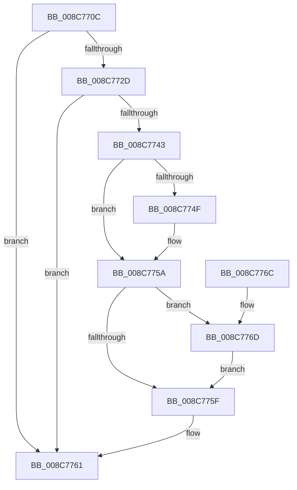

# EtwpCheckNotificationAccess

- RVA: `0x008C770C`–`0x008C7795` (길이 `137` bytes)
- VA: `0x00000001408C770C`
- 실행 섹션: `PAGE`
- PDB 이름 있음: `예`; PDB Function 태그: `아니요`
- unwind 정보 RVA: `0x00083F28`
- 디코드: `37`개 명령, `137/137` bytes 표시
- 미해석 바이트: `0` (있으면 어셈블리에 `.byte`로 보존)

> 이 문서는 커널 이미지의 기계어와 PDB 기호를 분석해 생성했습니다. 4번과 5번은 함수 원형과 자료형을 바이너리 사용 방식에서 추정한 C 해석이며 원본 소스 복구 결과는 아닙니다.

## 1. Dependencies

- 직접 호출 지점: **3**; 고유 호출 대상: **2**
- 직접 호출자로 확인된 함수: **2**
- RIP 상대 이미지 참조: **2**

### Outgoing calls
- `0x008C7724` → [EtwpCheckGuidAccess](EtwpCheckGuidAccess_function_008C697C.md) (function, `0x008C697C`)
- `0x008C7738` → [EtwpCheckGuidAccess](EtwpCheckGuidAccess_function_008C697C.md) (function, `0x008C697C`)
- `0x008C778C` → [EtwCheckSecurityLoggerAccess](../A0/EtwCheckSecurityLoggerAccess_function_00A0FE94.md) (function, `0x00A0FE94`)

### Direct callers
- [EtwpUpdatePeriodicCaptureState](../7B/EtwpUpdatePeriodicCaptureState_function_007BCC4C.md) at `0x007BCCDD`
- [EtwpValidateEnableNotification](EtwpValidateEnableNotification_function_008C779C.md) at `0x008C7894`

### Static image references
- `0x008C7746` → RVA `0x000113A0` (`.rdata`; read)
- `0x008C7753` → RVA `0x000113A8` (`.rdata`; read)

## 2. Other-region calls and transfers

- 다른 실행 섹션으로 향하는 call: **0**
- 별도 외부 분기/꼬리 이동을 확인하지 못했습니다.

## 3. Assembly (complete function range)

```asm
008C770C  48 89 5C 24 08                  mov qword ptr [rsp + 8], rbx
008C7711  57                              push rdi
008C7712  48 83 EC 20                     sub rsp, 0x20
008C7716  48 8B FA                        mov rdi, rdx
008C7719  45 33 C0                        xor r8d, r8d
008C771C  BA 80 00 00 00                  mov edx, 0x80
008C7721  48 8B D9                        mov rbx, rcx
008C7724  E8 53 F2 FF FF                  call 0x1408c697c
008C7729  85 C0                           test eax, eax
008C772B  78 34                           js 0x1408c7761
008C772D  45 33 C0                        xor r8d, r8d
008C7730  BA 80 00 00 00                  mov edx, 0x80
008C7735  48 8B CF                        mov rcx, rdi
008C7738  E8 3F F2 FF FF                  call 0x1408c697c
008C773D  8B C8                           mov ecx, eax
008C773F  85 C0                           test eax, eax
008C7741  78 1E                           js 0x1408c7761
008C7743  48 8B 03                        mov rax, qword ptr [rbx]
008C7746  48 2B 05 53 9C 74 FF            sub rax, qword ptr [rip - 0x8b63ad]
008C774D  75 0B                           jne 0x1408c775a
008C774F  48 8B 43 08                     mov rax, qword ptr [rbx + 8]
008C7753  48 2B 05 4E 9C 74 FF            sub rax, qword ptr [rip - 0x8b63b2]
008C775A  48 85 C0                        test rax, rax
008C775D  74 0E                           je 0x1408c776d
008C775F  8B C1                           mov eax, ecx
008C7761  48 8B 5C 24 30                  mov rbx, qword ptr [rsp + 0x30]
008C7766  48 83 C4 20                     add rsp, 0x20
008C776A  5F                              pop rdi
008C776B  C3                              ret
008C776C  CC                              int3
008C776D  65 48 8B 14 25 88 01 00 00      mov rdx, qword ptr gs:[0x188]
008C7776  65 48 8B 0C 25 88 01 00 00      mov rcx, qword ptr gs:[0x188]
008C777F  8A 92 32 02 00 00               mov dl, byte ptr [rdx + 0x232]
008C7785  48 8B 89 B8 00 00 00            mov rcx, qword ptr [rcx + 0xb8]
008C778C  E8 03 87 14 00                  call 0x140a0fe94
008C7791  8B C8                           mov ecx, eax
008C7793  EB CA                           jmp 0x1408c775f
```

## 4. C-style interpretation (structured pseudocode)

```c
__int64 __fastcall EtwpCheckNotificationAccess(__int64 a1, __int64 a2, int a3)
{
    __int64 result;
    __int64 v_rsp;
    unsigned __int64 v_stack_p8;

    v_stack_p8 = v_rbx;
    v_rsp = (v_rsp) - (32);
    a3 = 0;
    result = EtwpCheckGuidAccess(a1, 128, a3, a4);
    if (sign_flag) goto loc_008C7761;
    a3 = 0;
    result = EtwpCheckGuidAccess(a2, 128, a3, a4);
    if (sign_flag) goto loc_008C7761;
    result = (*(unsigned __int64 *)(a1)) - (*(unsigned __int64 *)(v_rip - 9135021));
    if (!(condition_is_not_equal)) {
        result = *(unsigned __int64 *)(a1 + 8);
        result = (result) - (*(unsigned __int64 *)(v_rip - 9135026));
    }
    if (result == 0) goto loc_008C776D;
loc_008C775F:
loc_008C7761:
    v_rsp = (v_rsp) + (32);
    return (unsigned int)((unsigned int)((unsigned int)((unsigned int)(result))));
loc_008C776D:
    result = EtwCheckSecurityLoggerAccess(*(unsigned __int64 *)(*(unsigned __int64 *)(gs_base + (0 + 392)) + 184), *(unsigned __int8 *)(*(unsigned __int64 *)(gs_base + (0 + 392)) + 562), a3, a4);
    goto loc_008C775F;
}
```

## 5. (Beta) C Style

```c
int64_t EtwpCheckNotificationAccess(void *Arg1, int64_t Arg2, int32_t Arg3)
{
    uint8_t *arg1 = (uint8_t *)Arg1;

    int64_t result;
    int64_t local_rsp;
    uint64_t v_stack_p8;

    v_stack_p8 = local_rbx;
    local_rsp = (local_rsp) - (32);
    Arg3 = 0;
    result = EtwpCheckGuidAccess(Arg1, 128, Arg3, a4);
    if (sign_flag) goto loc_008C7761;
    Arg3 = 0;
    result = EtwpCheckGuidAccess(Arg2, 128, Arg3, a4);
    if (sign_flag) goto loc_008C7761;
    result = (*(uint64_t *)(arg1)) - (*(uint64_t *)(v_rip - 0x8B63AD));
    if (!(condition_is_not_equal)) {
        result = *(uint64_t *)(arg1 + 0x8);
        result = (result) - (*(uint64_t *)(v_rip - 0x8B63B2));
    }
    if (result == 0) goto loc_008C776D;
loc_008C775F:
loc_008C7761:
    local_rsp = (local_rsp) + (32);
    return (uint32_t)((uint32_t)((uint32_t)((uint32_t)(result))));
loc_008C776D:
    result = EtwCheckSecurityLoggerAccess(*(uint64_t *)(*(uint64_t *)(gs_base + (0 + 0x188)) + 0xB8), *(uint8_t *)(*(uint64_t *)(gs_base + (0 + 0x188)) + 0x232), Arg3, a4);
    goto loc_008C775F;
}
```

### 관측된 메모리 오프셋

구조체 형식이 확인되지 않은 접근은 인자 기준의 오프셋으로만 기록했습니다.

| 기준 인자 | 오프셋 표현 | 폭 (bit) | 접근 |
|---|---:|---:|---|
| `Arg1` | `+ 0x0` | `64` | `R` |
| `Arg1` | `+ 0x8` | `64` | `R` |

## 6. Execution-region graph

[열기: 2D/3D 그래프와 함수 탐색 컨트롤 패널](../../../control-panel.html?section=page&rva=0x008C770C&view=graph)

- 2D 그래프는 위에서 아래로 흐르고, 3D 그래프는 빈 공간을 드래그해 회전합니다. Shift+드래그는 이동, 휠은 확대·축소, 함수 노드 선택은 대상 보고서 이동입니다.

### Static fallback


